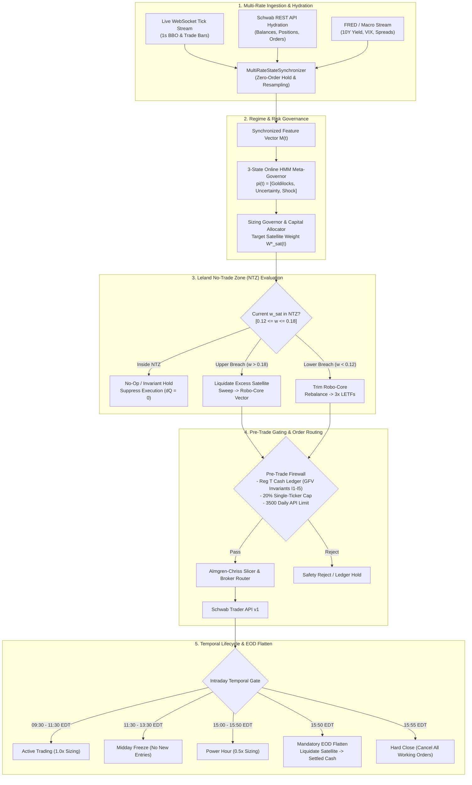

# Research Context & Architecture Review Compilation Skill

This skill provides the mandatory operational standard and automated workflows to snapshot and audit the active state of the `schwab_engine` trading infrastructure. It compiles scoped source code modules, runtime strategy configuration, live telemetry, and mathematical models into structured Markdown review documents.

## 1. Trigger Conditions & When to Use
Execute this workflow whenever:
- A system architecture review, research context, or quantitative strategy audit is requested (e.g., `#103`, pre-startup priming, post-session debrief).
- Priming an LLM agent context before executing architectural refactors or trade debugging.
- Conducting post-session or pre-market diagnostic audits on the GCP VM (`schwab-trader`) or local environment.
- Documenting operational state, multi-rate synchronization, Leland No-Trade Zone (NTZ) bounds, and HMM Meta-Governor transitions.

---

## 2. Mandatory Document Standards

All generated architecture reviews, research contexts, and strategy audits **MUST** adhere to the following four standards:

### 2.1 Timestamping & File Destination
- **File Path**: Output must be saved to:
  - `docs/YYMMDD.HH-architecture-strategy-review.md` (for system/architecture reviews and strategy audits)
  - `docs/YYMMDD.HH-research-context.md` (for research contexts and telemetry dumps)
  - *(Optional convenience mirror: `research_context.md` at repository root)*
  *(Where `YYMMDD.HH` represents current 2-digit year, 2-digit month, 2-digit day, and 2-digit 24-hour hour, e.g. `261020.16`)*.

- **Mandatory Front Header**: Every document must begin with the exact metadata block:
```markdown
# SYSTEM ARCHITECTURE & STRATEGY REVIEW: [SUBJECT]
- timestamp_iso: "[YYYY-MM-DDTHH:MM:SS-04:00]"
- engine_version: "2.4.0-argon"
- git_branch: "[CURRENT_BRANCH]"
- commit_sha: "[CURRENT_COMMIT_SHA]"
- account_scope: "single_account_comprehensive" (Account: ***4015)
- baseline_nlv_usd: 21086.00
```

### 2.2 Format & Notation Standards (Pythonic Vector Math & Registries)
- **Zero Raw LaTeX Macros**: Do **NOT** use `\frac`, `\left\lfloor`, `\right\rfloor`, `\mathbf`, `\sum`, `\begin{equation}`, or raw backslash math environments. Raw LaTeX causes downstream token bloat, markdown export errors, and unrendered backslash corruption.
- **Pythonic Pseudocode & Vector Math**: Express all mathematical formulations in clear Pythonic notation:
  - Sizing & Floor ops: `floor((V_freed * w_c) / P_c)`
  - Matrix / vector dot products: `w.T @ r`
  - Delta rebalance: `dQ = target_qty - current_qty`
  - Bayesian updates: `theta_post = (wins + kappa * mu_prior) / (trades + kappa)`
  - Kelly fraction: `f_quarter = 0.25 * (theta_post - (1 - theta_post) / R) * ((N + kappa) / (N + 2 * kappa))`
  - Almgren-Chriss trajectory: `n_j = (2 * sinh(0.5 * kappa * tau) / sinh(kappa * T)) * cosh(kappa * (T - (j - 0.5) * tau)) * X`
- **Dense Key-Value Registries**: Parameter sets, Leland NTZ bounds, and allocation vectors must be formatted as dense, unambiguous registries:
  - **Leland NTZ Bounds**: `[0.12, 0.18]` (Target `w* = 0.15`, Band width `tau = 0.03`)
  - **Robo-Core Sweep Vector**: `SPY: 0.35, QQQ: 0.25, HYG: 0.15, IEF: 0.15, IWM: 0.10`
  - **Satellite LETF Universe**: `TQQQ: 0.40, SOXL: 0.35, TNA: 0.25`
  - **Execution Constraints**: `max_single_ticker_pct: 0.20`, `daily_api_quota: 3500`, `min_cash_reserve: 0.05`

### 2.3 Pipeline Tracing & Decision Matrix
All reviews must trace data and account state along the primary processing chain:
1. **`MultiRateStateSynchronizer` (`data/multi_rate_sync.py`)**:
   - High-frequency micro stream: 1-second price bars, BBO quotes, order book depth.
   - Low-frequency macro stream: FRED economic series, Treasury yields (`$TNX`), VIX term structure.
   - Asynchronous alignment via timestamp latching and zero-order hold (ZOH).
2. **3-State HMM Meta-Governor (`governor.py`, `Argon`)**:
   - Filtered posterior probability vector: `pi(t) = [pi_Goldilocks, pi_Uncertainty, pi_Shock].T`
   - Transition persistence: `T_kk = 0.92` hysteresis.
   - Active regime assignment and dynamic risk scalar derivation: `W_sat*(t) = f(pi(t))`.
3. **Leland NTZ Band Evaluation & Dual-Sleeve Router**:
   - Satellite weight `w_sat(t) = V_sat(t) / NLV(t)`.
   - Upper breach (`w_sat > 0.18`): Liquidate excess satellite delta, sweep freed cash into Robo-Core vector.
   - Lower breach (`w_sat < 0.12`): Trim Robo-Core, rebalance into satellite high-beta LETFs.
   - Within NTZ (`0.12 <= w_sat <= 0.18`): Zero trade generation (eliminates churn and friction).

- **Explicit Decision Matrix**:
  Format live telemetry and state transitions into explicit `IF ... THEN ... -> ...` logic blocks:
  ```text
  IF pi_Shock > 0.60 OR Drawdown_sat > 0.05 THEN
      State = Macro Shock -> Trim Satellite by dQ = floor((V_freed * w_c) / P_c), sweep proceeds to Robo-Core (SPY/QQQ/HYG/IEF/IWM).
  ELSE IF 0.12 <= w_sat <= 0.18 THEN
      State = Inside Leland NTZ -> Hold positions, suppress order routing (dQ = 0).
  ELSE IF w_sat < 0.12 AND pi_Goldilocks > 0.70 THEN
      State = Goldilocks Expansion -> Trim Robo-Core, expand Satellite LETFs (TQQQ/SOXL/TNA) up to w* = 0.15.
  ELSE IF Clock >= 15:50 EDT THEN
      State = EOD Mandatory Flatten -> Cancel pending orders, liquidate intraday satellite positions to settled cash.
  ```

### 2.4 Complete Mermaid Diagram Generation
Every architecture review must include a complete, compile-ready ````mermaid ... ```` block diagramming runtime flow from market data ingestion through EOD flattening:

````markdown

````

---

## 3. Execution Runbook & Helper Scripts

### 3.1 Generating Automated Research Snapshots
To compile context files automatically:

1. **Using `scripts/prep_research.py`**:
   ```bash
   python scripts/prep_research.py [--issue "Review Subject or Scope"]
   ```
   Outputs to `docs/YYMMDD.HH-research-context.md` and mirrors to `research_context.md`.

2. **Using `scripts/compile_research_context.py` (GCP VM / Telemetry focus)**:
   ```bash
   # General session snapshot
   python scripts/compile_research_context.py --scope general --since "today" --output docs/YYMMDD.HH-research-context.md

   # Subsystem specific
   python scripts/compile_research_context.py --scope execution --since "today" --output docs/YYMMDD.HH-research-context.md
   python scripts/compile_research_context.py --scope risk --since "today" --output docs/YYMMDD.HH-research-context.md
   python scripts/compile_research_context.py --scope telemetry --since "today" --output docs/YYMMDD.HH-research-context.md
   ```

### 3.2 Manual or Custom Architecture Review Creation
When generating or synthesizing an architecture review manually or via an LLM agent:
1. Query current git metadata:
   - Branch: `git rev-parse --abbrev-ref HEAD`
   - Commit: `git rev-parse --short HEAD`
   - Timestamp: Local ISO-8601 with timezone offset (e.g., `-04:00`).
2. Construct file target path: `docs/YYMMDD.HH-architecture-strategy-review.md`.
3. Prepend the mandatory metadata header.
4. Populate sections with Pythonic vector math, Leland NTZ registries, `IF/THEN` decision logic, and compile-ready Mermaid diagrams.

---

## 4. Verification Checklist
Before completing an architecture review or research context task, verify:
- [ ] Destination path matches `docs/YYMMDD.HH-architecture-strategy-review.md` or `docs/YYMMDD.HH-research-context.md`.
- [ ] Header has valid `timestamp_iso`, `engine_version: "2.4.0-argon"`, `git_branch`, `commit_sha`, `account_scope`, and `baseline_nlv_usd: 21086.00`.
- [ ] Mathematical formulas use Pythonic pseudocode/vector notation without raw LaTeX macros.
- [ ] Leland NTZ bounds (`[0.12, 0.18]`) and sweep vectors (`SPY: 0.35, QQQ: 0.25, HYG: 0.15, IEF: 0.15, IWM: 0.10`) are explicitly registered.
- [ ] Decision matrix is formatted as `IF [Condition] THEN [State] -> [Execution Action]`.
- [ ] Compile-ready ````mermaid ... ```` flowchart is rendered and structurally valid.
