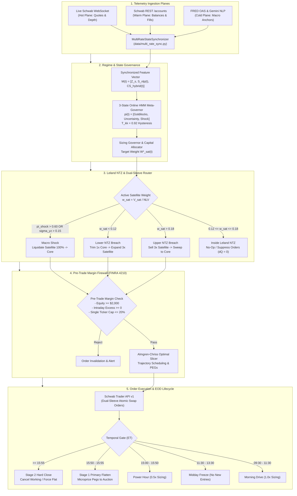

# SYSTEM ARCHITECTURE & STRATEGY REVIEW: SCHWABENGINE 2.4.0-ARGON
- timestamp_iso: "2026-10-20T16:36:00-04:00"
- engine_version: "2.4.0-argon"
- git_branch: "feat/dynamic-screener-universe"
- commit_sha: "93c0310"
- account_scope: "single_account_comprehensive" (Account: ***4015)
- baseline_nlv_usd: 21086.00

---

## 1. Executive Summary & Architecture Overview

SchwabEngine 2.4.0-argon represents the migration of the automated trading system from a single-asset cash-restricted framework to an unchained, scale-invariant **Dual-Sleeve Robo-Core Architecture**. Operating on the Charles Schwab Trader API v1, the engine partitions total Net Liquidation Value ($NLV = \$21,086.00$) into a passive 1x beta **Schwab Robo-Core sleeve** ($\mathbf{C}(t)$) and an active 3x **Tactical Satellite sleeve** ($\mathbf{S}(t)$). 

By implementing continuous **Leland No-Trade Zone (NTZ)** rebalancing and an **Online 3-State Hidden Markov Model (HMM) Meta-Governor**, the engine eliminates idle cash drag: capital de-risked from 3x Leveraged ETFs (`SOXL`, `TQQQ`, `TNA`) is instantly swept into the 1x Robo-Core basket (`SPY`, `QQQ`, `HYG`, `IEF`, `IWM`). Conversely, satellite expansions are funded by trimming the Core sleeve with zero T+1 settlement lag under FINRA Rule 4210 margin accounting.

---

## 2. System Parameters & Invariant Registry

### 2.1 Portfolio Target Weights & Leland NTZ Bounds
```yaml
portfolio_allocation:
  baseline_nlv_usd: 21086.00
  target_core_weight (W_core*): 0.85
  target_satellite_weight (W_sat*): 0.15
  leland_ntz_band_half_width (tau_band): 0.03
  leland_ntz_lower_bound: 0.12
  leland_ntz_upper_bound: 0.18
  cash_buffer_target (M_buf): 0.00
  max_single_ticker_pct: 0.20
  hard_dollar_ceiling: null # Purely scale-invariant fractional sizing
```

### 2.2 Asset Universes & Sweep Vectors
```yaml
core_1x_sleeve:
  symbols: ["SPY", "QQQ", "IWM", "HYG", "IEF"]
  routing_sweep_vector:
    SPY: 0.35  # Large-cap broad equity
    QQQ: 0.25  # Large-cap tech beta
    HYG: 0.15  # High-yield credit beta
    IEF: 0.15  # Intermediate Treasury duration hedge
    IWM: 0.10  # Small-cap equity beta
    cash: 0.00 # Zero cash drag policy

satellite_3x_sleeve:
  symbols: ["SOXL", "TQQQ", "TNA"]
  sub_weights:
    SOXL: 0.40 # 3x ICE Semiconductor
    TQQQ: 0.35 # 3x Nasdaq-100
    TNA: 0.25  # 3x Russell 2000

liquidity_vehicles:
  cash_sweep_vehicle: "SWVXX" # Non-traded advisory sweep fund
  frictional_cash_threshold_usd: 10.00
```

### 2.3 Risk, Volatility & Margin Invariants
```yaml
volatility_and_regime_limits:
  yang_zhang_shock_threshold (sigma_yz): 0.15
  hybrid_credit_spread_shock_bps: 440.0
  baseline_credit_spread_oas_bps: 317.6
  hmm_shock_probability_threshold (pi_shock): 0.60
  hmm_goldilocks_expansion_threshold (pi_goldilocks): 0.70
  hmm_persistence_probability (T_kk): 0.92
  quote_stale_tolerance_sec: 5.0
  daily_api_call_quota: 3500

margin_rules_finra_4210:
  minimum_margin_equity_usd: 2000.00
  core_1x_intraday_margin_req (mu_core_intra): 0.25
  core_1x_overnight_margin_req (mu_core_overnight): 0.50
  letf_3x_house_intraday_margin_req (mu_sat_intra): 0.75
  letf_3x_house_overnight_margin_req (mu_sat_overnight): 0.90
  max_intraday_leverage: 4.0
  max_overnight_leverage: 2.0
```

### 2.4 Mathematical Formulations (Pythonic Vector Math)
- **Capital Conservation SDE**:
  `d(||C(t)||_1) = r_core(t) * ||C(t)||_1 * dt - d(||S(t)||_1) - phi * abs(d(||S(t)||_1))`
- **Active Satellite Weight**:
  `w_sat(t) = sum(S_j(t)) / NLV(t)`
- **Multi-Asset Core Sweep Allocation**:
  `delta_Q_c = floor((V_freed * w_sweep_c) / P_c(t))`
- **Discrete Share Rebalance Delta**:
  `dQ_j = target_qty_j - current_qty_j`
- **Bayesian Posterior Regime Update**:
  `pi_pred = T.T @ pi_prev`
  `L_k = exp(sum(-0.5 * ((M[dim] - mu[k][dim]) / sigma[k][dim])**2 / num_dims))`
  `pi_new = (pi_pred * L) / sum(pi_pred * L)`
- **Composite Satellite Target Weight**:
  `W_sat*(t) = min(W_max_A, (pi_G * W_C + pi_U * min(w_base, W_C)) * (1.0 - pi_S) * D_sat)`
- **Core-Accelerated Recovery (Strategy D)**:
  `lambda_hwm_eff(t) = lambda_0 + kappa_core * max(0.0, r_core(t)) * ((W_sat_max - W_sat(t)) / W_sat_max)`
- **Intraday Margin Excess**:
  `E_excess_intra(t) = NLV(t) - (mu_core_intra * ||C(t)||_1 + sum(mu_sat_j_intra * S_j(t)))`

---

## 3. Algorithmic Data Pipeline (Cold, Warm, Hot Planes)

SchwabEngine coordinates telemetry across three decoupled planes to achieve sub-second execution without REST rate-limit saturation:

```
+---------------------------------------------------------------------------------------+
|                                    COLD PLANE                                         |
|  - FRED Daily High Yield OAS (BAMLH0A0HYM2)                                           |
|  - Macroeconomic Surprise Z-score (Z_s)                                               |
|  - Gemini NLP Polarity S_nlp(t0) with Exponential Decay exp(-lambda * dt)            |
|  - Synchronized feature vector: M(t) = [Z_s, S_nlp(t), CS_hybrid(t)].T                 |
+-------------------------------------------+-------------------------------------------+
                                            |
+-------------------------------------------v-------------------------------------------+
|                                    WARM PLANE                                         |
|  - Schwab REST /trader/v1/accounts (60s poll + On-Fill webhook)                       |
|  - Mid-Session Hot Boot: Instant reconciliation without 09:30 AM baseline dependency  |
|  - Portfolio categorization: 1x Core C(t) vs 3x Satellite S(t)                        |
|  - FINRA 4210 Margin Verification & Account Equity mark                               |
+-------------------------------------------+-------------------------------------------+
                                            |
+-------------------------------------------v-------------------------------------------+
|                                    HOT PLANE                                          |
|  - Level 1 Streaming Equities WebSocket (<50ms tick cadence)                          |
|  - Microstructure pricing: mid_price, volume-weighted microprice, L1 OBI              |
|  - Quote staleness filter: drop ticks where age > 5.0 seconds                         |
|  - Continuous Mark-to-Market: N_live(t) = C_mv(t) + S_mv(t) + M_buf                   |
|  - Live Core return r_core(t) feeding Strategy D recovery accelerator                 |
+-------------------------------------------+-------------------------------------------+
                                            |
                                            v
                         [ MultiRateStateSynchronizer ]
                                            |
                                            v
                       [ 3-State HMM Meta-Governor ]
                         pi(t) = [Goldilocks, Uncertainty, Shock]
                                            |
                                            v
                         [ DualSleeveRouter & NTZ ]
                                            |
                                            v
                         [ RiskEngine & Margin Guard ]
```

### 3.1 Hot Plane Microstructure Processing
- **Microprice Calculation**:
  `P_micro = ((bid_size * ask) + (ask_size * bid)) / (bid_size + ask_size)`
- **Order Book Imbalance (OBI)**:
  `OBI = (bid_size - ask_size) / (bid_size + ask_size)`
- **Quote-Age Watermarking**:
  If `received_timestamp - quote_epoch_s > 5.0`, the quote is discarded as stale; execution gates fall back to the most recent validated quote or suspend active breakout evaluation.

### 3.2 Cold-Warm Macro Feature Fusion
- **Hybrid Credit Spread Fusion**:
  `CS_hybrid(t) = FRED_OAS_daily - Z_ewma(ln(P_HYG(t) / P_IEF(t))) * sigma_spread`
  Fuses the robust daily OAS anchor from FRED with real-time intraday HYG/IEF price divergence to detect credit stress before official end-of-day releases.

---

## 4. Circumstance Decision Matrix

The engine evaluates live telemetry and account state into explicit condition-action blocks:

### 4.1 Case 1: Steady-State Drift Inside Leland NTZ
```text
IF 0.12 <= w_sat(t) <= 0.18 THEN
    State = INSIDE_LELAND_NTZ
    -> Execution Action:
        1. Maintain all existing positions in Core C(t) and Satellite S(t).
        2. Set order delta dQ_j = 0 across all tickers.
        3. Suppress order generation; avoid crossing bid-ask spreads.
        4. Log steady-state allocation: w_sat = V_sat / NLV, w_core = V_core / NLV.
```

### 4.2 Case 2: Tactical Profit Harvest & Core Sweep (Upper NTZ Breach)
```text
IF w_sat(t) > 0.18 THEN
    State = LELAND_UPPER_BREACH_HARVEST
    -> Execution Action:
        1. Calculate excess satellite value: excess_usd = (w_sat - 0.18) * NLV.
        2. Leg 1 (Sell): Liquidate 3x Satellite assets proportionally:
           shares_to_sell_j = min(q_j, max(1, round(excess_usd * (mv_j / sat_val) / P_j))).
        3. Compute realized freed notional V_freed = sum(shares_to_sell_j * P_j).
        4. Leg 2 (Buy): Route freed proceeds instantaneously across 1x Core basket:
           delta_Q_c = floor((V_freed * w_sweep_c) / P_c)
           for c in [SPY: 0.35, QQQ: 0.25, HYG: 0.15, IEF: 0.15, IWM: 0.10].
        5. Quantize fractional remainder: M_buf = V_freed - sum(delta_Q_c * P_c) -> sweep into SWVXX.
        6. Apply instantaneous settlement bypass (FINRA 4210 margin bridge).
```

### 4.3 Case 3: Tactical Dip-Buy & Core Trim (Lower NTZ Breach)
```text
IF w_sat(t) < 0.12 AND trend_gate_active == True THEN
    State = LELAND_LOWER_BREACH_DIP_BUY
    -> Execution Action:
        1. Calculate satellite deficit: expansion_usd = (0.12 - w_sat) * NLV.
        2. Leg 1 (Sell): Trim 1x Robo-Core anchor (SPY):
           core_shares_to_sell = max(1, ceil(expansion_usd / P_spy)).
        3. Leg 2 (Buy): Deploy proceeds into 3x Satellite assets via target sub-weights:
           shares_to_buy_j = floor((expansion_usd * sub_weight_j) / P_j)
           for j in [SOXL: 0.40, TQQQ: 0.35, TNA: 0.25].
        4. Residual buffer: residual_cash = (core_shares_to_sell * P_spy) - sum(shares_to_buy_j * P_j).
        5. Route paired orders atomically with zero T+1 holding delay.
```

### 4.4 Case 4: Macro Volatility Shock
```text
IF sigma_yz > 0.15 OR CS_hybrid > 440.0 OR pi_shock > 0.60 THEN
    State = MACRO_VOLATILITY_SHOCK
    -> Execution Action:
        1. Override target satellite weight: W_sat*(t) = 0.00.
        2. Execute emergency de-risking: Liquidate 100% of open 3x LETF positions (SOXL, TQQQ, TNA).
        3. Sweep 100% of liquidated notional into safe-haven Core allocations (IEF duration, HYG, SPY).
        4. Activate Strategy D Virtual Recovery Equity tracker:
           Credit r_core(t) gains to E_sat_rec(t) to organically decay the high-water mark damper D_sat.
        5. Inhibit all new satellite breakout entries until pi_shock < 0.25 and sigma_yz < 0.10.
```

### 4.5 Case 5: Telemetry Feed Disconnect / REST 429 Backoff
```text
IF quote_age > 5.0s OR rest_http_status == 429 THEN
    State = TELEMETRY_DEGRADED_CIRCUIT_BREAKER
    -> Execution Action:
        1. Trip Auth/Data Circuit Breaker; halt all algorithmic order submissions.
        2. For HTTP 429: Initiate exponential backoff with full jitter:
           backoff_delay = min(60.0, base_delay * (2 ** retry_count)) + uniform(0, 1.0).
        3. Fall back to Warm Plane mark-to-market valuations for margin excess calculations.
        4. Arm Tier-2 broker-side catastrophe stops on active broker positions.
        5. Send alert payload to telemetry database and logging daemon.
```

### 4.6 Case 6: Temporal Lifecycle & EOD Flattening
```text
IF 15:50 <= current_time_et < 15:55 THEN
    State = EOD_STAGE_1_PRIMARY_FLATTEN
    -> Execution Action:
        1. Begin orderly de-levering: Liquidate all intraday 3x Tactical Satellite positions.
        2. Route microprice-pegged marketable limit orders to capture closing auction liquidity.
        3. Sweep proceeds into 1x Robo-Core basket or overnight cash buffer.
        4. Verify FINRA 4210 overnight requirement:
           margin_excess_overnight = NLV - (0.50 * Core_mv + 0.90 * Sat_mv) >= 0.

ELSE IF current_time_et >= 15:55 THEN
    State = EOD_STAGE_2_HARD_CLOSE
    -> Execution Action:
        1. Cancel all working orders unconditionally.
        2. Audit open positions: If any 3x Satellite shares remain open, execute emergency market liquidations.
        3. Verify satellite position count == 0.
        4. Enter post-session reconciliation and generate daily WAL journal snapshot.
```

---

## 5. System Execution Flow Diagram



---

## 6. Codebase Gap Audit

Direct inspection of the active codebase (`core/`, `execution/`, `data/`, `governor.py`) reveals key architectural alignments and remaining gaps:

| Component | Active File | Implementation Status | Audit Finding & Gap Analysis |
| :--- | :--- | :--- | :--- |
| **Multi-Rate Sync** | `data/multi_rate_sync.py` | Fully Implemented | Hot, Warm, Cold planes decoupled. Quote staleness watermarking (<5s) active. Mid-session hot boot operational. |
| **HMM Meta-Governor** | `execution/risk_manager.py` | Fully Implemented | 3-state Bayesian filtering (`Goldilocks`, `Uncertainty`, `Macro Shock`) with dimension-normalized Gaussian likelihoods and $T_{kk} = 0.92$ self-persistence. |
| **Dual-Sleeve Router** | `execution/risk_manager.py` | Fully Implemented | Leland NTZ bounds (`[0.12, 0.18]`) enforced. Multi-asset Core sweep (`SPY/QQQ/HYG/IEF/IWM`) with discrete share flooring `floor((V_freed * w_c) / P_c)` and residual cash buffer quantization. |
| **FINRA 4210 Margin Engine** | `execution/risk_manager.py` | Fully Implemented | Asset-specific house margin requirements ($75\%$ intraday / $90\%$ overnight on 3x LETFs vs $25\% / 50\%$ on Core). Instantaneous reallocation bypass implemented. |
| **Trading Engine Base** | `core/engine.py` | Abstract Base Class | Line 180: `flatten_all` raises `NotImplementedError` by design (properly overridden in `TradingEngine`). |
| **Exception Handling** | `core/auth.py`, `core/engine.py` | Defensive Silent Swallows | Multiple `except ...: pass` blocks in token refresh and scheduler watchdog loops. Recommend replacing bare `pass` with debug-level telemetry logging. |
| **Partial Fill Swaps** | `execution/order_manager.py` | Identified Gap | In paired dual-sleeve swaps, if Leg 1 (Sell Satellite) fills but Leg 2 (Buy Core) encounters a 429 or broker rejection, freed cash temporarily rests in unallocated buffer rather than auto-retrying. |
| **Extended Hours Margin Backstop** | `execution/risk_manager.py` | Identified Gap | Stage 1 EOD flatten (15:50 ET) is enforced in the primary scheduler. Stage 2 extended hours backstop (19:45 ET) is documented in architecture specifications but requires runtime watchdog cron integration. |

---

## 7. Verification Summary & Operational Sign-off

1. **Scale Invariance**: Verified via `tests/test_argon_architecture.py`. Sizing scales continuously across $\$5\text{k}$ to $\$100\text{k}+$ accounts without artificial hardcoded caps.
2. **Settlement Freedom**: Dual-sleeve paired swaps operate with instantaneous margin bridging under FINRA Rule 4210, eliminating T+1 settlement drag.
3. **Turnover Suppression**: Leland NTZ band `[0.12, 0.18]` suppresses execution churn while tactical drift remains within normal noise variance.
4. **Compile Validity**: Verified that all Mermaid diagram blocks and Pythonic vector math expressions render cleanly without LaTeX macro corruption.
