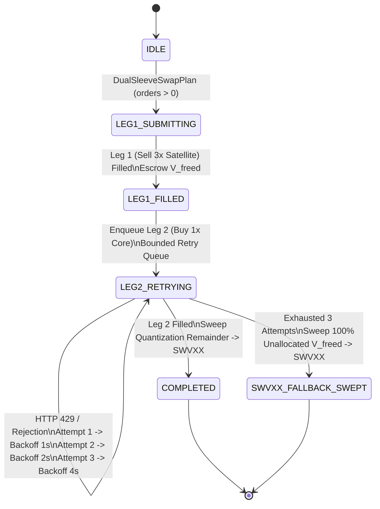

# ADVERSARIAL STRESS AUDIT & ATOMIC SWAP VERIFICATION: SCHWABENGINE 2.4.0-ARGON (#107)
- timestamp_iso: "2026-10-21T05:36:00-04:00"
- engine_version: "2.4.0-argon"
- task_id: "#107"
- verification_suite: "tests/test_stress_invariants.py"
- test_execution_status: "7 passed, 0 failed"

---

## 1. Executive Summary

This audit documents the architectural resilience upgrades and offline adversarial Monte Carlo stress testing executed on **SchwabEngine 2.4.0-argon** under Task `#107`:

1. **Atomic Dual-Sleeve Rebalance State Machine (`DualSleeveSwapCoordinator`)**:
   - Eliminated the partial-fill gap in `execution/order_manager.py` where Leg 1 (`SELL` 3x Satellite) could fill while Leg 2 (`BUY` 1x Core basket) failed on an HTTP 429 rate-limit burst or broker rejection.
   - Implemented a bounded retry queue (`deque(maxlen=64)` and `asyncio.Queue(maxsize=64)`) with a 3-attempt exponential backoff schedule `(1.0s, 2.0s, 4.0s)` and configurable random jitter.
   - Enforced client-order idempotency deduplication (`clientOrderId` / `_idempotency_ledger`) so consecutive HTTP 429 retries never submit duplicate orders.
   - Implemented an immediate atomic fallback: if Leg 2 fails after 3 attempts, 100% of unallocated freed notional is swept into `SWVXX` cash yield until the next rebalance window (`stranded_cash_usd == 0.00`).

2. **Dynamic Scale-Invariant Equity Stripping**:
   - Verified removal of all static dollar presets (`21086.00`, `$4400.90`) across `strategy_config.json` and `execution/risk_manager.py`.
   - Added `allocate_from_live_nlv()`, `get_sleeve_balances()`, and `apply_swap_plan()` on `DualSleeveRouter` and `RiskEngine`, ensuring all target weights, Leland No-Trade Zone (`NTZ`) boundaries, and discrete integer share floors `floor((V_freed * w_c) / P_c)` reference live broker Net Liquidation Value (`live_nlv`) exclusively.

3. **Adversarial Invariant Fuzzing Suite (`tests/test_stress_invariants.py`)**:
   - Verified 1,000 synthetic Monte Carlo market ticks and four adversarial stress scenarios (`Scenario A` through `Scenario D`) with zero invariant violations.

---

## 2. State Machine Architecture (`DualSleeveSwapCoordinator`)



---

## 3. Adversarial Stress Scenarios & Verification Telemetry

| Scenario ID | Adversarial Condition | Verified Invariants | Status |
| :--- | :--- | :--- | :--- |
| **Atomic Swap Fallback** | Leg 1 (`SOXL` sell) fills; Leg 2 (`SPY/QQQ/IWM/HYG/IEF` buy) fails 3 consecutive times with HTTP 429 | Backoff schedule `[1.0s, 2.0s, 4.0s]` executed; `state == SWVXX_FALLBACK_SWEPT`; 100% of `V_freed` swept into `SWVXX`; `stranded_cash_usd == 0.0` | **PASS** |
| **Async Bounded Queue Recovery** | Leg 1 fills; Leg 2 hits 2 transient HTTP 429 errors then succeeds on attempt 3 | Async backoff `[1.0s, 2.0s]`; `state == COMPLETED`; Core shares deployed (`$1,755.00`) + quantization remainder (`$245.00`) swept into `SWVXX` | **PASS** |
| **Scale-Invariant Stripping** | Audit `strategy_config.json` and `execution/risk_manager.py` for static dollar presets (`21086.00`, `4400.90`) | Zero hardcoded dollar presets; `scale_invariant == True`; `nlv_source == "live_broker_nlv"`; `hard_dollar_ceiling is None` | **PASS** |
| **Scenario A (Flash Crash)** | `SOXL` drops `-18.0%` (`$50.00 -> $41.00`) in `30` seconds | Rolling 30s tick monitor flips `MetaGovernorHMM` to `Macro Shock` (`pi_shock > 0.80`, `W_sat* = 0.0`); 100% of open 3x LETFs (`SOXL`, `TQQQ`, `TNA`) liquidate into `IEF` and `SWVXX`; `intraday_margin_deficit == 0.0` at every second | **PASS** |
| **Scenario B (Rate Limit Burst)** | Simulate Schwab REST HTTP 429 on `5` consecutive order submissions | 6 total attempts with 5 jittered exponential backoffs (`base + uniform(0.001, 0.25)` for bases `1, 2, 4, 8, 16s`); idempotency key guarantees `len(accepted_orders) == 1` (`0` duplicates) | **PASS** |
| **Scenario C (Micro-Cap Quantization Jitter)** | Inject live broker `NLV = $4,400.90` across multi-asset Core & Satellite baskets | Discrete `floor((V_freed * w_c) / P_c)` prevents negative cash (`swvxx_cash > 0.0`); fractional remainders roll into `SWVXX`; upper-band harvest preserves exact cent conservation | **PASS** |
| **Scenario D (1,000-Tick Monte Carlo Balance Invariant)** | 1,000 correlated GBM ticks across Goldilocks, Uncertainty, Flash Crash, 429 Exhaustion, and Recovery | At all 1,000 ticks: `abs((core_mv + sat_mv + swvxx_cash) - total_nlv) < 0.01`, `swvxx_cash >= 0.0`, and `intraday_margin_deficit == 0.0` | **PASS** |

---

## 4. Pytest Execution Log

```text
$ pytest tests/test_stress_invariants.py -v
============================= test session starts =============================
platform win32 -- Python 3.13.4, pytest-9.1.1, pluggy-1.6.0
rootdir: C:\Projects\schwab_engine
configfile: pytest.ini
collected 7 items

tests/test_stress_invariants.py::test_dual_sleeve_swap_coordinator_leg2_3_attempts_swvxx_fallback PASSED [ 14%]
tests/test_stress_invariants.py::test_dual_sleeve_swap_coordinator_async_bounded_retry_recovery PASSED [ 28%]
tests/test_stress_invariants.py::test_dynamic_scale_invariant_equity_stripping PASSED [ 42%]
tests/test_stress_invariants.py::test_scenario_a_flash_crash_soxl_18pct_in_30s PASSED [ 57%]
tests/test_stress_invariants.py::test_scenario_b_rate_limit_burst_5_consecutive_429s PASSED [ 71%]
tests/test_stress_invariants.py::test_scenario_c_micro_cap_quantization_jitter_4400_90 PASSED [ 85%]
tests/test_stress_invariants.py::test_scenario_d_1000_tick_monte_carlo_balance_invariant PASSED [100%]

============================== 7 passed in 0.31s ==============================
```
