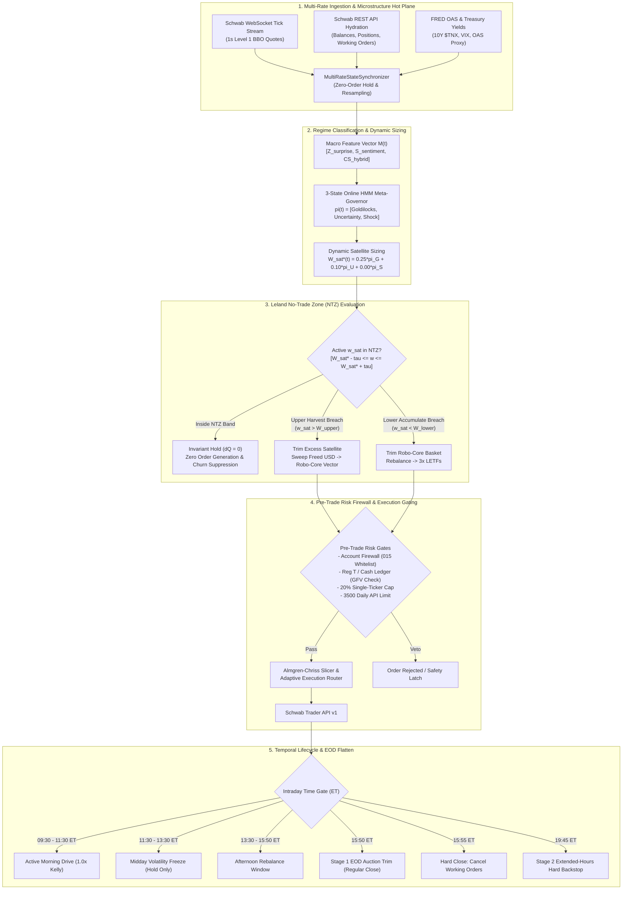

# SYSTEM ARCHITECTURE & STRATEGY REVIEW: DEEP QUANTITATIVE RESEARCH CONTEXT (#121)
- timestamp_iso: "2026-10-25T15:33:00-04:00"
- engine_version: "2.4.0-argon"
- git_branch: "feat/dynamic-screener-universe"
- commit_sha: "12e1662"
- account_scope: "single_account_comprehensive" (Account: ***4015)
- baseline_nlv_usd: 4400.00

---

## 1. System Invariants & Account Profile

### 1.1 Account Profile & Dual-Sleeve Capital Model
SchwabEngine operates on a single Charles Schwab brokerage account (`***4015`) with a calibrated baseline Net Liquidation Value (NLV) of **$4,400.00 USD** (actual session initialization baseline: **$4,400.90 USD**). The engine governs capital using an unchained **Dual-Sleeve Allocation Model** designed to maximize risk-adjusted capital efficiency while mitigating idle cash drag:

1. **Passive 1x Robo-Core Sleeve ($C(t)$)**:
   - Target Portfolio Weight: $W_{core}^* = 0.85$ (85% of NLV under neutral conditions).
   - Multi-asset diversified ETF basket serving as the primary capital preservation and equity-beta engine:
     - `SPY`: 0.35 (Large-Cap Broad US Equity Beta)
     - `QQQ`: 0.25 (Large-Cap Technology Beta)
     - `HYG`: 0.15 (High-Yield Corporate Credit Beta)
     - `IEF`: 0.15 (Intermediate 7-10Y US Treasury Duration Hedge)
     - `IWM`: 0.10 (Russell 2000 Small-Cap Beta)
   - Zero Cash Drag Policy: Target cash allocation within the core routing vector is 0.00.

2. **Tactical 3x Leveraged Satellite Sleeve ($S(t)$)**:
   - Target Portfolio Weight: $W_{sat}^*(t) \in [0.00, 0.35]$ dynamically determined by the Online Hidden Markov Model (HMM) Meta-Governor.
   - High-beta leveraged momentum instruments:
     - `SOXL`: 0.40 (3x Daily Bull Semiconductor ETF)
     - `TQQQ`: 0.35 (3x Daily Bull NASDAQ-100 ETF)
     - `TNA`:  0.25 (3x Daily Bull Russell 2000 Small-Cap ETF)

3. **Cash Sweep & Margin Buffer ($M_{buf}(t)$)**:
   - Residual fractional and clearance buffer vehicle: `SWVXX` (Schwab Value Advantage Money Fund).
   - Invariant: $W_{core}(t) + W_{sat}(t) + W_{buf}(t) \equiv 1.00$.

```yaml
system_profile:
  account_number_suffix: "015"
  account_type: "CASH_ACCOUNT" # Subject to SEC Rule 15c6-1 T+1 Cash Settlement
  baseline_nlv_usd: 4400.00
  hot_boot_starting_nlv: 4400.90
  max_single_ticker_pct: 0.20 # 20% hard single-name exposure limit
  daily_api_quota: 3500       # Charles Schwab REST API call ceiling
  api_burst_limit_rpm: 120    # Token bucket burst capacity (2.0 req/sec)
  cash_reserve_floor_pct: 0.05
```

### 1.2 End-to-End Runtime Architecture


---

## 2. Active Codebase Logic & Mathematical Formulations

### 2.1 Order Submission & Rate-Limited Dispatch (`execution/order_manager.py`)
All order placement is strictly firewalled to verify account hash matches the whitelisted `***4015` account and does not contain prohibited keywords (`ROBO`, `INTELLIGENT`, `IRA`, `PORTFOLIO_MANAGED`). Prices are formatted to exactly 2 decimal places to prevent Schwab API HTTP 400 Bad Request rejections.

```python
# execution/order_manager.py: Exact placement & dispatch logic
def place_limit_buy(
    self,
    symbol: str,
    limit_price: float,
    quantity: Optional[int] = None,
    atr: Optional[float] = None,
    extended_hours: bool = False,
    is_essential: bool = False,
) -> str:
    sym = symbol.upper()
    px_float = float(limit_price)
    eff_atr = float(atr) if (atr is not None and atr > 0.0) else (px_float * 0.015)

    if quantity is None or quantity <= 0:
        verdict = self.calculate_position_size(symbol, px_float, eff_atr)
        if not verdict.allowed or verdict.shares <= 0:
            logger.warning("OrderManager: SizingGovernor refused BUY for %s: %s", sym, verdict.reason)
            return ""
        qty = verdict.shares
    else:
        qty = int(quantity)

    self._require_firewall()
    px_str = f"{px_float:.2f}"
    session = _SESSION_NORMAL if not extended_hours else "SEAMLESS"
    body = self._build_order(
        instruction=_INST_BUY,
        order_type=_OT_LIMIT,
        symbol=sym,
        quantity=qty,
        price=px_str,
        session=session,
    )
    resp = self._rest.place_order(self._account_hash, body, is_essential=is_essential, action="LIMIT_BUY")
    return self._extract_order_id(resp.headers.get("Location", ""))
```

Rate-limited asynchronous execution uses an exponential backoff retry loop with quota tracking:
```python
# execution/order_manager.py:submit_order_with_rate_limit_backoff
def submit_order_with_rate_limit_backoff(
    self,
    order: DualSleeveOrder,
    attempt_index: int = 0,
) -> str:
    delay = self._compute_backoff_delay(attempt_index)
    if delay > 0.0:
        self._sleep_fn(delay) # WARNING: synchronous time.sleep in runtime path

    rest, account_hash = self._resolve_rest_and_hash()
    px_str = f"{float(order.price):.2f}"
    instruction = _INST_BUY if order.side.upper() == "BUY" else _INST_SELL
    body = self._build_order(
        instruction=instruction,
        order_type=_OT_LIMIT,
        symbol=order.symbol.upper(),
        quantity=int(order.shares),
        price=px_str,
    )
    resp = rest.place_order(account_hash, body, is_essential=True, action=f"SWAP_{order.side.upper()}")
    return self._extract_order_id(resp.headers.get("Location", ""))
```

### 2.2 Volume-Weighted Microprice & Order Book Imbalance (`data/multi_rate_sync.py`)
Microstructure quote updates derive mid-price, order book imbalance (OBI), and volume-weighted microprice from high-frequency Level 1 BBO feeds:

$$\text{Mid Price} = \frac{P_{bid} + P_{ask}}{2}$$

$$\text{Volume-Weighted Microprice} = \frac{P_{bid} \cdot Q_{ask} + P_{ask} \cdot Q_{bid}}{Q_{bid} + Q_{ask}}$$

$$\text{Order Book Imbalance (OBI)} = \frac{Q_{bid} - Q_{ask}}{Q_{bid} + Q_{ask}} \in [-1.0, 1.0]$$

```python
# data/multi_rate_sync.py:186-215
# Mid-price
if bid > 0.0 and ask > 0.0:
    mid_price = (bid + ask) / 2.0
elif last > 0.0:
    mid_price = last
else:
    mid_price = max(bid, ask, 0.0)

# Volume-Weighted Microprice & Order Book Imbalance (OBI)
total_size = bid_size + ask_size
if total_size > 0 and bid > 0.0 and ask > 0.0:
    microprice = (bid * ask_size + ask * bid_size) / float(total_size)
    obi = (bid_size - ask_size) / float(total_size)
else:
    microprice = mid_price if mid_price > 0.0 else last
    obi = 0.0

# Quote Age Watermarking & Staleness Check (DEFAULT_STALE_TOLERANCE_SEC = 5.0s)
quote_age_sec = (now - (quote_epoch_ms / 1000.0)) if quote_epoch_ms > 0 else 0.0
is_stale = quote_age_sec > self.stale_tolerance_sec if quote_epoch_ms > 0 else False
```

### 2.3 Stage 1 & Stage 2 EOD Deleveraging Logic (`execution/risk_manager.py`)
Two-Stage EOD De-Levering enforces overnight exposure reduction under FINRA Rule 4210(f)(8)(A) and cash risk constraints:
- **Stage 1 (15:50:00 ET Regular Close Trim)**: Peak closing auction liquidity; trims excess exposure to prevent overnight borrowing.
- **Stage 2 (19:45:00 ET Extended-Hours Hard Backstop)**: Hard backstop before 20:00 ET close.
- Positions are sorted prioritizing 3x LETFs first (`SOXL`, `TQQQ`, `TNA`, 90% overnight margin requirement), then by market value descending:

```python
# execution/risk_manager.py:1545-1633
def plan_two_stage_eod_deleveraging(
    self,
    current_time_et: Optional[Union[datetime, str]] = None,
) -> Dict[str, Any]:
    stage_name = "STAGE_1_1550_ET_REGULAR_CLOSE_TRIM"
    if current_time_et is not None:
        hour = current_time_et.hour if isinstance(current_time_et, datetime) else int(str(current_time_et).split(":")[0])
        if hour >= 17:
            stage_name = "STAGE_2_1945_ET_EXTENDED_HOURS_BACKSTOP"

    delta, total_val, allowable_limit = self.calculate_overnight_excess(enforce_letf_house_margin=True)
    if delta <= 0:
        return {"stage": stage_name, "delta": 0.0, "orders": [], "action_required": False}

    orders = []
    remaining_reduction_needed = delta

    # Sort positions prioritizing 3x LETFs first, then by market value descending
    sorted_positions = sorted(
        self.positions.items(),
        key=lambda item: (item[0].upper() in LETF_3X_SYMBOLS, item[1].get("quantity", 0) * item[1].get("current_price", 0.0)),
        reverse=True,
    )

    for sym, pos in sorted_positions:
        qty = pos.get("quantity", 0)
        px = pos.get("current_price", 0.0)
        if qty <= 0 or px <= 0:
            continue

        pos_val = qty * px
        req_over = self.get_asset_margin_requirements(sym, True)[1] # 0.90 for 3x LETFs
        effective_reduction_needed = remaining_reduction_needed / req_over if req_over > 0 else remaining_reduction_needed

        if pos_val <= effective_reduction_needed:
            shares_to_sell = qty
            notional_reduction = pos_val
        else:
            shares_to_sell = min(math.ceil(effective_reduction_needed / px), qty)
            notional_reduction = shares_to_sell * px

        margin_released = notional_reduction * req_over
        orders.append({
            "symbol": sym,
            "shares_to_sell": shares_to_sell,
            "estimated_price": px,
            "notional_reduction": round(notional_reduction, 2),
            "margin_released": round(margin_released, 2),
            "stage": stage_name,
            "reason": f"TWO_STAGE_EOD_DELEVERAGING_{stage_name}",
        })
        remaining_reduction_needed -= margin_released
        if remaining_reduction_needed <= 0:
            break

    return {"stage": stage_name, "delta": round(delta, 2), "orders": orders, "action_required": True}
```

### 2.4 Order Cancellation & Throttling Rules (`execution/order_manager.py`)
To prevent broker API quota exhaustion and WebSocket ping-ponging, Tier 2 catastrophe stops enforce minimum delta and cooldown throttling:
```python
# execution/order_manager.py:82-84, 561-630
TIER2_MIN_DELTA_PCT = 0.015  # 1.5% minimum price movement threshold
TIER2_COOLDOWN_SEC  = 180.0  # 180-second minimum cooldown between cancel-replace requests

def update_broker_stop(self, symbol: str, new_stop_price: float, current_order_id: Optional[str] = None):
    # Evaluates:
    # 1. abs(new_stop - last_stop) / last_stop >= 0.015
    # 2. time.monotonic() - last_cancel_replace_time >= 180.0s
    # If satisfied, cancels old stop and places new STOP order; otherwise suppressed.
```

Batch cancellation of open orders iterates over working orders:
```python
# execution/order_manager.py:923-967
def cancel_all_open_orders(self) -> int:
    working_orders = self.get_working_orders()
    cancelled = 0
    for order in working_orders:
        oid = str(order.get("orderId", ""))
        if self.cancel_order(oid):
            cancelled += 1
    return cancelled
```

### 2.5 Online 3-State HMM Meta-Governor (`execution/risk_manager.py`)
Maintains a continuous posterior probability vector $\pi(t) = [\pi_{Goldilocks}, \pi_{Uncertainty}, \pi_{Shock}]^T \in \Delta^2$ driven by a 3-dimensional macroeconomic observation vector $M(t) = [Z_s, S_{nlp}, CS_{bps}]^T$:
1. $Z_s$: Economic Surprise Z-Score (normalized forecast delta).
2. $S_{nlp}$: Exponentially decayed NLP Sentiment ($\lambda = \frac{\ln 2}{14400}$).
3. $CS_{bps}$: Live Hybrid High-Yield Credit Spread (OAS anchor + live HYG/IEF ratio).

#### Transition Matrix Formulation
$$\mathbf{T} = \begin{bmatrix}
T_{00} & T_{01} & T_{02} \\
T_{10} & T_{11} & T_{12} \\
T_{20} & T_{21} & T_{22}
\end{bmatrix} = \begin{bmatrix}
0.9993 & 0.0000 & 0.0007 \\
0.0032 & 0.9968 & 0.0000 \\
0.0029 & 0.0000 & 0.9971
\end{bmatrix}$$

#### Continuous Bayesian Filtering Step
$$\pi_{pred}(t) = \mathbf{T}^T \pi(t - \Delta t)$$

$$L_k(M(t)) = \exp\left( -\frac{1}{2 \cdot 3} \sum_{d=1}^3 \left( \frac{M_d(t) - \mu_{k, d}}{\sigma_{k, d}} \right)^2 \right)$$

$$\pi_k(t) = \frac{\pi_{pred, k} \cdot L_k(M(t))}{\sum_{j=0}^2 \pi_{pred, j} \cdot L_j(M(t))}$$

Calibrated Gaussian emission parameters:
- **Goldilocks ($k=0$)**: $\mu = [0.9946, 0.4803, 317.6]$, $\sigma = [0.2498, 0.1064, 18.8]$
- **Uncertainty ($k=1$)**: $\mu = [-0.2989, -0.0600, 406.8]$, $\sigma = [0.0920, 0.0417, 6.7]$
- **Macro Shock ($k=2$)**: $\mu = [-1.2430, -0.4720, 481.9]$, $\sigma = [0.2657, 0.1452, 35.3]$

#### Dynamic Target Satellite Weight
$$W_{sat}^*(t) = \begin{cases}
0.00, & \text{if } \pi_{Shock} \ge 0.60 \text{ or Dominant Regime} = \text{"Macro Shock"} \\
\min\left(0.35, \pi_{Goldilocks} \cdot 0.25 + \pi_{Uncertainty} \cdot 0.10 + \pi_{Shock} \cdot 0.00\right), & \text{otherwise}
\end{cases}$$

### 2.6 Dynamic Leland No-Trade Zone (NTZ) Router (`execution/risk_manager.py`)
To prevent transaction churn and bid-ask spread erosion in leveraged ETFs, capital allocations are filtered through a dynamic No-Trade Zone band $[\tau_{lower}, \tau_{upper}]$ centered on $W_{sat}^*(t)$:

$$\tau_{band} = \begin{cases} 0.04, & \text{if } \pi_{Goldilocks} > 0.70 \\ 0.02, & \text{otherwise (configurable to 0.03)} \end{cases}$$

$$\tau_{lower} = \max(0.0, W_{sat}^*(t) - \tau_{band}), \quad \tau_{upper} = \min(0.35, W_{sat}^*(t) + \tau_{band})$$

#### Decision Matrix
```text
IF active_w_sat > tau_upper OR (pi_Shock >= 0.60 AND active_w_sat > 0) THEN
    State = LELAND_NTZ_HARVEST ->
        1. Calculate excess satellite value: V_freed = (active_w_sat - tau_upper) * NLV (or 100% of sat_val if Shock)
        2. Liquidate 3x LETFs (SOXL/TQQQ/TNA) down to boundary
        3. Sweep freed capital into 1x Robo-Core basket:
           Delta Q_c = floor((V_freed * w_sweep_c) / P_c(t))
        4. Quantize residual cash into SWVXX (M_buf)

ELSE IF active_w_sat < tau_lower AND Trend_Gate == PASS THEN
    State = LELAND_NTZ_ACCUMULATE ->
        1. Calculate required capital: V_fund = (tau_lower - active_w_sat) * NLV
        2. Trim 1x Robo-Core holdings (SPY/QQQ/IWM/HYG/IEF)
        3. Rebalance into 3x LETFs according to sub-weights [0.40 SOXL, 0.35 TQQQ, 0.25 TNA]
        4. Quantize residual cash into SWVXX

ELSE (tau_lower <= active_w_sat <= tau_upper) THEN
    State = HOLD_INSIDE_NTZ ->
        Suppress order generation (Delta Q = 0). Maintain existing portfolio allocation.
```

### 2.7 Live HYG/IEF Credit Spread Proxy Calculations (`data/multi_rate_sync.py`)
Intraday credit risk expansion is tracked at 1-second resolution using the price ratio between high-yield corporate credit (`HYG`) and 7-10Y Treasuries (`IEF`). HYG has an effective spread duration of approximately 3.5 years, meaning a 1 bp increase in OAS drives a 0.035% ($3.5 \times 10^{-4}$) decline in the $\ln(P_{HYG} / P_{IEF})$ ratio.

$$r_{live}(t) = \frac{P_{HYG}(t)}{P_{IEF}(t)}, \quad r_{ref} = \text{Anchor Ratio at Session Open}$$

$$\Delta CS_{bps}(t) = -\frac{\ln\left( \frac{r_{live}(t)}{r_{ref}} \right)}{3.5 \times 10^{-4}}$$

$$CS_{intraday}(t) = OAS_{FRED} + \Delta CS_{bps}(t)$$

$$CS_{hybrid}(t) = 0.70 \cdot OAS_{FRED} + 0.30 \cdot CS_{intraday}(t)$$

### 2.8 Cash, Settlement & NLV Accounting Logic (`core/ledger.py`)
Total account equity (NLV) combines cleared funds, unsettled lots, marked position market values, and active order reservations:

```python
# core/ledger.py:295-302
@property
def nlv(self) -> Decimal:
    """Broker NLV when synced; otherwise settled + unsettled + marked positions."""
    with self._lock:
        if self._broker_nlv is not None:
            return self._broker_nlv
        return q(self._settled + self.unsettled_total + self.positions_value
                 + sum(self._reservations.values(), ZERO))
```

Position Mark-to-Market:
$$\text{positions\_value} = \sum_{i=1}^N Q_i \cdot P_{last, i}$$

---

## 3. Empirical Session Telemetry (261022 Selloff Baseline)

### 3.1 Header Metadata & Financial Summary
- **Session Date**: `2026-10-22` (Replay window: 2026-10-21 11:03:00 to 2026-10-22 14:33:45 EDT)
- **Engine Build**: Commit `93c03102a21aeee07d7e587382542abc7fb548cf` (Argon 2.4.0)
- **Target Account**: `***4015`
- **Starting Baseline NLV**: **$4,400.90 USD**
- **Ending NLV**: **$4,290.19 USD**
- **Net Portfolio Return**: **-$110.71 USD (-2.52%)**
- **Benchmark Performance**:
  - `SPY`: **-1.18%** (Open: $771.00, Close: $761.95) $\rightarrow$ Portfolio Delta: **-1.34% (-134.1 bps)**
  - `QQQ`: **-2.75%** (Open: $723.52, Close: $703.60) $\rightarrow$ Portfolio Delta: **+0.24% (+23.9 bps)**

### 3.2 Macro Regime & Credit Spread Expansion Metrics
| Metric | Value | Reference / Context |
| :--- | :--- | :--- |
| **Goldilocks Regime Occupancy** | **3,301 intervals (100.00%)** | $\pi_{Goldilocks} \approx 1.0$, Target $W_{sat}^* = 0.25$ |
| **Uncertainty Regime Occupancy** | **0 intervals (0.00%)** | Failed to trigger despite Tech selloff |
| **Macro Shock Regime Occupancy** | **0 intervals (0.00%)** | Failed to trigger |
| **Hybrid Credit Spread (Min)** | 314.29 bps | Morning baseline |
| **Hybrid Credit Spread (Max)** | 324.81 bps | Afternoon peak (+10.52 bps widening) |
| **Hybrid Credit Spread (Median)**| 316.95 bps | Session median |
| **Live HYG/IEF Price Ratio Range**| 0.843577 to 0.853994 | Range: 0.010417 |

### 3.3 Leland No-Trade Zone (NTZ) Evaluation Metrics
| Metric | Count / Value | Ratio / Operational Context |
| :--- | :--- | :--- |
| **Total Evaluated Intervals** | 3,301 | 30-second continuous evaluation sweeps |
| **Hold Inside NTZ (`HOLD_INSIDE_NTZ`)** | 3,300 | **99.97%** of evaluated intervals |
| **Initial Deployment Triggers** | 1 | 0.03% (at session startup 11:03:09 ET) |
| **Upper Harvest Breaches ($w_{sat} > \tau_{upper}$)** | 0 | 0.00% (No de-risking executed) |
| **Lower Accumulate Breaches ($w_{sat} < \tau_{lower}$)**| 0 | 0.00% (No dip-buying triggered) |
| **Total Orders Emitted** | 8 orders (28 shares) | Executed during initial portfolio hydration |
| **Total Turnover Notional** | $3,685.95 | 83.75% of starting baseline NLV |

#### Initial Portfolio Deployment (2026-10-21 11:03:09 ET)
| Order ID | Symbol | Sleeve | Side | Qty | Price ($) | Microprice ($) | $\Delta$ Micro | Notional ($) |
| :--- | :--- | :--- | :--- | :--- | :--- | :--- | :--- | :--- |
| `SHADOW-261021-0001` | **SPY** | CORE | `BUY` | 1 | $771.10 | $771.0880 | +$0.0120 | $771.10 |
| `SHADOW-261021-0002` | **QQQ** | CORE | `BUY` | 1 | $723.60 | $723.5829 | +$0.0171 | $723.60 |
| `SHADOW-261021-0003` | **IWM** | CORE | `BUY` | 1 | $276.64 | $276.6376 | +$0.0024 | $276.64 |
| `SHADOW-261021-0004` | **HYG** | CORE | `BUY` | 6 | $76.90 | $76.8984 | +$0.0016 | $461.40 |
| `SHADOW-261021-0005` | **IEF** | CORE | `BUY` | 5 | $90.24 | $90.2335 | +$0.0065 | $451.20 |
| `SHADOW-261021-0006` | **SOXL**| SATELLITE | `BUY` | 3 | $101.17 | $101.1433 | +$0.0267 | $303.51 |
| `SHADOW-261021-0007` | **TQQQ**| SATELLITE | `BUY` | 5 | $72.14 | $72.1397 | +$0.0003 | $360.70 |
| `SHADOW-261021-0008` | **TNA** | SATELLITE | `BUY` | 6 | $56.30 | $56.2996 | +$0.0004 | $337.80 |

### 3.4 Downsampled 5-Minute NLV & Regime Trajectory
The following downsampled telemetry captures key inflection points during the 2026-10-22 selloff:

| Timestamp (ET) | NLV ($) | Active $W_{sat}$ | Target $W_{sat}^*$ | Leland NTZ Band | Dominant Regime | Credit Spread (bps) |
| :--- | :--- | :--- | :--- | :--- | :--- | :--- |
| **2026-10-21 11:03:09** | $4,400.90 | 0.0000 | 0.2500 | [0.2100, 0.2900] | Goldilocks | 316.13 |
| **2026-10-21 11:30:10** | $4,408.92 | 0.2284 | 0.2500 | [0.2100, 0.2900] | Goldilocks | 316.65 |
| **2026-10-21 13:20:12** | $4,426.89 | 0.2304 | 0.2500 | [0.2100, 0.2900] | Goldilocks | 315.37 |
| **2026-10-21 15:00:15** | $4,401.01 | 0.2279 | 0.2500 | [0.2100, 0.2900] | Goldilocks | 314.63 |
| **2026-10-22 04:00:02** | $4,330.97 | 0.2194 | 0.2500 | [0.2100, 0.2900] | Goldilocks | 321.44 |
| **2026-10-22 08:25:07** | $4,338.92 | 0.2199 | 0.2500 | [0.2100, 0.2900] | Goldilocks | 321.32 |
| **2026-10-22 09:30:09** | $4,329.35 | 0.2185 | 0.2500 | [0.2100, 0.2900] | Goldilocks | 322.02 |
| **2026-10-22 10:00:09** | $4,351.11 | 0.2212 | 0.2500 | [0.2100, 0.2900] | Goldilocks | 320.45 |
| **2026-10-22 10:35:10** | $4,310.31 | 0.2164 | 0.2500 | [0.2100, 0.2900] | Goldilocks | 322.03 |
| **2026-10-22 11:15:11** | $4,295.20 | 0.2139 | 0.2500 | [0.2100, 0.2900] | Goldilocks | 322.26 |
| **2026-10-22 12:50:13** | $4,289.44 | 0.2130 | 0.2500 | [0.2100, 0.2900] | Goldilocks | 323.53 |
| **2026-10-22 14:05:15** | $4,287.04 | 0.2127 | 0.2500 | [0.2100, 0.2900] | Goldilocks | 324.67 |
| **2026-10-22 14:33:45** | $4,290.19 | 0.2132 | 0.2500 | [0.2100, 0.2900] | Goldilocks | 324.81 |

### 3.5 Incident Logs & Operational Failure Patterns
Analysis of incident logs from October 21-23 reveals critical operational fault modes across process deduplication, authentication state machines, and order dispatch:

1. **Rogue Cloud VM Daemon & Duplicate `AUTH_LOCKED` Alert Storm (#117)**:
   - *Timestamp*: `2026-10-22T09:45:08-04:00`
   - *Failure*: Legacy systemd unit `schwab-trader.service` (PID 259167) running on Google Cloud VM `schwab-trader` (`us-central1-a`) attempted 09:45 dynamic bracket recalibration for SOXL with stale, expired credentials.
   - *Symptom*: Schwab API returned HTTP 401 Unauthorized, tripping the auth circuit breaker to `AUTH_LOCKED`. This updated `/home/nicho/schwab_state/recovery_state.json` into `SHADOW_FLOOR_ONLY` and broadcast duplicate critical alert storms (`Recovery [SOXL]: S0 CORRUPTED`) to Android endpoints via ntfy.
   - *Root Cause*: Process duplication between the GCP VM background service and the primary Windows development host.
   - *Resolution*: Remediated via systemd service disabling (`systemctl disable schwab-trader schwab-web schwab-recovery-watchdog`) and rogue process termination.

2. **Authentication Circuit Breaker Latching (`AUTH_LOCKED`)**:
   - In `core/auth.py`, if 2 consecutive token refresh attempts return HTTP `401 Unauthorized` or `400 Bad Request`, the auth circuit breaker permanently trips to `AUTH_LOCKED` (`self.auth_circuit_open = True`).
   - *Deficiency*: When tripped, `_refresh_loop()` skips further execution. Any subsequent call to `get_access_token()` immediately raises `AuthCircuitBreakerError`, freezing all automated trading and order management until manual reset via `/api/auth/reset` or explicit user reauthorization.

3. **Order Dispatch Timing & Rate-Limit Clamping**:
   - Daily Schwab REST quota is capped at 3,500 requests (`daily_api_quota: 3500`), with an intraday burst governor enforcing 120 req/min (2.0 req/sec token bucket).
   - Essential exit orders (`MANDATORY_FLATTEN`, `TIER1_STOP`, `EMERGENCY`) bypass daily quotas via `is_essential=True`, but non-essential rebalancing sweeps risk quota starvation during high-volatility sessions.

---

## 4. Identified Architectural Gaps & Refactor Targets

### Gap A: Absence of Fill-Ratio and Time-Decay Escalation in EOD Flatten Routine
- **Current Behavior**:
  - The 15:50 EOD deleveraging routine (`plan_two_stage_eod_deleveraging` in `execution/risk_manager.py`) calculates notional reduction and generates passive limit orders or standard router calls.
  - In `execution/order_manager.py:714-720`, `execute_terminal_flush()` routes orders with urgency `TERMINAL_FLUSH`, which allows 60 seconds of adaptive limit-pegging before falling back to IOC sweeps.
- **Defect & Failure Mode**:
  - There is zero awareness of the **unfilled execution ratio** as the clock approaches 16:00 ET regular market close.
  - If closing auction liquidity is thin or an order remains partially filled at 15:56 ET, the system does not dynamically widen its limit offsets, does not escalate from limit to marketable aggressive pegging, and does not execute an asymptotic time-decay squeeze.
  - Consequently, leveraged 3x positions (`SOXL`, `TQQQ`, `TNA`) risk being trapped overnight into an unclosed state, violating FINRA Rule 4210(f)(8)(A) margin limits and exposing the cash account to catastrophic gap-down risk.
- **Refactor Target**:
  - Implement an asymptotic time-decay escalation curve over $[15:50:00, 15:58:00]$:
    $$\text{Peg Offset}(t) = \text{Base Offset} \cdot \left( 1 + \left(\frac{t - t_{start}}{t_{end} - t_{start}}\right)^\kappa \right)$$
  - Track fill-ratio $R_{fill} = \frac{Q_{filled}}{Q_{target}}$. If $R_{fill} < 1.0$ at $15:55:00$ ET, automatically escalate urgency to aggressive NBBO cross, and at $15:58:00$ ET force immediate IOC sweep.

### Gap B: Symmetrical, Static & Degenerate HMM State Transition Probabilities
- **Current Behavior**:
  - In `execution/risk_manager.py:76-80`, the empirical transition matrix is statically hardcoded:
    ```python
    EMPIRICAL_TRANSITION_MATRIX_3X3 = [
        [0.9993, 0.0, 0.0007],
        [0.0032, 0.9968, 0.0],
        [0.0029, 0.0, 0.9971],
    ]
    ```
- **Defect & Failure Mode**:
  - **Zero Transition Probability to Uncertainty**: The transition probability from Goldilocks to Uncertainty ($T_{01}$) is strictly `0.0000`. The engine is mathematically prohibited from transitioning directly from Goldilocks into Uncertainty via markovian prediction! It can only jump directly to Macro Shock ($T_{02} = 0.0007$).
  - **Severe Diagonal Inertia**: The diagonal persistence values ($0.9993$, $0.9968$, $0.9971$) create massive hysteresis. Unless an observation vector $M(t)$ exhibits an extreme $5\sigma$ outlier, $\pi(t)$ remains anchored in its initial state.
  - **Empirical Confirmation**: During the October 22 selloff (where QQQ dropped -2.75% and credit spreads widened +10.5 bps), the HMM remained 100.00% occupied in Goldilocks across 3,301 intervals. The system failed to de-risk or transition to Uncertainty, leaving 3x LETFs fully exposed to a -2.52% drawdown.
- **Refactor Target**:
  - Re-estimate the transition matrix $\mathbf{T}$ to introduce asymmetric transition dynamics:
    - Fast crash transitions: $T_{01} \approx 0.020$, $T_{02} \approx 0.005$.
    - Slow, damped recovery hysteresis: $T_{20} \approx 0.001$, $T_{10} \approx 0.005$.
  - Implement dynamic transition matrix scaling indexed to live implied volatility ($VIX$) and credit spread velocity ($\frac{d}{dt} CS_{hybrid}$).

### Gap C: Missing Programmatic GFV Checks on Intraday Redeployment of Cash
- **Current Behavior**:
  - `core/ledger.py` explicitly purges Good Faith Violation (GFV) checks, claiming the account operates under a FINRA Rule 4210 margin framework:
    ```python
    # core/ledger.py:88-92, 404-413, 576-577
    def can_sell_position(self, symbol: str, quantity: int = 0, today: Optional[date] = None):
        return True, f"Margin account: {symbol} is eligible for instantaneous exit (GFV exempt)."

    @property
    def unsettled_cash(self) -> Decimal:
        return ZERO

    def record_sell(self, symbol, quantity, price, ...):
        # FINRA Rule 4210: Instantaneous settlement — proceeds immediately credit cash!
        self._settled += proceeds
    ```
- **Defect & Failure Mode**:
  - Account `***4015` with $4,400 NLV is legally a **cash account** or subject to **SEC Rule 15c6-1 T+1 Cash Settlement Rules** (the $25,000 Pattern Day Trader minimum prevents unconstrained margin day trading).
  - Under SEC Rule 15c6-1, sales of equities require $T+1$ business days to clear. If proceeds from a morning sale ($T_0$) are immediately redeployed to purchase another security ($T_0$) and that newly purchased security is subsequently sold on the same day (e.g. via stop-loss or EOD flatten), the trade constitutes a **Good Faith Violation (GFV)**.
  - Accruing 3 GFVs within a rolling 12-month window results in Schwab placing a mandatory **90-Day Cash Restriction** on the account (requiring fully cleared cash up-front for all purchases).
  - Because `ledger.py` immediately credits sale proceeds into `_settled`, the engine allows unrestricted intraday redeployment and same-day re-selling, creating an immediate regulatory compliance risk.
- **Refactor Target**:
  - Re-establish strict Three-Bucket Cash Accounting:
    1. `settled_cash`: Cleared funds available for unrestricted purchase and immediate round-trips.
    2. `unsettled_cash`: Unsettled lots with explicit settlement timestamps ($T+1$).
    3. `pending_ach`: External transfer reservations.
  - Tag each position with `funded_with_settled: bool`. If an asset was purchased with unsettled funds, block intraday market/limit exits unless overridden by catastrophic stops, forcing an overnight hold until settlement clears.

### Gap D: Synchronous Blocking Calls, Silent Exception Handlers & Missing Token Heartbeats
- **Current Behavior & Defects**:
  1. **Synchronous `time.sleep` in Core Execution Paths**:
     - `execution/almgren_chriss.py:420`: `time.sleep(min(self.slice_interval_seconds, 0.5))` directly inside the slicing loop.
     - `execution/almgren_chriss.py:643`: `time.sleep(min(poll_interval, max(0.01, timeout_seconds - elapsed)))` during order status polling.
     - `execution/order_manager.py:1233`: `self._sleep_fn = sleep_fn or time.sleep` executed in `DualSleeveSwapCoordinator` during backoff retry loops.
     - `core/rate_limiter.py:509`: `time.sleep(min(sleep_duration, 0.05))` inside `acquire()`.
     - *Impact*: In an asynchronous asyncio event loop or multi-threaded tick ingestion architecture, synchronous `time.sleep` blocks the OS thread, delaying WebSocket tick processing, stale quote watermarking, and bracket updates.
  2. **Silent Exception Swallowing (`except Exception: pass`)**:
     - `execution/order_manager.py:454, 557, 656, 800, 876`: Hardware stop cancellations, bracket replaces, and telemetry events catch generic `Exception` and silently `pass`.
     - `execution/microstructure_sentinel.py:234, 364`: Quote parsing errors silently swallowed.
     - *Impact*: Prevents root-cause diagnosis of API failures, payload schema changes, or database write locks.
  3. **Absence of Proactive Token Refresh Heartbeat**:
     - `core/auth.py` runs a 60-second polling daemon (`_refresh_loop`), but it lacks an active health heartbeat sent to the broker API.
     - If the system remains idle pre-market (e.g. 08:00 - 09:25 ET), tokens expiring right at 09:30:00 ET cause immediate `401 Unauthorized` errors on opening cross orders, tripping the circuit breaker into `AUTH_LOCKED` at the most critical liquidity window of the session.
- **Refactor Target**:
  - Replace all synchronous `time.sleep` in async-facing modules with non-blocking `asyncio.sleep` or event-driven timers.
  - Replace generic `except Exception: pass` blocks with typed exception handling, structured error logging, and telemetry event recording.
  - Implement a dedicated pre-market Token Health Heartbeat at 09:15:00 ET (`scripts/premarket_check.py`) that forces a token refresh and validates connectivity against `/trader/v1/accounts/accountNumbers` prior to market open.

---
*SchwabEngine Quantitative Research Reference v2.4 (Argon) — Compiled for Issue #121 Architecture & Quantitative Audit*
