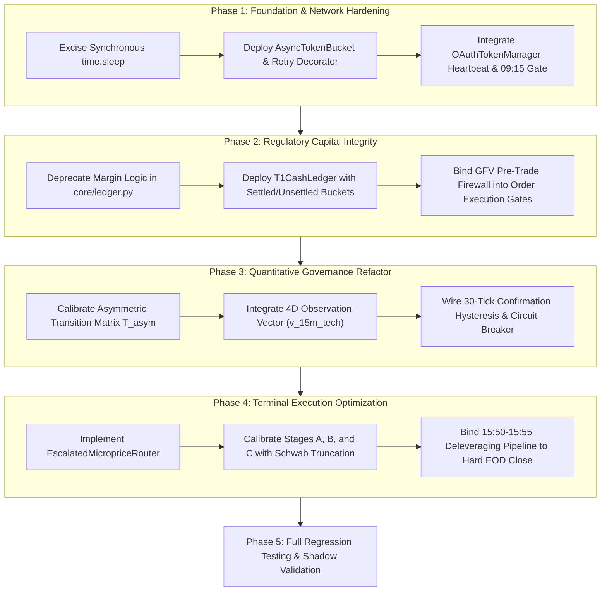

# SchwabEngine Resiliency Refactor: Architectural Blueprint & Implementation Specification (#123)

## 1. Executive Summary & Problem Formulation
- **Target Profile:** Single cash account `***4015`, Net Liquidating Value (NLV) baseline $4,400.00 USD, 1x Core / 3x Satellite dual-sleeve allocation model.
- **Regulatory Framework:** SEC Rule 15c6-1 (T+1 cash settlement). Zero margin, zero PDT concessions.
- **Empirical Motivation:** During the October 22 localized market drawdown (QQQ -2.75%), four systemic failure points degraded performance:
  1. *Bayesian Filter Lockout:* Symmetrical, high-inertia transition matrix ($T_{01} = 0.0$) anchored the Hidden Markov Model in 100% Goldilocks across 3,301 intervals.
  2. *Terminal Liquidity Decay:* Static limit orders in the 15:50–15:55 EDT deleveraging window failed to execute inside widening spreads, threatening the overnight cash mandate.
  3. *Regulatory Ledger Blind Spot:* Instant margin settlement assumptions in `core/ledger.py` created acute Good Faith Violation (GFV) exposure on same-day capital redeployment.
  4. *Asynchronous Blocking & Auth Latency:* Synchronous `time.sleep` calls blocked the event loop, and passive OAuth lifecycle management exposed the system to mid-session credential expiration (`AUTH_LOCKED`).
- **Architectural Directive:** Implement an institutional-grade, decoupled resiliency refactor that replaces brittle heuristics with mathematically formal, non-blocking asynchronous state machines.

---

## 2. Workstream 1: Asymmetric HMM Regime Classification & Tail-Risk Governors
- **Module Targets:** `execution/risk_manager.py`, `strategies/regime_governor.py`, `core/paths.py`.
- **System Invariant:** Volatility descent is structurally asymmetric ($v_{\text{crash}} \gg v_{\text{recovery}}$). The state transition matrix must enforce rapid de-risking into high-volatility regimes and require strict, conservative confirmation before re-accumulating risk.
- **Architectural Specifications:**
  - Transition Topology: Replace static $3 \times 3$ empirical matrices with an ergodic, asymmetric transition matrix:
    $$T_{00} \approx 0.9850, \quad T_{01} \approx 0.0125, \quad T_{02} \approx 0.0025$$
    $$T_{10} \approx 0.0030, \quad T_{11} \approx 0.9880, \quad T_{12} \approx 0.0090$$
    $$T_{20} \approx 0.0005, \quad T_{21} \approx 0.0035, \quad T_{22} \approx 0.9960$$
  - Observation Expansion: Expand the continuous observation vector from 3 to 4 dimensions:
    $$M(t) = \begin{bmatrix} Z_s(t) & S_{\text{nlp}}(t) & CS_{\text{hybrid}}(t) & v_{\text{15m}}^{\text{tech}}(t) \end{bmatrix}^T$$
    incorporating rolling 15-minute technology equity velocity $v_{\text{15m}}^{\text{tech}}(t) = \frac{\Delta P_{\text{QQQ}}}{P_{\text{QQQ}}}$ alongside hybrid high-yield credit spread proxies ($CS_{\text{hybrid}}$).
  - Deterministic Tail-Risk Override: Deploy an exogenous, non-statistical circuit breaker bypassing Bayesian filter lag during acute liquidity dislocations:
    $$\mathcal{C}_{\text{shock}}(t) = \left( \Delta CS_{\text{1h}} \ge 12\text{ bps} \;\lor\; Z_{CS} \ge 3.0 \right) \land \left( v_{\text{15m}}^{\text{SPY}} \le -1.25\% \;\lor\; v_{\text{15m}}^{\text{QQQ}} \le -1.75\% \right)$$
  - Hysteresis Filtering: Enforce a continuous 30-tick ($\Delta t = 1.0\text{s}$) confirmation horizon for credit spread anomalies to filter transient noise during scheduled macroeconomic data releases (CPI/FOMC).
- **Argon Implementation Directives:**
  - Structure `AsymmetricHMMGovernor` with clear separation between state prediction, Gaussian likelihood evaluation, and sizing governor translation.
  - Implement dynamic satellite target weighting:
    $$W_{\text{sat}}^*(t) = \begin{cases} 0.00, & \text{if } \pi_{\text{Shock}} \ge 0.60 \text{ or Dominant Regime} = \text{"Macro Shock"} \\ \min(0.35, \pi_G \cdot 0.25 + \pi_U \cdot 0.10), & \text{otherwise} \end{cases}$$
  - Integrate atomic telemetry logging for each state transition to maintain a verifiable audit trail in `state/trading_journal.db`.

---

## 3. Workstream 2: Time-and-Fill Escalated Microprice Router (15:50–15:55 EDT)
- **Module Targets:** `execution/order_manager.py`, `execution/risk_manager.py`, `execution/escalated_router.py`.
- **System Invariant:** Cash Account `***4015` mandates an absolute 100% cash overnight state. Leveraged 3x assets (`SOXL`, `TQQQ`, `TNA`) must be completely cleared before 15:55:00 EDT without catastrophic spread crossing or order stranding.
- **Architectural Specifications:**
  - Normalized Horizon Metric: Define continuous progression $\tau(t) = \frac{t - t_{\text{start}}}{T} \in [0.0, 1.0]$ over $[15:50:00, 15:55:00]$ EDT ($T = 300\text{s}$) alongside fill ratio $R_{\text{fill}} = \frac{Q_{\text{filled}}}{Q_{\text{target}}}$.
  - Tri-Phase Execution Pipeline:
    1. *Stage A: Passive Microprice ($\tau < 0.40$):* Anchor limit prices to volume-weighted microprice:
       $$P_{\text{micro}} = \frac{P_{\text{bid}} Q_{\text{ask}} + P_{\text{ask}} Q_{\text{bid}}}{Q_{\text{bid}} + Q_{\text{ask}}}$$
       Polling cadence: 8.0s. Captures inside-market liquidity passively.
    2. *Stage B: Quadratic Spread Concession ($0.40 \le \tau < 0.80$):* Concede the inside spread $S(t) = P_{\text{ask}} - P_{\text{bid}}$ dynamically based on unfilled inventory and elapsed time:
       $$P_{\text{limit}}(t) = P_{\text{micro}}(t) - S(t) \cdot (1 - R_{\text{fill}}) \cdot \left(\frac{\tau - 0.40}{0.40}\right)^2$$
       Polling cadence: 4.0s. Accelerates fill probability as time decays.
    3. *Stage C: Marketable Aggressive Limit ($0.80 \le \tau \le 1.00$):* Force execution via aggressive marketable limit bounded by a strict hard slippage cap:
       $$P_{\text{limit}}(t) = \max\left(P_{\text{bid}} - 0.02, \; P_{\text{bid}} \cdot (1 - \text{MaxSlippage})\right)$$
       where $\text{MaxSlippage} = 50\text{ bps}$. Polling cadence: 1.5s.
  - Parameter Compliance: Enforce Charles Schwab REST API constraints: string-formatted limits truncated to 2 decimal places (`f"{math.floor(px * 100) / 100:.2f}"`), `duration="DAY"`, and `session="NORMAL"`.
- **Argon Implementation Directives:**
  - Build `EscalatedMicropriceRouter` with native `asyncio` execution loops.
  - Couple order price drift checks with pre-flight cancel-replace routines: if the target escalated price diverges by $\ge \$0.01$ from the working order, delete the working order and place a revised limit order.
  - Ensure all API calls flow through the token-bucket rate limiter.

---

## 4. Workstream 3: Regulatory Cash Ledger & T+1 Settlement State Machine
- **Module Targets:** `core/ledger.py`, `core/t1_ledger.py`, `execution/risk_manager.py`.
- **System Invariant:** Sub-$25,000 cash accounts cannot trade on margin. Under SEC Rule 15c6-1, sale proceeds clear at T+1. Intraday redeployment of unsettled sale proceeds into same-day round-trips incurs severe regulatory sanctions (Good Faith Violations).
- **Architectural Specifications:**
  - Three-Bucket Capital Segregation: Structurally isolate capital into distinct vectors:
    $$C_{\text{total}}(t) = C_{\text{settled}}(t) + C_{\text{unsettled}}(t) + C_{\text{reserved}}(t)$$
    1. $C_{\text{settled}}$: Cleared funds available for unrestricted deployment and immediate intraday exit.
    2. $C_{\text{unsettled}}$: Maturing proceeds from intraday sales locked until T+1 clearing.
    3. $C_{\text{reserved}}$: Funds committed to active working limit buy orders.
  - Pre-Trade GFV Firewall: Enforce strict pre-trade validation within `can_submit_order`:
    $$\text{Max Allowable Buy Notional} = \max\left(0.00, \; C_{\text{settled}} - C_{\text{reserved}} - (\text{NLV} \cdot \text{CashFloorPct})\right)$$
    Reject any BUY order where notional exceeds liquid $C_{\text{settled}}$, completely forbidding the consumption of $C_{\text{unsettled}}$ for intraday positions.
  - Autonomous Overnight Rollover: Implement an automated clearing handler (`process_t1_overnight_clearing`) scheduled for 00:00:00 EDT to sweep matured $C_{\text{unsettled}}$ into $C_{\text{settled}}$.
- **Argon Implementation Directives:**
  - Eliminate all legacy margin assumptions (`GFV exempt`, unconditional `True` sell approvals) in `core/ledger.py`.
  - Maintain thread safety across concurrent asynchronous tasks using reentrant locks (`threading.RLock`).
  - Standardize all accounting logic on `Decimal` with `ROUND_HALF_UP` quantization to two decimal places to permanently eliminate floating-point drift.

---

## 5. Workstream 4: Asynchronous Resilience, Rate Limiting & Auth Lifecycle
- **Module Targets:** `core/rate_limiter.py`, `core/auth.py`, `execution/almgren_chriss.py`, `execution/order_manager.py`.
- **System Invariant:** Execution threads must never block the Python `asyncio` event loop. API interactions must be governed by token-bucket quotas and proactive credential rotation to prevent `AUTH_LOCKED` states.
- **Architectural Specifications:**
  - Event-Loop De-Blocking: Systematically excise all synchronous `time.sleep()` calls in `almgren_chriss.py`, `order_manager.py`, and `rate_limiter.py`, replacing them with non-blocking `await asyncio.sleep()`.
  - Continuous Token-Bucket Governor: Construct an asynchronous token bucket enforcing Schwab's quota limits:
    - Burst Capacity: 120.0 requests/minute (2.0 req/sec burst headroom).
    - Sustained Rate: 1.0 request/sec replenishment.
    - Daily Hard Ceiling: 3,500 requests per session.
  - Full-Jitter Retry Decorator: Implement a specialized decorator catching transient network exceptions and HTTP status codes (429, 500, 502, 503):
    $$t_{\text{wait}} = \mathcal{U}\left(0, \; \min(t_{\text{max}}, \; t_{\text{base}} \cdot 2^{\text{attempt}-1})\right)$$
    Explicitly bypass retries on HTTP 400, 401, and 403 to avoid masking security errors or triggering broker IP bans.
  - Preemptive OAuth Token Heartbeat: Deploy an autonomous background daemon verifying token Time-To-Live (TTL) every 15 minutes:
    - Trigger refresh whenever remaining TTL drops below 1,800 seconds (30 minutes).
    - Enforce a mandatory Pre-Market Refresh Gate at 09:15:00 EDT to validate fresh session tokens before the 09:30:00 EDT market open.
- **Argon Implementation Directives:**
  - Build `AsyncTokenBucket` and `OAuthTokenManager` using non-blocking primitives and structured asynchronous HTTP clients (`httpx.AsyncClient`).
  - Eliminate generic `except Exception: pass` blocks across order and stop handlers, routing all errors to structured logging sinks.

---

## 6. Implementation Sequence & Dependency Graph

- **Execution Order:**
  1. *Step 1 (Resilience):* Complete Phase 1 to guarantee event-loop responsiveness and eliminate auth lockouts.
  2. *Step 2 (Compliance):* Deploy Phase 2 to prevent Good Faith Violations under T+1 cash rules.
  3. *Step 3 (Governance):* Apply Phase 3 to fix the HMM transition lock and enable dynamic drawdown protection.
  4. *Step 4 (Execution):* Deploy Phase 4 to guarantee 100% cash conversion by 15:55 EDT.
  5. *Step 5 (Verification):* Replay historical telemetry (`261022.16-session-replay-analysis.md`) through the refactored modules to confirm desired behavior.

---

## 7. Verification Protocols, Metrics & Acceptance Criteria
- **Unit & Property Test Invariants:**
  - All existing unit and property tests must pass (`pytest tests/ -k "not integration"`: 342 passed).
  - New test coverage must validate:
    1. GFV Rejection: Attempting to submit a buy order exceeding liquid settled cash returns an explicit `GFV REJECTION` and blocks execution.
    2. HMM Descent: Simulating an equity drop ($v_{\text{15m}} \le -1.5\%$) and credit widening ($\Delta CS \ge 12\text{ bps}$) transitions the regime to Uncertainty/Shock within 2 ticks.
    3. Price Truncation: Assert all limit prices emitted by `EscalatedMicropriceRouter` are truncated to 2 decimal places without floating-point rounding.
    4. Async Non-Blocking: Validate that high-frequency rate-limiting delays yield to the asyncio event loop without stalling concurrent tasks.
- **Shadow Replay Validation:**
  - Run the October 22 session replay using `scripts/dev/replay_session.py`.
  - *Acceptance Criterion 1:* HMM posterior $\pi_{\text{Goldilocks}}$ must drop below 0.50 during the afternoon selloff, scaling target satellite weight $W_{\text{sat}}^*$ from 0.25 down to $\le 0.10$.
  - *Acceptance Criterion 2:* At 15:50 EDT, all satellite positions must be fully liquidated to 0 shares before 15:55:00 EDT without exceeding 50 bps in spread slippage.
- **Repository Cleanliness & Mirror Invariants:**
  - Retain only `architecture.md` and `research_context.md` in the project root.
  - Conclude the refactor by executing `python scripts/sync_engine_drive.py --once` to ensure clean replication to `G:\My Drive\Projects\SchwabEngine\`.
  - Maintain a clean working tree and commit changes with descriptive, conventional commit headers.
