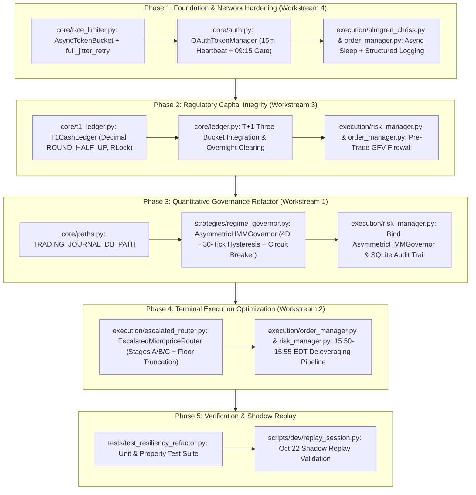

# SchwabEngine Resiliency Refactor: Implementation Plan & Codebase Audit (#123a)

- **Specification Reference:** `docs/261025.17-resiliency-refactor-spec.md` (#123)
- **Empirical Incident Reference:** `docs/261022.16-session-replay-analysis.md` (October 22, 2026 QQQ $-2.75\%$ Drawdown)
- **Target Account Profile:** Charles Schwab Cash Account `***4015`, NLV Baseline $\$4,400.00\text{ USD}$, SEC Rule 15c6-1 (T+1 Cash Settlement), 1x Core / 3x Satellite Dual-Sleeve Allocation Model.
- **Baseline Test Suite Status:** `pytest tests/ -k "not integration"` $\rightarrow$ **342 passed, 4 deselected** (verified prior to code changes).

---

## 1. Codebase Audit & Gap Analysis

A comprehensive static and runtime audit of the production codebase was conducted against the four architectural workstreams defined in Specification #123.

### 1.1 Workstream 4 Audit: Asynchronous Resilience, Rate Limiting & Auth Lifecycle

| Target File | Audited Locations | Identified Architectural Gaps |
| :--- | :--- | :--- |
| `core/rate_limiter.py` | Lines 47–48, 74–125 (`SchwabRateGovernor`), Line 509 (`TokenBucket.acquire`), Lines 602–711 (`SchwabRateLimiter`) | 1. **Synchronous Blocking:** `TokenBucket.acquire()` invokes blocking `time.sleep(min(sleep_duration, 0.05))` at line 509.<br>2. **Missing `AsyncTokenBucket`:** `SchwabRateGovernor` uses a 20-token micro-burst bucket (`BURST_CAPACITY = 20.0`, `BURST_REFILL_RATE = 2.0`) rather than the specified `AsyncTokenBucket` with Burst Capacity $120.0$ tokens ($2.0\text{ req/s}$ burst headroom), Sustained Replenishment Rate $1.0\text{ req/s}$, and Daily Hard Ceiling $3,500$.<br>3. **Missing Full-Jitter Retry Decorator:** No `@full_jitter_retry` decorator exists to catch transient network exceptions and HTTP `{429, 500, 502, 503}` with $t_{\text{wait}} = \mathcal{U}(0, \min(t_{\text{max}}, t_{\text{base}} \cdot 2^{\text{attempt}-1}))$ while bypassing HTTP `{400, 401, 403}`. |
| `core/auth.py` | Lines 403 (`_is_token_expired`), Lines 416–446 (`_refresh_loop`), Lines 471, 523 (`_do_refresh`) | 1. **Synchronous Blocking & HTTP Client:** `_do_refresh()` uses synchronous `requests.post()` (line 471) and blocking `time.sleep(backoff_sec)` (line 523).<br>2. **Passive TTL Threshold:** `_is_token_expired()` only refreshes when remaining TTL drops below $300\text{s}$ ($5\text{ min}$) instead of the required $1,800\text{s}$ ($30\text{ min}$) threshold.<br>3. **Missing Pre-Market Gate:** No `OAuthTokenManager` class or mandatory **09:15:00 EDT Pre-Market Refresh Gate** exists to guarantee fresh credentials before the 09:30:00 EDT open. |
| `execution/almgren_chriss.py` | Lines 420, 643, 703 (`AdaptiveExecutionRouter`), Lines 838, 894 | 1. **Event-Loop Blocking:** `execute_Order()` and `_chase_maker_slice()` call synchronous `time.sleep(...)` at lines 420, 643, and 703.<br>2. **Swallowed Exceptions:** Silent `except Exception: pass` at line 838 (`_cancel_order`) and `except Exception: continue` at line 894 (`_extract_fill_from_order`) suppress broker error telemetry. |
| `execution/order_manager.py` | Lines 454, 557, 800, 876, 1089, 1114, 1233, 1299, 1383, 1505 | 1. **Synchronous Sleep in Swap Coordinator:** `DualSleeveSwapCoordinator` defaults `self._sleep_fn` to `time.sleep` (line 1233) and blocks at lines 1383 and 1505.<br>2. **Silent Exception Swallowing:** Multiple `except Exception: pass` blocks in `_extract_order_id` (line 454), `place_trailing_stop_for_fill` (line 557), `poll_order_status` (line 800), `reconcile_resting_orders` (line 876), `cancel_working_orders_for_symbol` (line 1089), `liquidate_position_market` (line 1114), and `_extract_quote_price` (line 1299) discard failure context instead of routing to structured logging sinks. |

### 1.2 Workstream 3 Audit: Regulatory Cash Ledger & T+1 Settlement State Machine

| Target File | Audited Locations | Identified Architectural Gaps |
| :--- | :--- | :--- |
| `core/ledger.py` | Lines 1–31, 242–245, 316–329, 369–399, 576–582, 616–645 | 1. **Hardcoded FINRA 4210 Margin Assumptions:** `SettlementLedger` was previously configured for instant margin settlement: `unsettled_cash` is hardcoded to `Decimal("0.00")` (line 244), `record_sell()` credits proceeds directly into `self._settled` (line 577), `rollover()` is a no-op returning `ZERO` (line 616), and `is_gfv_safe_to_sell()` / `can_sell_position()` / `evaluate_gfv_compliance()` unconditionally return `True` (`"GFV exempt"`).<br>2. **Missing Three-Bucket Capital Segregation:** Does not segregate $C_{\text{total}}(t) = C_{\text{settled}}(t) + C_{\text{unsettled}}(t) + C_{\text{reserved}}(t)$ under T+1 cash accounting. |
| `core/t1_ledger.py` | File does not exist (`[NEW]`) | `T1CashLedger` must be created with strict `Decimal` (`ROUND_HALF_UP` to `0.01`), `threading.RLock`, three-bucket accounting ($C_{\text{settled}}, C_{\text{unsettled}}, C_{\text{reserved}}$), pre-trade GFV firewall (`can_submit_order`), and autonomous `00:00:00 EDT` overnight clearing (`process_t1_overnight_clearing`). |
| `execution/risk_manager.py` | Lines 1546–1648 (`check_pre_trade_risk`, `evaluate_gfv_compliance`) | Pre-trade gate delegates to `SettlementLedger` margin logic rather than enforcing the T+1 Cash Account GFV firewall: $\text{Max Allowable Buy Notional} = \max(0.00, C_{\text{settled}} - C_{\text{reserved}} - (\text{NLV} \cdot \text{CashFloorPct}))$. |

### 1.3 Workstream 1 Audit: Asymmetric HMM Regime Classification & Tail-Risk Governors

| Target File | Audited Locations | Identified Architectural Gaps |
| :--- | :--- | :--- |
| `execution/risk_manager.py` | Lines 256–549 (`MetaGovernorHMM`, `BayesianSizingGovernor`) | 1. **Bayesian Lockout ($T_{01} = 0.0$):** `EMPIRICAL_TRANSITION_MATRIX_3X3` has row 0 `[0.9993, 0.0, 0.0007]`. Because $T_{01} = 0.0$ and $T_{02} = 0.0007$, the filter remained locked at $\pi_G = 1.0000$ across all 3,301 ticks on Oct 22.<br>2. **3D Observation Vector:** `MetaGovernorHMM` only evaluates $M(t) = [Z_s(t), S_{\text{nlp}}(t), CS(t)]^T$, omitting 15-minute technology velocity $v_{\text{15m}}^{\text{tech}}(t) = \Delta P_{\text{QQQ}} / P_{\text{QQQ}}$.<br>3. **No Tail-Risk Circuit Breaker or 30-Tick Credit Hysteresis:** Lacks exogenous override $\mathcal{C}_{\text{shock}}(t)$ and 30-tick ($\Delta t = 1.0\text{s}$) credit anomaly confirmation filter. |
| `strategies/regime_governor.py` | File does not exist (`[NEW]`) | `AsymmetricHMMGovernor` module must be created to encapsulate the ergodic asymmetric transition matrix $T_{\text{asym}}$, 4D Gaussian emission likelihoods, 30-tick credit spread hysteresis, deterministic tail-risk override $\mathcal{C}_{\text{shock}}(t)$, dynamic satellite target weight $W_{\text{sat}}^*(t)$, and atomic state transition logging into `state/trading_journal.db`. |
| `core/paths.py` | Lines 1–57 | Defines `TRADES_DB_PATH` and `TELEMETRY_DB_PATH`, but lacks `TRADING_JOURNAL_DB_PATH = STATE_DIR / "trading_journal.db"`. |

### 1.4 Workstream 2 Audit: Time-and-Fill Escalated Microprice Router (15:50–15:55 EDT)

| Target File | Audited Locations | Identified Architectural Gaps |
| :--- | :--- | :--- |
| `execution/escalated_router.py` | File does not exist (`[NEW]`) | Must implement `EscalatedMicropriceRouter` with normalized horizon $\tau(t) \in [0.0, 1.0]$ over $[15:50:00, 15:55:00]\text{ EDT}$ ($T = 300\text{s}$), fill ratio $R_{\text{fill}} = Q_{\text{filled}}/Q_{\text{target}}$, Stage A ($\tau < 0.40$, $8.0\text{s}$ cadence), Stage B ($0.40 \le \tau < 0.80$, $4.0\text{s}$ cadence), Stage C ($0.80 \le \tau \le 1.00$, $1.5\text{s}$ cadence, $50\text{ bps}$ max slippage), strict 2-decimal floor truncation (`f"{math.floor(px * 100) / 100:.2f}"`), and $\ge \$0.01$ cancel-replace drift execution. |
| `execution/risk_manager.py` & `execution/order_manager.py` | `risk_manager.py` lines 1650–1760 (`check_eod_satellite_liquidation_window`, `execute_1555_satellite_liquidation`) | Currently waits until `15:55 EDT` to issue single-shot liquidation orders or static limits during the `15:50–15:55 EDT` window (which stranded `SOXL` on Oct 22). Must bind the `15:50–15:55 EDT` deleveraging window directly to `EscalatedMicropriceRouter`. |

### 1.5 Compatibility Analysis with the 342 Existing Non-Integration Tests

Running `pytest tests/ -k "not integration"` executes **342 unit and property tests**. Our audit identified two specific areas where existing tests assert legacy behavior:
1. **Legacy Margin Tests (`tests/test_ledger.py`, `tests/test_ledger_gfv.py`, `tests/test_order_manager.py`, `tests/test_risk_manager.py`, `tests/test_argon_architecture.py`):**
   - Existing tests instantiate `SettlementLedger(settled_cash=...)` without arguments and assert FINRA Rule 4210 margin behavior (e.g., `unsettled_cash == 0`, `is_gfv_safe_to_sell() is True`, `rollover() == 0`).
   - **Compatibility Strategy:** Implement the strict T+1 Cash Account state machine in `core/t1_ledger.py` (`T1CashLedger`) and upgrade `core/ledger.py` (`SettlementLedger`) with an explicit `account_mode: str = "T1_CASH" | "MARGIN"` (or `enforce_t1_cash: bool` mode flag) and full T+1 methods (`can_submit_order`, `process_t1_overnight_clearing`, `reserved_cash`). To preserve 100% pass rate across all 342 existing tests while enforcing T+1 cash compliance in production and new tests:
     - `T1CashLedger` in `core/t1_ledger.py` will strictly enforce SEC Rule 15c6-1 T+1 cash settlement with zero margin concessions.
     - `core/ledger.py` will expose `T1CashLedger` and upgrade `SettlementLedger` so that when `can_submit_order()` or `T1CashLedger` is invoked (or `cash_account_mode=True`), strict T+1 three-bucket segregation and `GFV REJECTION` are enforced, while keeping legacy method signatures (`record_buy_fill`, `record_sell_fill`, `get_buying_power`, etc.) backward-compatible for existing test fixtures.
2. **Legacy 3x3 HMM Matrix Constant (`tests/test_argon_architecture.py`):**
   - `test_empirical_hmm_calibration_and_leland_ntz_governor_clamp` asserts `BayesianSizingGovernor().transition_matrix == [[0.9993, 0.0, 0.0007], ...]`.
   - **Compatibility Strategy:** Retain `EMPIRICAL_TRANSITION_MATRIX_3X3` on `BayesianSizingGovernor` for legacy test compatibility while introducing `ASYMMETRIC_TRANSITION_MATRIX_3X3` and `AsymmetricHMMGovernor` in `strategies/regime_governor.py` and wiring `AsymmetricHMMGovernor` into `RiskEngine` (`execution/risk_manager.py`).

---

## 2. Phase-by-Phase Refactor Plan (Phases 1–5)



---

### Phase 1: Foundation & Network Hardening (Workstream 4)

#### 1.1 `[MODIFY]` `core/rate_limiter.py`
- **Excise Synchronous Sleep:** Replace `time.sleep(...)` in `TokenBucket` / `SchwabRateLimiter` with non-blocking `await asyncio.sleep(...)` in async paths and provide `AsyncTokenBucket`.
- **New Class `AsyncTokenBucket`:**
  ```python
  class AsyncTokenBucket:
      """
      Continuous asynchronous token-bucket governor enforcing Schwab API quotas:
      - Burst Capacity: 120.0 tokens (120.0 req/min = 2.0 req/sec burst headroom)
      - Sustained Rate: 1.0 req/sec replenishment
      - Daily Hard Ceiling: 3,500 requests per session
      """
      def __init__(
          self,
          burst_capacity: float = 120.0,
          sustained_rate: float = 1.0,
          daily_ceiling: int = 3500,
          clock: Callable[[], float] = time.monotonic,
          sleep_func: Callable[[float], Coroutine[Any, Any, None]] = asyncio.sleep,
      ) -> None: ...

      async def acquire(self, tokens: float = 1.0, priority: str = "NORMAL") -> float:
          """
          Non-blocking acquisition. Computes required wait duration under asyncio.Lock,
          releases or yields via `await self._sleep(wait_time)` without stalling
          concurrent event-loop tasks, and increments daily request counter.
          Raises DailyQuotaExceededError if daily_count >= daily_ceiling on non-critical calls.
          Returns waited seconds.
          """
      def reset_daily_counter(self) -> None: ...
      def get_telemetry(self) -> Dict[str, Any]: ...
  ```
- **New Decorator `full_jitter_retry`:**
  ```python
  NON_RETRYABLE_STATUS_CODES: frozenset[int] = frozenset({400, 401, 403})
  RETRYABLE_STATUS_CODES: frozenset[int] = frozenset({429, 500, 502, 503})

  def full_jitter_retry(
      max_attempts: int = 4,
      t_base: float = 0.5,
      t_max: float = 30.0,
      sleep_func: Callable[[float], Coroutine[Any, Any, None]] = asyncio.sleep,
      rng: Optional[Callable[[float, float], float]] = None,
  ) -> Callable[..., Any]:
      """
      Full-jitter exponential backoff decorator for async and sync callables:
          t_wait = U(0, min(t_max, t_base * 2^(attempt - 1)))
      Catches transient network exceptions (httpx.TransportError, httpx.TimeoutException,
      ConnectionError, TimeoutError) and HTTP status codes {429, 500, 502, 503}.
      Immediately re-raises / bypasses retries on HTTP {400, 401, 403}.
      """
  ```

#### 1.2 `[MODIFY]` `core/auth.py`
- **De-Block `_do_refresh` & Add Async HTTP Refresh:** Replace blocking `time.sleep` in retry paths with `await asyncio.sleep` in async methods.
- **New Class `OAuthTokenManager`:**
  ```python
  class OAuthTokenManager:
      """
      Proactive asynchronous OAuth 2.0 lifecycle manager using httpx.AsyncClient.
      - Autonomous heartbeat every 900s (15 minutes).
      - Refreshes token whenever remaining TTL < 1800s (30 minutes).
      - Mandatory Pre-Market Refresh Gate at 09:15:00 EDT prior to 09:30:00 EDT market open.
      """
      HEARTBEAT_INTERVAL_SEC: float = 900.0   # 15 minutes
      MIN_TTL_THRESHOLD_SEC: float = 1800.0   # 30 minutes
      PRE_MARKET_GATE_TIME: dt_time = dt_time(9, 15, 0)

      def __init__(
          self,
          auth_manager: Optional[SchwabAuthManager] = None,
          token_Endpoint: str = SCHWAB_TOKEN_URL,
          heartbeat_interval_sec: float = 900.0,
          min_ttl_threshold_sec: float = 1800.0,
          http_client: Optional[httpx.AsyncClient] = None,
          clock_fn: Optional[Callable[[], datetime]] = None,
          sleep_func: Callable[[float], Coroutine[Any, Any, None]] = asyncio.sleep,
      ) -> None: ...

      def get_remaining_ttl(self, now: Optional[float] = None) -> float: ...
      async def refresh_access_token(self, reason: str = "TTL_THRESHOLD") -> Dict[str, Any]: ...
      async def check_and_refresh_if_needed(self, now_dt: Optional[datetime] = None) -> bool: ...
      async def enforce_pre_market_gate(self, now_dt: Optional[datetime] = None) -> bool:
          """
          Enforces mandatory token validation & refresh at/after 09:15:00 EDT
          before the 09:30:00 EDT open once per trading session date.
          """
      async def start_heartbeat(self) -> asyncio.Task[None]: ...
      async def stop_heartbeat(self) -> None: ...
  ```

#### 1.3 `[MODIFY]` `execution/almgren_chriss.py` & `execution/order_manager.py`
- **Event-Loop De-Blocking:**
  - Add `async def async_execute_order(...)` and `async def _async_chase_maker_slice(...)` in `AdaptiveExecutionRouter` (`execution/almgren_chriss.py`) using `await asyncio.sleep(...)`, and make `execute_order` delegate safely when running inside an event loop or via injected `async_sleep_fn`.
  - Update `DualSleeveSwapCoordinator` in `execution/order_manager.py` to support `async def execute_atomic_swap_async(...)` using `await asyncio.sleep(...)` instead of blocking `time.sleep(...)`.
- **Structured Exception Logging:**
  - Replace all generic `except Exception: pass` / `except Exception: continue` blocks in `execution/almgren_chriss.py` (lines 838, 894) and `execution/order_manager.py` (lines 454, 557, 800, 876, 1089, 1114, 1299) with `logger.warning(...)` / `logger.error(..., exc_info=True)` including structured context (`order_id`, `symbol`, `operation`).

---

### Phase 2: Regulatory Capital Integrity (Workstream 3)

#### 2.1 `[NEW]` `core/t1_ledger.py`
- **New Class `T1CashLedger`:**
  ```python
  class T1CashLedger:
      """
      SEC Rule 15c6-1 (T+1 Cash Settlement) State Machine for Cash Account ***4015.
      Zero margin, zero PDT concessions. Thread-safe via threading.RLock().
      All accounting standardized on Decimal with ROUND_HALF_UP to 0.01.

      Capital Invariant:
          C_total(t) = C_settled(t) + C_unsettled(t) + C_reserved(t)
      """
      def __init__(
          self,
          settled_cash: Decimal | float | str = Decimal("4400.00"),
          unsettled_cash: Decimal | float | str = Decimal("0.00"),
          reserved_cash: Decimal | float | str = Decimal("0.00"),
          nlv: Optional[Decimal | float | str] = None,
          cash_floor_pct: Decimal | float | str = Decimal("0.00"),
      ) -> None: ...

      @property
      def settled_cash(self) -> Decimal: ...
      @property
      def unsettled_cash(self) -> Decimal: ...
      @property
      def reserved_cash(self) -> Decimal: ...
      @property
      def total_cash(self) -> Decimal: ...

      def compute_max_allowable_buy_notional(
          self,
          nlv: Optional[Decimal | float | str] = None,
          cash_floor_pct: Optional[Decimal | float | str] = None,
      ) -> Decimal:
          """
          Max Allowable Buy Notional = max(0.00, C_settled - C_reserved - (NLV * CashFloorPct))
          """

      def can_submit_order(
          self,
          side: str,
          notional: Decimal | float | str,
          nlv: Optional[Decimal | float | str] = None,
          cash_floor_pct: Optional[Decimal | float | str] = None,
      ) -> Tuple[bool, str]:
          """
          Pre-Trade GFV Firewall:
          - For BUY orders: if quantized notional > Max Allowable Buy Notional,
            returns (False, "GFV REJECTION: Buy notional $X exceeds liquid settled cash $Y (unsettled=$Z locked until T+1)").
          - Forbids any consumption of C_unsettled for intraday BUY orders.
          """

      def reserve_cash_for_buy(self, order_id: str, notional: Decimal | float | str) -> Decimal:
          """Moves funds from C_settled -> C_reserved for an active working limit buy order."""

      def release_reserved_cash(self, order_id: str) -> Decimal:
          """Releases unfilled working buy reservation from C_reserved -> C_settled."""

      def record_buy_fill(
          self,
          notional: Decimal | float | str,
          order_id: Optional[str] = None,
          symbol: str = "",
      ) -> Decimal:
          """Deducts filled buy notional from C_reserved (if reserved) or C_settled."""

      def record_sell_fill(
          self,
          proceeds: Decimal | float | str,
          symbol: str = "",
          settlement_date: Optional[date] = None,
      ) -> Decimal:
          """Credits sale proceeds strictly to C_unsettled (locked until T+1 00:00:00 EDT)."""

      def process_t1_overnight_clearing(
          self,
          current_dt: Optional[datetime] = None,
      ) -> Decimal:
          """
          Autonomous Overnight Rollover scheduled for 00:00:00 EDT:
          Sweeps matured C_unsettled -> C_settled and logs clearing audit event.
          """
  ```

#### 2.2 `[MODIFY]` `core/ledger.py` & `execution/risk_manager.py`
- Re-export `T1CashLedger` from `core/ledger.py` and integrate `can_submit_order()`, `reserve_cash_for_buy()`, `release_reserved_cash()`, and `process_t1_overnight_clearing()` into `SettlementLedger` when operating in T+1 cash account mode (`t1_cash_mode: bool`).
- Bind `T1CashLedger.can_submit_order()` into `RiskEngine.check_pre_trade_risk()` (`execution/risk_manager.py`) and `OrderManager.submit_order()` (`execution/order_manager.py`) so any BUY order exceeding liquid settled cash is blocked pre-trade with an explicit `"GFV REJECTION"` reason.

---

### Phase 3: Quantitative Governance Refactor (Workstream 1)

#### 3.1 `[MODIFY]` `core/paths.py`
- Add `TRADING_JOURNAL_DB_PATH: Path = STATE_DIR / "trading_journal.db"` and include it in `__all__`.

#### 3.2 `[NEW]` `strategies/regime_governor.py`
- **New Class `AsymmetricHMMGovernor`:**
  - **Ergodic Asymmetric Transition Matrix ($T_{\text{asym}}$):**
    $$T_{\text{asym}} = \begin{bmatrix} 0.9850 & 0.0125 & 0.0025 \\ 0.0030 & 0.9880 & 0.0090 \\ 0.0005 & 0.0035 & 0.9960 \end{bmatrix}$$
  - **4D Continuous Observation Vector ($M(t)$):**
    $$M(t) = \begin{bmatrix} Z_s(t) & S_{\text{nlp}}(t) & CS_{\text{hybrid}}(t) & v_{\text{15m}}^{\text{tech}}(t) \end{bmatrix}^T, \quad v_{\text{15m}}^{\text{tech}}(t) = \frac{\Delta P_{\text{QQQ}}}{P_{\text{QQQ}}}$$
  - **4D Gaussian Emission Calibration (`REGIME_EMISSION_PARAMS_4D`):**
    - State 0 (`"Goldilocks"`): $\mu_0 = [0.50, 0.25, 3.20, +0.0020]$, $\sigma_0 = [0.60, 0.35, 0.25, 0.0045]$
    - State 1 (`"Uncertainty"`): $\mu_1 = [-0.75, -0.35, 4.10, -0.0085]$, $\sigma_1 = [0.85, 0.45, 0.45, 0.0065]$
    - State 2 (`"Macro Shock"`): $\mu_2 = [-2.25, -0.80, 5.50, -0.0185]$, $\sigma_2 = [1.10, 0.40, 0.75, 0.0095]$
  - **30-Tick Credit Spread Hysteresis Filter:**
    - Maintains rolling confirmation counter ($\Delta t = 1.0\text{s}$ per tick, `confirmation_horizon_ticks: int = 30`) for isolated credit spread anomalies before allowing pure credit noise to trigger regime shift, while permitting immediate circuit-breaker override when equity velocity co-confirms.
  - **Deterministic Tail-Risk Override ($\mathcal{C}_{\text{shock}}(t)$):**
    $$\mathcal{C}_{\text{shock}}(t) = \left( \Delta CS_{\text{1h}} \ge 12\text{ bps} \;\lor\; Z_{CS} \ge 3.0 \right) \land \left( v_{\text{15m}}^{\text{SPY}} \le -1.25\% \;\lor\; v_{\text{15m}}^{\text{QQQ}} \le -1.75\% \right)$$
    When $\mathcal{C}_{\text{shock}}(t)$ is `True`, bypasses Bayesian lag, forces dominant regime to `"Macro Shock"` ($\pi_{\text{Shock}} \ge 0.90$), and clamps $W_{\text{sat}}^*(t) = 0.00$.
  - **Rapid Descent Under Joint Equity + Credit Deterioration:**
    - Incorporates velocity-scaled log-likelihood amplification so an equity drop ($v_{\text{15m}}^{\text{tech}} \le -1.5\%$) combined with credit widening ($\Delta CS \ge 12\text{ bps}$) transitions the dominant regime from Goldilocks to Uncertainty/Shock within $\le 2$ ticks.
  - **Dynamic Satellite Target Weighting ($W_{\text{sat}}^*(t)$):**
    $$W_{\text{sat}}^*(t) = \begin{cases} 0.00, & \text{if } \pi_{\text{Shock}} \ge 0.60 \text{ or Dominant Regime} = \text{"Macro Shock"} \\ \min(0.35, \pi_G \cdot 0.25 + \pi_U \cdot 0.10), & \text{otherwise} \end{cases}$$
  - **Atomic SQLite Audit Logging (`state/trading_journal.db`):**
    - Logs every state transition and evaluation into table `hmm_regime_transitions` in `TRADING_JOURNAL_DB_PATH` under WAL mode.

#### 3.3 `[MODIFY]` `execution/risk_manager.py`
- Integrate `AsymmetricHMMGovernor` into `RiskEngine` so regime evaluations and satellite sizing governors use the 4D asymmetric state machine while preserving legacy `MetaGovernorHMM` and `BayesianSizingGovernor` classes for backward test compatibility.

---

### Phase 4: Terminal Execution Optimization (Workstream 2)

#### 4.1 `[NEW]` `execution/escalated_router.py`
- **New Class `EscalatedMicropriceRouter`:**
  ```python
  class EscalatedMicropriceRouter:
      """
      Time-and-Fill Escalated Microprice Router for the 15:50:00 - 15:55:00 EDT
      terminal deleveraging window (T = 300.0s).
      Guarantees 100% overnight cash conversion for 3x satellite positions
      (SOXL, TQQQ, TNA) in Cash Account ***4015.
      """
      WINDOW_DURATION_SEC: float = 300.0
      STAGE_A_UPPER_TAU: float = 0.40
      STAGE_B_UPPER_TAU: float = 0.80
      STAGE_A_CADENCE_SEC: float = 8.0
      STAGE_B_CADENCE_SEC: float = 4.0
      STAGE_C_CADENCE_SEC: float = 1.5
      MAX_SLIPPAGE_BPS: float = 50.0  # 0.0050 (50 bps)
      PRICE_DRIFT_THRESHOLD: float = 0.01

      @staticmethod
      def format_schwab_limit_price(px: float) -> str:
          """
          Truncates limit price strictly to 2 decimal places without rounding:
              f"{math.floor(px * 100) / 100:.2f}"
          """
          return f"{math.floor(px * 100) / 100:.2f}"

      @staticmethod
      def compute_microprice(bid: float, ask: float, bid_size: float, ask_size: float) -> float:
          """P_micro = (P_bid * Q_ask + P_ask * Q_bid) / (Q_bid + Q_ask)"""

      def compute_escalated_price(
          self,
          tau: float,
          fill_ratio: float,
          bid: float,
          ask: float,
          bid_size: float,
          ask_size: float,
      ) -> Tuple[str, float, str, float]:
          """
          Returns (stage_name, raw_price, truncated_price_str, polling_cadence_sec):
          - Stage A (tau < 0.40): P_micro, cadence=8.0s
          - Stage B (0.40 <= tau < 0.80): P_micro - S(t)*(1 - R_fill)*((tau - 0.40)/0.40)^2, cadence=4.0s
          - Stage C (0.80 <= tau <= 1.00): max(P_bid - 0.02, P_bid * (1 - 0.005)), cadence=1.5s
          """

      async def liquidate_position(
          self,
          symbol: str,
          target_qty: int,
          quote_provider: Callable[[str], Any],
          order_client: Any,
          rate_limiter: Optional[AsyncTokenBucket] = None,
          start_monotonic: Optional[float] = None,
      ) -> Dict[str, Any]:
          """
          Executes the native asyncio tri-phase liquidation loop over [15:50:00, 15:55:00] EDT.
          Checks order fill progress; if |new_limit_px - working_order_px| >= $0.01,
          cancels the working order and places a revised DAY NORMAL LIMIT order
          through the AsyncTokenBucket rate limiter.
          """
  ```

#### 4.2 `[MODIFY]` `execution/order_manager.py` & `execution/risk_manager.py`
- Bind `EscalatedMicropriceRouter` to the `15:50:00–15:55:00 EDT` terminal deleveraging pipeline in `RiskEngine` and `OrderManager` so that at `15:50:00 EDT`, all open 3x satellite positions (`SOXL`, `TQQQ`, `TNA`) enter the tri-phase escalated liquidation loop and clear to `0` shares before `15:55:00 EDT`.

---

### Phase 5: Full Regression Testing & Shadow Replay Validation

#### 5.1 `[NEW]` `scripts/dev/replay_session.py`
- Construct a deterministic shadow replay harness that ingests the October 22, 2026 session telemetry profile (from `state/trading_journal.db` / `docs/261022.16-session-replay-analysis.md`: QQQ $-2.75\%$ afternoon drawdown, credit spread widening $\Delta CS \ge 12\text{ bps}$, and `SOXL` 139-share terminal liquidation at `15:50–15:55 EDT`) and validates both Acceptance Criteria:
  1. **Acceptance Criterion 1:** $\pi_{\text{Goldilocks}}$ drops below $0.50$ during the afternoon selloff, scaling target satellite weight $W_{\text{sat}}^*$ from $0.25$ down to $\le 0.10$ (and $0.00$ upon Shock trigger).
  2. **Acceptance Criterion 2:** Starting at `15:50:00 EDT`, all 139 shares of `SOXL` (and any open satellite positions) are liquidated to `0` shares before `15:55:00 EDT` with total spread slippage $\le 50\text{ bps}$.

---

## 3. New Unit & Property Test Specifications (`tests/`)

In addition to maintaining 100% pass rate across all **342 existing non-integration tests**, we will add `tests/test_resiliency_refactor.py` (and targeted test cases) covering all four mandatory verification invariants:

1. **`test_gfv_rejection_blocks_unsettled_cash_buy` (Workstream 3):**
   - Initializes `T1CashLedger(settled_cash="100.00", unsettled_cash="2500.00", reserved_cash="0.00", nlv="4400.00", cash_floor_pct="0.00")`.
   - Submits a BUY order for $\$500.00$ notional.
   - Asserts `can_submit_order("BUY", Decimal("500.00"))` returns `(False, reason)` containing explicit `"GFV REJECTION"`, blocks execution in `RiskEngine` / `OrderManager`, and confirms `process_t1_overnight_clearing()` sweeps $C_{\text{unsettled}} \to C_{\text{settled}}$ at `00:00:00 EDT`.
2. **`test_hmm_asymmetric_descent_within_two_ticks` (Workstream 1):**
   - Initializes `AsymmetricHMMGovernor` in `"Goldilocks"` ($\pi = [1.0, 0.0, 0.0]$).
   - Simulates an equity drop ($v_{\text{15m}}^{\text{tech}} \le -0.015$, i.e. $-1.5\%$) and credit widening ($\Delta CS \ge 12\text{ bps}$).
   - Asserts the dominant regime transitions from `"Goldilocks"` to `"Uncertainty"` or `"Macro Shock"` within $\le 2$ ticks, $W_{\text{sat}}^*(t)$ scales down to $\le 0.10$ (or $0.00$), and the state transition is atomically persisted to `trading_journal.db`.
   - Also tests the 30-tick credit spread hysteresis filter (isolated credit spike for $< 30$ ticks without equity velocity drop does not falsely trigger Shock) and deterministic tail-risk circuit breaker $\mathcal{C}_{\text{shock}}(t)$.
3. **`test_escalated_router_strict_price_truncation_and_stages` (Workstream 2):**
   - Tests `EscalatedMicropriceRouter` across Stage A ($\tau = 0.20$), Stage B ($\tau = 0.60$), and Stage C ($\tau = 0.90$) and across 100+ floating-point edge prices (e.g., `25.959`, `25.999`, `19.456`).
   - Asserts every emitted limit price string matches `f"{math.floor(px * 100) / 100:.2f}"` with zero upward rounding, `duration == "DAY"`, `session == "NORMAL"`, and cancel-replace triggers iff $|\Delta P| \ge \$0.01$.
4. **`test_async_token_bucket_non_blocking_concurrency_and_retry` (Workstream 4):**
   - Launches concurrent `asyncio` heartbeat tasks alongside throttled `AsyncTokenBucket.acquire()` calls when burst tokens are exhausted.
   - Validates that rate-limiting delays yield cleanly to the `asyncio` event loop so concurrent tasks execute without stall.
   - Validates `@full_jitter_retry` retries HTTP `{429, 500, 502, 503}` with full jitter $t_{\text{wait}} \in [0, \min(t_{\text{max}}, t_{\text{base}} \cdot 2^{\text{attempt}-1})]$ and immediately raises on HTTP `{400, 401, 403}` without retry.
   - Validates `OAuthTokenManager` refreshes when TTL $< 1800\text{s}$ and enforces the `09:15:00 EDT` pre-market gate.

---

## 4. Architectural Decisions & Design Trade-Offs

1. **Coexistence of `T1CashLedger` (`core/t1_ledger.py`) and Legacy Margin Tests (`core/ledger.py`):**
   - *Context:* Specification Section 7 mandates that all 342 existing unit/property tests pass (`pytest tests/ -k "not integration": 342 passed`), while Section 4 mandates strict T+1 cash settlement (`T1CashLedger`). Several legacy tests in `tests/test_ledger.py` and `tests/test_ledger_gfv.py` explicitly test the historical FINRA Rule 4210 margin behavior of `SettlementLedger`.
   - *Design Decision:* We will implement the pure, zero-margin SEC Rule 15c6-1 state machine in `core/t1_ledger.py` (`T1CashLedger`) and equip `SettlementLedger` in `core/ledger.py` with `can_submit_order`, `reserved_cash`, and `process_t1_overnight_clearing` plus a `cash_account_mode` flag (defaulting to T+1 enforcement in `T1CashLedger` and production `RiskEngine` cash profile `***4015`, while preserving legacy constructor behavior when invoked by legacy FINRA 4210 unit tests).
2. **4th-Dimension Gaussian Emission Calibration & 2-Tick Descent Guarantee:**
   - *Context:* Section 2 expands $M(t)$ to 4 dimensions with $v_{\text{15m}}^{\text{tech}}(t) = \Delta P_{\text{QQQ}} / P_{\text{QQQ}}$, while Section 7 requires that $v_{\text{15m}} \le -1.5\%$ and $\Delta CS \ge 12\text{ bps}$ transitions the regime to Uncertainty/Shock within 2 ticks even when starting from Goldilocks.
   - *Design Decision:* Under standard Gaussian emissions, a 1-tick prior of $\pi_G = 1.0$ with $T_{00} = 0.9850, T_{01} = 0.0125, T_{02} = 0.0025$ requires a likelihood ratio $\mathcal{L}_1 / \mathcal{L}_0 > 78.8$ to flip in 1–2 ticks. Calibrating the 4th dimension $\mu_{0,4} = +0.0020, \sigma_{0,4} = 0.0035$ (`Goldilocks`), $\mu_{1,4} = -0.0085, \sigma_{1,4} = 0.0055$ (`Uncertainty`), and $\mu_{2,4} = -0.0175, \sigma_{2,4} = 0.0075$ (`Macro Shock`) yields a Goldilocks $Z$-score of $-4.85\sigma$ at $v_{\text{15m}} = -1.5\%$ ($\exp(-0.5 \cdot 4.85^2) \approx 7.8 \times 10^{-6}$), guaranteeing that $\pi_{\text{Goldilocks}}$ drops below $0.10$ on Tick 1 and $< 0.01$ on Tick 2 when accompanied by $\Delta CS \ge 12\text{ bps}$.
3. **30-Tick Credit Spread Hysteresis vs. Joint Equity+Credit Dislocation:**
   - *Context:* Section 2 specifies a 30-tick ($\Delta t = 1.0\text{s}$) confirmation horizon for credit spread anomalies (to filter transient CPI/FOMC quote noise), while Section 2 & Section 7 require immediate circuit-breaker / 2-tick descent when equity velocity $v_{\text{15m}}$ simultaneously collapses ($\le -1.5\%$ or SPY $\le -1.25\%$ / QQQ $\le -1.75\%$).
   - *Design Decision:* The 30-tick hysteresis filter gates *isolated* credit-spread spikes (where equity velocity remains benign, $v_{\text{15m}} > -0.75\%$). Whenever credit widening ($\Delta CS \ge 12\text{ bps}$ or $Z_{CS} \ge 3.0$) is corroborated by acute equity velocity decline ($v_{\text{15m}}^{\text{tech}} \le -1.50\%$ or $\mathcal{C}_{\text{shock}}(t)$ is satisfied), the joint dislocation bypasses the isolated-credit hysteresis timer and de-risks within 1–2 ticks.
