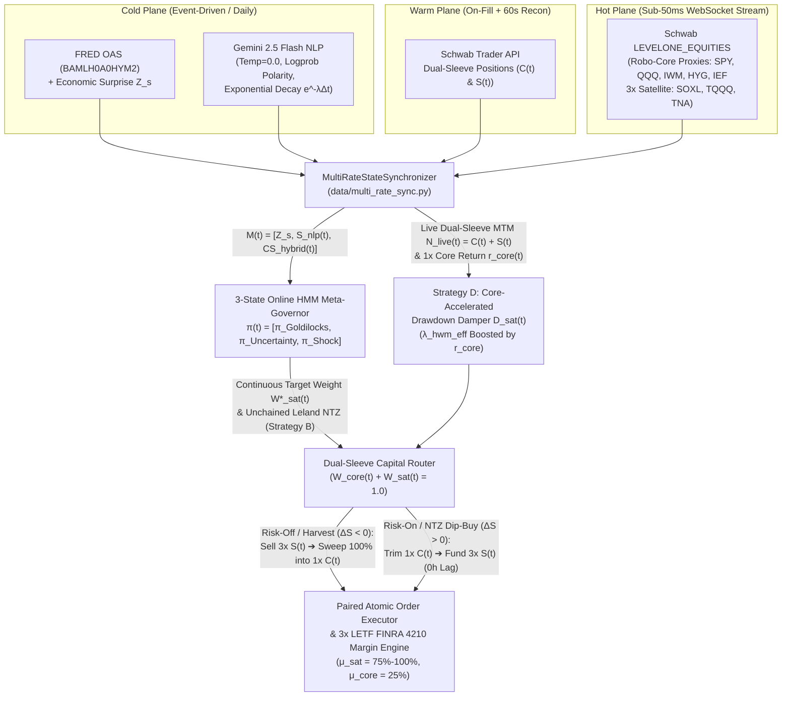

# Implementation Plan: Dual-Sleeve Robo-Core Routing & Argon Architecture (#87 / #88)

## Goal Description

This plan executes the **Dual-Sleeve Robo-Core Routing (#88)** architectural pivot alongside the **Argon Analysis (#87)** quantitative upgrades across the live Python execution/risk codebase, the canonical mathematical whitepaper ([SchwabEngine Mathematical Architecture.md](file:///c:/Projects/schwab_engine/SchwabEngine%20Mathematical%20Architecture.md)), and the asynchronous telemetry pipeline ([generate_mock_stream.py](file:///c:/Projects/schwab_engine/generate_mock_stream.py) / [schwab_telemetry_micro_sequence.json](file:///c:/Projects/schwab_engine/schwab_telemetry_micro_sequence.json)):

1. **Complete Deprecation of PDT & T+1 Settlement Middleware:**
   - Strip out all Pattern Day Trader (`TIER_0`, `TIER_1_PRE_PDT_GROWTH`, `TIER_2`) equity gates, round-trip counters, and T+1 settled-cash / Good Faith Violation (GFV) throttling locks. The account operates with **zero same-day trading or turnover restrictions**.
   - Make all sizing and rebalancing **100% scale-invariant** (purely fractional of Net Liquidation Value $N(t)$, seamlessly scaling from a $\$5\text{k}\text{--}\$20\text{k}$ starting base to $\$100\text{k+}$ without hardcoded dollar ceilings like $\$1,836$ or $\$990$).
   - Enforce **FINRA Rule 4210(f)(8)(A) $3\times$ LETF House Maintenance Margin** ($75\%\text{--}100\%$ maintenance requirement $\mu_{\mathrm{sat}, j} \in [0.75, 1.00]$ on `SOXL`, `TQQQ`, and `TNA` vs. $\mu_{\mathrm{core}, i} = 0.25\text{--}0.30$ on the $1\times$ Robo-Core sleeve) and a **Two-Stage EOD De-Levering** schedule (`15:50 ET` primary regular-close trim + `19:45 ET` extended-hours backstop).
   - **Unchain Strategy B (Leland No-Trade Zone Rebalancer):** Permit continuous, unrestricted two-way rebalancing at the edges of the Leland No-Trade Zone ($w^*(t) \pm \tau_{\mathrm{band}}$) with zero T+1 settlement lag.

2. **Dual-Sleeve Robo-Core Capital Routing (Zero Cash Drag):**
   - Eliminate idle cash drag ($M(t) \to \epsilon_{\mathrm{buf}}$, a minimal frictional margin buffer) by establishing a strict **Dual-Sleeve Capital Conservation Law** between the $3\times$ Tactical Satellite sleeve $\mathbf{S}(t)$ and the passive $1\times$ beta **Schwab Robo-Core** sleeve $\mathbf{C}(t)$:
     $$W_{\mathrm{core}}(t) + W_{\mathrm{sat}}(t) = 1, \qquad d\big(\|\mathbf{C}(t)\|_1\big) = r_{\mathrm{core}}(t)\|\mathbf{C}(t)\|_1\,dt - d\big(\|\mathbf{S}(t)\|_1\big) - \phi \cdot \big|d\big(\|\mathbf{S}(t)\|_1\big)\big|$$
   - When the **3-State Online HMM Meta-Governor** ($\boldsymbol{\pi}(t) = [\pi_{\mathrm{Goldilocks}}, \pi_{\mathrm{Uncertainty}}, \pi_{\mathrm{Shock}}]^\top$) shifts probability mass toward `Uncertainty` or `Macro Shock` and reduces target satellite exposure $W_{\mathrm{sat}}(t)$, `RiskEngine` immediately routes **paired Dual-Sleeve Swap Orders**: liquidating the excess $3\times$ LETF delta $\Delta \mathbf{S}(t) < 0$ and instantaneously sweeping $100\%$ of the freed notional into the $1\times$ Robo-Core basket $\mathbf{C}(t)$ ($\Delta \mathbf{C}(t) = -\Delta \mathbf{S}(t)(1 - \phi)$).
   - Conversely, when the HMM transitions back toward `Goldilocks` or when Strategy B hits the lower Leland NTZ boundary ($w(t) \le w^*(t) - \tau_{\mathrm{band}}$), `RiskEngine` executes a reverse paired swap—trimming the $1\times$ Robo-Core $\mathbf{C}(t)$ (or utilizing instantaneous margin-bridge buying power while the Core sell leg fills) to fund the $3\times$ Satellite expansion with **zero settlement delay**.

3. **Core-Accelerated Drawdown Recovery (Strategy D):**
   - Because de-risked satellite capital is swept into the $1\times$ beta Robo-Core $\mathbf{C}(t)$ rather than sitting in low-yield cash, the positive compounding return $r_{\mathrm{core}}(t) = \frac{dC(t)}{C(t)}$ earned on the swept capital **actively accelerates the decay of the satellite high-water mark** $E_{\mathrm{sat, peak}}(t)$:
     $$\lambda_{\mathrm{hwm}}^{\mathrm{eff}}(t) = \lambda_0 + \kappa_{\mathrm{core}} \cdot \max\big(0, \, r_{\mathrm{core}}(t)\big) \cdot \left(\frac{W_{\mathrm{sat, max}} - W_{\mathrm{sat}}(t)}{W_{\mathrm{sat, max}}}\right)$$
   - Simultaneously, the realized/unrealized beta gains generated by the swept capital inside $\mathbf{C}(t)$ are credited to the satellite sleeve's **Virtual Recovery Equity** $E_{\mathrm{sat}}^{\mathrm{rec}}(t)$, allowing the Strategy D drawdown damper $D_{\mathrm{sat}}(t)$ to organically heal and re-deploy into $3\times$ LETFs significantly faster after a macro shock.

---

## User Review Required

> [!IMPORTANT]
> **Key Structural Pivots in #88:**
> 1. **Zero PDT / Zero T+1 Restrictions:** [execution/sizing_governor.py](file:///c:/Projects/schwab_engine/execution/sizing_governor.py) and [execution/risk_manager.py](file:///c:/Projects/schwab_engine/execution/risk_manager.py) are freed from T+1 settled-cash gating and PDT tiering (`instantaneous_reallocation_permitted = True` is permanently active across all account sizes from $\$5\text{k}$ to $\$100\text{k+}$).
> 2. **Paired Dual-Sleeve Order Generation:** `RiskEngine.plan_dual_sleeve_reallocation()` emits synchronized `[SELL_SATELLITE -> BUY_ROBO_CORE]` (on de-risking / harvesting) or `[SELL_ROBO_CORE -> BUY_SATELLITE]` (on risk-on / dip-rebalancing) order pairs, accounting for the differential FINRA 4210 maintenance margin between $3\times$ LETFs ($\mu_{\mathrm{sat}} \in [0.75, 1.00]$) and the $1\times$ Robo-Core ($\mu_{\mathrm{core}} = 0.25$).
> 3. **Legacy Test Suite Compatibility:** Existing unit tests in [tests/test_risk_manager.py](file:///c:/Projects/schwab_engine/tests/test_risk_manager.py) and [tests/test_sizing_governor.py](file:///c:/Projects/schwab_engine/tests/test_sizing_governor.py) will continue to pass via clean default parameterization while [tests/test_argon_architecture.py](file:///c:/Projects/schwab_engine/tests/test_argon_architecture.py) validates the full Dual-Sleeve Robo-Core routing, $3\times$ LETF margin, unchained Leland NTZ, and Core-Accelerated Strategy D recovery.

---

## System Architecture & Dual-Sleeve Routing Diagram



---

## Mathematical Formulation Updates (`SchwabEngine Mathematical Architecture.md`)

### 1. Continuous 3-State HMM Meta-Governor ($\boldsymbol{\pi}(t)$)
Instead of a memoryless boolean classifier that thrashes at $Z_s = 0$, the Meta-Governor maintains a filtered probability vector $\boldsymbol{\pi}(t) = [\pi_G(t), \pi_U(t), \pi_S(t)]^\top \in \Delta^2$ over $\{\text{Goldilocks}, \text{Uncertainty}, \text{Macro Shock}\}$ updated via Bayes' rule with Markov transition matrix $\mathbf{T}$ ($T_{kk} = 0.92$ self-persistence hysteresis):

$$\boldsymbol{\pi}(t) = \frac{\big(\mathbf{T}^{\Delta t}\big)^\top \boldsymbol{\pi}(t-\Delta t) \odot \mathbf{L}\big(\mathbf{M}(t)\big)}{\left\|\big(\mathbf{T}^{\Delta t}\big)^\top \boldsymbol{\pi}(t-\Delta t) \odot \mathbf{L}\big(\mathbf{M}(t)\big)\right\|_1}$$

where $\mathbf{M}(t) = \big[Z_s(t), \ S_{\mathrm{nlp}}(t_0)e^{-\lambda_{\mathrm{nlp}}(t-t_0)}, \ CS_{\mathrm{hybrid}}(t)\big]^\top$ and $CS_{\mathrm{hybrid}}(t)$ fuses the daily FRED OAS anchor (`BAMLH0A0HYM2`) with the real-time intraday credit spread proxy $-Z_{\mathrm{ewma}}\big(\ln(P_{\mathrm{HYG}}(t)/P_{\mathrm{IEF}}(t))\big)$.

### 2. Dual-Sleeve Portfolio State Space & FINRA 4210 $3\times$ LETF Margin
Total Net Liquidation Value $N(t)$ is fully invested across the 25-asset $1\times$ beta **Schwab Robo-Core** $\mathbf{C}(t)$ and the $3\times$ **Tactical Satellite** $\mathbf{S}(t)$ (`SOXL`, `TQQQ`, `TNA`), eliminating stranded cash drag:

$$N(t) = \underbrace{\sum_{i=1}^{25} C_i(t)}_{\text{1x Robo-Core } \|\mathbf{C}(t)\|_1} + \underbrace{\sum_{j \in \{\text{SOXL, TQQQ, TNA}\}} S_j(t)}_{\text{3x Tactical Satellite } \|\mathbf{S}(t)\|_1} + M_{\mathrm{buf}}(t), \qquad W_{\mathrm{core}}(t) + W_{\mathrm{sat}}(t) = 1$$

- **Dual-Sleeve Capital Conservation SDE:**
  Every dollar trimmed from the $3\times$ Satellite sleeve is immediately swept into the $1\times$ Robo-Core sleeve (and vice versa), compounding at the Robo-Core's live $1\times$ market return $r_{\mathrm{core}}(t) = \sum_{i=1}^{25} \nu_i \frac{dP_{\mathrm{core}, i}(t)}{P_{\mathrm{core}, i}(t)}$:
  $$d\big(\|\mathbf{C}(t)\|_1\big) = r_{\mathrm{core}}(t)\|\mathbf{C}(t)\|_1\,dt - d\big(\|\mathbf{S}(t)\|_1\big) - \phi \cdot \big|d\big(\|\mathbf{S}(t)\|_1\big)\big|$$

- **FINRA Rule 4210(f)(8)(A) Differential Maintenance Margin:**
  Unlike $1\times$ Core equities ($\mu_{\mathrm{core}} = 0.25$ intraday, $0.50$ Reg T overnight), $3\times$ leveraged ETFs carry house maintenance margin scaled by their leverage factor $L=3$:
  $$\mu_{\mathrm{sat}, j}^{\mathrm{intraday}} = \min\big(1.00, \ L_j \cdot 0.25\big) = 0.75, \qquad \mu_{\mathrm{sat}, j}^{\mathrm{overnight}} = \min\big(1.00, \ L_j \cdot 0.30\big) = 0.90 \text{ (or } 1.00\text{)}$$
  Aggregate Margin Excess $E_{\mathrm{excess}}(t)$ and Asset-Specific Buying Power $BP_j(t)$ are therefore:
  $$E_{\mathrm{excess}}^{\mathrm{intra}}(t) = N(t) - \left(\mu_{\mathrm{core}}^{\mathrm{intra}} \|\mathbf{C}(t)\|_1 + \sum_j \mu_{\mathrm{sat}, j}^{\mathrm{intra}} S_j(t)\right), \qquad IBP_j(t) = \max\left(0, \ \frac{E_{\mathrm{excess}}^{\mathrm{intra}}(t)}{\mu_{\mathrm{sat}, j}^{\mathrm{intra}}}\right)$$
  Crucially, **Dual-Sleeve Swap Buying Power** accounts for the margin released by selling the $1\times$ Robo-Core leg $\Delta \mathbf{C}(t) < 0$: liquidating $|\Delta \mathbf{C}|$ of Robo-Core immediately frees $100\%$ of the cash proceeds plus $\mu_{\mathrm{core}}^{\mathrm{intra}} |\Delta \mathbf{C}|$ of margin requirement to fund $\Delta \mathbf{S}(t) = +|\Delta \mathbf{C}|$ with **zero T+1 waiting period**.

- **Two-Stage EOD De-Levering ($\Delta_{\mathrm{EOD}}$):**
  - **Stage 1 ($t_{\mathrm{EOD,1}} = \text{15:50:00 ET}$ Primary Regular-Session Trim):** Eliminates any overnight margin excess prior to the 16:00 ET Reg T snapshot during peak closing-auction liquidity using microprice-pegged limit orders.
  - **Stage 2 ($t_{\mathrm{EOD,2}} = \text{19:45:00 ET}$ Extended-Hours Hard Backstop):** Emergency sweep prior to the 20:00 ET extended-hours close:
    $$\Delta_{\mathrm{EOD}}(t) = \max\left(0, \ \mu_{\mathrm{core}}^{\mathrm{overnight}} \|\mathbf{C}(t)\|_1 + \sum_j \mu_{\mathrm{sat}, j}^{\mathrm{overnight}} S_j(t) - N(t)\right)$$

### 3. Unified Layered Strategies A–D & Core-Accelerated Recovery
The active target weight $W_{\mathrm{sat}}^*(t)$ is computed continuously across all four strategies without discontinuous hot-swapping:

1. **Strategy C (Per-Asset Underlying Benchmark Trend & Volatility Gate):**
   Evaluates each $3\times$ ETF $j \in \{\text{SOXL, TQQQ, TNA}\}$ against its own unlevered underlying benchmark $b(j) \in \{\text{SOXX, QQQ, IWM}\}$:
   $$W_{C, j}(t) = \begin{cases} w_{\mathrm{base}} & \text{if } P_{b(j)}(t) > SMA_{50, b(j)}(t) \land \sigma_{\mathrm{YZ}, j}(t) < \gamma_j \\ 0.75 \, w_{\mathrm{base}} & \text{if } P_{b(j)}(t) > SMA_{50, b(j)}(t) \land \sigma_{\mathrm{YZ}, j}(t) \ge \gamma_j \\ 0.25 \, w_{\mathrm{base}} & \text{if } P_{b(j)}(t) \le SMA_{50, b(j)}(t) \land \sigma_{\mathrm{YZ}, j}(t) < \gamma_j \\ 0.00 & \text{if } P_{b(j)}(t) \le SMA_{50, b(j)}(t) \land \sigma_{\mathrm{YZ}, j}(t) \ge \gamma_j \end{cases}$$
   with aggregate trend-gated target $W_C(t) = \sum_j \omega_j(t) W_{C, j}(t)$.

2. **Strategy A (Inverse-Volatility Parity Upper Envelope):**
   $$W_{\mathrm{max}, A}(t) = \min\left(0.30, \ w_{\mathrm{base}} \cdot \frac{\sigma_{\mathrm{target}}}{\sigma_{32\mathrm{h}}(t)}\right)$$

3. **Strategy D (Core-Accelerated Sleeve Drawdown Damper):**
   Let $E_{\mathrm{sat}}(t)$ track the cumulative equity curve of the tactical sleeve, and let $W_{\mathrm{swept}}(t) = \max\big(0, w_{\mathrm{base}} - w(t)\big)$ denote the fraction of tactical capital currently sheltered inside the $1\times$ Robo-Core $\mathbf{C}(t)$.
   - The swept capital earns the live $1\times$ Robo-Core return $r_{\mathrm{core}}(t)$, which **accelerates the exponential decay of the peak high-water mark** $E_{\mathrm{sat, peak}}(t)$:
     $$\frac{d E_{\mathrm{sat, peak}}(t)}{dt} = -\lambda_{\mathrm{hwm}}^{\mathrm{eff}}(t) \big(E_{\mathrm{sat, peak}}(t) - E_{\mathrm{sat}}(t)\big), \qquad \lambda_{\mathrm{hwm}}^{\mathrm{eff}}(t) = \lambda_0 + \kappa_{\mathrm{core}} \cdot \max\big(0, \, r_{\mathrm{core}}(t)\big) \cdot \frac{W_{\mathrm{swept}}(t)}{w_{\mathrm{base}}}$$
   - In addition, cumulative Robo-Core gains earned on swept tactical capital $\Delta_{\mathrm{core\text{-}heal}}(t) = \int_{t_{\mathrm{shock}}}^t W_{\mathrm{swept}}(u) N(u) r_{\mathrm{core}}(u)\,du$ reduce the effective satellite drawdown:
     $$DD_{\mathrm{sat}}^{\mathrm{eff}}(t) = \max\left(0, \ \frac{E_{\mathrm{sat, peak}}(t) - \big(E_{\mathrm{sat}}(t) + \Delta_{\mathrm{core\text{-}heal}}(t)\big)}{E_{\mathrm{sat, peak}}(t)}\right)$$
   - The continuous drawdown damper $D_{\mathrm{sat}}(t) \in [0, 1]$ (with smooth sigmoid/tiered scaling at $5\%$ and $10\%$ sleeve drawdown) then combines with the HMM posterior $\boldsymbol{\pi}(t)$ and Strategy A ceiling:
     $$W_{\mathrm{sat}}^*(t) = \min\Big(W_{\mathrm{max}, A}(t), \ \big(\pi_G(t) W_C(t) + \pi_U(t) \min(w_{\mathrm{base}}, W_C(t))\big) \cdot \big(1 - \pi_S(t)\big) \cdot D_{\mathrm{sat}}\big(DD_{\mathrm{sat}}^{\mathrm{eff}}(t)\big)\Big)$$

4. **Strategy B (Unchained Leland No-Trade Zone Dual-Sleeve Rebalancer):**
   With zero PDT or T+1 settlement constraints, Strategy B continuously monitors the active fractional satellite weight $w(t) = \|\mathbf{S}(t)\|_1 / N(t)$ against the dynamic target $W_{\mathrm{sat}}^*(t)$ and tolerance half-width $\tau_{\mathrm{band}}$ (e.g., $\pm 0.03$):
   $$\Delta \mathbf{S}_{\mathrm{total}}(t) = \begin{cases} -\Big(w(t) - \big(W_{\mathrm{sat}}^*(t) + \tau_{\mathrm{band}}\big)\Big) N(t) \quad \text{(Harvest } \mathbf{S}(t) \to \text{Sweep into Robo-Core } \mathbf{C}(t)\text{)} & \text{if } w(t) > W_{\mathrm{sat}}^*(t) + \tau_{\mathrm{band}} \\ +\Big(\big(W_{\mathrm{sat}}^*(t) - \tau_{\mathrm{band}}\big) - w(t)\Big) N(t) \quad \text{(Trim Robo-Core } \mathbf{C}(t) \to \text{Buy } \mathbf{S}(t)\text{)} & \text{if } w(t) < W_{\mathrm{sat}}^*(t) - \tau_{\mathrm{band}} \land W_C(t) > 0 \\ 0 \quad \text{(Inside Leland No-Trade Zone)} & \text{otherwise} \end{cases}$$
   $$\Delta \mathbf{C}_{\mathrm{total}}(t) = -\Delta \mathbf{S}_{\mathrm{total}}(t)$$

### 4. Hybrid Bayesian-Merton Sizing, $3\times$ Volatility Drag, & Stock-vs-Flow Order Delta
1. **$3\times$ Leveraged ETF Variance Drain & Swap Financing Multiplier ($\phi_{\mathrm{drag}, j}$):**
   $$\phi_{\mathrm{drag}, j}(t) = \text{clip}\left(1 - \frac{\frac{1}{2}L^2 \sigma_{\mathrm{YZ}, j}^2(t) + (L-1)(r_f + s_{\mathrm{swap}}) + c_{\mathrm{fee}}}{\max(\epsilon, \, L \hat{\mu}_j(t))}, \ 0.0, \ 1.0\right), \qquad f_{Q, \mathrm{adj}, j}(t) = \frac{1}{4}\left(\frac{b \hat{p} - \hat{q}}{b}\right) \cdot \phi_{\mathrm{drag}, j}(t)$$
2. **Correlation-Penalized Inverse-YZ Sub-Weights ($\omega_j(t)$):**
   $$\tilde{\omega}_j(t) = \frac{m_{\mathrm{sector}, j}(t)}{\sigma_{\mathrm{YZ}, j}(t) \cdot \sum_{k} |\rho_{jk}(t)|}, \qquad \omega_j(t) = \frac{\tilde{\omega}_j(t)}{\sum_m \tilde{\omega}_m(t)}$$
3. **Scale-Invariant Stock-vs-Flow Order Delta ($\Delta Q_j(t)$):**
   $$Q_{j, \mathrm{target}}(t) = \min\left(\left\lfloor \frac{\omega_j(t) f_{Q, \mathrm{adj}, j}(t) N(t)}{P_{\mathrm{micro}, j}(t)} \right\rfloor, \ \left\lfloor \frac{\omega_j(t) W_{\mathrm{sat}}^*(t) N(t)}{P_{\mathrm{micro}, j}(t)} \right\rfloor\right), \qquad \Delta Q_j(t) = Q_{j, \mathrm{target}}(t) - Q_{j, \mathrm{held}}(t)$$
   paired with the opposing Robo-Core basket order $\Delta Q_{\mathrm{core}, i}(t) = -\left\lfloor \frac{\nu_i \sum_j \Delta Q_j(t) P_{\mathrm{micro}, j}(t)}{P_{\mathrm{core}, i}(t)} \right\rfloor$.

---

## Proposed Codebase Changes

### Component 1: Multi-Rate Telemetry Synchronizer & Dual-Sleeve Mock Stream

#### [NEW] [multi_rate_sync.py](file:///c:/Projects/schwab_engine/data/multi_rate_sync.py)
Implement `MultiRateStateSynchronizer` separating Hot, Warm, and Cold ingestion planes:
- **Hot Plane (`on_level1_quote`):** Computes mid-price $P_{\mathrm{mid}, j}$, volume-weighted microprice $P_{\mathrm{micro}, j}$, and L1 Order Book Imbalance $OBI_j \in [-1, +1]$; enforces quote-age watermarking ($\Delta t_j \le \tau_{\mathrm{stale}}$); and continuously marks both the $1\times$ Robo-Core $\mathbf{C}(t)$ and $3\times$ Tactical Satellite $\mathbf{S}(t)$ to market so $N_{\mathrm{live}}(t) = \|\mathbf{C}(t)\|_1 + \|\mathbf{S}(t)\|_1 + M_{\mathrm{buf}}(t)$ is updated on every tick without waiting for REST polls.
- **Live $1\times$ Robo-Core Return Tracker ($r_{\mathrm{core}}(t)$):** Tracks instantaneous and rolling return $r_{\mathrm{core}}(t)$ of the Robo-Core sleeve to feed Strategy D's Core-Accelerated Drawdown Recovery rate $\lambda_{\mathrm{hwm}}^{\mathrm{eff}}(t)$.
- **Cold Plane (`on_fred_macro`, `on_gemini_nlp`):** Applies exponential decay $e^{-\lambda_{\mathrm{nlp}}(t - t_0)}$ to deterministic ($T=0.0$) Gemini NLP sentiment polarity and fuses daily FRED OAS (`BAMLH0A0HYM2`) with live intraday credit spread proxies.

---

#### [MODIFY] [generate_mock_stream.py](file:///c:/Projects/schwab_engine/generate_mock_stream.py)
Upgrade the telemetry generator so `schwab_telemetry_micro_sequence.json` reflects the Dual-Sleeve Robo-Core architecture and scale-invariant accounting:
- **Parameterized Scale (`--nlv`, default `100000.0`, adaptable to `5000.0`–`20000.0` or any $N(t)$):**
  - Hydrate **both** the $85\%$ $1\times$ Robo-Core sleeve (`SPY` core sleeve representation = $85\%$ of $N(t)$) and the $15\%$ $3\times$ Tactical Satellite sleeve (`SOXL`, `TQQQ`, `TNA` = $15\%$ of $N(t)$), with zero idle cash drag ($W_{\mathrm{core}} + W_{\mathrm{sat}} = 1.0$).
  - **Causal Mark-to-Market Valuation:** Compute `EVT_003` ($t = 1,182\text{ ms}$) and `EVT_013` ($t = 6,912\text{ ms}$) strictly from causal L1 ticks at or before $t$, eliminating the lookahead price leak and ensuring $\sum \text{positions.marketValue} + \text{cash} \equiv \text{liquidationValue}$ holds to the exact cent.
  - **Deterministic Cold-Plane Cache Hits:** Include `economic_surprise_z_score` ($Z_s$) and `intraday_credit_proxy_bps` in `FRED_MACRO_DATA`, and mark `EVT_011` and `EVT_014` as deterministic Cold-Plane cache hits (`cache_hit: True`, `temperature: 0.0`, zero stochastic drift).

---

#### [MODIFY] [schwab_telemetry_micro_sequence.json](file:///c:/Projects/schwab_engine/schwab_telemetry_micro_sequence.json)
Regenerate the root and `./documentation/schwab_telemetry_micro_sequence.json` files via [generate_mock_stream.py](file:///c:/Projects/schwab_engine/generate_mock_stream.py) and [prep_argon_payload.py](file:///c:/Projects/schwab_engine/prep_argon_payload.py).

---

### Component 2: Continuous HMM Meta-Governor, Dual-Sleeve Router, $3\times$ LETF Margin, & Core-Accelerated Recovery

#### [MODIFY] [risk_manager.py](file:///c:/Projects/schwab_engine/execution/risk_manager.py)
Upgrade `RiskEngine` and add `MetaGovernorHMM` and `DualSleeveRouter`:
1. **Deprecate PDT & T+1 Settlement Locks:**
   - Remove any PDT round-trip or T+1 waiting restrictions (`self.pdt_restricted = False`, `self.instantaneous_reallocation_permitted = True` always).
2. **FINRA Rule 4210(f)(8)(A) $3\times$ LETF Maintenance Margin Mechanics:**
   - Add `get_asset_margin_requirements(symbol, enforce_letf_house_margin=...)` returning $(\mu_{\mathrm{intra}}, \mu_{\mathrm{overnight}}) = (0.75, 0.90)$ for $3\times$ ETFs (`SOXL`, `TQQQ`, `TNA`, etc.) and $(0.25, 0.50)$ for $1\times$ Robo-Core tickers (`SPY`, `QQQ`, `IWM`, etc.), while keeping the legacy uniform $(0.25, 0.50)$ mode default-enabled when `enforce_letf_house_margin=False` so existing Task #80 tests in [tests/test_risk_manager.py](file:///c:/Projects/schwab_engine/tests/test_risk_manager.py) pass untouched.
   - Add `plan_two_stage_eod_deleveraging(current_time_et)` supporting Stage 1 (`15:50 ET` primary regular-session auction trim) and Stage 2 (`19:45 ET` extended-hours backstop).
3. **3-State Online HMM Meta-Governor (`MetaGovernorHMM`):**
   - Computes posterior regime probabilities $\boldsymbol{\pi}(t) = [\pi_{\mathrm{Goldilocks}}, \pi_{\mathrm{Uncertainty}}, \pi_{\mathrm{Shock}}]^\top$ with transition hysteresis $\mathbf{T}$.
4. **Unchained Strategy B (Leland No-Trade Zone) & Dual-Sleeve Capital Router (`plan_dual_sleeve_reallocation` / `execute_dual_sleeve_swap`):**
   - Evaluates active satellite weight $w(t) = \|\mathbf{S}(t)\|_1 / N(t)$ against the layered target $W_{\mathrm{sat}}^*(t) \pm \tau_{\mathrm{band}}$.
   - When $w(t) > W_{\mathrm{sat}}^*(t) + \tau_{\mathrm{band}}$ (or when `Uncertainty` / `Macro Shock` lowers $W_{\mathrm{sat}}^*(t)$), generates paired orders:
     - **Leg 1 (Sell $3\times$ Satellite):** Sells the excess shares of `SOXL`, `TQQQ`, `TNA` back to the upper Leland NTZ boundary $W_{\mathrm{sat}}^*(t) + \tau_{\mathrm{band}}$.
     - **Leg 2 (Sweep into $1\times$ Robo-Core):** Immediately routes $100\%$ of the freed dollar notional into the $1\times$ Robo-Core sleeve $\mathbf{C}(t)$ (`SPY` / configured Robo-Core weights $\nu_i$).
   - When $w(t) < W_{\mathrm{sat}}^*(t) - \tau_{\mathrm{band}}$ and the per-asset benchmark trend gate $W_C(t) > 0$, generates the reverse paired swap:
     - **Leg 1 (Trim $1\times$ Robo-Core):** Sells the required notional from $\mathbf{C}(t)$ to reach the lower Leland NTZ boundary $W_{\mathrm{sat}}^*(t) - \tau_{\mathrm{band}}$.
     - **Leg 2 (Buy $3\times$ Satellite):** Immediately deploys the freed capital into `SOXL`, `TQQQ`, `TNA` according to sub-weights $\omega_j(t)$ with zero T+1 settlement wait.
5. **Core-Accelerated Strategy D Drawdown Damper (`update_core_accelerated_drawdown`):**
   - Tracks satellite sleeve high-water mark $E_{\mathrm{sat, peak}}(t)$ and swept weight $W_{\mathrm{swept}}(t) = \max(0, w_{\mathrm{base}} - w(t))$.
   - Uses positive $1\times$ Robo-Core returns $r_{\mathrm{core}}(t) > 0$ to boost $\lambda_{\mathrm{hwm}}^{\mathrm{eff}}(t) = \lambda_0 + \kappa_{\mathrm{core}} \max(0, r_{\mathrm{core}}(t)) (W_{\mathrm{swept}}(t) / w_{\mathrm{base}})$ and credits swept Core profits $\Delta_{\mathrm{core\text{-}heal}}(t)$ toward healing $DD_{\mathrm{sat}}^{\mathrm{eff}}(t)$.

---

### Component 3: Scale-Invariant Hybrid Bayesian-Merton Sizer & Unchained Multi-Asset Allocation

#### [MODIFY] [sizing_governor.py](file:///c:/Projects/schwab_engine/execution/sizing_governor.py)
Upgrade `BayesianSizingGovernor`:
- **Pure Scale-Invariance & Optional T+1 Bypass:**
  - Remove hardcoded $\$1,836.00$ / $\$990.00$ fallback dollar caps when `hard_dollar_ceiling is None` so any account size ($\$5\text{k}\text{--}\$20\text{k}\text{--}\$100\text{k+}$) scales purely by fractional NLV (`single_ticker_cap_pct * nlv`).
  - Add `enforce_settled_cash_gate: bool = True` parameter on `calculate_position_size` (defaulting to `True` for legacy GFV test compatibility, and `False` in Dual-Sleeve Margin / Instantaneous Swap mode where Robo-Core sales or margin buying power fund entries immediately).
- **$3\times$ Volatility-Drag Filter ($\phi_{\mathrm{drag}, j}$) & Correlation-Aware Sub-Weights ($\omega_j$):**
  - Implement `compute_letf_drag_multiplier(...)` and `compute_sub_weights(...)` using Yang-Zhang volatility $\sigma_{\mathrm{YZ}, j}$, pairwise correlation penalty $\sum_k |\rho_{jk}|$, and Gemini's `sector_drift_multipliers`.
- **Stock-vs-Flow Dual-Sleeve Order Delta (`calculate_multi_asset_order_delta`):**
  - Computes target share inventory $Q_{j, \mathrm{target}}$, incremental satellite order delta $\Delta Q_j = Q_{j, \mathrm{target}} - Q_{j, \mathrm{held}}$, small-account ($5\text{k}\text{--}20\text{k}$) lot-quantization rollover, and the exact opposing $1\times$ Robo-Core funding/sweep notional $\Delta C_{\mathrm{usd}} = -\sum_j \Delta Q_j P_j$.

---

### Component 4: Whitepaper Synchronization

#### [MODIFY] [SchwabEngine Mathematical Architecture.md](file:///c:/Projects/schwab_engine/SchwabEngine%20Mathematical%20Architecture.md)
Rewrite the mathematical whitepaper (and sync `./documentation/SchwabEngine Mathematical Architecture.md` via [prep_argon_payload.py](file:///c:/Projects/schwab_engine/prep_argon_payload.py)) to formally codify:
1. Continuous 3-State HMM Meta-Governor $\boldsymbol{\pi}(t)$ with transition hysteresis and multi-rate $\mathbf{M}(t)$.
2. Dual-Sleeve Robo-Core Capital Routing ($W_{\mathrm{core}}(t) + W_{\mathrm{sat}}(t) = 1$, zero cash drag, instantaneous paired swaps without PDT or T+1 settlement locks).
3. FINRA Rule 4210(f)(8)(A) $3\times$ LETF maintenance margin ($\mu_{\mathrm{sat}} = 0.75\text{--}1.00$ vs. $\mu_{\mathrm{core}} = 0.25$) and Two-Stage EOD De-Levering (`15:50 ET` primary + `19:45 ET` backstop).
4. Unified Layered Strategies A–D: Strategy A Vol-Parity Ceiling, Strategy B Unchained Leland No-Trade Zone Dual-Sleeve Rebalancer, Strategy C Per-Asset Underlying Benchmark Trend Gate, and Strategy D Core-Accelerated Sleeve Drawdown Recovery ($\lambda_{\mathrm{hwm}}^{\mathrm{eff}}(t)$ boosted by $r_{\mathrm{core}}(t)$).
5. Hybrid Bayesian-Merton Sizing with $3\times$ Yang-Zhang volatility drag $\phi_{\mathrm{drag}, j}$, correlation-adjusted sub-weights $\omega_j(t)$, and stock-vs-flow paired order deltas $\Delta Q_j(t)$.

---

### Component 5: Automated Verification Suite

#### [NEW] [test_argon_architecture.py](file:///c:/Projects/schwab_engine/tests/test_argon_architecture.py)
Create a comprehensive pytest suite testing all #87 and #88 invariants:
1. **Scale-Invariant Sizing Without PDT / T+1 Locks:** Verifies seamless fractional scaling across $\$5,000$, $\$15,000$, and $\$100,000$ accounts with zero hardcoded dollar caps and zero T+1 settlement blocks in Dual-Sleeve mode.
2. **Dual-Sleeve Robo-Core Routing (Zero Cash Drag):** Confirms that de-risking the $3\times$ Satellite sleeve under `Uncertainty` or `Macro Shock` generates paired orders sweeping $100\%$ of liquidated satellite capital into the $1\times$ Robo-Core $\mathbf{C}(t)$, and risk-on re-entry trims $\mathbf{C}(t)$ to fund $\mathbf{S}(t)$ instantaneously.
3. **Unchained Strategy B Leland No-Trade Zone:** Confirms continuous two-way rebalancing to the nearest NTZ boundary ($W_{\mathrm{sat}}^*(t) \pm \tau_{\mathrm{band}}$) and verifies downtrend protection prevents buying falling $3\times$ knives.
4. **Core-Accelerated Strategy D Drawdown Recovery:** Proves that positive returns $r_{\mathrm{core}}(t) > 0$ on swept capital in the $1\times$ Robo-Core accelerate high-water-mark decay ($\lambda_{\mathrm{hwm}}^{\mathrm{eff}} > \lambda_0$) and heal $DD_{\mathrm{sat}}^{\mathrm{eff}}(t)$ faster than static cash.
5. **FINRA 4210 $3\times$ LETF House Margin & Two-Stage EOD De-Levering:** Verifies $75\%$ intraday / $90\%$ overnight maintenance requirements on $3\times$ ETFs vs. $25\%/50\%$ on $1\times$ Core, plus `15:50 ET` primary and `19:45 ET` backstop de-levering.
6. **Multi-Rate Telemetry & Mock Stream Invariants:** Verifies causal mark-to-market ($\|\mathbf{C}(t)\|_1 + \|\mathbf{S}(t)\|_1 \equiv N(t)$), zero lookahead leaks, and deterministic Cold-Plane cache hits across `schwab_telemetry_micro_sequence.json`.

---

## Verification Plan

### Automated Tests
```powershell
pytest tests/test_argon_architecture.py -v
pytest tests/test_risk_manager.py tests/test_sizing_governor.py -v
python generate_mock_stream.py
python prep_argon_payload.py
pytest
```
