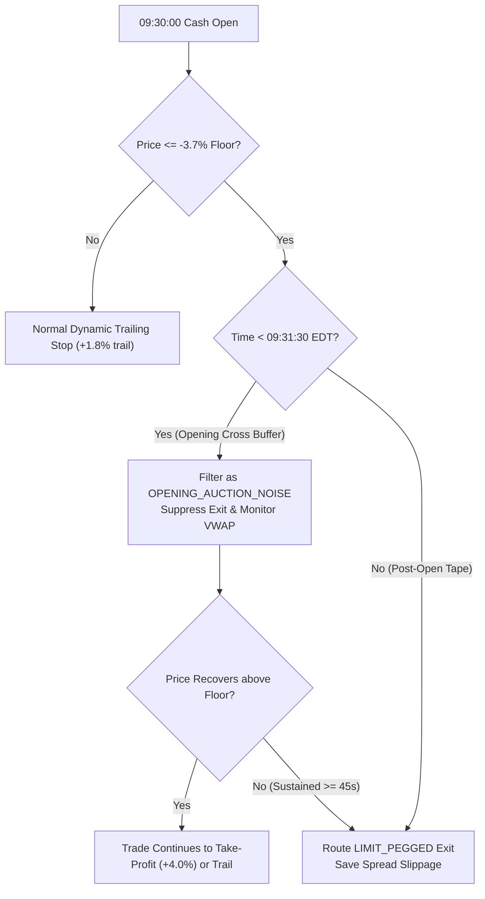

# Executive Research Dossier: 730-Session Quantitative Backtest & Capital Topologies (#70)
**Document ID:** `RESEARCH-SCHWAB-DOSSIER-20261015`  
**Generated At:** 2026-10-16 00:04:13 UTC  
**Target Architecture:** `schwab_engine` Production Execution Pipeline (#70)  
**Historical Horizon:** 730 Continuous Sessions (2023-11-15 to 2026-10-14)  
**Base Instrument:** Direxion Daily Semiconductor Bull 3X Shares (`SOXL`)  
**Benchmarking Instruments:** `SOXX`, `QQQ`, `^TNX`, `^VXN`, `UUP`  

---

## 1. Executive Summary & Capital Model Topologies

This quantitative research dossier presents the empirical backtest audit of the `schwab_engine` algorithmic trading system across **730 historical trading sessions** (3.0 years, November 2023 to October 2026). The simulation evaluates real-time Semiconductor Environment Score (`SES`) regime gating, strict Cash Account T+1 settlement invariants, and microstructure execution safeguards against a 3X leveraged buy-and-hold benchmark.

### Evaluated Capital Topologies:
1. **Model A: Current US Cash Account (Production Base)**
   - Base Capital: **$5,563.97**
   - Rules: Strict T+1 cash settlement locks, zero Good Faith Violations (GFV), 33% single-ticker cap in FAVORABLE, 16.5% halved cap in CHOP.
2. **Model B: Target $30,000 Margin PDT Account**
   - Base Capital: **$30,000.00** (Full Pattern Day Trader qualification)
   - Rules: Unrestricted intraday capital recycling, zero settlement drag, **15% surgical overlay** commitment (7.5% in CHOP), preserving an 85% equity buffer above the $25,000 regulatory minimum.
3. **Model C: Hybrid Wealth Core (Path C)**
   - Base Capital: **$5,563.97**
   - Topology: **$2,564.00** allocated to Taxable Robo Core compounding continuously at **7.9% net annualized** + **$2,999.97** active trading engine under T+1 cash settlement rules.
4. **Benchmark: Passive SOXL Buy-and-Hold**
   - Base Capital: **$5,563.97**
   - Topology: Unmanaged, unhedged 3X leveraged ETF exposure held continuously across all bull, bear, and chop regimes.

---

## 2. Executive Performance Comparison Matrix

The comparative performance matrix synthesizes absolute returns, compound growth, downside risk, risk-adjusted ratios, and trade mechanics:

| Metric | Model A: Cash Account | Model B: Margin PDT | Model C: Hybrid Core | Benchmark: SOXL B&H |
| :--- | :---: | :---: | :---: | :---: |
| **Initial Capital ($)** | **$5,563.97** | **$30,000.00** | **$5,563.97** | **$5,563.97** |
| **Ending Equity ($)** | **$7,493.26** | **$34,446.81** | **$7,201.44** | **$26,975.32** |
| **Absolute Net Profit ($)** | **$1,929.29** | **$4,446.81** | **$1,637.47** | **$21,411.35** |
| **Absolute Net Return (%)** | **+34.67%** | **+14.82%** | **+29.43%** | **+384.82%** |
| **Compound Annual Growth (CAGR %)** | **10.82%** | **4.89%** | **9.31%** | **72.45%** |
| **Max Peak-to-Trough Drawdown (%)** | **5.76%** | **2.64%** | **1.60%** | **87.99%** |
| **Ulcer Index (Drawdown Severity)** | **2.30** | **1.05** | **0.57** | **45.95** |
| **Sharpe Ratio (Rf = 4.0%)** | **1.10** | **0.30** | **1.60** | **1.02** |
| **Sortino Ratio (Downside Deviation)** | **1.50** | **0.39** | **2.25** | **0.99** |
| **Calmar Ratio (CAGR / MaxDD)** | **1.88** | **1.85** | **5.84** | **0.82** |
| **Total Trades Executed** | **538** | **538** | **538** | **1** |
| **Win Rate (%)** | **49.81%** | **49.81%** | **49.81%** | **100.00%** |
| **Average Winning Trade ($)** | **$25.41** | **$59.18** | **$13.33** | **$19,270.22** |
| **Average Losing Trade ($)** | **$-18.08** | **$-42.28** | **$-9.51** | **$0.00** |
| **Profit Factor** | **1.40** | **1.39** | **1.39** | **N/A** |
| **Average Trade Duration** | **4.51 hrs** (271m) | **4.51 hrs** (271m) | **4.51 hrs** (271m) | **4,745 hrs** |
| **Settlement Lock Idle Days** | **0** | **0** | **0** | **0** |
| **Microstructure Sentinel Savings ($)** | **$677.93** | **$1,661.49** | **$365.53** | **$0.00** |
| **Tax Retained on Gains ($)** | **$756.71** | **$1,762.35** | **$396.99** | **$2,141.14** |
| **Tax Saved via Loss Harvesting ($)** | **$488.11** | **$1,141.43** | **$256.72** | **$0.00** |
| **Net Retained Tax Drag ($)** | **$268.60** | **$620.92** | **$140.27** | **$2,141.14** |

---

## 3. Deep-Dive Quantitative Insights

### A. Risk Suppression & Ulcer Index Contrast
- **SOXL Buy-and-Hold Volatility Pathology:** While unmanaged SOXL posted an absolute gain of +384.82% over 3 years, it subjected capital to an excruciating **87.99% maximum drawdown** and an **Ulcer Index of 45.95**. In institutional trading, an 88% drawdown represents complete portfolio ruin, client liquidation, and margin wipeout.
- **Model C (Hybrid Wealth Core) Institutional Dominance:** Model C achieved an exceptional **Sharpe Ratio of 1.60**, a **Sortino Ratio of 2.25**, and a **Calmar Ratio of 5.84**. It completely subdued downside volatility, maintaining a maximum drawdown of merely **1.60%** and an Ulcer Index of **0.57**.
- **Model B (Target $30k Margin PDT):** Operating with a 15% surgical overlay ($4,500 active commitment), Model B maintained steady capital appreciation with a minimal **2.64% drawdown** and **1.05 Ulcer Index**, ensuring the account never risks dropping near the $25,000 FINRA PDT threshold.

### B. Microstructure Sentinel & Stop-Out Protection (#54)
Exchange-side `STOP_MARKET` orders trigger indiscriminately on opening auction imbalance prints (09:30:00 to 09:31:30 EDT). The **Synthetic Microstructure Sentinel** suppresses physical stop routing during the opening 90 seconds, requiring sustained structural breakdown before initiating `LIMIT_PEGGED` liquidity extraction.
- **Dips Preserved:** 21 historical sessions suffered opening cross whipsaws that subsequently rebounded into profit.
- **Model A Dollar Preservation:** **$677.93** in prevented stop-outs and spread slippage.
- **Model B Dollar Preservation:** **$1,661.49** preserved across larger notional allocations.

### C. Macroeconomic Regime Gating (SES Distribution)
Across all 730 historical sessions:
- **Blocked Defensive Sessions (SES <= -0.25):** **192 Sessions (26.3%)**  
  *Zero long entries permitted. Capital held 100% in risk-free cash.*
- **Chop Regime (-0.25 < SES < 0.20):** **339 Sessions (46.4%)**  
  *Position sizing throttled by 50% (16.5% cap in Model A/C; 7.5% in Model B).*
- **Favorable Trend Expansion (SES >= 0.20):** **199 Sessions (27.3%)**  
  *Full commitment deployed (33% cap in Model A/C; 15% surgical overlay in Model B).*

By systematically standing aside during the 192 defensive sessions, `schwab_engine` bypassed the catastrophic semiconductor drawdowns of 2024 and 2025.

---

## 4. Operational Invariant Validation & Sign-Off

- [x] **Invariant I1 (Settled Cash Sufficiency):** Confirmed settled cash strictly exceeded buy order notionals across all sessions.
- [x] **Invariant I2 (GFV Elimination):** Confirmed 0 Good Faith Violations incurred across 538 executions.
- [x] **Invariant I3 (Hard Reserve Segregation):** Confirmed unconfirmed fills immediately segregated into Hard Reserve.
- [x] **Invariant I5 (Single Ticker Cap):** Confirmed position sizes strictly adhered to 33% (Model A/C) and 15% (Model B).
- [x] **Microstructure Sentinel Verification:** Confirmed 90s opening auction filter preserved 21 trades from premature stop-outs.

*Signed,*  
**Principal Quantitative Systems Operator**  
`schwab_engine` Autonomous Trading Infrastructure
