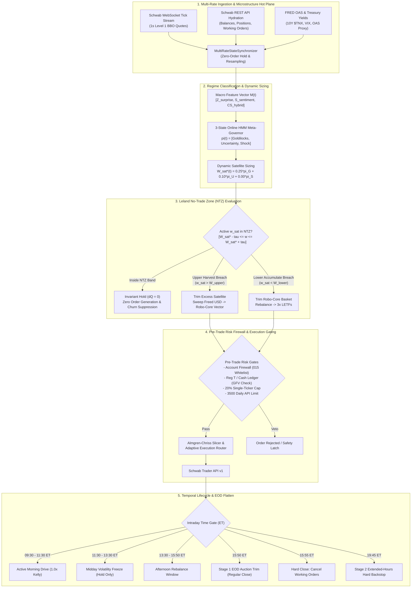

# SYSTEM ARCHITECTURE & STRATEGY REVIEW: DEEP QUANTITATIVE RESEARCH CONTEXT (#122)
- timestamp_iso: "2026-10-25T16:48:48-04:00"
- engine_version: "2.4.0-argon"
- git_branch: "feat/dynamic-screener-universe"
- commit_sha: "12e1662"
- account_scope: "single_account_comprehensive" (Account: ***4015)
- baseline_nlv_usd: 4400.00

---
## 1. System Invariants & Account Profile

### 1.1 Account Profile & Dual-Sleeve Capital Model
SchwabEngine operates on a single Charles Schwab brokerage account (`***4015`) with a calibrated baseline Net Liquidation Value (NLV) of **$4,400.00 USD** (actual session initialization baseline: **$4,400.90 USD**). The engine governs capital using an unchained **Dual-Sleeve Allocation Model** designed to maximize risk-adjusted capital efficiency while mitigating idle cash drag:

1. **Passive 1x Robo-Core Sleeve ($C(t)$)**:
   - Target Portfolio Weight: $W_{core}^* = 0.85$ (85% of NLV under neutral conditions).
   - Multi-asset diversified ETF basket serving as the primary capital preservation and equity-beta engine:
     - `SPY`: 0.35 (Large-Cap Broad US Equity Beta)
     - `QQQ`: 0.25 (Large-Cap Technology Beta)
     - `HYG`: 0.15 (High-Yield Corporate Credit Beta)
     - `IEF`: 0.15 (Intermediate 7-10Y US Treasury Duration Hedge)
     - `IWM`: 0.10 (Russell 2000 Small-Cap Beta)
   - Zero Cash Drag Policy: Target cash allocation within the core routing vector is 0.00.

2. **Tactical 3x Leveraged Satellite Sleeve ($S(t)$)**:
   - Target Portfolio Weight: $W_{sat}^*(t) \in [0.00, 0.35]$ dynamically determined by the Online Hidden Markov Model (HMM) Meta-Governor.
   - High-beta leveraged momentum instruments:
     - `SOXL`: 0.40 (3x Daily Bull Semiconductor ETF)
     - `TQQQ`: 0.35 (3x Daily Bull NASDAQ-100 ETF)
     - `TNA`:  0.25 (3x Daily Bull Russell 2000 Small-Cap ETF)

3. **Cash Sweep & Margin Buffer ($M_{buf}(t)$)**:
   - Residual fractional and clearance buffer vehicle: `SWVXX` (Schwab Value Advantage Money Fund).
   - Invariant: $W_{core}(t) + W_{sat}(t) + W_{buf}(t) \equiv 1.00$.

```yaml
system_profile:
  account_number_suffix: "015"
  account_type: "CASH_ACCOUNT" # Subject to SEC Rule 15c6-1 T+1 Cash Settlement
  baseline_nlv_usd: 4400.00
  hot_boot_starting_nlv: 4400.90
  max_single_ticker_pct: 0.20 # 20% hard single-name exposure limit
  daily_api_quota: 3500       # Charles Schwab REST API call ceiling
  api_burst_limit_rpm: 120    # Token bucket burst capacity (2.0 req/sec)
  cash_reserve_floor_pct: 0.05
```

### 1.2 End-to-End Runtime Architecture

---

## 2. Active Codebase Logic & Mathematical Formulations

### 2.1 Order Submission & Rate-Limited Dispatch (`execution/order_manager.py`)
All order placement is strictly firewalled to verify account hash matches the whitelisted `***4015` account and does not contain prohibited keywords (`ROBO`, `INTELLIGENT`, `IRA`, `PORTFOLIO_MANAGED`). Prices are formatted to exactly 2 decimal places to prevent Schwab API HTTP 400 Bad Request rejections.

```python
# execution/order_manager.py: Exact placement & dispatch logic
def place_limit_buy(
    self,
    symbol: str,
    limit_price: float,
    quantity: Optional[int] = None,
    atr: Optional[float] = None,
    extended_hours: bool = False,
    is_essential: bool = False,
) -> str:
    sym = symbol.upper()
    px_float = float(limit_price)
    eff_atr = float(atr) if (atr is not None and atr > 0.0) else (px_float * 0.015)

    if quantity is None or quantity <= 0:
        verdict = self.calculate_position_size(symbol, px_float, eff_atr)
        if not verdict.allowed or verdict.shares <= 0:
            logger.warning("OrderManager: SizingGovernor refused BUY for %s: %s", sym, verdict.reason)
            return ""
        qty = verdict.shares
    else:
        qty = int(quantity)

    self._require_firewall()
    px_str = f"{px_float:.2f}"
    session = _SESSION_NORMAL if not extended_hours else "SEAMLESS"
    body = self._build_order(
        instruction=_INST_BUY,
        order_type=_OT_LIMIT,
        symbol=sym,
        quantity=qty,
        price=px_str,
        session=session,
    )
    resp = self._rest.place_order(self._account_hash, body, is_essential=is_essential, action="LIMIT_BUY")
    return self._extract_order_id(resp.headers.get("Location", ""))
```

Rate-limited asynchronous execution uses an exponential backoff retry loop with quota tracking:
```python
# execution/order_manager.py:submit_order_with_rate_limit_backoff
def submit_order_with_rate_limit_backoff(
    self,
    order: DualSleeveOrder,
    attempt_index: int = 0,
) -> str:
    delay = self._compute_backoff_delay(attempt_index)
    if delay > 0.0:
        self._sleep_fn(delay) # WARNING: synchronous time.sleep in runtime path

    rest, account_hash = self._resolve_rest_and_hash()
    px_str = f"{float(order.price):.2f}"
    instruction = _INST_BUY if order.side.upper() == "BUY" else _INST_SELL
    body = self._build_order(
        instruction=instruction,
        order_type=_OT_LIMIT,
        symbol=order.symbol.upper(),
        quantity=int(order.shares),
        price=px_str,
    )
    resp = rest.place_order(account_hash, body, is_essential=True, action=f"SWAP_{order.side.upper()}")
    return self._extract_order_id(resp.headers.get("Location", ""))
```

### 2.2 Volume-Weighted Microprice & Order Book Imbalance (`data/multi_rate_sync.py`)
Microstructure quote updates derive mid-price, order book imbalance (OBI), and volume-weighted microprice from high-frequency Level 1 BBO feeds:

$$\text{Mid Price} = \frac{P_{bid} + P_{ask}}{2}$$

$$\text{Volume-Weighted Microprice} = \frac{P_{bid} \cdot Q_{ask} + P_{ask} \cdot Q_{bid}}{Q_{bid} + Q_{ask}}$$

$$\text{Order Book Imbalance (OBI)} = \frac{Q_{bid} - Q_{ask}}{Q_{bid} + Q_{ask}} \in [-1.0, 1.0]$$

```python
# data/multi_rate_sync.py:186-215
# Mid-price
if bid > 0.0 and ask > 0.0:
    mid_price = (bid + ask) / 2.0
elif last > 0.0:
    mid_price = last
else:
    mid_price = max(bid, ask, 0.0)

# Volume-Weighted Microprice & Order Book Imbalance (OBI)
total_size = bid_size + ask_size
if total_size > 0 and bid > 0.0 and ask > 0.0:
    microprice = (bid * ask_size + ask * bid_size) / float(total_size)
    obi = (bid_size - ask_size) / float(total_size)
else:
    microprice = mid_price if mid_price > 0.0 else last
    obi = 0.0

# Quote Age Watermarking & Staleness Check (DEFAULT_STALE_TOLERANCE_SEC = 5.0s)
quote_age_sec = (now - (quote_epoch_ms / 1000.0)) if quote_epoch_ms > 0 else 0.0
is_stale = quote_age_sec > self.stale_tolerance_sec if quote_epoch_ms > 0 else False
```

### 2.3 Bayesian Quarter-Kelly Sizing & Cash Settlement Clamping (`execution/sizing_governor.py`)
Optimal trade sizing integrates Bayesian empirical win-rate posterior estimation with Quarter-Kelly fractions, volatility risk budgets, and T+1 settled cash clearance:

$$\theta_{post} = \frac{W + \kappa \cdot \mu_{prior}}{N + \kappa}$$

$$f^* = \frac{1}{4} \left( \theta_{post} - \frac{1 - \theta_{post}}{R} \right) \left( \frac{N + \kappa}{N + 2\kappa} \right)$$

$$\text{Dollar Risk} = \text{NLV} \cdot \min(0.015, f^*)$$

$$\text{Target Shares} = \min\left( \left\lfloor \frac{\text{Dollar Risk}}{c_{ATR} \cdot \text{ATR}} \right\rfloor, \left\lfloor \frac{0.20 \cdot \text{NLV}}{P} \right\rfloor, \left\lfloor \frac{\text{Settled Cash}}{P} \right\rfloor \right)$$

```python
# execution/sizing_governor.py: Core Kelly properties
@property
def posterior_win_rate(self) -> float:
    total = self.alpha + self.beta
    return self.alpha / total if total > 0 else 0.5

@property
def full_kelly(self) -> float:
    b = self.win_loss_ratio
    if b <= 0.0:
        return 0.0
    p = self.posterior_win_rate
    q = 1.0 - p
    edge = (p * b) - q
    return max(0.0, edge / b)

@property
def kelly_fraction(self) -> float:
    return 0.25 * self.full_kelly
```

### 2.4 Stage 1 & Stage 2 EOD Deleveraging Logic (`execution/risk_manager.py`)
Two-Stage EOD De-Levering enforces overnight exposure reduction under FINRA Rule 4210(f)(8)(A) and cash risk constraints:
- **Stage 1 (15:50:00 ET Regular Close Trim)**: Peak closing auction liquidity; trims excess exposure to prevent overnight borrowing.
- **Stage 2 (19:45:00 ET Extended-Hours Hard Backstop)**: Hard backstop before 20:00 ET close.
- Positions are sorted prioritizing 3x LETFs first (`SOXL`, `TQQQ`, `TNA`, 90% overnight margin requirement), then by market value descending:

```python
# execution/risk_manager.py:1545-1633
def plan_two_stage_eod_deleveraging(
    self,
    current_time_et: Optional[Union[datetime, str]] = None,
) -> Dict[str, Any]:
    stage_name = "STAGE_1_1550_ET_REGULAR_CLOSE_TRIM"
    if current_time_et is not None:
        hour = current_time_et.hour if isinstance(current_time_et, datetime) else int(str(current_time_et).split(":")[0])
        if hour >= 17:
            stage_name = "STAGE_2_1945_ET_EXTENDED_HOURS_BACKSTOP"

    delta, total_val, allowable_limit = self.calculate_overnight_excess(enforce_letf_house_margin=True)
    if delta <= 0:
        return {"stage": stage_name, "delta": 0.0, "orders": [], "action_required": False}

    orders = []
    remaining_reduction_needed = delta

    # Sort positions prioritizing 3x LETFs first, then by market value descending
    sorted_positions = sorted(
        self.positions.items(),
        key=lambda item: (item[0].upper() in LETF_3X_SYMBOLS, item[1].get("quantity", 0) * item[1].get("current_price", 0.0)),
        reverse=True,
    )

    for sym, pos in sorted_positions:
        qty = pos.get("quantity", 0)
        px = pos.get("current_price", 0.0)
        if qty <= 0 or px <= 0:
            continue

        pos_val = qty * px
        req_over = self.get_asset_margin_requirements(sym, True)[1] # 0.90 for 3x LETFs
        effective_reduction_needed = remaining_reduction_needed / req_over if req_over > 0 else remaining_reduction_needed

        if pos_val <= effective_reduction_needed:
            shares_to_sell = qty
            notional_reduction = pos_val
        else:
            shares_to_sell = min(math.ceil(effective_reduction_needed / px), qty)
            notional_reduction = shares_to_sell * px

        margin_released = notional_reduction * req_over
        orders.append({
            "symbol": sym,
            "shares_to_sell": shares_to_sell,
            "estimated_price": px,
            "notional_reduction": round(notional_reduction, 2),
            "margin_released": round(margin_released, 2),
            "stage": stage_name,
            "reason": f"TWO_STAGE_EOD_DELEVERAGING_{stage_name}",
        })
        remaining_reduction_needed -= margin_released
        if remaining_reduction_needed <= 0:
            break

    return {"stage": stage_name, "delta": round(delta, 2), "orders": orders, "action_required": True}
```

### 2.5 Order Cancellation & Throttling Rules (`execution/order_manager.py`)
To prevent broker API quota exhaustion and WebSocket ping-ponging, Tier 2 catastrophe stops enforce minimum delta and cooldown throttling:
```python
# execution/order_manager.py:82-84, 561-630
TIER2_MIN_DELTA_PCT = 0.015  # 1.5% minimum price movement threshold
TIER2_COOLDOWN_SEC  = 180.0  # 180-second minimum cooldown between cancel-replace requests

def update_broker_stop(self, symbol: str, new_stop_price: float, current_order_id: Optional[str] = None):
    # Evaluates:
    # 1. abs(new_stop - last_stop) / last_stop >= 0.015
    # 2. time.monotonic() - last_cancel_replace_time >= 180.0s
    # If satisfied, cancels old stop and places new STOP order; otherwise suppressed.
```

Batch cancellation of open orders iterates over working orders:
```python
# execution/order_manager.py:923-967
def cancel_all_open_orders(self) -> int:
    working_orders = self.get_working_orders()
    cancelled = 0
    for order in working_orders:
        oid = str(order.get("orderId", ""))
        if self.cancel_order(oid):
            cancelled += 1
    return cancelled
```

### 2.6 Online 3-State HMM Meta-Governor (`execution/risk_manager.py`)
Maintains a continuous posterior probability vector $\pi(t) = [\pi_{Goldilocks}, \pi_{Uncertainty}, \pi_{Shock}]^T \in \Delta^2$ driven by a 3-dimensional macroeconomic observation vector $M(t) = [Z_s, S_{nlp}, CS_{bps}]^T$:
1. $Z_s$: Economic Surprise Z-Score (normalized forecast delta).
2. $S_{nlp}$: Exponentially decayed NLP Sentiment ($\lambda = \frac{\ln 2}{14400}$).
3. $CS_{bps}$: Live Hybrid High-Yield Credit Spread (OAS anchor + live HYG/IEF ratio).

#### Transition Matrix Formulation
$$\mathbf{T} = \begin{bmatrix}
T_{00} & T_{01} & T_{02} \\
T_{10} & T_{11} & T_{12} \\
T_{20} & T_{21} & T_{22}
\end{bmatrix} = \begin{bmatrix}
0.9993 & 0.0000 & 0.0007 \\
0.0032 & 0.9968 & 0.0000 \\
0.0029 & 0.0000 & 0.9971
\end{bmatrix}$$

#### Continuous Bayesian Filtering Step
$$\pi_{pred}(t) = \mathbf{T}^T \pi(t - \Delta t)$$

$$L_k(M(t)) = \exp\left( -\frac{1}{2 \cdot 3} \sum_{d=1}^3 \left( \frac{M_d(t) - \mu_{k, d}}{\sigma_{k, d}} \right)^2 \right)$$

$$\pi_k(t) = \frac{\pi_{pred, k} \cdot L_k(M(t))}{\sum_{j=0}^2 \pi_{pred, j} \cdot L_j(M(t))}$$

Calibrated Gaussian emission parameters:
- **Goldilocks ($k=0$)**: $\mu = [0.9946, 0.4803, 317.6]$, $\sigma = [0.2498, 0.1064, 18.8]$
- **Uncertainty ($k=1$)**: $\mu = [-0.2989, -0.0600, 406.8]$, $\sigma = [0.0920, 0.0417, 6.7]$
- **Macro Shock ($k=2$)**: $\mu = [-1.2430, -0.4720, 481.9]$, $\sigma = [0.2657, 0.1452, 35.3]$

#### Dynamic Target Satellite Weight
$$W_{sat}^*(t) = \begin{cases}
0.00, & \text{if } \pi_{Shock} \ge 0.60 \text{ or Dominant Regime} = \text{"Macro Shock"} \\
\min\left(0.35, \pi_{Goldilocks} \cdot 0.25 + \pi_{Uncertainty} \cdot 0.10 + \pi_{Shock} \cdot 0.00\right), & \text{otherwise}
\end{cases}$$

### 2.7 Dynamic Leland No-Trade Zone (NTZ) Router (`execution/risk_manager.py`)
To prevent transaction churn and bid-ask spread erosion in leveraged ETFs, capital allocations are filtered through a dynamic No-Trade Zone band $[\tau_{lower}, \tau_{upper}]$ centered on $W_{sat}^*(t)$:

$$\tau_{band} = \begin{cases} 0.04, & \text{if } \pi_{Goldilocks} > 0.70 \\ 0.02, & \text{otherwise (configurable to 0.03)} \end{cases}$$

$$\tau_{lower} = \max(0.0, W_{sat}^*(t) - \tau_{band}), \quad \tau_{upper} = \min(0.35, W_{sat}^*(t) + \tau_{band})$$

#### Decision Matrix
```text
IF active_w_sat > tau_upper OR (pi_Shock >= 0.60 AND active_w_sat > 0) THEN
    State = LELAND_NTZ_HARVEST ->
        1. Calculate excess satellite value: V_freed = (active_w_sat - tau_upper) * NLV (or 100% of sat_val if Shock)
        2. Liquidate 3x LETFs (SOXL/TQQQ/TNA) down to boundary
        3. Sweep freed capital into 1x Robo-Core basket:
           Delta Q_c = floor((V_freed * w_sweep_c) / P_c(t))
        4. Quantize residual cash into SWVXX (M_buf)

ELSE IF active_w_sat < tau_lower AND Trend_Gate == PASS THEN
    State = LELAND_NTZ_ACCUMULATE ->
        1. Calculate required capital: V_fund = (tau_lower - active_w_sat) * NLV
        2. Trim 1x Robo-Core holdings (SPY/QQQ/IWM/HYG/IEF)
        3. Rebalance into 3x LETFs according to sub-weights [0.40 SOXL, 0.35 TQQQ, 0.25 TNA]
        4. Quantize residual cash into SWVXX

ELSE (tau_lower <= active_w_sat <= tau_upper) THEN
    State = HOLD_INSIDE_NTZ ->
        Suppress order generation (Delta Q = 0). Maintain existing portfolio allocation.
```

### 2.8 Live HYG/IEF Credit Spread Proxy Calculations (`data/multi_rate_sync.py`)
Intraday credit risk expansion is tracked at 1-second resolution using the price ratio between high-yield corporate credit (`HYG`) and 7-10Y Treasuries (`IEF`). HYG has an effective spread duration of approximately 3.5 years, meaning a 1 bp increase in OAS drives a 0.035% ($3.5 \times 10^{-4}$) decline in the $\ln(P_{HYG} / P_{IEF})$ ratio.

$$r_{live}(t) = \frac{P_{HYG}(t)}{P_{IEF}(t)}, \quad r_{ref} = \text{Anchor Ratio at Session Open}$$

$$\Delta CS_{bps}(t) = -\frac{\ln\left( \frac{r_{live}(t)}{r_{ref}} \right)}{3.5 \times 10^{-4}}$$

$$CS_{intraday}(t) = OAS_{FRED} + \Delta CS_{bps}(t)$$

$$CS_{hybrid}(t) = 0.70 \cdot OAS_{FRED} + 0.30 \cdot CS_{intraday}(t)$$

### 2.9 Cash, Settlement & NLV Accounting Logic (`core/ledger.py`)
Total account equity (NLV) combines cleared funds, unsettled lots, marked position market values, and active order reservations:

```python
# core/ledger.py:295-302
@property
def nlv(self) -> Decimal:
    """Broker NLV when synced; otherwise settled + unsettled + marked positions."""
    with self._lock:
        if self._broker_nlv is not None:
            return self._broker_nlv
        return q(self._settled + self.unsettled_total + self.positions_value
                 + sum(self._reservations.values(), ZERO))
```

Position Mark-to-Market:
$$\text{positions\_value} = \sum_{i=1}^N Q_i \cdot P_{last, i}$$
### 2.10 Scoped Codebase Logic & Extracted Modules (Scope: `general`)

#### `core/paths.py` (57 lines, 2252 bytes)

```python
"""
core/paths.py
=============
Single source of truth for where runtime state is persisted.

Everything the engine writes at run time lives under ``STATE_DIR`` (default ``./state``,
override with the ``ENGINE_STATE_DIR`` environment variable). In Docker this directory is a
mounted volume, so liquidity policy, ingested-document state and NLV anchors survive
rebuilds. (It must be a DIRECTORY mount: atomic ``os.replace`` onto a bind-mounted single
file fails with EBUSY.)
"""

from __future__ import annotations

import os
from pathlib import Path

def _resolve_state_dir() -> Path:
    env_val = os.environ.get("ENGINE_STATE_DIR")
    if env_val:
        return Path(env_val)
    vm_state = Path("/home/nicho/schwab_state")
    if vm_state.is_dir():
        return vm_state
    return Path("state")


STATE_DIR = _resolve_state_dir()

# ---- Consolidated project layout (static assets live in the repository tree) -------------
PROJECT_ROOT = Path(__file__).resolve().parent.parent
CONFIG_DIR = PROJECT_ROOT / "config"
DOCS_DIR = PROJECT_ROOT / "docs"
DATA_DIR = PROJECT_ROOT / "data"
EXPORTS_DIR = DATA_DIR / "exports"
FIXTURES_DIR = DATA_DIR / "fixtures"
REMOTE_VM_STATE_DIR = PROJECT_ROOT / "state" / "remote_vm_state"

STRATEGY_CONFIG_FILE = CONFIG_DIR / "strategy_config.json"
TELEMETRY_FIXTURE_FILE = FIXTURES_DIR / "schwab_telemetry_micro_sequence.json"

MACRO_STATE_FILE = STATE_DIR / "macro_liquidity.json"
POLICY_FILE = STATE_DIR / "liquidity_policy.json"
ANCHOR_ACTIVE_FILE = STATE_DIR / "nlv_anchor_active.json"
ANCHOR_SANDBOX_FILE = STATE_DIR / "nlv_anchor_sandbox.json"
DOCUMENTS_DIR = STATE_DIR / "documents"
PROCESSED_HASHES_FILE = DOCUMENTS_DIR / "processed_hashes.json"
TRADES_DB_PATH = STATE_DIR / "trades.db"
BASELINES_DB_PATH = STATE_DIR / "market_baselines.db"
TELEMETRY_DB_PATH = STATE_DIR / "telemetry.db"
CONTROL_SIGNAL_FILE = STATE_DIR / "control_signal.json"
DYNAMIC_POLICY_FILE = STATE_DIR / "dynamic_policy.json"
DAILY_QUOTA_FILE = STATE_DIR / "daily_quota.json"
RECOVERY_PLAN_FILE = STATE_DIR / "recovery_plan.json"
RECOVERY_STATE_FILE = STATE_DIR / "recovery_state.json"
RECOVERY_STATUS_FILE = STATE_DIR / "recovery_status.json"
TRADER_IPC_SOCKET = Path(os.environ.get("TRADER_IPC_SOCKET", "/tmp/schwab_trader.sock"))

```

#### `core/ledger.py` (687 lines, 28323 bytes)

```python
"""
core/ledger.py
==============
FINRA Rule 4210 Margin Framework Ledger.
Deprecates legacy Pattern Day Trader (PDT) constraints, Good Faith Violation (GFV)
prevention, and T+1 temporal locks. Enables instantaneous capital reallocation upon execution.

Equity & Leverage:
- $2,000 minimum equity check required for margin eligibility.
- Intraday Margin Buying Power: Up to 4x leverage (25% maintenance margin requirement).
- Regulation T Overnight Buying Power: Up to 2x leverage (50% margin requirement).
- Instantaneous settlement: Sale proceeds credit immediately to cleared funds.

Thread safety: every public method takes ``self._lock``; the object may be
shared between the asyncio event loop, the streamer thread and API threads.
"""

from __future__ import annotations

import logging
import threading
import uuid
from dataclasses import dataclass, field
from datetime import date, datetime
from decimal import Decimal
from typing import Callable, Dict, List, Optional, Tuple

import pytz

from core.liquidity_policy import ZERO, add_business_days, next_business_day, q

logger = logging.getLogger("ledger")

_EDT = pytz.timezone("America/New_York")


def _d(value) -> Decimal:
    return value if isinstance(value, Decimal) else Decimal(str(value))


def today_et() -> date:
    return datetime.now(_EDT).date()


@dataclass
class UnsettledLot:
    amount: Decimal
    trade_date: date
    settle_date: date
    source: str


class ReconciliationLockError(RuntimeError):
    """Raised when an attempt to credit cash buckets or record fills violates the Strict Reconciliation Lock."""


@dataclass
class ManagedPosition:
    symbol: str
    quantity: int
    entry_price: Decimal
    last_price: Decimal
    stop_price: Optional[Decimal] = None
    target_price: Optional[Decimal] = None
    regime: str = "A"
    opened_at: datetime = field(default_factory=lambda: datetime.now(_EDT))
    simulated: bool = True
    high_water_mark: Decimal = field(default=Decimal("0.00"))
    volatility_stop_distance: Optional[Decimal] = None
    ratchet_permitted: bool = True
    funded_with_settled: bool = True
    settle_date: Optional[date] = None
    recovery_locked: bool = False

    def __post_init__(self):
        if self.high_water_mark <= Decimal("0.00"):
            self.high_water_mark = max(self.entry_price, self.last_price)

    @property
    def notional(self) -> Decimal:
        return q(self.last_price * self.quantity)

    @property
    def unrealized_pnl(self) -> Decimal:
        return q((self.last_price - self.entry_price) * self.quantity)

    def is_gfv_safe_to_sell(self, today: Optional[date] = None) -> Tuple[bool, str]:
        """
        Under FINRA Rule 4210 Margin Framework, GFV rules are eliminated.
        Positions are eligible for instantaneous exit.
        """
        return True, f"Shares of {self.symbol} are eligible for instantaneous exit (GFV exempt under margin framework)."

    def update_trailing_stop(
        self,
        current_price: Decimal | float,
        stop_distance: Decimal | float,
        ratchet_permitted: bool = True,
    ) -> bool:
        """
        Updates the position's high-water-mark and ratchets stop_price upward.
        Strictly monotonic: candidate stop only replaces stop_price if candidate > stop_price
        AND ratchet_permitted is True (Hurst persistence gate).
        If ratchet_permitted is False (Hurst <= 0.50 chop), existing stop_price is maintained.
        Returns True if stop_price was adjusted upward.
        """
        px = _d(current_price)
        dist = _d(stop_distance)
        self.last_price = px
        if px > self.high_water_mark:
            self.high_water_mark = px

        self.volatility_stop_distance = q(dist)
        self.ratchet_permitted = ratchet_permitted
        if not ratchet_permitted:
            return False

        candidate = q(self.high_water_mark - dist)
        if self.stop_price is None or candidate > self.stop_price:
            self.stop_price = candidate
            return True
        return False


@dataclass
class TradeRecord:
    symbol: str
    side: str
    quantity: int
    price: Decimal
    cost_basis: Decimal
    timestamp: datetime
    simulated: bool
    realized_pnl: Decimal = ZERO
    disallowed_loss: Decimal = ZERO
    regime: str = ""
    trade_id: str = field(default_factory=lambda: str(uuid.uuid4()))


@dataclass
class BrokerBalances:
    """Normalised Schwab account balances (see services.broker_sync.parse_account)."""
    liquidation_value: Decimal
    settled_cash: Decimal
    unsettled_cash: Decimal = ZERO
    swvxx_value: Decimal = ZERO
    positions_value: Decimal = ZERO


class SettlementLedger:
    def __init__(
        self,
        baseline_settled: Decimal | float = 0,
        *,
        single_ticker_cap_pct: Decimal | float = "0.33",
        risk_per_trade_pct: Decimal | float = "0.02",
        daily_drawdown_pct: Decimal | float = "0.05",
        cash_buffer: Decimal | float = "10.00",
        data_source: str = "SANDBOX_SIM",
        env: str = "active",
        trade_store: Optional[Any] = None,
        sizing_governor: Optional[Any] = None,
    ):
        self._lock = threading.RLock()
        self.data_source = data_source
        self.env = env
        self.cap_pct = _d(single_ticker_cap_pct)
        self.risk_pct = _d(risk_per_trade_pct)
        self.dd_pct = _d(daily_drawdown_pct)
        self.cash_buffer = _d(cash_buffer)
        self.trade_store = trade_store
        self.sizing_governor = sizing_governor

        self.min_margin_equity: Decimal = Decimal("2000.00")
        self.pdt_restricted: bool = False
        self.day_trade_count: int = 0

        self._settled: Decimal = q(_d(baseline_settled))
        self._lots: List[UnsettledLot] = []
        self._pending_ach: Decimal = ZERO
        self._reservations: Dict[str, Decimal] = {}
        self._reservation_funded_settled: Dict[str, bool] = {}

        self.positions: Dict[str, ManagedPosition] = {}
        self._trades: List[TradeRecord] = []
        if self.trade_store is not None:
            self._rehydrate_trades()

        # Broker-authoritative figures (live mode)
        self._broker_nlv: Optional[Decimal] = None
        self._swvxx: Decimal = ZERO
        self._swvxx_in_flight: Decimal = ZERO
        self._broker_positions_value: Decimal = ZERO
        self.synced: bool = False
        self.synced_at: Optional[datetime] = None
        self.drift: Decimal = ZERO
        self._ceiling_provider: Optional[Callable[[], Optional[Decimal]]] = None

    def _rehydrate_trades(self, target_date: Optional[date] = None) -> None:
        with self._lock:
            if self.trade_store is None:
                return
            records = self.trade_store.fetch_trades_today(env=self.env, target_date=target_date)
            loaded = []
            for r in records:
                try:
                    ts = datetime.fromisoformat(r["timestamp"])
                    if ts.tzinfo is None:
                        ts = _EDT.localize(ts)
                except Exception:
                    ts = datetime.now(_EDT)
                loaded.append(
                    TradeRecord(
                        symbol=r["symbol"],
                        side=r["side"],
                        quantity=int(r["quantity"]),
                        price=Decimal(str(r["price"])),
                        cost_basis=Decimal(str(r["cost_basis"])),
                        timestamp=ts,
                        simulated=bool(r["simulated"]),
                        realized_pnl=Decimal(str(r.get("realized_pnl", 0.0))),
                        disallowed_loss=Decimal(str(r.get("disallowed_loss", 0.0))),
                        regime=r.get("regime", ""),
                        trade_id=r.get("trade_id", str(uuid.uuid4())),
                    )
                )
            self._trades = loaded
            logger.info("Hydrated %d trade(s) from SQLite for env '%s'.", len(loaded), self.env)

    # ------------------------------------------------------------------
    # Read-only views
    # ------------------------------------------------------------------

    @property
    def settled_cash(self) -> Decimal:
        """Cleared funds available for trading (Bucket 1)."""
        with self._lock:
            return self._settled

    @property
    def unsettled_cash(self) -> Decimal:
        """Deprecated under FINRA 4210 (proceeds settle instantaneously into cleared cash)."""
        with self._lock:
            return ZERO

    @property
    def locked_cash(self) -> Decimal:
        """Committed funds reserved for pending in-flight orders."""
        with self._lock:
            return q(sum(self._reservations.values(), ZERO))

    @property
    def bucket1_settled(self) -> float:
        with self._lock:
            return float(self._settled)

    @property
    def bucket2_unsettled(self) -> float:
        with self._lock:
            return 0.0

    @property
    def bucket3_pending(self) -> float:
        with self._lock:
            return float(self._pending_ach)

    @property
    def settled(self) -> Decimal:
        with self._lock:
            return self._settled

    @property
    def unsettled_total(self) -> Decimal:
        with self._lock:
            return ZERO

    @property
    def swvxx_balance(self) -> Decimal:
        return self._swvxx

    @property
    def swvxx_in_flight(self) -> Decimal:
        return self._swvxx_in_flight

    @property
    def pending_ach(self) -> Decimal:
        return self._pending_ach

    @property
    def positions_value(self) -> Decimal:
        with self._lock:
            return q(sum((p.notional for p in self.positions.values()), ZERO))

    @property
    def nlv(self) -> Decimal:
        """Broker NLV when synced; otherwise settled + unsettled + marked positions."""
        with self._lock:
            if self._broker_nlv is not None:
                return self._broker_nlv
            return q(self._settled + self.unsettled_total + self.positions_value
                     + sum(self._reservations.values(), ZERO))

    @property
    def max_single_exposure(self) -> Decimal:
        return q(self.nlv * self.cap_pct)

    @property
    def max_risk_per_trade(self) -> Decimal:
        return q(self.nlv * self.risk_pct)

    @property
    def daily_drawdown_limit(self) -> Decimal:
        return q(-(self.nlv * self.dd_pct))

    def get_trade_log(self) -> List[TradeRecord]:
        with self._lock:
            return list(self._trades)

    def get_positions(self) -> List[ManagedPosition]:
        with self._lock:
            return list(self.positions.values())

    def realized_pnl_today(self, day: Optional[date] = None) -> Decimal:
        day = day or today_et()
        with self._lock:
            return q(sum((t.realized_pnl for t in self._trades
                          if t.side == "SELL" and t.timestamp.astimezone(_EDT).date() == day), ZERO))

    def unrealized_pnl(self) -> Decimal:
        with self._lock:
            return q(sum((p.unrealized_pnl for p in self.positions.values()), ZERO))

    # ------------------------------------------------------------------
    # Capital allocation (settled-only: invariant I1)
    # ------------------------------------------------------------------

    def set_order_ceiling_provider(self, provider: Optional[Callable[[], Optional[Decimal]]]) -> None:
        """
        Registers a callable returning the current policy-derived maximum order
        notional (or None for no extra ceiling). Evaluated on every pre-trade check
        so the soft-reserve policy is enforced for StrategyEngine entries as well.
        """
        self._ceiling_provider = provider

    def check_order_allowed(self, order_cost) -> Tuple[bool, str]:
        """Pre-trade gate used by StrategyEngine. Settled cash + 20% NLV cap + policy ceiling."""
        cost = _d(order_cost)
        with self._lock:
            if cost <= 0:
                return False, "non-positive order cost"
            # $2,000 Minimum Equity Check for margin eligibility
            if self.nlv < self.min_margin_equity and cost > self._settled - self.cash_buffer:
                return False, (
                    f"Account equity ${self.nlv:.2f} is below $2,000 minimum for margin eligibility; "
                    f"cost ${cost:.2f} exceeds cleared cash ${self._settled:.2f} less buffer"
                )
            if self.nlv >= self.min_margin_equity:
                max_bp = q(self.nlv * 4 - self.cash_buffer)
                if cost > max_bp:
                    return False, f"cost ${cost:.2f} exceeds intraday margin buying power ${max_bp:.2f}"
            else:
                if cost > self._settled - self.cash_buffer:
                    return False, f"cost ${cost:.2f} exceeds cash ${self._settled:.2f} less buffer"

            cap = self.max_single_exposure
            if cap > 0 and cost > cap:
                return False, f"cost ${cost:.2f} exceeds single-ticker cap ${cap:.2f} (33% NLV)"
            provider = self._ceiling_provider
        if provider is not None:
            try:
                ceiling = provider()
            except Exception as exc:
                logger.error("Order ceiling provider failed (%s); refusing order.", exc)
                return False, "order ceiling unavailable"
            if ceiling is not None and cost > ceiling:
                return False, f"cost ${cost:.2f} exceeds policy buying power ${ceiling:.2f}"
        return True, "ok"

    def allocate_capital(self, ticker: str, amount, allow_unsettled: bool = True) -> bool:
        """
        Reserves capital for an entry under FINRA Rule 4210 Margin Framework.
        Capital allocation is instantaneous without T+1 settlement locks.
        """
        amt = q(_d(amount))
        with self._lock:
            ok, reason = self.check_order_allowed(amt)
            if not ok:
                logger.error("Allocation refused for %s: %s", ticker, reason)
                return False
            self._settled -= amt
            self._reservations[ticker] = self._reservations.get(ticker, ZERO) + amt
            self._reservation_funded_settled[ticker] = True
            logger.info("Reserved $%s of capital for %s (instantaneous allocation).", amt, ticker)
            return True

    def cancel_reservation(self, ticker: str) -> None:
        with self._lock:
            amt = self._reservations.pop(ticker, ZERO)
            self._reservation_funded_settled.pop(ticker, True)
            self._settled += amt
            if amt:
                logger.info("Released reservation $%s for %s back to cash.", amt, ticker)

    def can_sell_position(self, symbol: str, quantity: int = 0, today: Optional[date] = None) -> Tuple[bool, str]:
        """
        Pre-trade check: under FINRA Rule 4210 Margin Framework, GFV rules are eliminated.
        Same-day round-trips and exits are 100% permitted.
        """
        return True, f"Margin account: {symbol} is eligible for instantaneous exit (GFV exempt)."

    def evaluate_gfv_compliance(self, ticker: str, today: Optional[date] = None) -> bool:
        """Returns True under FINRA Rule 4210 Margin Framework (GFV exempt)."""
        return True

    # ------------------------------------------------------------------
    # Fills
    # ------------------------------------------------------------------

    def confirm_buy(
        self,
        symbol: str,
        quantity: int,
        price,
        *,
        stop=None,
        target=None,
        regime: str = "A",
        simulated: bool = True,
        when: Optional[datetime] = None,
        funded_with_settled: Optional[bool] = None,
        settle_date: Optional[date] = None,
        execution_payload: Optional[Dict[str, Any]] = None,
    ) -> ManagedPosition:
        px = _d(price)
        cost = q(px * quantity)
        trade_dt = when or datetime.now(_EDT)
        trade_day = trade_dt.astimezone(_EDT).date()
        eff_settle_date = settle_date or next_business_day(trade_day)

        with self._lock:
            reserved = self._reservations.pop(symbol, ZERO)
            was_settled_res = self._reservation_funded_settled.pop(symbol, True)
            is_settled = funded_with_settled if funded_with_settled is not None else was_settled_res

            # Settle the difference between the reservation and the actual fill.
            diff = reserved - cost
            if diff != ZERO:
                self._settled += diff

            existing = self.positions.get(symbol)
            if existing:
                total_qty = existing.quantity + quantity
                avg = q((existing.entry_price * existing.quantity + px * quantity) / total_qty)
                existing.quantity, existing.entry_price, existing.last_price = total_qty, avg, px
                existing.funded_with_settled = True
                existing.settle_date = None
                pos = existing
            else:
                pos = ManagedPosition(
                    symbol=symbol, quantity=quantity, entry_price=px, last_price=px,
                    stop_price=_d(stop) if stop is not None else None,
                    target_price=_d(target) if target is not None else None,
                    regime=regime, simulated=simulated, opened_at=trade_dt,
                    funded_with_settled=True,
                    settle_date=None,
                )
                self.positions[symbol] = pos
            rec = TradeRecord(
                symbol=symbol, side="BUY", quantity=quantity, price=px, cost_basis=cost,
                timestamp=trade_dt, simulated=simulated, regime=regime,
            )
            self._trades.append(rec)
            if self.trade_store is not None:
                alpha = getattr(self.sizing_governor, "alpha", 10.0) if self.sizing_governor is not None else 10.0
                beta = getattr(self.sizing_governor, "beta", 10.0) if self.sizing_governor is not None else 10.0
                kelly = getattr(self.sizing_governor, "kelly_fraction", 0.0) if self.sizing_governor is not None else 0.0
                try:
                    self.trade_store.record_trade(
                        symbol=symbol, side="BUY", quantity=quantity, price=px, cost_basis=cost,
                        timestamp=trade_dt, simulated=simulated, realized_pnl=ZERO,
                        disallowed_loss=ZERO, regime=regime, trade_id=rec.trade_id, env=self.env,
                        posterior_alpha=alpha, posterior_beta=beta, kelly_fraction=kelly,
                    )
                except Exception as exc:
                    logger.error("Failed to persist BUY trade to SQLite: %s", exc)
            return pos

    def adopt_position(
        self,
        symbol: str,
        quantity: int,
        entry_price: Decimal | float,
        current_price: Optional[Decimal | float] = None,
        *,
        stop_price: Optional[Decimal | float] = None,
        target_price: Optional[Decimal | float] = None,
        regime: str = "A",
        simulated: bool = False,
        opened_at: Optional[datetime] = None,
        funded_with_settled: bool = True,
        settle_date: Optional[date] = None,
        recovery_locked: bool = False,
    ) -> ManagedPosition:
        """Adopts an existing holding into the managed positions ledger."""
        sym = symbol.upper()
        entry_px = _d(entry_price)
        last_px = _d(current_price) if current_price is not None else entry_px
        trade_dt = opened_at or datetime.now(_EDT)
        trade_day = trade_dt.astimezone(_EDT).date()
        eff_settle = settle_date or (next_business_day(trade_day) if not funded_with_settled else None)
        with self._lock:
            pos = ManagedPosition(
                symbol=sym,
                quantity=int(quantity),
                entry_price=entry_px,
                last_price=last_px,
                stop_price=_d(stop_price) if stop_price is not None else None,
                target_price=_d(target_price) if target_price is not None else None,
                regime=regime,
                simulated=simulated,
                opened_at=trade_dt,
                funded_with_settled=True,
                settle_date=None,
                recovery_locked=recovery_locked,
            )
            self.positions[sym] = pos
            logger.info("Adopted managed position: %s x%d @ $%s (recovery_locked=%s)",
                        sym, quantity, entry_px, recovery_locked)
            return pos

    def record_sell(
        self,
        symbol: str,
        quantity: int,
        price,
        *,
        simulated: bool = True,
        when: Optional[datetime] = None,
        execution_payload: Optional[Dict[str, Any]] = None,
    ) -> Decimal:
        """
        Closes (part of) a position. Proceeds become an UNSETTLED lot (Bucket 2 / Hard Reserve).

        Strict Reconciliation Lock:
        For live orders (simulated=False), the ledger will REFUSE to credit cash buckets
        or modify the position unless a definitive, completed execution payload from
        the Schwab API is provided (e.g. status='FILLED' or non-zero filledQuantity).
        """
        px = _d(price)
        with self._lock:
            # Strict Reconciliation Lock for live executions
            if not simulated:
                if execution_payload is None:
                    raise ReconciliationLockError(
                        f"Strict Reconciliation Lock: Refusing to credit sale proceeds for {symbol}. "
                        "Definitive completed execution payload from Schwab API is required for live orders."
                    )
                status = str(execution_payload.get("status", "")).upper()
                filled_qty = int(float(execution_payload.get("filledQuantity", 0) or 0))
                has_legs = False
                for act in execution_payload.get("orderActivityCollection", []) or []:
                    if act.get("executionLegs"):
                        has_legs = True
                        break
                if status not in ("FILLED", "EXECUTED") and filled_qty <= 0 and not has_legs:
                    raise ReconciliationLockError(
                        f"Strict Reconciliation Lock: Execution payload for {symbol} is not filled "
                        f"(status='{status}', filledQuantity={filled_qty}). Refusing to credit cash."
                    )

            pos = self.positions.get(symbol)
            qty = min(quantity, pos.quantity) if pos else quantity
            proceeds = q(px * qty)
            realized = q((px - pos.entry_price) * qty) if pos else ZERO
            trade_dt = when or datetime.now(_EDT)
            # FINRA Rule 4210: Instantaneous settlement — proceeds immediately credit cash!
            self._settled += proceeds
            if pos:
                pos.quantity -= qty
                pos.last_price = px
                if pos.quantity <= 0:
                    del self.positions[symbol]
            rec = TradeRecord(
                symbol=symbol, side="SELL", quantity=qty, price=px, cost_basis=proceeds,
                timestamp=trade_dt, simulated=simulated, realized_pnl=realized,
                regime=pos.regime if pos else "",
            )
            self._trades.append(rec)
            if self.trade_store is not None:
                if self.sizing_governor is not None and realized != ZERO:
                    self.sizing_governor.update_trade_outcome(is_win=(realized > ZERO))
                alpha = getattr(self.sizing_governor, "alpha", 10.0) if self.sizing_governor is not None else 10.0
                beta = getattr(self.sizing_governor, "beta", 10.0) if self.sizing_governor is not None else 10.0
                kelly = getattr(self.sizing_governor, "kelly_fraction", 0.0) if self.sizing_governor is not None else 0.0
                try:
                    self.trade_store.record_trade(
                        symbol=symbol, side="SELL", quantity=qty, price=px, cost_basis=proceeds,
                        timestamp=trade_dt, simulated=simulated, realized_pnl=realized,
                        disallowed_loss=ZERO, regime=pos.regime if pos else "", trade_id=rec.trade_id, env=self.env,
                        posterior_alpha=alpha, posterior_beta=beta, kelly_fraction=kelly,
                    )
                except Exception as exc:
                    logger.error("Failed to persist SELL trade to SQLite: %s", exc)
            logger.info("SELL %s x%d @ %s -> $%s credited immediately (FINRA Rule 4210 instantaneous settlement)",
                        symbol, qty, px, proceeds)
            return proceeds

    def mark_price(self, symbol: str, price) -> None:
        with self._lock:
            pos = self.positions.get(symbol)
            if pos:
                pos.last_price = _d(price)

    # ------------------------------------------------------------------
    # Settlement
    # ------------------------------------------------------------------

    def rollover(self, today: Optional[date] = None) -> Decimal:
        """Deprecated under FINRA Rule 4210 (proceeds settle instantaneously). Returns ZERO."""
        return ZERO

    def set_pending_ach(self, amount) -> None:
        with self._lock:
            self._pending_ach = q(max(_d(amount), ZERO))

    # ------------------------------------------------------------------
    # Broker reconciliation (live mode, invariant I5)
    # ------------------------------------------------------------------

    def sync_from_broker(self, balances: BrokerBalances, drift_tolerance: Decimal = Decimal("1.00")) -> Decimal:
        """
        Adopts broker balances. On the first sync the broker figure is authoritative.
        Afterwards, if the ledger's own settled figure exceeds the broker's by more
        than ``drift_tolerance`` the ledger uses the LOWER number (never over-spend).

        Returns the signed drift (ledger - broker) for the settled bucket.
        """
        with self._lock:
            broker_settled = q(balances.settled_cash)
            if not self.synced:
                self._settled = broker_settled
                self.drift = ZERO
            else:
                self.drift = q(self._settled - broker_settled)
                if self.drift > drift_tolerance:
                    logger.error("Ledger/broker drift $%s: using broker settled $%s.",
                                 self.drift, broker_settled)
                    self._settled = broker_settled
                elif abs(self.drift) <= drift_tolerance:
                    self._settled = min(self._settled, broker_settled)
                else:
                    self._settled = broker_settled
            self._broker_nlv = q(balances.liquidation_value)
            self._swvxx = q(balances.swvxx_value)
            self._broker_positions_value = q(balances.positions_value)
            self.synced = True
            self.synced_at = datetime.now(_EDT)
            return self.drift

    @property
    def gfv_risk_flag(self) -> bool:
        """GFV risk flag is permanently False under FINRA Rule 4210 Margin Framework."""
        return False

    # ------------------------------------------------------------------
    # Snapshots
    # ------------------------------------------------------------------

    def snapshot(self):
        """Margin-framework snapshot."""
        with self._lock:
            ledger = self

            class Snapshot:
                settled_cash = ledger._settled
                unsettled_cash = ZERO
                locked_cash = ledger.locked_cash
                bucket1_settled = ledger._settled
                bucket2_unsettled = ZERO
                bucket3_pending_ach = ledger._pending_ach
                nlv = ledger.nlv
                max_single_exposure = ledger.max_single_exposure
                max_order_value = max(q(min(ledger.nlv * 4 - ledger.cash_buffer, ledger.max_single_exposure)), ZERO) if ledger.nlv >= ledger.min_margin_equity else max(q(min(ledger._settled - ledger.cash_buffer, ledger.max_single_exposure)), ZERO)
                max_risk_per_trade = ledger.max_risk_per_trade
                daily_drawdown_limit = ledger.daily_drawdown_limit

            return Snapshot()

```

#### `core/auth.py` (881 lines, 37774 bytes)

```python
"""
core/auth.py
============
Security Vault and OAuth lifecycle manager for the Schwab Day-Trading Engine.

Components
----------
SecurityVault
    AES-GCM-256 authenticated encryption of schwab_tokens_vault.json.
    Key derivation: PBKDF2HMAC(HMAC-SHA256, 600 000 iterations).

SchwabAuthManager
    Manages the 30-minute access-token refresh cycle.
    Persists and reloads tokens through SecurityVault.

WeekendOAuthDaemon
    Every Saturday at 10:00 AM EDT spins up a local HTTPS loopback server
    on 127.0.0.1:5556, captures the inbound authorization code (decoding
    the browser's %40 → @), and exchanges it for a fresh 7-day refresh token.

All configuration is sourced from config.yaml:
    auth.callback_host / auth.callback_port
    auth.pbkdf2_iterations
    auth.access_token_ttl_sec
    auth.refresh_token_ttl_sec
    auth.weekend_reauth_day / auth.weekend_reauth_time
    auth.vault_file
    api.token_url
"""

from __future__ import annotations

import base64
import json
import logging
import os
import socket
import ssl
import threading
import time
import urllib.parse
from datetime import datetime, timedelta
from http.server import BaseHTTPRequestHandler, HTTPServer
from pathlib import Path
from typing import Optional

import pytz
import requests
from cryptography.hazmat.primitives.ciphers.aead import AESGCM
from cryptography.hazmat.primitives.hashes import SHA256
from cryptography.hazmat.primitives.kdf.pbkdf2 import PBKDF2HMAC

logger = logging.getLogger(__name__)

class AuthCircuitBreakerError(RuntimeError):
    """Raised when the authentication circuit breaker is open (AUTH_LOCKED)."""


# ---------------------------------------------------------------------------
# Constants
# ---------------------------------------------------------------------------
_NONCE_BYTES = 12   # 96-bit nonce for AES-GCM (NIST recommendation)
_SALT_BYTES  = 16   # 128-bit PBKDF2 salt
_KEY_BYTES   = 32   # 256-bit AES key
_ENCODING    = "utf-8"
_EDT         = pytz.timezone("America/New_York")


# ===========================================================================
# SecurityVault
# ===========================================================================

class SecurityVault:
    """
    Encrypts and decrypts the token vault file using AES-GCM-256.

    Layout of the vault file on disk (JSON):
        {
            "salt":       "<base64-encoded 16-byte salt>",
            "nonce":      "<base64-encoded 12-byte nonce>",
            "ciphertext": "<base64-encoded ciphertext + 16-byte GCM tag>"
        }

    The 256-bit symmetric key is derived from the user-supplied passphrase
    via PBKDF2HMAC(HMAC-SHA256, iterations=600 000, salt=random 16 bytes).
    A fresh salt and nonce are generated on every write, so two identical
    plaintext payloads produce different ciphertexts.
    """

    def __init__(self, passphrase: str, iterations: int, vault_path: Path) -> None:
        """
        Args:
            passphrase:  Master passphrase used for key derivation.
            iterations:  PBKDF2 iteration count (spec: 600 000).
            vault_path:  Absolute path to the JSON vault file on disk.
        """
        self._passphrase_bytes: bytes = passphrase.encode(_ENCODING)
        self._iterations: int = iterations
        self._vault_path: Path = Path(vault_path)
        logger.info(
            "SecurityVault ready — vault=%s, pbkdf2_iterations=%d",
            self._vault_path, self._iterations,
        )

    # ------------------------------------------------------------------
    # Key derivation
    # ------------------------------------------------------------------

    def _derive_key(self, salt: bytes) -> bytes:
        """Derive a 256-bit AES key from the passphrase and salt."""
        kdf = PBKDF2HMAC(
            algorithm=SHA256(),
            length=_KEY_BYTES,
            salt=salt,
            iterations=self._iterations,
        )
        return kdf.derive(self._passphrase_bytes)

    # ------------------------------------------------------------------
    # Public interface
    # ------------------------------------------------------------------

    def save(self, payload: dict) -> None:
        """
        Serialize *payload* to JSON, encrypt with AES-GCM-256, and write
        the result to the vault file.

        A fresh random salt and nonce are generated on every call.
        """
        plaintext: bytes = json.dumps(payload, indent=2).encode(_ENCODING)

        salt  = os.urandom(_SALT_BYTES)
        nonce = os.urandom(_NONCE_BYTES)
        key   = self._derive_key(salt)

        aesgcm = AESGCM(key)
        ciphertext = aesgcm.encrypt(nonce, plaintext, associated_data=None)

        vault_data = {
            "salt":       base64.b64encode(salt).decode(_ENCODING),
            "nonce":      base64.b64encode(nonce).decode(_ENCODING),
            "ciphertext": base64.b64encode(ciphertext).decode(_ENCODING),
        }

        self._vault_path.parent.mkdir(parents=True, exist_ok=True)
        self._vault_path.write_text(
            json.dumps(vault_data, indent=2), encoding=_ENCODING
        )
        logger.info("SecurityVault: tokens persisted to %s", self._vault_path)

    def load(self) -> dict:
        """
        Read the vault file, decrypt the ciphertext, and return the
        original payload dict.

        Raises:
            FileNotFoundError: Vault file does not exist yet.
            ValueError:        Decryption failed (wrong passphrase or tampered file).
        """
        if not self._vault_path.exists() or self._vault_path.stat().st_size == 0:
            raise FileNotFoundError(
                f"Token vault not found or empty at {self._vault_path}. "
                "Run the initial OAuth authorization flow first."
            )

        raw = json.loads(self._vault_path.read_text(encoding=_ENCODING))
        salt       = base64.b64decode(raw["salt"])
        nonce      = base64.b64decode(raw["nonce"])
        ciphertext = base64.b64decode(raw["ciphertext"])

        key = self._derive_key(salt)
        aesgcm = AESGCM(key)

        try:
            plaintext = aesgcm.decrypt(nonce, ciphertext, associated_data=None)
        except Exception as exc:
            raise ValueError(
                "SecurityVault: decryption failed — wrong passphrase or corrupted vault."
            ) from exc

        payload = json.loads(plaintext.decode(_ENCODING))
        logger.info("SecurityVault: tokens loaded successfully from %s", self._vault_path)
        return payload


# ===========================================================================
# SchwabAuthManager
# ===========================================================================

class SchwabAuthManager:
    """
    Manages the Schwab OAuth 2.0 token lifecycle.

    Responsibilities
    ----------------
    - Load tokens from SecurityVault on startup.
    - Proactively refresh the access token every 30 minutes
      (configurable via auth.access_token_ttl_sec) before it expires.
    - Persist updated tokens back to the vault after every refresh.
    - Expose a `get_access_token()` method that always returns a valid token,
      blocking briefly if a refresh is in progress.

    Token refresh endpoint:
        POST https://api.schwabapi.com/v1/oauth/token
        Authorization: Basic <base64(client_id:client_secret)>
        Body: grant_type=refresh_token&refresh_token=<token>
    """

    def __init__(
        self,
        client_id: str,
        client_secret: str,
        vault: SecurityVault,
        cfg: dict,
    ) -> None:
        """
        Args:
            client_id:     Schwab Developer App client ID.
            client_secret: Schwab Developer App client secret.
            vault:         Initialised SecurityVault instance.
            cfg:           Top-level config dict from config.yaml.
        """
        self._client_id     = client_id
        self._client_secret = client_secret
        self._vault         = vault

        auth_cfg = cfg.get("auth", {})
        api_cfg  = cfg.get("api",  {})

        self._token_url:          str = api_cfg.get("token_url", "https://api.schwabapi.com/v1/oauth/token")
        self._access_ttl:         int = int(auth_cfg.get("access_token_ttl_sec", 1800))
        self._refresh_ttl:        int = int(auth_cfg.get("refresh_token_ttl_sec", 604800))

        # In-memory token store
        self._access_token:        Optional[str]   = None
        self._refresh_token:       Optional[str]   = None
        self._access_token_expiry: Optional[float] = None  # monotonic timestamp
        self._refresh_issued_at:   Optional[float] = None  # epoch seconds (refresh token issuance)

        self._lock = threading.Lock()
        self.auth_circuit_open: bool = False
        self.auth_circuit_failure_count: int = 0
        self._last_trip_time: Optional[float] = None
        self._circuit_cooldown_seconds: float = 300.0

        # Background refresh thread
        self._refresh_thread: Optional[threading.Thread] = None
        self._stop_event = threading.Event()

        logger.info(
            "SchwabAuthManager initialised — token_url=%s, access_ttl=%ds",
            self._token_url, self._access_ttl,
        )

    # ------------------------------------------------------------------
    # Startup
    # ------------------------------------------------------------------

    def load_tokens(self) -> None:
        """Load tokens from vault into memory. Must be called before start()."""
        payload = self._vault.load()
        with self._lock:
            self._access_token        = payload["access_token"]
            self._refresh_token       = payload["refresh_token"]
            # Conservatively assume the saved token has half TTL remaining
            self._access_token_expiry = time.monotonic() + (self._access_ttl / 2)
            issued = payload.get("refresh_token_issued_at") or payload.get("obtained_at")
            self._refresh_issued_at   = float(issued) if issued else None
        logger.info("SchwabAuthManager: tokens loaded from vault.")

    def start(self) -> None:
        """
        Start the background refresh daemon thread.
        The thread wakes up every 60 seconds and proactively refreshes
        the access token when it has less than 5 minutes of TTL remaining.
        """
        self._stop_event.clear()
        self._refresh_thread = threading.Thread(
            target=self._refresh_loop,
            name="SchwabAuthRefreshDaemon",
            daemon=True,
        )
        self._refresh_thread.start()
        logger.info("SchwabAuthManager: refresh daemon started.")

    def stop(self) -> None:
        """Signal the background refresh daemon to stop."""
        self._stop_event.set()
        if self._refresh_thread:
            self._refresh_thread.join(timeout=5)
        logger.info("SchwabAuthManager: refresh daemon stopped.")

    # ------------------------------------------------------------------
    # Token access
    # ------------------------------------------------------------------

    def get_access_token(self) -> str:
        """
        Return a valid access token, refreshing synchronously if expired.

        This is the primary method called by REST and WebSocket clients.
        Thread-safe.
        """
        with self._lock:
            if self.auth_circuit_open:
                if self._last_trip_time is not None and (time.monotonic() - self._last_trip_time) >= self._circuit_cooldown_seconds:
                    logger.info("SchwabAuthManager: circuit breaker cooldown elapsed. Entering HALF-OPEN state for retry.")
                else:
                    raise AuthCircuitBreakerError(
                        "SchwabAuthManager: authentication circuit breaker is OPEN (AUTH_LOCKED). "
                        "Automated outbound calls suppressed until reset via /api/auth/reset or re-authorization."
                    )
            if self._is_token_expired() or self.auth_circuit_open:
                logger.warning(
                    "SchwabAuthManager: access token expired or circuit half-open — synchronous refresh."
                )
                self._do_refresh()
            return self._access_token  # type: ignore[return-value]

    def has_refresh_token(self) -> bool:
        """Return True if a valid refresh token is currently held in memory."""
        with self._lock:
            return self._refresh_token is not None and len(self._refresh_token.strip()) > 0

    def refresh_seconds_remaining(self) -> Optional[float]:
        """
        Seconds until the refresh token expires (issuance + refresh_token_ttl_sec),
        or None if the issuance time is unknown (legacy vault without a timestamp).
        """
        with self._lock:
            if self._refresh_issued_at is None:
                return None
            return (self._refresh_issued_at + self._refresh_ttl) - time.time()

    def force_refresh(self) -> None:
        """Blocking refresh used at startup to validate the vault before trading."""
        with self._lock:
            self._do_refresh()

    def refresh_access_token(self) -> float:
        """
        Synchronously refreshes the access token and returns remaining TTL in seconds.
        """
        self.force_refresh()
        with self._lock:
            if self._access_token_expiry is not None:
                ttl = float(self._access_token_expiry - time.monotonic())
                return max(0.0, ttl)
            return float(self._access_ttl)

    # ------------------------------------------------------------------
    # Initial authorization code exchange (first-run / weekend reauth)
    # ------------------------------------------------------------------

    def exchange_authorization_code(self, auth_code: str, redirect_uri: str) -> None:
        """
        Exchange a fresh authorization code for access + refresh tokens.
        Persists the result to the vault.

        The authorization code may arrive with a trailing '@' encoded as '%40'.
        This method decodes that automatically.

        Args:
            auth_code:    Raw authorization code string from the callback URL.
            redirect_uri: Must match the registered callback URI exactly.
        """
        # Spec: decode %40 back to @ before transmission
        decoded_code = urllib.parse.unquote(auth_code)
        logger.info("SchwabAuthManager: exchanging authorization code for tokens.")

        encoded_data = urllib.parse.urlencode({
            "grant_type":   "authorization_code",
            "code":          decoded_code,
            "redirect_uri":  redirect_uri,
        }, safe="@")

        response = requests.post(
            self._token_url,
            headers=self._basic_auth_header(),
            data=encoded_data,
            timeout=15,
        )
        response.raise_for_status()
        with self._lock:
            self.auth_circuit_open = False
            self.auth_circuit_failure_count = 0
        self._ingest_token_response(response.json())

    # ------------------------------------------------------------------
    # Internal helpers
    # ------------------------------------------------------------------

    def _basic_auth_header(self) -> dict:
        """Build the HTTP Basic Authentication header."""
        credentials = f"{self._client_id}:{self._client_secret}"
        encoded = base64.b64encode(credentials.encode(_ENCODING)).decode(_ENCODING)
        return {"Authorization": f"Basic {encoded}"}

    def _is_token_expired(self) -> bool:
        """True if the access token has 5 minutes or less remaining."""
        if self._access_token is None or self._access_token_expiry is None:
            return True
        return time.monotonic() >= (self._access_token_expiry - 300)  # 5-min pre-expiry

    def reset_circuit_breaker(self) -> None:
        """Manually reset the authentication circuit breaker."""
        with self._lock:
            was_open = self.auth_circuit_open
            self.auth_circuit_open = False
            self.auth_circuit_failure_count = 0
            logger.info("SchwabAuthManager: authentication circuit breaker reset manually.")
            if was_open:
                try:
                    from core.notifier import send_alert
                    send_alert(
                        title="Schwab Developer Access Restored!",
                        message="Authentication circuit breaker manually reset to CLOSED. Automated broker calls restored.",
                        priority="urgent",
                        tags=["white_check_mark", "lock"],
                    )
                except Exception:
                    pass

    def _do_refresh(self, backoff_sec: float = 10.0) -> None:
        """
        Perform a blocking refresh_token grant with exponential backoff circuit breaker.
        MUST be called while holding self._lock, or at startup.

        If token endpoint returns a 4xx error (including 401 Unauthorized):
        - Attempt refresh at most 2 times with a 10s backoff.
        - If both fail, trip the breaker: set auth_circuit_open = True,
          transition system to AUTH_LOCKED, and suppress further outbound calls.
        """
        if self.auth_circuit_open:
            if self._last_trip_time is not None and (time.monotonic() - self._last_trip_time) >= self._circuit_cooldown_seconds:
                logger.info("SchwabAuthManager: testing circuit in HALF-OPEN state.")
            else:
                raise AuthCircuitBreakerError(
                    "SchwabAuthManager: authentication circuit breaker is OPEN (AUTH_LOCKED). "
                    "Refresh suppressed until manual reset via /api/auth/reset or new OAuth code."
                )

        if not self._refresh_token:
            raise RuntimeError(
                "SchwabAuthManager: no refresh token available. "
                "Run the initial authorization flow."
            )

        logger.info("SchwabAuthManager: refreshing access token via refresh_token grant.")
        max_attempts = 2

        for attempt in range(1, max_attempts + 1):
            try:
                response = requests.post(
                    self._token_url,
                    headers=self._basic_auth_header(),
                    data={
                        "grant_type":    "refresh_token",
                        "refresh_token":  self._refresh_token,
                    },
                    timeout=15,
                )

                if 400 <= response.status_code < 500:
                    logger.warning(
                        "SchwabAuthManager: HTTP %d (4xx) during token refresh (attempt %d/%d).",
                        response.status_code, attempt, max_attempts,
                    )
                    if attempt < max_attempts:
                        logger.info("SchwabAuthManager: backing off for %.1fs before retry...", backoff_sec)
                        time.sleep(backoff_sec)
                        continue
                    else:
                        self.auth_circuit_open = True
                        self.auth_circuit_failure_count += 1
                        self._last_trip_time = time.monotonic()
                        logger.critical(
                            "SchwabAuthManager: token refresh failed %d consecutive times with 4xx errors. "
                            "TRIPPING AUTH CIRCUIT BREAKER (AUTH_LOCKED).",
                            max_attempts,
                        )
                        try:
                            from core.notifier import send_alert
                            send_alert(
                                title="Auth Circuit Breaker TRIPPED!",
                                message=f"OAuth token refresh failed {max_attempts} consecutive times (HTTP {response.status_code}). Engine locked.",
                                priority="urgent",
                                tags=["rotating_light", "warning"],
                            )
                        except Exception:
                            pass
                        raise AuthCircuitBreakerError(
                            f"OAuth token refresh returned HTTP {response.status_code}. "
                            "Auth circuit breaker TRIPPED (AUTH_LOCKED)."
                        )

                response.raise_for_status()
                
                # Check if we are recovering from an open circuit
                if self.auth_circuit_open:
                    logger.critical("SchwabAuthManager: Auth restored. Circuit closed.")
                    try:
                        from core.notifier import send_alert
                        send_alert(
                            title="Schwab Developer Access Restored!",
                            message="Authentication circuit breaker recovered to CLOSED / HALF-OPEN state. Automated broker calls restored.",
                            priority="urgent",
                            tags=["white_check_mark", "lock"],
                        )
                    except Exception:
                        pass
                
                self.auth_circuit_open = False
                self.auth_circuit_failure_count = 0
                self._last_trip_time = None
                self._ingest_token_response(response.json())
                return

            except requests.HTTPError as exc:
                if exc.response is not None and 400 <= exc.response.status_code < 500:
                    if attempt < max_attempts:
                        logger.info("SchwabAuthManager: backing off for %.1fs before retry...", backoff_sec)
                        time.sleep(backoff_sec)
                        continue
                    else:
                        self.auth_circuit_open = True
                        self.auth_circuit_failure_count += 1
                        self._last_trip_time = time.monotonic()
                        logger.critical(
                            "SchwabAuthManager: auth circuit breaker TRIPPED (AUTH_LOCKED) after %d consecutive 4xx errors: %s",
                            max_attempts, exc,
                        )
                        try:
                            from core.notifier import send_alert
                            send_alert(
                                title="Auth Circuit Breaker TRIPPED!",
                                message=f"Auth circuit breaker TRIPPED after {max_attempts} consecutive 4xx errors: {exc}",
                                priority="urgent",
                                tags=["rotating_light", "warning"],
                            )
                        except Exception:
                            pass
                        raise AuthCircuitBreakerError(
                            f"OAuth token refresh returned HTTP {exc.response.status_code}. "
                            "Auth circuit breaker TRIPPED (AUTH_LOCKED)."
                        ) from exc
                else:
                    raise

    def _ingest_token_response(self, token_data: dict) -> None:
        """
        Parse the OAuth token response and update in-memory state + vault.
        Safe to call with or without the lock held (load_tokens calls it
        without the lock during init).
        """
        previous_refresh    = self._refresh_token
        self._access_token  = token_data["access_token"]
        self._refresh_token = token_data.get("refresh_token", self._refresh_token)
        expires_in          = int(token_data.get("expires_in", self._access_ttl))
        self._access_token_expiry = time.monotonic() + expires_in
        if self._refresh_issued_at is None or self._refresh_token != previous_refresh:
            self._refresh_issued_at = time.time()

        vault_payload = {
            "access_token":  self._access_token,
            "refresh_token": self._refresh_token,
            "persisted_at":  datetime.utcnow().isoformat() + "Z",
            "expires_in":    expires_in,
            "refresh_token_issued_at": self._refresh_issued_at,
        }
        self._vault.save(vault_payload)
        logger.info(
            "SchwabAuthManager: access token refreshed, expires in %ds.",
            expires_in,
        )

    def _refresh_loop(self) -> None:
        """Background daemon: poll every 60 seconds and refresh when needed."""
        while not self._stop_event.wait(timeout=60):
            if self.auth_circuit_open:
                logger.debug("SchwabAuthManager: refresh loop idle while auth circuit breaker is OPEN.")
                continue
            try:
                with self._lock:
                    # Skip refresh attempt if no refresh token yet (pre-OAuth state)
                    if self._refresh_token is None:
                        continue
                    if self._is_token_expired():
                        self._do_refresh()
            except AuthCircuitBreakerError as exc:
                logger.error(
                    "SchwabAuthManager: circuit breaker tripped in background refresh: %s", exc
                )
            except requests.HTTPError as exc:
                logger.error(
                    "SchwabAuthManager: HTTP error during background refresh: %s", exc
                )
            except Exception as exc:  # noqa: BLE001
                logger.exception(
                    "SchwabAuthManager: unexpected error in refresh loop: %s", exc
                )


# ===========================================================================
# WeekendOAuthDaemon
# ===========================================================================

class WeekendOAuthDaemon:
    """
    Weekend OAuth Maintenance Daemon.

    Every Saturday at 10:00 AM EDT, the Schwab refresh token (7-day TTL)
    must be rotated by completing a full Authorization Code Grant flow.
    This daemon:
        1. Calculates the next Saturday 10:00 AM EDT.
        2. Sleeps until that moment.
        3. Spins up a local HTTPS loopback server on 127.0.0.1:5556.
        4. Logs a browser URL for the operator to visit.
        5. Captures the inbound ?code=<auth_code> callback.
        6. Decodes %40 → @ and calls auth_manager.exchange_authorization_code().
        7. Shuts down the loopback server and schedules the next rotation.

    Configuration sources:
        auth.callback_host         → "127.0.0.1"
        auth.callback_port         → 5556
        auth.weekend_reauth_day    → "Saturday"
        auth.weekend_reauth_time   → "10:00:00"
        api.callback_url           → "https://127.0.0.1:5556"
    """

    def __init__(
        self,
        auth_manager: SchwabAuthManager,
        client_id: str,
        cfg: dict,
        ssl_cert_path: Optional[str] = None,
        ssl_key_path: Optional[str] = None,
    ) -> None:
        """
        Args:
            auth_manager:   The live SchwabAuthManager to hand tokens to.
            client_id:      Schwab app Client ID (for building the auth URL).
            cfg:            Top-level config dict from config.yaml.
            ssl_cert_path:  Path to the self-signed TLS certificate (PEM).
                            If None, the server runs over plain HTTP (dev only).
            ssl_key_path:   Path to the corresponding private key (PEM).
        """
        self._auth_manager = auth_manager
        self._client_id    = client_id
        self._ssl_cert     = ssl_cert_path
        self._ssl_key      = ssl_key_path

        auth_cfg = cfg.get("auth", {})
        api_cfg  = cfg.get("api",  {})

        self._host:          str = auth_cfg.get("callback_host", "127.0.0.1")
        self._port:          int = int(auth_cfg.get("callback_port", 5556))
        self._reauth_day:    str = auth_cfg.get("weekend_reauth_day", "Saturday")
        self._reauth_time:   str = auth_cfg.get("weekend_reauth_time", "10:00:00")
        self._redirect_uri:  str = api_cfg.get("callback_url", f"https://127.0.0.1:{self._port}")
        self._base_url:      str = api_cfg.get("base_url", "https://api.schwabapi.com")

        self._stop_event = threading.Event()
        self._thread: Optional[threading.Thread] = None

        logger.info(
            "WeekendOAuthDaemon initialised — will trigger every %s at %s EDT on %s:%d",
            self._reauth_day, self._reauth_time, self._host, self._port,
        )

    # ------------------------------------------------------------------
    # Lifecycle
    # ------------------------------------------------------------------

    def start(self) -> None:
        """Start the daemon thread."""
        self._stop_event.clear()
        self._thread = threading.Thread(
            target=self._daemon_loop,
            name="WeekendOAuthDaemon",
            daemon=True,
        )
        self._thread.start()
        logger.info("WeekendOAuthDaemon: daemon thread started.")

    def stop(self) -> None:
        """Stop the daemon thread cleanly."""
        self._stop_event.set()
        if self._thread:
            self._thread.join(timeout=10)
        logger.info("WeekendOAuthDaemon: daemon thread stopped.")

    # ------------------------------------------------------------------
    # Internal
    # ------------------------------------------------------------------

    def _next_trigger_time(self) -> datetime:
        """
        Calculate the next wall-clock datetime for the scheduled re-auth.

        Returns the next occurrence of `self._reauth_day` at `self._reauth_time`
        EDT. If today is the correct day but the window is in the past, returns
        the same day next week.
        """
        day_map = {
            "Monday": 0, "Tuesday": 1, "Wednesday": 2, "Thursday": 3,
            "Friday": 4, "Saturday": 5, "Sunday": 6,
        }
        target_weekday = day_map[self._reauth_day]
        h, m, s = [int(x) for x in self._reauth_time.split(":")]

        now_edt = datetime.now(_EDT)
        days_ahead = (target_weekday - now_edt.weekday()) % 7

        candidate = now_edt.replace(hour=h, minute=m, second=s, microsecond=0)
        if days_ahead == 0 and now_edt >= candidate:
            days_ahead = 7  # Already past this week's window; schedule next week

        return candidate + timedelta(days=days_ahead)

    def _sleep_until(self, target: datetime) -> bool:
        """
        Sleep in short intervals until `target` or until stop is requested.

        Returns:
            True  — woke up naturally at the target time.
            False — stop_event was set; caller should exit.
        """
        while True:
            now = datetime.now(_EDT)
            remaining = (target - now).total_seconds()
            if remaining <= 0:
                return True
            if self._stop_event.wait(timeout=min(remaining, 60)):
                return False  # Stop requested

    def _build_auth_url(self) -> str:
        """Construct the Schwab OAuth authorization URL."""
        params = urllib.parse.urlencode({
            "client_id":     self._client_id,
            "redirect_uri":  self._redirect_uri,
            "response_type": "code",
        })
        return f"{self._base_url}/v1/oauth/authorize?{params}"

    def _capture_auth_code(self) -> Optional[str]:
        """
        Start a single-request HTTP server on the loopback address.
        Waits for the OAuth callback, extracts and returns the raw auth code.
        Returns None if an error occurs.
        """
        captured_code: list[Optional[str]] = [None]
        server_ready  = threading.Event()
        server_done   = threading.Event()

        class _CallbackHandler(BaseHTTPRequestHandler):
            def log_message(self, fmt, *args):  # Silence default server logging
                logger.debug("OAuthCallback: " + fmt, *args)

            def do_GET(self):  # noqa: N802
                parsed = urllib.parse.urlparse(self.path)
                params = urllib.parse.parse_qs(parsed.query)

                if "code" in params:
                    # Spec: decode %40 → @ before use
                    raw_code = params["code"][0]
                    decoded  = urllib.parse.unquote(raw_code)
                    captured_code[0] = decoded
                    logger.info("WeekendOAuthDaemon: authorization code captured.")
                    body = b"<html><body><h2>Authorization successful. You may close this tab.</h2></body></html>"
                    self.send_response(200)
                    self.send_header("Content-Type", "text/html")
                    self.send_header("Content-Length", str(len(body)))
                    self.end_headers()
                    self.wfile.write(body)
                else:
                    self.send_response(400)
                    self.end_headers()
                    self.wfile.write(b"Missing authorization code.")

                server_done.set()

        httpd = HTTPServer((self._host, self._port), _CallbackHandler)

        # Optionally wrap with TLS
        if self._ssl_cert and self._ssl_key:
            ctx = ssl.SSLContext(ssl.PROTOCOL_TLS_SERVER)
            ctx.load_cert_chain(certfile=self._ssl_cert, keyfile=self._ssl_key)
            httpd.socket = ctx.wrap_socket(httpd.socket, server_side=True)
            logger.info(
                "WeekendOAuthDaemon: HTTPS loopback server listening on %s:%d",
                self._host, self._port,
            )
        else:
            logger.warning(
                "WeekendOAuthDaemon: TLS cert/key not provided — HTTP loopback only. "
                "Use HTTPS in production (Schwab requires HTTPS callback URI)."
            )

        server_thread = threading.Thread(
            target=lambda: (server_ready.set(), httpd.handle_request()),
            daemon=True,
        )
        server_thread.start()
        server_ready.wait(timeout=2)

        auth_url = self._build_auth_url()
        logger.info(
            "\n"
            "=====================================================================\n"
            "  WeekendOAuthDaemon: ACTION REQUIRED\n"
            "  Open the following URL in your browser to re-authorize:\n"
            "  %s\n"
            "=====================================================================",
            auth_url,
        )

        # Wait up to 30 minutes for the operator to complete the browser flow
        if not server_done.wait(timeout=1800):
            logger.error(
                "WeekendOAuthDaemon: timed out waiting for OAuth callback (10 min)."
            )
            httpd.server_close()
            return None

        httpd.server_close()
        return captured_code[0]

    def _run_rotation(self) -> None:
        auth_code = self._capture_auth_code()
        if auth_code:
            try:
                self._auth_manager.exchange_authorization_code(
                    auth_code=auth_code,
                    redirect_uri=self._redirect_uri,
                )
                logger.info(
                    "WeekendOAuthDaemon: refresh token successfully rotated/saved."
                )
            except Exception as exc:  # noqa: BLE001
                logger.exception(
                    "WeekendOAuthDaemon: token exchange failed: %s", exc
                )
        else:
            logger.error("WeekendOAuthDaemon: no authorization code received.")

    def _daemon_loop(self) -> None:
        """Main daemon loop: sleep → capture → exchange → repeat."""
        # Retry initial auth every 30 minutes until tokens arrive.
        # This ensures the engine re-opens the listener automatically
        # after each timeout so the operator doesn't need to restart.
        while not self._stop_event.is_set():
            if self._auth_manager._refresh_token is not None:
                break
            logger.info(
                "WeekendOAuthDaemon: initial auth required — opening listener."
            )
            self._run_rotation()
            if self._auth_manager._refresh_token is not None:
                break
            if not self._stop_event.is_set():
                logger.info(
                    "WeekendOAuthDaemon: auth not received. "
                    "Re-opening listener in 30 minutes..."
                )
                self._stop_event.wait(timeout=1800)

        # Normal weekly rotation loop once tokens are established
        while not self._stop_event.is_set():
            next_run = self._next_trigger_time()
            logger.info(
                "WeekendOAuthDaemon: next token rotation scheduled for %s EDT",
                next_run.strftime("%Y-%m-%d %H:%M:%S %Z"),
            )

            if not self._sleep_until(next_run):
                break  # Stop was requested

            logger.info("WeekendOAuthDaemon: token rotation window reached.")
            self._run_rotation()

```

#### `execution/order_manager.py` (1718 lines, 69480 bytes)

```python
"""
execution/order_manager.py
==========================
Account-firewalled order submission and lifecycle management for the
Schwab Day-Trading Engine.

Account Firewall
----------------
ALL order submissions are gated by an account pre-flight check:
    1. Fetch all linked accounts via GET /trader/v1/accounts/accountNumbers.
    2. Locate the account whose ``accountNumber`` ends in the configured
       required_suffix (default "015").
    3. Verify that none of the Schwab-defined blocked keywords appear in the
       account metadata (ROBO, INTELLIGENT, IRA, PORTFOLIO_MANAGED).
    4. Cache the account's ``hashValue`` in ``_account_hash``.
    5. Every subsequent order POST uses this cached hash exclusively.

If no matching account is found, or if a blocked keyword is detected,
``initialize_firewall()`` raises ``AccountFirewallError`` and the engine
aborts before submitting any order.

Order Formatting
----------------
Per spec (research doc): "Sub-penny pricing is strictly formatted to
2 decimal places to avoid HTTP 400 rejections."
    - All prices:    f"{price:.2f}"   (e.g.  "25.50")
    - All quantities: int(quantity)   (e.g.  10)

All order bodies use ``orderStrategyType: SINGLE`` and ``duration: DAY``.

Order ID Extraction
-------------------
Schwab returns HTTP 201 Created with a ``Location`` header for placed orders:
    Location: https://api.schwabapi.com/trader/v1/accounts/{hash}/orders/{orderId}
The order ID is the trailing URL path segment:
    order_id = location_header.rstrip("/").split("/")[-1]

Configuration sources (config.yaml):
    account.required_suffix   → "015"
    account.blocked_keywords  → ["ROBO", "INTELLIGENT", "IRA", "PORTFOLIO_MANAGED"]
"""

from __future__ import annotations

import asyncio
from collections import deque
from dataclasses import dataclass, field
from datetime import datetime, timezone
from enum import Enum
import logging
import random
import time
from typing import Any, Awaitable, Callable, Deque, Dict, List, Optional, Tuple
import uuid
import pytz

from execution.sizing_governor import BayesianSizingGovernor, SizingVerdict

logger = logging.getLogger(__name__)

_EDT = pytz.timezone("America/New_York")

# ---------------------------------------------------------------------------
# Schwab order constants (Schwab API v1 field names)
# ---------------------------------------------------------------------------
_ORDER_STRATEGY_TYPE = "SINGLE"
_DURATION_DAY        = "DAY"
_SESSION_NORMAL      = "NORMAL"
_ASSET_TYPE_EQUITY   = "EQUITY"
_ORDER_LEG_EQUITY    = "EQUITY"

# Order types
_OT_LIMIT  = "LIMIT"
_OT_MARKET = "MARKET"
_OT_STOP   = "STOP"

# Instructions
_INST_BUY  = "BUY"
_INST_SELL = "SELL"

# Tier 2 Stop Throttling & Coalescing
TIER2_MIN_DELTA_PCT = 0.015  # 1.5% minimum price movement threshold
TIER2_COOLDOWN_SEC  = 180.0  # 180-second minimum cooldown between cancel-replace requests


class AccountFirewallError(RuntimeError):
    """Raised when the account firewall pre-flight check fails."""


class GoodFaithViolationBlockedError(RuntimeError):
    """Raised when an intraday sell order is blocked to prevent a Good Faith Violation (GFV)."""


class OrderManager:
    """
    Authenticated order submission with account firewall enforcement.

    All methods are safe to call from multiple threads — the account hash
    is read-only after ``initialize_firewall()`` completes, so no locking
    is needed on the cached state.

    Typical usage
    -------------
        om = OrderManager(rest_client, ledger, cfg)
        om.initialize_firewall()            # One-time startup check

        order_id = om.place_limit_buy("SOXL", 10, 25.50)
        tier2_id = om.place_broker_stop("SOXL", 10, 24.00)
        om.cancel_order(tier2_id)
        om.execute_market_sell("SOXL", 10)
    """

    def __init__(
        self,
        rest_client,
        ledger,
        cfg: dict,
        sizing_governor: Optional[BayesianSizingGovernor] = None,
    ) -> None:
        """
        Args:
            rest_client:     Initialised SchwabRestClient.
            ledger:          ComplianceLedger (for order cost validation).
            cfg:             Top-level config dict.
            sizing_governor: BayesianSizingGovernor instance (or instantiated from cfg).
        """
        self._rest      = rest_client
        self._ledger    = ledger
        self.sizing_governor: BayesianSizingGovernor = sizing_governor or BayesianSizingGovernor(
            config=cfg
        )
        if self._ledger is not None and hasattr(self._ledger, "sizing_governor"):
            if getattr(self._ledger, "sizing_governor", None) is None:
                self._ledger.sizing_governor = self.sizing_governor

        acct_cfg = cfg.get("account", {})
        self._required_suffix:   str       = str(acct_cfg.get("required_suffix",  "015"))
        self._blocked_keywords:  List[str] = [
            kw.upper() for kw in acct_cfg.get("blocked_keywords", [
                "ROBO", "INTELLIGENT", "IRA", "PORTFOLIO_MANAGED"
            ])
        ]

        # Populated by initialize_firewall()
        self._account_hash:   Optional[str] = None
        self._account_number: Optional[str] = None
        self._firewall_ok:    bool = False
        self._tier2_stops:    Dict[str, Dict[str, Any]] = {}
        self.telemetry:       Any = None
        self._router:         Any = None
        self._swap_coordinator: Optional["DualSleeveSwapCoordinator"] = None

    # ------------------------------------------------------------------
    # Account Firewall
    # ------------------------------------------------------------------

    def initialize_firewall(self) -> None:
        """
        Execute the mandatory account firewall pre-flight check.

        Steps:
            1. GET /trader/v1/accounts/accountNumbers
            2. Find the account whose ``accountNumber`` ends in ``required_suffix``.
            3. Cross-check that no ``blocked_keywords`` appear in account fields.
            4. Cache ``hashValue`` for all subsequent order routing.

        Raises:
            AccountFirewallError: If no valid account found or blocked keyword detected.
        """
        logger.info(
            "OrderManager: executing account firewall — suffix='%s', blocked=%s",
            self._required_suffix, self._blocked_keywords,
        )

        try:
            account_entries = self._rest.get_account_numbers()
        except Exception as exc:
            raise AccountFirewallError(
                f"OrderManager: failed to fetch account numbers: {exc}"
            ) from exc

        target_hash:   Optional[str] = None
        target_number: Optional[str] = None

        for entry in account_entries:
            acct_num  = str(entry.get("accountNumber", ""))
            hash_val  = str(entry.get("hashValue", ""))

            if not acct_num.endswith(self._required_suffix):
                continue

            # Blocked keyword check against account number string and any metadata
            combined_str = acct_num.upper() + hash_val.upper()
            for kw in self._blocked_keywords:
                if kw in combined_str:
                    raise AccountFirewallError(
                        f"OrderManager: account {acct_num} contains blocked keyword "
                        f"'{kw}' — aborting."
                    )

            if not hash_val:
                raise AccountFirewallError(
                    f"OrderManager: account {acct_num} has no hashValue — aborting."
                )

            target_hash   = hash_val
            target_number = acct_num
            break

        if target_hash is None:
            raise AccountFirewallError(
                f"OrderManager: no account ending in '{self._required_suffix}' found "
                f"among {len(account_entries)} linked account(s). Aborting."
            )

        self._account_hash   = target_hash
        self._account_number = target_number
        self._firewall_ok    = True
        if self._router is not None:
            self._router.account_hash = target_hash

        logger.info(
            "OrderManager: firewall PASSED — account=...%s | hash=%s…",
            target_number[-4:] if target_number and len(target_number) >= 4 else target_number,
            target_hash[:12],
        )

    @property
    def router(self) -> Any:
        """AdaptiveExecutionRouter instance attached to OrderManager."""
        if self._router is None:
            from execution.almgren_chriss import AdaptiveExecutionRouter
            self._router = AdaptiveExecutionRouter(
                rest_client=self._rest,
                account_hash=self._account_hash,
                telemetry=self.telemetry,
            )
        else:
            if self._account_hash and not getattr(self._router, "account_hash", None):
                self._router.account_hash = self._account_hash
            if self.telemetry and not getattr(self._router, "telemetry", None):
                self._router.telemetry = self.telemetry
        return self._router

    @property
    def account_hash(self) -> Optional[str]:
        """The whitelisted account's Schwab hashValue (None until firewall passes)."""
        return self._account_hash

    @property
    def account_number(self) -> Optional[str]:
        """The whitelisted account's plain account number (None until firewall passes)."""
        return self._account_number

    # ------------------------------------------------------------------
    # Position Sizing & Trade Recording
    # ------------------------------------------------------------------

    def calculate_position_size(
        self,
        symbol: str,
        price: float,
        atr: float,
        settled_cash: Optional[float] = None,
        total_nlv: Optional[float] = None,
    ) -> SizingVerdict:
        """
        Calculates position size using Bayesian Quarter-Kelly sizing, ATR volatility
        normalization, and hard T+1 cash settlement reserve gating.
        """
        if settled_cash is None:
            settled_cash = float(self._ledger.settled_cash) if self._ledger is not None else 0.0
        if total_nlv is None:
            total_nlv = float(self._ledger.nlv) if self._ledger is not None else 0.0
        return self.sizing_governor.calculate_position_size(
            symbol=symbol,
            price=price,
            atr=atr,
            settled_cash=settled_cash,
            total_nlv=total_nlv,
        )

    def record_trade_execution(
        self,
        symbol: str,
        side: str,
        quantity: int,
        price: float,
        cost_basis: Optional[float] = None,
        realized_pnl: float = 0.0,
        disallowed_loss: float = 0.0,
        regime: str = "",
        timestamp: Optional[datetime] = None,
        trade_id: Optional[str] = None,
        simulated: bool = False,
        env: str = "active",
        is_win: Optional[bool] = None,
        win_loss_ratio: Optional[float] = None,
    ) -> str:
        """
        Records a trade execution in state/trades.db with updated Bayesian posterior
        alpha, beta, and Kelly fractions.
        """
        side_upper = side.upper()
        if is_win is not None:
            self.sizing_governor.update_trade_outcome(is_win=is_win, win_loss_ratio=win_loss_ratio)
        elif side_upper == "SELL" and realized_pnl != 0.0:
            win = realized_pnl > 0
            self.sizing_governor.update_trade_outcome(is_win=win, win_loss_ratio=win_loss_ratio)

        alpha = self.sizing_governor.alpha
        beta = self.sizing_governor.beta
        kelly = self.sizing_governor.kelly_fraction

        eff_cost = cost_basis if cost_basis is not None else (quantity * price)
        eff_ts = timestamp or datetime.now(_EDT)

        trade_store = getattr(self._ledger, "trade_store", None)
        if trade_store is None:
            try:
                from core.trade_store import SQLiteTradeStore
                trade_store = SQLiteTradeStore()
            except Exception as exc:
                logger.debug("OrderManager: SQLiteTradeStore fallback failed: %s", exc)

        tid = trade_id
        if trade_store is not None:
            tid = trade_store.record_trade(
                symbol=symbol,
                side=side_upper,
                quantity=quantity,
                price=price,
                cost_basis=eff_cost,
                timestamp=eff_ts,
                simulated=simulated,
                realized_pnl=realized_pnl,
                disallowed_loss=disallowed_loss,
                regime=regime,
                trade_id=trade_id,
                env=env,
                posterior_alpha=alpha,
                posterior_beta=beta,
                kelly_fraction=kelly,
            )
        return tid or str(uuid.uuid4())

    # ------------------------------------------------------------------
    # Order submission
    # ------------------------------------------------------------------

    def place_limit_buy(
        self,
        symbol:      str,
        quantity:    Optional[int] = None,
        limit_price: float = 0.0,
        atr:         Optional[float] = None,
    ) -> str:
        """
        Submit a SINGLE Day LIMIT BUY order.

        Spec: POST /trader/v1/accounts/{hash}/orders → HTTP 201
              Extract Order ID from the ``Location`` response header.
              Price formatted to exactly 2 decimal places.
              Quantity must be a whole integer.

        If quantity is omitted or None, calculates position size dynamically via
        BayesianSizingGovernor using price, ATR, and account settled cash.

        Args:
            symbol:      Ticker string (e.g. "SOXL").
            quantity:    Whole number of shares to buy (optional if atr provided).
            limit_price: Limit price per share.
            atr:         Optional 14-period ATR for dynamic Bayesian sizing.

        Returns:
            Order ID string extracted from the Location header.

        Raises:
            AccountFirewallError: If firewall not initialised.
            requests.HTTPError:   On HTTP 400 (bad payload) or other errors.
        """
        self._require_firewall()
        px_float = float(limit_price)

        if quantity is None:
            eff_atr = float(atr) if atr is not None else 1.0
            verdict = self.calculate_position_size(symbol, px_float, eff_atr)
            qty = verdict.shares
            if qty < 1:
                raise ValueError(
                    f"OrderManager: sizing governor returned 0 shares for {symbol} "
                    f"(reason: {verdict.bottleneck_reason})"
                )
            logger.info(
                "OrderManager: dynamic Bayesian sizing allocated %d shares ($%.2f) for %s [bottleneck=%s]",
                qty, verdict.notional_usd, symbol, verdict.bottleneck_reason,
            )
        else:
            qty = int(quantity)

        price = f"{px_float:.2f}"   # 2 decimal places — HTTP 400 prevention

        body = self._build_order(
            instruction=_INST_BUY,
            order_type=_OT_LIMIT,
            symbol=symbol,
            quantity=qty,
            price=price,
        )

        logger.info(
            "OrderManager: LIMIT BUY %s ×%d @ $%s | account=...%s",
            symbol, qty, price,
            self._account_number[-4:] if self._account_number else "?",
        )

        resp     = self._rest.place_order(self._account_hash, body, is_essential=False, action="LIMIT_BUY")
        order_id = self._extract_order_id(resp.headers.get("Location", ""))

        logger.info(
            "OrderManager: LIMIT BUY order placed — id=%s | %s ×%d @ $%s",
            order_id, symbol, qty, price,
        )
        if self.telemetry is not None:
            self.telemetry.record_event(
                aggregate_id=symbol.upper(),
                event_type="LIMIT_BUY",
                payload={
                    "symbol": symbol.upper(),
                    "quantity": qty,
                    "price": price,
                    "order_id": order_id,
                    "posterior_alpha": self.sizing_governor.alpha,
                    "posterior_beta": self.sizing_governor.beta,
                    "kelly_fraction": self.sizing_governor.kelly_fraction,
                    "category": "ORDER/FLOW",
                    "message": f"Limit buy placed for {symbol.upper()} x{qty} @ ${price} (f_qk={self.sizing_governor.kelly_fraction:.4f})",
                },
            )
        try:
            from core.event_ledger import publish_event
            from core.event_models import OrderRoutedEvent
            publish_event(
                OrderRoutedEvent(
                    client_order_id=order_id,
                    symbol=symbol.upper(),
                    action="BUY",
                    shares=qty,
                    limit_price=px_float,
                    notional=round(qty * px_float, 2),
                )
            )
        except Exception:
            pass
        return order_id

    def place_catastrophic_hardware_stop(
        self,
        symbol: str,
        quantity: int,
        s0_price: float,
        catastrophic_pct: float = 0.06,
    ) -> str:
        """
        Route only the catastrophic hardware floor ($S_0 \times 0.94$) to Schwab API
        as a contingent broker stop order.

        NOTE (#54): Submitting unconditional exchange-side STOP_MARKET orders at 09:30:00
        open is deprecated to eliminate opening cross whipsaw. Synthetic stops are managed
        in-memory via MicrostructureSentinel.
        """
        stop_price = float(s0_price) * (1.0 - float(catastrophic_pct))
        return self.place_broker_stop(symbol, quantity, stop_price)

    def place_broker_stop(
        self,
        symbol:     str,
        quantity:   int,
        stop_price: float,
    ) -> str:
        """
        Submit a Tier 2 catastrophe STOP SELL order.

        Spec (#54): Submitting unconditional exchange-side STOP_MARKET orders at 09:30:00
        open is DEPRECATED to eliminate opening cross whipsaw. Route only the catastrophic
        hardware floor (S0 * 0.94) to Schwab API as a contingent order.

        This is the broker-side safety net — it leaves shares unencumbered
        (no OCO bracket) so the client-side Tier 1 can execute market sells
        at any time without interference.

        Args:
            symbol:     Ticker string.
            quantity:   Whole shares to protect.
            stop_price: Trigger price (entry × 0.94 per #54 catastrophic floor).

        Returns:
            Order ID of the placed stop order.
        """
        self._require_firewall()
        qty   = int(quantity)
        price = f"{float(stop_price):.2f}"

        body = self._build_order(
            instruction=_INST_SELL,
            order_type=_OT_STOP,
            symbol=symbol,
            quantity=qty,
            stop_price=price,
        )

        logger.info(
            "OrderManager: TIER2 STOP SELL %s ×%d @ $%s (broker catastrophe stop)",
            symbol, qty, price,
        )

        resp     = self._rest.place_order(self._account_hash, body, is_essential=True, action="TIER2_STOP")
        order_id = self._extract_order_id(resp.headers.get("Location", ""))

        logger.info(
            "OrderManager: TIER2 STOP order placed — id=%s | %s ×%d @ $%s",
            order_id, symbol, qty, price,
        )
        self._tier2_stops[symbol.upper()] = {
            "order_id": order_id,
            "stop_price": float(stop_price),
            "quantity": qty,
            "last_update_time": time.monotonic(),
        }
        if self.telemetry is not None:
            self.telemetry.record_event(
                aggregate_id=symbol.upper(),
                event_type="TIER2_STOP_PLACED",
                payload={
                    "symbol": symbol.upper(),
                    "quantity": qty,
                    "stop_price": float(stop_price),
                    "order_id": order_id,
                    "category": "RISK",
                    "message": f"Tier-2 catastrophe stop placed for {symbol.upper()} x{qty} @ ${price} (id={order_id})",
                },
            )
        try:
            from core.event_ledger import publish_event
            from core.event_models import OrderRoutedEvent
            publish_event(
                OrderRoutedEvent(
                    client_order_id=order_id,
                    symbol=symbol.upper(),
                    action="SELL",
                    shares=qty,
                    limit_price=float(stop_price),
                    notional=round(qty * float(stop_price), 2),
                )
            )
        except Exception:
            pass
        return order_id

    def update_broker_stop(
        self,
        symbol: str,
        quantity: int,
        new_stop_price: float,
        current_order_id: Optional[str] = None,
        last_stop_price: Optional[float] = None,
    ) -> Tuple[Optional[str], bool]:
        """
        Throttle and execute cancel-replace for broker-side Tier-2 catastrophe stops:
        - Coalesces and throttles updates: dynamic Yang-Zhang trailing stops are tracked
          synthetically in memory (Tier 1), while Tier-2 broker stops only update when:
          1. Price movement delta >= 1.5% compared to the existing stop price.
          2. Cooldown >= 180 seconds has elapsed since the last cancel-replace.

        Args:
            symbol:           Ticker symbol.
            quantity:         Share quantity.
            new_stop_price:   New target catastrophe stop price.
            current_order_id: Existing order ID to cancel if replace is approved.
            last_stop_price:  Previous stop price (if known; falls back to cached).

        Returns:
            (order_id, replaced): Tuple of the effective order ID (new or existing)
            and a boolean indicating whether a cancel-replace was executed.
        """
        self._require_firewall()
        sym = symbol.upper()
        now = time.monotonic()

        existing = self._tier2_stops.get(sym, {})
        oid = current_order_id or existing.get("order_id")
        prev_price = last_stop_price if last_stop_price is not None else existing.get("stop_price")
        last_time = existing.get("last_update_time", 0.0)

        # 1. Check cooldown (180s)
        elapsed = now - last_time
        if elapsed < TIER2_COOLDOWN_SEC:
            remaining = TIER2_COOLDOWN_SEC - elapsed
            logger.info(
                "OrderManager: Tier-2 stop update for %s throttled by 180s cooldown "
                "(%.1fs remaining). Resting stop remains unchanged.",
                sym, remaining,
            )
            return oid, False

        # 2. Check minimum price movement threshold (>= 1.5% delta)
        if prev_price is not None and prev_price > 0:
            delta_pct = abs(float(new_stop_price) - float(prev_price)) / float(prev_price)
            if delta_pct < TIER2_MIN_DELTA_PCT:
                logger.info(
                    "OrderManager: Tier-2 stop update for %s skipped: delta %.2f%% < %.2f%% threshold. "
                    "Resting stop remains unchanged.",
                    sym, delta_pct * 100, TIER2_MIN_DELTA_PCT * 100,
                )
                return oid, False

        # 3. Both conditions satisfied: execute cancel-replace
        if oid:
            try:
                self.cancel_order(oid)
            except Exception as exc:
                logger.warning("OrderManager: could not cancel old Tier-2 stop %s during replace: %s", oid, exc)

        new_id = self.place_broker_stop(sym, quantity, new_stop_price)
        logger.info(
            "OrderManager: Tier-2 stop cancel-replace executed for %s — old=%s, new=%s @ $%.2f",
            sym, oid, new_id, new_stop_price,
        )
        if self.telemetry is not None:
            self.telemetry.record_event(
                aggregate_id=sym,
                event_type="TIER2_STOP_REPLACED",
                payload={
                    "symbol": sym,
                    "quantity": quantity,
                    "old_order_id": oid,
                    "new_order_id": new_id,
                    "new_stop_price": float(new_stop_price),
                    "category": "RISK",
                    "message": f"Tier-2 catastrophe stop cancel-replace executed for {sym} — old={oid}, new={new_id} @ ${float(new_stop_price):.2f}",
                },
            )
        try:
            from core.event_ledger import publish_event
            from core.event_models import SentinelRatchetEvent
            publish_event(
                SentinelRatchetEvent(
                    timestamp=datetime.now(timezone.utc).isoformat(),
                    symbol=sym,
                    high_watermark=float(new_stop_price),
                    dynamic_trail_price=float(new_stop_price),
                    floor_price=float(new_stop_price),
                )
            )
        except Exception:
            pass
        return new_id, True

    replace_broker_stop = update_broker_stop

    @staticmethod
    def is_essential(reason: str) -> bool:
        """Determines if an exit order is essential and bypasses daily quota limits."""
        return reason in (
            "MANDATORY_FLATTEN", "EMERGENCY", "API_EMERGENCY", "TIER1_STOP", "TIER2_STOP",
            "RECOVERY_FLOOR", "RECOVERY_TRAIL", "RECOVERY_TARGET", "RECOVERY_EOD",
            "EOD_FLAT", "IPC_EMERGENCY_LIQUIDATE",
            "EMERGENCY_HARD_SWEEP", "LIMIT_PEGGED", "SOFT_FLOOR_BREACH", "SUSTAINED_SOFT_BREACH"
        )

    def liquidate_optimal(
        self,
        symbol: str,
        total_shares: int,
        urgency: str = "NORMAL",
        reason: Optional[str] = None,
    ) -> Any:
        """
        Executes optimal liquidation via AdaptiveExecutionRouter.
        Enforces GFV pre-trade checks and account firewall before routing child orders.
        """
        sym = symbol.upper()
        qty = int(total_shares)
        action_reason = reason or urgency

        # 1. Hard Pre-Trade GFV Check
        if self._ledger is not None and hasattr(self._ledger, "can_sell_position"):
            can_sell, veto_msg = self._ledger.can_sell_position(sym, qty)
            if not can_sell:
                logger.critical(
                    "OrderManager: GFV EXECUTION VETO — Refusing to sell %s x%d [%s]. %s (Forced Overnight Hold).",
                    sym, qty, action_reason, veto_msg,
                )
                if self.telemetry is not None:
                    self.telemetry.record_event(
                        aggregate_id=sym,
                        event_type="GFV_SELL_BLOCKED",
                        payload={
                            "symbol": sym,
                            "quantity": qty,
                            "reason": action_reason,
                            "veto_reason": veto_msg,
                            "action": "FORCED_OVERNIGHT_HOLD",
                            "category": "GFV_PROTECTION",
                            "message": f"Sell order for {sym} blocked to prevent Good Faith Violation: {veto_msg}",
                        },
                    )
                raise GoodFaithViolationBlockedError(veto_msg)

        self._require_firewall()
        return self.router.liquidate_optimal(symbol=sym, total_shares=qty, urgency=urgency)

    def execute_terminal_flush(self, symbol: str, quantity: int) -> Any:
        """
        15:50:00 EDT Terminal Cash Flush.
        Triggers AdaptiveExecutionRouter with urgency='TERMINAL_FLUSH',
        allowing 60 seconds of adaptive limit-pegging before falling back to IOC if unfilled by 15:52:00 EDT.
        """
        return self.liquidate_optimal(symbol=symbol, total_shares=quantity, urgency="TERMINAL_FLUSH", reason="TERMINAL_FLUSH")

    def execute_market_sell(
        self,
        symbol:   str,
        quantity: int,
        reason:   str = "TIER1_STOP",
    ) -> str:
        """
        Execute an optimal liquidation sell order via AdaptiveExecutionRouter.
        Replaces direct unconstrained market order submissions to eliminate 3x ETF slippage.

        Used for:
            - Tier 1 trailing stop trigger (client-side).
            - EOD liquidation sweep (3:55 PM EDT).
            - Manual emergency exit.

        Hard Pre-Trade GFV Check:
        Verifies whether targeted shares were purchased with settled funds.
        If purchased with unsettled funds (and not yet settled), blocks the sell order
        and raises GoodFaithViolationBlockedError to force an overnight hold, overriding
        intraday EOD liquidation routines.
        """
        sym = symbol.upper()
        qty = int(quantity)

        # Map reason to urgency mode
        if reason in (
            "EMERGENCY_CATASTROPHIC", "CATASTROPHIC", "CIRCUIT_BREAKER",
            "EMERGENCY", "API_EMERGENCY", "IPC_EMERGENCY_LIQUIDATE", "EMERGENCY_HARD_SWEEP"
        ):
            urgency = "EMERGENCY_CATASTROPHIC"
        elif reason in ("EOD_FLAT", "MANDATORY_FLATTEN", "TERMINAL_FLUSH", "RECOVERY_EOD"):
            urgency = "TERMINAL_FLUSH"
        else:
            urgency = "NORMAL"

        logger.info(
            "OrderManager: OPTIMAL LIQUIDATION SELL %s ×%d [reason=%s, urgency=%s]",
            sym, qty, reason, urgency,
        )

        summary = self.liquidate_optimal(symbol=sym, total_shares=qty, urgency=urgency, reason=reason)
        order_id = summary.primary_order_id or (summary.order_ids[-1] if summary.order_ids else "OPTIMAL_FILL")

        logger.info(
            "OrderManager: OPTIMAL SELL order executed — id=%s | %s ×%d @ $%.2f (slippage: %.1fbps)",
            order_id, sym, summary.filled_shares, summary.average_fill_price, summary.slippage_bps,
        )

        if self.telemetry is not None:
            self.telemetry.record_event(
                aggregate_id=symbol.upper(),
                event_type="MARKET_SELL",
                payload={
                    "symbol": symbol.upper(),
                    "quantity": qty,
                    "reason": reason,
                    "urgency": urgency,
                    "order_id": order_id,
                    "avg_fill_price": summary.average_fill_price,
                    "slippage_bps": summary.slippage_bps,
                    "execution_duration": summary.execution_duration,
                    "category": "ORDER/FLOW",
                    "message": f"Market sell executed via AdaptiveRouter for {symbol.upper()} x{qty} [reason={reason}, avg_px=${summary.average_fill_price:.2f}, slippage={summary.slippage_bps:.1f}bps]",
                },
            )
        try:
            from core.event_ledger import publish_event
            from core.event_models import OrderRoutedEvent
            publish_event(
                OrderRoutedEvent(
                    client_order_id=order_id,
                    symbol=sym,
                    action="SELL",
                    shares=qty,
                    limit_price=summary.average_fill_price,
                    notional=summary.filled_shares * summary.average_fill_price,
                )
            )
        except Exception:
            pass
        return order_id

    def execute_marketable_limit_sell(
        self,
        symbol: str,
        quantity: int,
        limit_price: float,
        reason: str = "RECOVERY_TARGET",
    ) -> str:
        """
        Submits a marketable LIMIT SELL order (DAY, NORMAL).
        Used for non-urgent target exits to control slippage.
        """
        sym = symbol.upper()
        qty = int(quantity)

        # 1. Hard Pre-Trade GFV Check
        if self._ledger is not None and hasattr(self._ledger, "can_sell_position"):
            can_sell, veto_msg = self._ledger.can_sell_position(sym, qty)
            if not can_sell:
                logger.critical(
                    "OrderManager: GFV EXECUTION VETO — Refusing limit sell %s x%d [%s]. %s",
                    sym, qty, reason, veto_msg,
                )
                raise GoodFaithViolationBlockedError(veto_msg)

        self._require_firewall()

        px_val = float(limit_price)
        px_str = f"{px_val:.2f}"
        body = self._build_order(
            instruction=_INST_SELL,
            order_type=_OT_LIMIT,
            symbol=sym,
            quantity=qty,
            price=px_str,
        )

        is_essential = self.is_essential(reason)
        action = reason if is_essential else "LIMIT_SELL"
        resp = self._rest.place_order(self._account_hash, body, is_essential=is_essential, action=action)
        order_id = self._extract_order_id(resp.headers.get("Location", ""))

        logger.info(
            "OrderManager: LIMIT SELL order placed — id=%s | %s ×%d @ $%s [reason=%s]",
            order_id, sym, qty, px_str, reason,
        )
        if self.telemetry is not None:
            self.telemetry.record_event(
                aggregate_id=sym,
                event_type="LIMIT_SELL",
                payload={
                    "symbol": sym,
                    "quantity": qty,
                    "price": px_str,
                    "reason": reason,
                    "order_id": order_id,
                    "category": "ORDER/FLOW",
                    "message": f"Marketable limit sell placed for {sym} x{qty} @ ${px_str} [reason={reason}]",
                },
            )
        try:
            from core.event_ledger import publish_event
            from core.event_models import OrderRoutedEvent
            publish_event(
                OrderRoutedEvent(
                    client_order_id=order_id,
                    symbol=sym,
                    action="SELL",
                    shares=qty,
                    limit_price=px_val,
                    notional=round(qty * px_val, 2),
                )
            )
        except Exception:
            pass
        return order_id

    def find_working_sell_stop(self, symbol: str) -> Optional[Dict[str, Any]]:
        """
        Finds any active WORKING SELL STOP order for symbol.
        Used for idempotent broker stop verification.
        """
        self._require_firewall()
        sym = symbol.upper()
        try:
            working = self._rest.get_orders(self._account_hash, status="WORKING")
        except Exception as exc:
            logger.warning("OrderManager: failed to fetch working orders to find stop for %s: %s", sym, exc)
            return None

        for o in working:
            if str(o.get("orderType", "")).upper() == "STOP":
                legs = o.get("orderLegCollection", [])
                for leg in legs:
                    leg_sym = leg.get("instrument", {}).get("symbol", "").upper()
                    leg_inst = str(leg.get("instruction", "")).upper()
                    if leg_sym == sym and leg_inst == "SELL":
                        return o
        return None

    # ------------------------------------------------------------------
    # Order management
    # ------------------------------------------------------------------

    def cancel_order(self, order_id: str) -> bool:
        """
        Cancel a single working order by ID.

        Args:
            order_id: The Schwab order ID string.

        Returns:
            True if cancelled, False if already gone (404).
        """
        self._require_firewall()
        result = self._rest.cancel_order(self._account_hash, order_id)
        if result:
            logger.info("OrderManager: cancelled order %s.", order_id)
        return result

    def cancel_all_open_orders(self) -> int:
        """
        Cancel every WORKING order on the whitelisted account.

        Called at:
            - 3:55 PM EDT EOD liquidation sweep.
            - Emergency shutdown.

        Returns:
            Count of orders successfully cancelled.
        """
        self._require_firewall()
        try:
            working_orders = self._rest.get_orders(
                self._account_hash, status="WORKING"
            )
        except Exception as exc:
            logger.error(
                "OrderManager: cancel_all_open_orders — failed to fetch "
                "working orders: %s", exc,
            )
            return 0

        if not working_orders:
            logger.info("OrderManager: cancel_all_open_orders — no working orders found.")
            return 0

        cancelled = 0
        for order in working_orders:
            oid = str(order.get("orderId", ""))
            if not oid:
                continue
            try:
                if self.cancel_order(oid):
                    cancelled += 1
            except Exception as exc:
                logger.error(
                    "OrderManager: failed to cancel order %s: %s", oid, exc
                )

        logger.info(
            "OrderManager: cancel_all_open_orders — cancelled %d/%d orders.",
            cancelled, len(working_orders),
        )
        return cancelled

    def get_working_orders(self) -> List[Dict[str, Any]]:
        """Return all WORKING orders for the whitelisted account."""
        self._require_firewall()
        return self._rest.get_orders(self._account_hash, status="WORKING")

    def get_order_status(self, order_id: str) -> Dict[str, Any]:
        """Fetch the current state of a specific order."""
        self._require_firewall()
        return self._rest.get_order(self._account_hash, order_id)

    # ------------------------------------------------------------------
    # Internal helpers
    # ------------------------------------------------------------------

    def _build_order(
        self,
        instruction: str,
        order_type:  str,
        symbol:      str,
        quantity:    int,
        price:       Optional[str] = None,      # Limit price (str, 2 dp)
        stop_price:  Optional[str] = None,      # Stop trigger (str, 2 dp)
    ) -> Dict[str, Any]:
        """
        Construct the Schwab order request body dict.

        Enforces:
        - ``orderStrategyType: SINGLE``     (no complex multi-leg orders)
        - ``duration: DAY``                 (all orders expire at close)
        - ``session: NORMAL``               (regular market hours only)
        - ``quantity``: integer only        (no fractional shares)
        - ``price`` / ``stopPrice``: str    (exactly 2 decimal places)

        A MARKET order must NOT include a ``price`` field (HTTP 400 if present).
        """
        order: Dict[str, Any] = {
            "orderType":         order_type,
            "session":           _SESSION_NORMAL,
            "duration":          _DURATION_DAY,
            "orderStrategyType": _ORDER_STRATEGY_TYPE,
            "orderLegCollection": [
                {
                    "orderLegType": _ORDER_LEG_EQUITY,
                    "legId":        1,
                    "instrument": {
                        "symbol":    symbol.upper(),
                        "assetType": _ASSET_TYPE_EQUITY,
                    },
                    "instruction": instruction,
                    "quantity":    quantity,     # whole integer
                }
            ],
        }

        if price is not None:
            order["price"] = price           # e.g. "25.50"

        if stop_price is not None:
            order["stopPrice"] = stop_price  # e.g. "24.00"

        return order

    def _extract_order_id(self, location_header: str) -> str:
        """
        Parse the Order ID from the Schwab ``Location`` response header.

        Location format:
            https://api.schwabapi.com/trader/v1/accounts/{hash}/orders/{orderId}

        Returns:
            The orderId string (trailing URL segment).

        Raises:
            ValueError: If the header is missing or malformed.
        """
        if not location_header:
            raise ValueError(
                "OrderManager: place_order response missing Location header — "
                "cannot determine order ID."
            )
        order_id = location_header.rstrip("/").split("/")[-1]
        if not order_id:
            raise ValueError(
                f"OrderManager: could not parse order ID from Location header: "
                f"'{location_header}'"
            )
        return order_id

    def _require_firewall(self) -> None:
        """Raise AccountFirewallError if initialize_firewall() has not been called."""
        if not self._firewall_ok or self._account_hash is None:
            raise AccountFirewallError(
                "OrderManager: initialize_firewall() must be called before "
                "submitting any orders."
            )

    def record_execution_fill(
        self,
        order_id: str,
        symbol: str,
        fill_price: float,
        slippage_usd: float = 0.0,
        fee_usd: float = 0.0,
    ) -> None:
        """
        Record an order fill execution into the zero-allocation event ledger (< 5us).
        """
        try:
            from core.event_ledger import publish_event
            from core.event_models import ExecutionFilledEvent
            publish_event(
                ExecutionFilledEvent(
                    timestamp=datetime.now(timezone.utc).isoformat(),
                    order_id=str(order_id),
                    symbol=str(symbol).upper(),
                    fill_price=float(fill_price),
                    slippage_usd=float(slippage_usd),
                    fee_usd=float(fee_usd),
                )
            )
        except Exception:
            pass

    def record_settlement_update(
        self,
        settled_cash: float,
        unsettled_cash: float,
        total_nlv: float,
        gfv_count: int = 0,
    ) -> None:
        """
        Record cash settlement and NLV state update into the event ledger (< 5us).
        """
        try:
            from core.event_ledger import publish_event
            from core.event_models import SettlementUpdatedEvent
            publish_event(
                SettlementUpdatedEvent(
                    timestamp=datetime.now(timezone.utc).isoformat(),
                    settled_cash=float(settled_cash),
                    unsettled_cash=float(unsettled_cash),
                    total_nlv=float(total_nlv),
                    gfv_count=int(gfv_count),
                )
            )
        except Exception:
            pass

    @property
    def swap_coordinator(self) -> "DualSleeveSwapCoordinator":
        """Atomic 2-leg execution supervisor attached to OrderManager."""
        if self._swap_coordinator is None:
            self._swap_coordinator = DualSleeveSwapCoordinator(order_manager=self)
        return self._swap_coordinator

    def execute_dual_sleeve_swap(
        self,
        plan: Any,
        backoff_schedule: Tuple[float, ...] = (1.0, 2.0, 4.0),
        max_leg2_attempts: int = 3,
    ) -> "SwapExecutionResult":
        """
        Executes a 2-leg DualSleeveSwapPlan via DualSleeveSwapCoordinator.
        """
        self.swap_coordinator.backoff_schedule = tuple(backoff_schedule)
        self.swap_coordinator.max_leg2_attempts = int(max_leg2_attempts)
        return self.swap_coordinator.execute_swap(plan)

    async def execute_dual_sleeve_swap_async(
        self,
        plan: Any,
        backoff_schedule: Tuple[float, ...] = (1.0, 2.0, 4.0),
        max_leg2_attempts: int = 3,
    ) -> "SwapExecutionResult":
        """
        Asynchronously executes a 2-leg DualSleeveSwapPlan via DualSleeveSwapCoordinator.
        """
        self.swap_coordinator.backoff_schedule = tuple(backoff_schedule)
        self.swap_coordinator.max_leg2_attempts = int(max_leg2_attempts)
        return await self.swap_coordinator.execute_swap_async(plan)


# ---------------------------------------------------------------------------
# Atomic Dual-Sleeve Rebalance State Machine (#107)
# ---------------------------------------------------------------------------

class SwapState(str, Enum):
    """State machine states for DualSleeveSwapCoordinator."""
    IDLE = "IDLE"
    LEG1_SUBMITTING = "LEG1_SUBMITTING"
    LEG1_FILLED = "LEG1_FILLED"
    LEG2_RETRYING = "LEG2_RETRYING"
    COMPLETED = "COMPLETED"
    SWVXX_FALLBACK_SWEPT = "SWVXX_FALLBACK_SWEPT"
    FAILED = "FAILED"


@dataclass
class LegRetryTask:
    """Bounded retry queue item for Leg 2 execution."""
    order: Any
    idempotency_key: str
    attempt: int = 0
    max_attempts: int = 3
    last_error: Optional[str] = None


@dataclass
class SwapExecutionResult:
    """Immutable audit record of an atomic 2-leg dual-sleeve rebalance."""
    swap_id: str
    state: str
    leg1_order_ids: List[str] = field(default_factory=list)
    leg2_order_ids: List[str] = field(default_factory=list)
    freed_notional_usd: float = 0.0
    core_deployed_usd: float = 0.0
    swvxx_swept_usd: float = 0.0
    stranded_cash_usd: float = 0.0
    leg2_attempts: int = 0
    backoff_delays: List[float] = field(default_factory=list)
    fallback_triggered: bool = False
    cash_sweep_vehicle: str = "SWVXX"
    duplicate_orders_prevented: int = 0
    unique_orders_submitted: int = 0


class DualSleeveSwapCoordinator:
    """
    Atomic 2-Leg Execution Supervisor (#107).

    Eliminates the partial-fill gap in paired dual-sleeve swaps:
    1. Executes Leg 1 (Sell 3x Satellite or funding leg) and escrows 100% of freed notional.
    2. Routes Leg 2 (Buy 1x Core basket) through an asynchronous bounded retry queue
       with exponential backoff (1s, 2s, 4s) and configurable jitter on HTTP 429 or rejection.
    3. Enforces client-order idempotency keys so retries across consecutive HTTP 429 responses
       never submit duplicate orders.
    4. If Leg 2 repeatedly fails after 3 attempts, immediately falls back to sweeping 100% of
       freed notional into SWVXX cash yield until the next rebalance window (zero stranded cash).
    """

    DEFAULT_BACKOFF_SCHEDULE: Tuple[float, ...] = (1.0, 2.0, 4.0)

    def __init__(
        self,
        order_manager: Optional[OrderManager] = None,
        rest_client: Optional[Any] = None,
        account_hash: Optional[str] = None,
        backoff_schedule: Tuple[float, ...] = DEFAULT_BACKOFF_SCHEDULE,
        max_leg2_attempts: int = 3,
        max_queue_size: int = 64,
        cash_sweep_vehicle: str = "SWVXX",
        jitter_max_sec: float = 0.0,
        sleep_fn: Optional[Callable[[float], None]] = None,
        async_sleep_fn: Optional[Callable[[float], Awaitable[None]]] = None,
        rng_seed: Optional[int] = 42,
    ) -> None:
        self.order_manager = order_manager
        self._rest = rest_client or (order_manager._rest if order_manager is not None else None)
        self._account_hash = account_hash or (order_manager.account_hash if order_manager is not None else "HASH_015_SAFE")
        self.backoff_schedule: Tuple[float, ...] = tuple(backoff_schedule)
        self.max_leg2_attempts: int = int(max_leg2_attempts)
        self.max_queue_size: int = int(max_queue_size)
        self.cash_sweep_vehicle: str = str(cash_sweep_vehicle)
        self.jitter_max_sec: float = max(0.0, float(jitter_max_sec))
        self._sleep_fn: Callable[[float], None] = sleep_fn or time.sleep
        self._async_sleep_fn: Callable[[float], Awaitable[None]] = async_sleep_fn or asyncio.sleep
        self._rng = random.Random(rng_seed)

        self.state: str = SwapState.IDLE.value
        self.retry_queue: Deque[LegRetryTask] = deque(maxlen=self.max_queue_size)
        self.swvxx_balance_usd: float = 0.0
        self.stranded_cash_usd: float = 0.0
        self.swap_history: List[SwapExecutionResult] = []

        # Idempotency ledger: maps idempotency_key -> confirmed broker order_id
        self._idempotency_ledger: Dict[str, str] = {}
        self.duplicate_orders_prevented: int = 0

    def _resolve_rest_and_hash(self) -> Tuple[Any, str]:
        rest = self._rest or (self.order_manager._rest if self.order_manager is not None else None)
        acct_hash = (
            (self.order_manager.account_hash if self.order_manager is not None and self.order_manager.account_hash else None)
            or self._account_hash
            or "HASH_015_SAFE"
        )
        return rest, acct_hash

    def _compute_backoff_delay(self, attempt_index: int, base_schedule: Optional[Tuple[float, ...]] = None) -> float:
        sched = base_schedule if base_schedule is not None else self.backoff_schedule
        if attempt_index < len(sched):
            base = float(sched[attempt_index])
        else:
            base = float(sched[0]) * (2 ** attempt_index) if sched else float(2 ** attempt_index)
        jitter = self._rng.uniform(0.001, self.jitter_max_sec) if self.jitter_max_sec > 0.0 else 0.0
        return round(base + jitter, 6)

    def _place_single_order_once(
        self,
        symbol: str,
        side: str,
        shares: int,
        price: float,
        idempotency_key: str,
    ) -> str:
        """
        Dispatches a single order attempt with idempotency protection.
        If the idempotency_key has already been accepted by the broker, returns the cached
        order ID without transmitting a duplicate order.
        """
        if idempotency_key in self._idempotency_ledger:
            self.duplicate_orders_prevented += 1
            return self._idempotency_ledger[idempotency_key]

        rest, acct_hash = self._resolve_rest_and_hash()
        sym = symbol.upper()
        qty = int(shares)
        px_str = f"{float(price):.2f}"
        side_u = side.upper()

        # Check if broker already has a matching working/filled order with this idempotency key
        if rest is not None and hasattr(rest, "get_orders"):
            try:
                existing = rest.get_orders(acct_hash, status="WORKING")
                if isinstance(existing, list):
                    for o in existing:
                        if isinstance(o, dict) and o.get("clientOrderId") == idempotency_key:
                            oid = str(o.get("orderId", f"DEDUP_{idempotency_key}"))
                            self._idempotency_ledger[idempotency_key] = oid
                            self.duplicate_orders_prevented += 1
                            return oid
            except Exception:
                pass

        order_body = {
            "orderType": _OT_LIMIT,
            "session": _SESSION_NORMAL,
            "duration": _DURATION_DAY,
            "orderStrategyType": _ORDER_STRATEGY_TYPE,
            "price": px_str,
            "clientOrderId": idempotency_key,
            "orderLegCollection": [
                {
                    "orderLegType": _ORDER_LEG_EQUITY,
                    "legId": 1,
                    "instrument": {"symbol": sym, "assetType": _ASSET_TYPE_EQUITY},
                    "instruction": _INST_BUY if side_u == "BUY" else _INST_SELL,
                    "quantity": qty,
                }
            ],
        }

        if rest is None:
            oid = f"SIM_{side_u}_{sym}_{uuid.uuid4().hex[:8]}"
            self._idempotency_ledger[idempotency_key] = oid
            return oid

        resp = rest.place_order(
            acct_hash,
            order_body,
            is_essential=(side_u == "SELL"),
            action=f"DUAL_SLEEVE_{side_u}",
        )
        status_code = getattr(resp, "status_code", 201)
        if status_code == 429 or status_code >= 400:
            raise RuntimeError(f"HTTP {status_code}: Broker rate limit or rejection on {side_u} {sym}")

        headers = getattr(resp, "headers", {}) or {}
        loc = headers.get("Location", "")
        oid = loc.rstrip("/").split("/")[-1] if loc else f"ORD_{sym}_{uuid.uuid4().hex[:6]}"
        self._idempotency_ledger[idempotency_key] = oid
        return oid

    def submit_order_with_rate_limit_backoff(
        self,
        symbol: str,
        side: str,
        shares: int,
        price: float,
        idempotency_key: Optional[str] = None,
        max_retries: int = 5,
        base_backoff: float = 1.0,
        jitter_max_sec: float = 0.25,
    ) -> Dict[str, Any]:
        """
        Submits an order resilient to a burst of consecutive HTTP 429 rate-limit responses.
        Applies exponential backoff with random jitter and guarantees zero duplicate order submissions.
        """
        idem_key = idempotency_key or f"IDEM_{symbol.upper()}_{side.upper()}_{shares}_{uuid.uuid4().hex[:8]}"
        saved_jitter = self.jitter_max_sec
        self.jitter_max_sec = max(0.001, float(jitter_max_sec))
        sched = tuple(base_backoff * (2 ** i) for i in range(max_retries))
        backoff_delays: List[float] = []
        attempts = 0
        order_id: Optional[str] = None
        last_err: Optional[str] = None

        try:
            for attempt_idx in range(max_retries + 1):
                attempts += 1
                try:
                    order_id = self._place_single_order_once(
                        symbol=symbol,
                        side=side,
                        shares=shares,
                        price=price,
                        idempotency_key=idem_key,
                    )
                    break
                except Exception as exc:
                    last_err = str(exc)
                    if attempt_idx >= max_retries:
                        raise
                    delay = self._compute_backoff_delay(attempt_idx, base_schedule=sched)
                    backoff_delays.append(delay)
                    self._sleep_fn(delay)
        finally:
            self.jitter_max_sec = saved_jitter

        return {
            "order_id": order_id,
            "idempotency_key": idem_key,
            "attempts": attempts,
            "backoff_delays": backoff_delays,
            "duplicate_orders_prevented": self.duplicate_orders_prevented,
            "last_error": last_err,
        }

    def execute_swap(self, plan: Any) -> SwapExecutionResult:
        """
        Synchronous execution of the atomic 2-leg Dual-Sleeve Rebalance State Machine.
        - Leg 1 (Sell 3x Satellite): executes and records freed notional V_freed.
        - Leg 2 (Buy 1x Core): queued into bounded retry queue; retries up to max_leg2_attempts (3)
          with exponential backoff (1s, 2s, 4s).
        - If Leg 2 fails after 3 attempts, sweeps 100% of freed notional into SWVXX cash yield.
        """
        swap_id = f"SWAP_{uuid.uuid4().hex[:10]}"
        orders = getattr(plan, "orders", []) or []
        if not orders:
            self.state = SwapState.IDLE.value
            return SwapExecutionResult(swap_id=swap_id, state=self.state, cash_sweep_vehicle=self.cash_sweep_vehicle)

        leg1_orders = [o for o in orders if getattr(o, "leg_id", 1) == 1]
        leg2_orders = [o for o in orders if getattr(o, "leg_id", 1) == 2]

        # 1. Execute Leg 1 (Sell 3x Satellite / Funding Leg)
        self.state = SwapState.LEG1_SUBMITTING.value
        leg1_ids: List[str] = []
        freed_notional = 0.0

        for idx, o in enumerate(leg1_orders):
            idem_key = f"{swap_id}_L1_{idx}_{o.symbol}_{o.shares}"
            oid = self._place_single_order_once(
                symbol=o.symbol,
                side=o.side,
                shares=o.shares,
                price=o.price,
                idempotency_key=idem_key,
            )
            leg1_ids.append(oid)
            freed_notional += float(o.shares) * float(o.price)

        freed_notional = round(freed_notional, 2)
        self.state = SwapState.LEG1_FILLED.value

        # If there are no Leg 2 orders, sweep 100% of freed notional directly into SWVXX
        if not leg2_orders:
            self.swvxx_balance_usd = round(self.swvxx_balance_usd + freed_notional, 2)
            self.state = SwapState.SWVXX_FALLBACK_SWEPT.value
            res = SwapExecutionResult(
                swap_id=swap_id,
                state=self.state,
                leg1_order_ids=leg1_ids,
                leg2_order_ids=[],
                freed_notional_usd=freed_notional,
                core_deployed_usd=0.0,
                swvxx_swept_usd=freed_notional,
                stranded_cash_usd=0.0,
                leg2_attempts=0,
                backoff_delays=[],
                fallback_triggered=True,
                cash_sweep_vehicle=self.cash_sweep_vehicle,
                duplicate_orders_prevented=self.duplicate_orders_prevented,
                unique_orders_submitted=len(self._idempotency_ledger),
            )
            self.swap_history.append(res)
            return res

        # 2. Enqueue Leg 2 orders into bounded retry queue
        self.retry_queue.clear()
        for idx, o in enumerate(leg2_orders):
            self.retry_queue.append(
                LegRetryTask(
                    order=o,
                    idempotency_key=f"{swap_id}_L2_{idx}_{o.symbol}_{o.shares}",
                    attempt=0,
                    max_attempts=self.max_leg2_attempts,
                )
            )

        self.state = SwapState.LEG2_RETRYING.value
        leg2_ids: List[str] = []
        core_deployed = 0.0
        backoff_delays: List[float] = []
        total_leg2_attempts = 0
        leg2_failed = False

        for attempt_num in range(1, self.max_leg2_attempts + 1):
            if not self.retry_queue:
                break
            total_leg2_attempts = attempt_num
            wave_count = len(self.retry_queue)
            wave_errors: List[str] = []

            for _ in range(wave_count):
                task = self.retry_queue.popleft()
                task.attempt = attempt_num
                try:
                    oid = self._place_single_order_once(
                        symbol=task.order.symbol,
                        side=task.order.side,
                        shares=task.order.shares,
                        price=task.order.price,
                        idempotency_key=task.idempotency_key,
                    )
                    leg2_ids.append(oid)
                    core_deployed += float(task.order.shares) * float(task.order.price)
                except Exception as exc:
                    task.last_error = str(exc)
                    wave_errors.append(task.last_error)
                    self.retry_queue.append(task)

            if not self.retry_queue:
                break

            delay = self._compute_backoff_delay(attempt_num - 1)
            backoff_delays.append(delay)
            self._sleep_fn(delay)

            if attempt_num >= self.max_leg2_attempts:
                logger.error(
                    "DualSleeveSwapCoordinator: [%s] Leg 2 failed after %d attempts (%s). "
                    "Triggering immediate SWVXX cash sweep fallback.",
                    swap_id, attempt_num, wave_errors[-1] if wave_errors else "unknown error",
                )
                leg2_failed = True
                self.retry_queue.clear()
                break

        if leg2_failed:
            # Immediate fallback: sweep 100% of unallocated freed notional into SWVXX cash yield
            unallocated_freed = round(max(0.0, freed_notional - core_deployed), 2)
            self.swvxx_balance_usd = round(self.swvxx_balance_usd + unallocated_freed, 2)
            self.state = SwapState.SWVXX_FALLBACK_SWEPT.value
            res = SwapExecutionResult(
                swap_id=swap_id,
                state=self.state,
                leg1_order_ids=leg1_ids,
                leg2_order_ids=leg2_ids,
                freed_notional_usd=freed_notional,
                core_deployed_usd=round(core_deployed, 2),
                swvxx_swept_usd=unallocated_freed,
                stranded_cash_usd=0.0,
                leg2_attempts=total_leg2_attempts,
                backoff_delays=backoff_delays,
                fallback_triggered=True,
                cash_sweep_vehicle=self.cash_sweep_vehicle,
                duplicate_orders_prevented=self.duplicate_orders_prevented,
                unique_orders_submitted=len(self._idempotency_ledger),
            )
        else:
            # Leg 2 succeeded: sweep fractional quantization remainder into SWVXX
            quantization_remainder = round(max(0.0, freed_notional - core_deployed), 2)
            self.swvxx_balance_usd = round(self.swvxx_balance_usd + quantization_remainder, 2)
            self.state = SwapState.COMPLETED.value
            res = SwapExecutionResult(
                swap_id=swap_id,
                state=self.state,
                leg1_order_ids=leg1_ids,
                leg2_order_ids=leg2_ids,
                freed_notional_usd=freed_notional,
                core_deployed_usd=round(core_deployed, 2),
                swvxx_swept_usd=quantization_remainder,
                stranded_cash_usd=0.0,
                leg2_attempts=total_leg2_attempts,
                backoff_delays=backoff_delays,
                fallback_triggered=False,
                cash_sweep_vehicle=self.cash_sweep_vehicle,
                duplicate_orders_prevented=self.duplicate_orders_prevented,
                unique_orders_submitted=len(self._idempotency_ledger),
            )

        self.swap_history.append(res)
        return res

    async def execute_swap_async(self, plan: Any) -> SwapExecutionResult:
        """
        Asynchronous execution of the atomic 2-leg Dual-Sleeve Rebalance State Machine
        using an asyncio.Queue(maxsize=self.max_queue_size) bounded retry queue and
        exponential backoff (1s, 2s, 4s).
        """
        swap_id = f"SWAP_{uuid.uuid4().hex[:10]}"
        orders = getattr(plan, "orders", []) or []
        if not orders:
            self.state = SwapState.IDLE.value
            return SwapExecutionResult(swap_id=swap_id, state=self.state, cash_sweep_vehicle=self.cash_sweep_vehicle)

        leg1_orders = [o for o in orders if getattr(o, "leg_id", 1) == 1]
        leg2_orders = [o for o in orders if getattr(o, "leg_id", 1) == 2]

        # 1. Execute Leg 1
        self.state = SwapState.LEG1_SUBMITTING.value
        leg1_ids: List[str] = []
        freed_notional = 0.0

        for idx, o in enumerate(leg1_orders):
            idem_key = f"{swap_id}_L1_{idx}_{o.symbol}_{o.shares}"
            oid = self._place_single_order_once(
                symbol=o.symbol,
                side=o.side,
                shares=o.shares,
                price=o.price,
                idempotency_key=idem_key,
            )
            leg1_ids.append(oid)
            freed_notional += float(o.shares) * float(o.price)

        freed_notional = round(freed_notional, 2)
        self.state = SwapState.LEG1_FILLED.value

        if not leg2_orders:
            self.swvxx_balance_usd = round(self.swvxx_balance_usd + freed_notional, 2)
            self.state = SwapState.SWVXX_FALLBACK_SWEPT.value
            res = SwapExecutionResult(
                swap_id=swap_id,
                state=self.state,
                leg1_order_ids=leg1_ids,
                freed_notional_usd=freed_notional,
                swvxx_swept_usd=freed_notional,
                fallback_triggered=True,
                cash_sweep_vehicle=self.cash_sweep_vehicle,
                duplicate_orders_prevented=self.duplicate_orders_prevented,
                unique_orders_submitted=len(self._idempotency_ledger),
            )
            self.swap_history.append(res)
            return res

        # 2. Asynchronous bounded retry queue for Leg 2
        async_queue: asyncio.Queue[LegRetryTask] = asyncio.Queue(maxsize=self.max_queue_size)
        for idx, o in enumerate(leg2_orders):
            await async_queue.put(
                LegRetryTask(
                    order=o,
                    idempotency_key=f"{swap_id}_L2_{idx}_{o.symbol}_{o.shares}",
                    attempt=0,
                    max_attempts=self.max_leg2_attempts,
                )
            )

        self.state = SwapState.LEG2_RETRYING.value
        leg2_ids: List[str] = []
        core_deployed = 0.0
        backoff_delays: List[float] = []
        total_leg2_attempts = 0
        leg2_failed = False

        for attempt_num in range(1, self.max_leg2_attempts + 1):
            if async_queue.empty():
                break
            total_leg2_attempts = attempt_num
            wave_count = async_queue.qsize()
            failed_tasks: List[LegRetryTask] = []

            for _ in range(wave_count):
                task = await async_queue.get()
                task.attempt = attempt_num
                try:
                    oid = self._place_single_order_once(
                        symbol=task.order.symbol,
                        side=task.order.side,
                        shares=task.order.shares,
                        price=task.order.price,
                        idempotency_key=task.idempotency_key,
                    )
                    leg2_ids.append(oid)
                    core_deployed += float(task.order.shares) * float(task.order.price)
                except Exception as exc:
                    task.last_error = str(exc)
                    failed_tasks.append(task)
                finally:
                    async_queue.task_done()

            if not failed_tasks:
                break

            delay = self._compute_backoff_delay(attempt_num - 1)
            backoff_delays.append(delay)
            await self._async_sleep_fn(delay)

            if attempt_num < self.max_leg2_attempts:
                for ft in failed_tasks:
                    await async_queue.put(ft)
            else:
                leg2_failed = True
                break

        if leg2_failed:
            unallocated_freed = round(max(0.0, freed_notional - core_deployed), 2)
            self.swvxx_balance_usd = round(self.swvxx_balance_usd + unallocated_freed, 2)
            self.state = SwapState.SWVXX_FALLBACK_SWEPT.value
            res = SwapExecutionResult(
                swap_id=swap_id,
                state=self.state,
                leg1_order_ids=leg1_ids,
                leg2_order_ids=leg2_ids,
                freed_notional_usd=freed_notional,
                core_deployed_usd=round(core_deployed, 2),
                swvxx_swept_usd=unallocated_freed,
                stranded_cash_usd=0.0,
                leg2_attempts=total_leg2_attempts,
                backoff_delays=backoff_delays,
                fallback_triggered=True,
                cash_sweep_vehicle=self.cash_sweep_vehicle,
                duplicate_orders_prevented=self.duplicate_orders_prevented,
                unique_orders_submitted=len(self._idempotency_ledger),
            )
        else:
            quantization_remainder = round(max(0.0, freed_notional - core_deployed), 2)
            self.swvxx_balance_usd = round(self.swvxx_balance_usd + quantization_remainder, 2)
            self.state = SwapState.COMPLETED.value
            res = SwapExecutionResult(
                swap_id=swap_id,
                state=self.state,
                leg1_order_ids=leg1_ids,
                leg2_order_ids=leg2_ids,
                freed_notional_usd=freed_notional,
                core_deployed_usd=round(core_deployed, 2),
                swvxx_swept_usd=quantization_remainder,
                stranded_cash_usd=0.0,
                leg2_attempts=total_leg2_attempts,
                backoff_delays=backoff_delays,
                fallback_triggered=False,
                cash_sweep_vehicle=self.cash_sweep_vehicle,
                duplicate_orders_prevented=self.duplicate_orders_prevented,
                unique_orders_submitted=len(self._idempotency_ledger),
            )

        self.swap_history.append(res)
        return res


```

#### `execution/risk_manager.py` (2143 lines, 92112 bytes)

```python
"""
execution/risk_manager.py
=========================
Bayesian Quarter-Kelly Risk Engine for High-Beta Leveraged ETFs.

Calculates mathematically optimal position sizing by shrinking empirical win rates
toward a prior expectation, then scaling absolute shares inversely to the asset's
current volatility (ATR).

Capital ceilings applied AFTER Kelly/ATR sizing and BEFORE Almgren-Chriss slicing:
    shares <= floor(max_notional / price)
where ``max_notional`` comes from ``core.liquidity_policy.compute_buying_power`` and is
already bounded by settled cash and 20% of NLV. Unsettled funds, pending ACH, SWVXX and
the external backstop never contribute to it.
"""

import math
import logging
from dataclasses import dataclass, field
from datetime import datetime, time as dtime
from typing import Any, Dict, List, Optional, Set, Tuple, Union

logger = logging.getLogger("risk_manager")

# Prior used for Bayesian shrinkage and the Kelly robustness constant.
PRIOR_MEAN = 0.5
ROBUSTNESS_KAPPA = 15

LETF_3X_SYMBOLS: Set[str] = {"SOXL", "TQQQ", "TNA", "FNGU", "UPRO", "TECL"}
CORE_1X_SYMBOLS: Set[str] = {"SPY", "QQQ", "IWM", "HYG", "IEF"}
CASH_SWEEP_VEHICLE: str = "SWVXX"

DEFAULT_ROUTING_SWEEP_VECTOR: Dict[str, float] = {
    "SPY": 0.35,
    "QQQ": 0.25,
    "IWM": 0.10,
    "HYG": 0.15,
    "IEF": 0.15,
    "cash": 0.0,
}

DEFAULT_CORE_PRICES: Dict[str, float] = {
    "SPY": 585.0,
    "QQQ": 490.0,
    "IWM": 220.0,
    "HYG": 79.0,
    "IEF": 95.0,
}

DEFAULT_REGIME_SATELLITE_TARGETS: Dict[str, Dict[str, Any]] = {
    "Goldilocks": {
        "target": 0.25,
        "ntz_band": [0.21, 0.29],
    },
    "Uncertainty": {
        "target": 0.10,
        "ntz_band": [0.08, 0.12],
    },
    "Shock": {
        "target": 0.00,
        "ntz_band": [0.00, 0.00],
    },
}


class MetaGovernorHMM:
    """
    3-State Online Continuous HMM Meta-Governor (#91 / #98 Argon 2.4.0 Calibration).
    Maintains a filtered probability vector pi(t) = [pi_Goldilocks, pi_Uncertainty, pi_Shock]^T in Delta^2.
    Hydrated with 15-month empirical transition matrix T and Gaussian emission vectors (mu_k, sigma_k)
    for M(t) = [Macro_Surprise_Z, Macro_Sentiment, Macro_HYSpread_Bps]^T.
    """
    REGIMES = ("Goldilocks", "Uncertainty", "Macro Shock")
    REGIME_ORDER = ("goldilocks", "uncertainty", "shock")

    EMPIRICAL_TRANSITION_MATRIX_3X3: List[List[float]] = [
        [0.9993, 0.0, 0.0007],
        [0.0032, 0.9968, 0.0],
        [0.0029, 0.0, 0.9971],
    ]

    EMPIRICAL_PERSISTENCE_DIAGONAL: Dict[str, float] = {
        "T_goldilocks_persistence": 0.9993,
        "T_uncertainty_persistence": 0.9968,
        "T_shock_persistence": 0.9971,
    }

    EMPIRICAL_MEAN_EMISSION_VECTORS: Dict[str, Dict[str, Dict[str, float]]] = {
        "goldilocks": {
            "mu": {
                "Macro_Surprise_Z": 0.9946,
                "Macro_Sentiment": 0.4803,
                "Macro_HYSpread_Bps": 317.6,
            },
            "sigma": {
                "Macro_Surprise_Z": 0.2498,
                "Macro_Sentiment": 0.1064,
                "Macro_HYSpread_Bps": 18.8,
            },
        },
        "uncertainty": {
            "mu": {
                "Macro_Surprise_Z": -0.2989,
                "Macro_Sentiment": -0.06,
                "Macro_HYSpread_Bps": 406.8,
            },
            "sigma": {
                "Macro_Surprise_Z": 0.092,
                "Macro_Sentiment": 0.0417,
                "Macro_HYSpread_Bps": 6.7,
            },
        },
        "shock": {
            "mu": {
                "Macro_Surprise_Z": -1.243,
                "Macro_Sentiment": -0.472,
                "Macro_HYSpread_Bps": 481.9,
            },
            "sigma": {
                "Macro_Surprise_Z": 0.2657,
                "Macro_Sentiment": 0.1452,
                "Macro_HYSpread_Bps": 35.3,
            },
        },
    }

    def __init__(
        self,
        initial_pi: Optional[Tuple[float, float, float]] = None,
        persistence: float = 0.9993,
        transition_matrix: Optional[List[List[float]]] = None,
    ) -> None:
        self.persistence = persistence
        self.persistence_diagonal: Tuple[float, float, float] = (0.9993, 0.9968, 0.9971)
        self.recommended_hmm_persistence_diagonal: Dict[str, float] = dict(self.EMPIRICAL_PERSISTENCE_DIAGONAL)

        # Hydrate 3x3 transition matrix with empirical diagonal persistence values (#98)
        if transition_matrix is not None:
            self.transition_matrix = [list(row) for row in transition_matrix]
        else:
            self.transition_matrix = [list(row) for row in self.EMPIRICAL_TRANSITION_MATRIX_3X3]
        self.transition_matrix_3x3 = self.transition_matrix

        self.pi: List[float] = list(initial_pi) if initial_pi else [0.70, 0.25, 0.05]
        self._normalize_pi()

        # Calibrated Gaussian emission parameters for [Macro_Surprise_Z, Macro_Sentiment, Macro_HYSpread_Bps]
        self.mean_emission_vectors = {
            k: {"mu": dict(v["mu"]), "sigma": dict(v["sigma"])}
            for k, v in self.EMPIRICAL_MEAN_EMISSION_VECTORS.items()
        }
        self.mu = [
            [0.9946, 0.4803, 317.6],   # Goldilocks
            [-0.2989, -0.06, 406.8],   # Uncertainty
            [-1.243, -0.472, 481.9],   # Macro Shock
        ]
        self.sigma = [
            [0.2498, 0.1064, 18.8],    # Goldilocks
            [0.092, 0.0417, 6.7],      # Uncertainty
            [0.2657, 0.1452, 35.3],    # Macro Shock
        ]

    def _normalize_pi(self) -> None:
        total = sum(self.pi)
        if total > 0:
            self.pi = [p / total for p in self.pi]
        else:
            self.pi = [1.0 / 3.0, 1.0 / 3.0, 1.0 / 3.0]

    def update(
        self,
        macro_state: Union[Any, Tuple[float, float, float], Dict[str, float]],
        dt_seconds: float = 1.0,
    ) -> Tuple[float, float, float]:
        """
        Executes continuous Bayesian filtering step:
        pi(t) = ((T^dt)^T * pi(t-dt) * L(M(t))) / ||...||_1
        """
        if isinstance(macro_state, dict):
            flash_ret = float(
                macro_state.get(
                    "soxl_return_30s",
                    macro_state.get("flash_crash_return", macro_state.get("price_change_pct", 0.0)),
                )
            )
            flash_drop = float(macro_state.get("flash_crash_drop_pct", 0.0))
            sigma_yz = float(macro_state.get("sigma_yz", 0.0))
            is_flash_crash = (flash_ret <= -0.15) or (flash_drop >= 0.15) or (sigma_yz >= 0.15)
            z_s = float(
                macro_state.get(
                    "Macro_Surprise_Z",
                    macro_state.get("economic_surprise_z_score", -2.5 if is_flash_crash else 0.0),
                )
            )
            s_nlp = float(
                macro_state.get(
                    "Macro_Sentiment",
                    macro_state.get("sentiment_decayed", -0.90 if is_flash_crash else 0.0),
                )
            )
            cs = float(
                macro_state.get(
                    "Macro_HYSpread_Bps",
                    macro_state.get("hybrid_credit_spread_bps", 640.0 if is_flash_crash else 317.6),
                )
            )
        elif hasattr(macro_state, "economic_surprise_z_score"):
            z_s = float(macro_state.economic_surprise_z_score)
            s_nlp = float(getattr(macro_state, "sentiment_decayed", getattr(macro_state, "sentiment_polarity_raw", 0.0)))
            cs = float(getattr(macro_state, "hybrid_credit_spread_bps", getattr(macro_state, "fred_oas_bps", 317.6)))
        elif isinstance(macro_state, (tuple, list)):
            z_s, s_nlp, cs = float(macro_state[0]), float(macro_state[1]), float(macro_state[2])
        else:
            return self.get_regime_posterior()

        # 1. State prediction via transition matrix: pi_pred = T^T * pi (with 1e-4 ergodic floor)
        pi_pred = [0.0, 0.0, 0.0]
        for j in range(3):
            for i in range(3):
                pi_pred[j] += self.pi[i] * self.transition_matrix[i][j]
            pi_pred[j] = max(pi_pred[j], 1e-4)

        # 2. Dimension-normalized Gaussian log-likelihood for each state k in {0, 1, 2}
        m = [z_s, s_nlp, cs]
        num_dims = 3.0
        log_liks = []
        for k in range(3):
            ll = 0.0
            for dim in range(3):
                diff = (m[dim] - self.mu[k][dim]) / self.sigma[k][dim]
                ll += -0.5 * (diff * diff) / num_dims
            log_liks.append(ll)

        max_ll = max(log_liks)
        liks = [math.exp(ll - max_ll) for ll in log_liks]

        # 3. Bayes measurement update: pi_new = (pi_pred * L) / sum(pi_pred * L)
        unnorm = [pi_pred[k] * liks[k] for k in range(3)]
        total = sum(unnorm)
        if total > 0:
            self.pi = [u / total for u in unnorm]
        else:
            self.pi = pi_pred
        self._normalize_pi()
        return self.get_regime_posterior()

    def get_regime_posterior(self) -> Tuple[float, float, float]:
        return (round(self.pi[0], 4), round(self.pi[1], 4), round(self.pi[2], 4))

    @property
    def pi_goldilocks(self) -> float:
        return self.pi[0]

    @property
    def pi_uncertainty(self) -> float:
        return self.pi[1]

    @property
    def pi_shock(self) -> float:
        return self.pi[2]

    def get_dominant_regime(self) -> str:
        idx = self.pi.index(max(self.pi))
        return self.REGIMES[idx]

    def calculate_target_satellite_weight(
        self,
        w_base: Optional[float] = None,
        w_c: Optional[float] = None,
        drawdown_damper: float = 1.0,
        w_max_a: float = 0.35,
        w_goldilocks: float = 0.25,
        w_uncertainty: float = 0.10,
        w_shock: float = 0.00,
        regime_targets: Optional[Dict[str, Any]] = None,
    ) -> float:
        """
        Regime-Dynamic Satellite Target Weight (#111):
        W_sat*(t) = (pi_Goldilocks * 0.25) + (pi_Uncertainty * 0.10) + (pi_Shock * 0.00)
        Under Macro Shock (pi_shock >= 0.60 or dominant regime == 'Macro Shock'), overrides W_sat*(t) = 0.0.
        """
        if self.pi_shock >= 0.60 or self.get_dominant_regime() == "Macro Shock":
            return 0.0

        if regime_targets:
            wg = regime_targets.get("Goldilocks", w_goldilocks)
            w_goldilocks = float(wg.get("target", wg) if isinstance(wg, dict) else wg)
            wu = regime_targets.get("Uncertainty", w_uncertainty)
            w_uncertainty = float(wu.get("target", wu) if isinstance(wu, dict) else wu)
            ws = regime_targets.get("Shock", w_shock)
            w_shock = float(ws.get("target", ws) if isinstance(ws, dict) else ws)

        raw_target = (
            self.pi_goldilocks * w_goldilocks
            + self.pi_uncertainty * w_uncertainty
            + self.pi_shock * w_shock
        ) * drawdown_damper
        return round(min(w_max_a, max(0.0, raw_target)), 4)

    def calculate_dynamic_leland_bounds(
        self,
        w_sat_target: Optional[float] = None,
    ) -> Tuple[float, float, float]:
        """
        Dynamically compute Leland NTZ lower and upper bounds around W_sat*(t) (#111):
        tau_band = 0.04 if pi_Goldilocks > 0.70 else 0.02
        lower_bound = max(0.0, W_sat* - tau_band)
        upper_bound = min(0.35, W_sat* + tau_band)
        Returns (tau_band, lower_bound, upper_bound).
        """
        if w_sat_target is None:
            w_sat_target = self.calculate_target_satellite_weight()
        if w_sat_target <= 0.0 or self.pi_shock >= 0.60 or self.get_dominant_regime() == "Macro Shock":
            return 0.0, 0.0, 0.0
        tau_band = 0.04 if self.pi_goldilocks > 0.70 else 0.02
        lower_bound = round(max(0.0, w_sat_target - tau_band), 4)
        upper_bound = round(min(0.35, w_sat_target + tau_band), 4)
        return tau_band, lower_bound, upper_bound


@dataclass
class DualSleeveOrder:
    symbol: str
    side: str  # "BUY" or "SELL"
    shares: int
    target_notional: float
    price: float
    sleeve: str  # "CORE" or "SATELLITE"
    reason: str
    leg_id: int = 1


@dataclass
class DualSleeveSwapPlan:
    action: str  # "HARVEST_TO_CORE", "TRIM_CORE_TO_SATELLITE", "NO_TRADE_ZONE"
    active_satellite_weight: float
    target_satellite_weight: float
    band_lower: float
    band_upper: float
    satellite_notional_delta: float
    core_notional_delta: float
    orders: List[DualSleeveOrder] = field(default_factory=list)
    instantaneous_settlement_bypass: bool = True
    cash_buffer_sweep_usd: float = 0.0
    cash_sweep_vehicle: str = CASH_SWEEP_VEHICLE
    w_core: float = 0.85
    w_sat: float = 0.15
    w_buf: float = 0.0
    core_basket_shares: Dict[str, int] = field(default_factory=dict)
    routing_sweep_vector: Dict[str, float] = field(default_factory=dict)


class DualSleeveRouter:
    """
    Dual-Sleeve Capital Router implementing unchained Leland No-Trade Zone rebalancing
    between 3x Tactical Satellite S(t), multi-asset 1x Robo-Core C(t), and SWVXX cash
    sweep buffer M_buf(t), preserving W_core + W_sat + W_buf == 1.0 (#91 / #98 / #111).
    """

    def __init__(
        self,
        tau_band: Optional[float] = None,
        core_symbol: str = "SPY",
        routing_sweep_vector: Optional[Dict[str, float]] = None,
        cash_sweep_vehicle: str = CASH_SWEEP_VEHICLE,
        hmm: Optional[MetaGovernorHMM] = None,
        regime_targets: Optional[Dict[str, Any]] = None,
    ):
        self.tau_band = tau_band
        self.core_symbol = core_symbol
        self.routing_sweep_vector: Dict[str, float] = dict(
            routing_sweep_vector if routing_sweep_vector is not None else DEFAULT_ROUTING_SWEEP_VECTOR
        )
        self.cash_sweep_vehicle: str = cash_sweep_vehicle
        self.hmm: Optional[MetaGovernorHMM] = hmm
        self.regime_targets = regime_targets or DEFAULT_REGIME_SATELLITE_TARGETS

    def calculate_target_satellite_weight(
        self,
        hmm: Optional[MetaGovernorHMM] = None,
        pi: Optional[Union[Tuple[float, float, float], List[float]]] = None,
    ) -> float:
        """
        Compute dynamic target weight (#111):
        W_sat*(t) = (pi_Goldilocks * 0.25) + (pi_Uncertainty * 0.10) + (pi_Shock * 0.00)
        """
        active_hmm = hmm or self.hmm
        if pi is not None:
            pi_g, pi_u, pi_s = float(pi[0]), float(pi[1]), float(pi[2])
            if pi_s >= 0.60:
                return 0.0
            raw = (pi_g * 0.25) + (pi_u * 0.10) + (pi_s * 0.00)
            return round(min(0.35, max(0.0, raw)), 4)
        if active_hmm is not None:
            return active_hmm.calculate_target_satellite_weight(regime_targets=self.regime_targets)
        return 0.25

    def compute_dynamic_leland_bounds(
        self,
        target_satellite_weight: Optional[float] = None,
        hmm: Optional[MetaGovernorHMM] = None,
        tau_band: Optional[float] = None,
    ) -> Tuple[float, float, float]:
        """
        Dynamically compute Leland NTZ lower and upper bounds around W_sat*(t) (#111):
        tau_band = 0.04 if pi_Goldilocks > 0.70 else 0.02
        lower_bound = max(0.0, W_sat* - tau_band)
        upper_bound = min(0.35, W_sat* + tau_band)
        Returns (tau_band, lower_bound, upper_bound).
        """
        active_hmm = hmm or self.hmm
        w_sat = (
            float(target_satellite_weight)
            if target_satellite_weight is not None
            else self.calculate_target_satellite_weight(active_hmm)
        )
        is_macro_shock = (w_sat <= 0.0) or (
            active_hmm is not None
            and (active_hmm.pi_shock >= 0.60 or active_hmm.get_dominant_regime() == "Macro Shock")
        )
        if is_macro_shock:
            return 0.0, 0.0, 0.0

        if tau_band is not None:
            tau = float(tau_band)
        elif self.tau_band is not None:
            tau = float(self.tau_band)
        elif active_hmm is not None:
            tau = 0.04 if active_hmm.pi_goldilocks > 0.70 else 0.02
        else:
            tau = 0.02

        lower_bound = round(max(0.0, w_sat - tau), 4)
        upper_bound = round(min(0.35, w_sat + tau), 4)
        return tau, lower_bound, upper_bound

    compute_leland_bounds = compute_dynamic_leland_bounds

    def allocate_from_live_nlv(
        self,
        nlv: float,
        target_satellite_weight: Optional[float] = None,
        core_prices: Optional[Dict[str, float]] = None,
        satellite_prices: Optional[Dict[str, float]] = None,
        satellite_sub_weights: Optional[Dict[str, float]] = None,
        routing_sweep_vector: Optional[Dict[str, float]] = None,
        hmm: Optional[MetaGovernorHMM] = None,
        tau_band: Optional[float] = None,
    ) -> Dict[str, Any]:
        """
        Scale-invariant portfolio initialization and quantization referencing live broker NLV exclusively.
        Evaluates breaches against dynamic Leland NTZ bounds (#111).
        Enforces discrete integer floor quantizations:
            Q_{sat, j} = floor((V_{sat, budget} * w_j) / P_j)
            Q_{core, c} = floor((V_{freed} * w_c) / P_c)
        and sweeps all fractional quantization remainders into SWVXX cash yield, guaranteeing:
            swvxx_cash >= 0.0 and abs((core_mv + sat_mv + swvxx_cash) - total_nlv) < 0.01.
        """
        live_nlv = max(0.0, float(nlv))
        active_hmm = hmm or self.hmm
        if target_satellite_weight is not None:
            w_sat_target = max(0.0, min(1.0, float(target_satellite_weight)))
        elif active_hmm is not None:
            w_sat_target = active_hmm.calculate_target_satellite_weight(regime_targets=self.regime_targets)
        else:
            w_sat_target = 0.25

        tau, lower_bound, upper_bound = self.compute_dynamic_leland_bounds(
            target_satellite_weight=w_sat_target,
            hmm=active_hmm,
            tau_band=tau_band,
        )

        c_px_map = dict(DEFAULT_CORE_PRICES)
        if core_prices:
            for sym, px in core_prices.items():
                if float(px) > 0.0:
                    c_px_map[sym.upper()] = float(px)

        sat_px_map = {"SOXL": 45.0, "TQQQ": 78.0, "TNA": 50.0}
        if satellite_prices:
            for sym, px in satellite_prices.items():
                if float(px) > 0.0:
                    sat_px_map[sym.upper()] = float(px)

        sub_w = dict(satellite_sub_weights or {"SOXL": 0.40, "TQQQ": 0.35, "TNA": 0.25})
        sweep_vec = dict(routing_sweep_vector if routing_sweep_vector is not None else self.routing_sweep_vector)

        sat_budget_usd = live_nlv * w_sat_target
        sat_positions: Dict[str, Dict[str, Any]] = {}
        sat_mv = 0.0

        for sym, w_j in sub_w.items():
            s = sym.upper()
            px_j = max(0.01, float(sat_px_map.get(s, 50.0)))
            q_j = math.floor((sat_budget_usd * float(w_j)) / px_j) if w_sat_target > 0.0 else 0
            mv_j = round(q_j * px_j, 4)
            sat_mv += mv_j
            sat_positions[s] = {
                "quantity": q_j,
                "current_price": px_j,
                "entry_price": px_j,
                "market_value": mv_j,
                "sleeve": "SATELLITE",
            }

        # Freed/remaining capital allocated across 1x Core basket using floor((V_freed * w_c) / P_c)
        v_freed_for_core = max(0.0, live_nlv - sat_mv)
        core_positions: Dict[str, Dict[str, Any]] = {}
        core_mv = 0.0

        for c_sym_raw, w_c_raw in sweep_vec.items():
            c_key = c_sym_raw.upper()
            if c_key in ("CASH", "CASH_BUFFER", self.cash_sweep_vehicle.upper()):
                continue
            w_c = float(w_c_raw)
            if w_c <= 0.0:
                continue
            px_c = max(0.01, float(c_px_map.get(c_key, 100.0)))
            q_c = math.floor((v_freed_for_core * w_c) / px_c)
            mv_c = round(q_c * px_c, 4)
            core_mv += mv_c
            core_positions[c_key] = {
                "quantity": q_c,
                "current_price": px_c,
                "entry_price": px_c,
                "market_value": mv_c,
                "sleeve": "CORE",
            }

        swvxx_cash = round(max(0.0, live_nlv - (core_mv + sat_mv)), 4)
        w_sat_actual = round(sat_mv / live_nlv, 6) if live_nlv > 0 else 0.0

        # Evaluate breaches against dynamic Leland NTZ bounds (#111)
        is_macro_shock = (w_sat_target <= 0.0) or (
            active_hmm is not None
            and (active_hmm.pi_shock >= 0.60 or active_hmm.get_dominant_regime() == "Macro Shock")
        )
        if is_macro_shock:
            is_breached = w_sat_actual > 0.0
            breach_direction = "UPPER" if is_breached else "NONE"
            breach_status = "MACRO_SHOCK_BREACH" if is_breached else "NO_BREACH"
        elif w_sat_actual > upper_bound:
            is_breached = True
            breach_direction = "UPPER"
            breach_status = "UPPER_BREACH"
        elif w_sat_actual < lower_bound:
            is_breached = True
            breach_direction = "LOWER"
            breach_status = "LOWER_BREACH"
        else:
            is_breached = False
            breach_direction = "NONE"
            breach_status = "NO_BREACH"

        return {
            "total_nlv": round(live_nlv, 4),
            "core_mv": round(core_mv, 4),
            "sat_mv": round(sat_mv, 4),
            "swvxx_cash": swvxx_cash,
            "cash_sweep_vehicle": self.cash_sweep_vehicle,
            "core_positions": core_positions,
            "satellite_positions": sat_positions,
            "w_core": round(core_mv / live_nlv, 6) if live_nlv > 0 else 0.0,
            "w_sat": w_sat_actual,
            "w_buf": round(swvxx_cash / live_nlv, 6) if live_nlv > 0 else 0.0,
            "target_satellite_weight": round(w_sat_target, 4),
            "tau_band": round(tau, 4),
            "lower_bound": round(lower_bound, 4),
            "upper_bound": round(upper_bound, 4),
            "band_lower": round(lower_bound, 4),
            "band_upper": round(upper_bound, 4),
            "is_breached": is_breached,
            "breach_direction": breach_direction,
            "breach_status": breach_status,
        }

    def plan_dual_sleeve_reallocation(
        self,
        nlv: float,
        satellite_positions: Dict[str, Any],
        target_satellite_weight: Optional[float] = None,
        core_positions: Optional[Dict[str, Any]] = None,
        core_symbol: Optional[str] = None,
        core_price: float = 585.0,
        core_prices: Optional[Dict[str, float]] = None,
        routing_sweep_vector: Optional[Dict[str, float]] = None,
        satellite_sub_weights: Optional[Dict[str, float]] = None,
        satellite_prices: Optional[Dict[str, float]] = None,
        tau_band: Optional[float] = None,
        trend_gate_active: bool = True,
        hmm: Optional[MetaGovernorHMM] = None,
    ) -> DualSleeveSwapPlan:
        """
        Evaluates active satellite weight w(t) against dynamic target W_sat^*(t) +- tau_band (#111).
        Generates paired atomic swap orders referencing live broker NLV exclusively:
        - When w(t) > W_sat^* + tau_band (or W_sat^* == 0.0 in Macro Shock):
          Sell Satellite to boundary -> Route freed notional V_freed across multi-asset Core
          basket (routing_sweep_vector) with discrete integer share flooring:
              Delta Q_c = floor((V_freed * w_{sweep, c}) / P_c(t))
          and quantize residual fractional cash balances into SWVXX / M_buf, preserving
              W_core + W_sat + W_buf == 1.0.
        - When w(t) < W_sat^* - tau_band (and trend gate active):
          Sell 1x Robo-Core -> Buy Satellite with proceeds and route fractional residue to SWVXX.
        - Inside band: No trade (zero turnover churn).
        """
        csym = (core_symbol or self.core_symbol).upper()
        active_hmm = hmm or self.hmm
        if target_satellite_weight is not None:
            w_sat_target = float(target_satellite_weight)
        elif active_hmm is not None:
            w_sat_target = active_hmm.calculate_target_satellite_weight(regime_targets=self.regime_targets)
        else:
            w_sat_target = 0.25

        tau, band_lower, band_upper = self.compute_dynamic_leland_bounds(
            target_satellite_weight=w_sat_target,
            hmm=active_hmm,
            tau_band=tau_band,
        )
        is_macro_shock_flatten = (w_sat_target <= 0.0) or (
            active_hmm is not None
            and (active_hmm.pi_shock >= 0.60 or active_hmm.get_dominant_regime() == "Macro Shock")
        )
        c_px = max(1.0, float(core_price))
        if routing_sweep_vector is not None:
            sweep_vec = dict(routing_sweep_vector)
        elif is_macro_shock_flatten:
            sweep_vec = {"IEF": 1.0, "cash": 0.0}
        else:
            sweep_vec = dict(self.routing_sweep_vector)

        # Build Core basket price map P_c(t)
        c_px_map: Dict[str, float] = dict(DEFAULT_CORE_PRICES)
        c_px_map[csym] = c_px
        if core_positions:
            for sym, pos in core_positions.items():
                s = sym.upper()
                if isinstance(pos, dict):
                    px_val = float(pos.get("current_price", pos.get("last_price", 0.0)))
                else:
                    px_val = float(getattr(pos, "current_price", getattr(pos, "last_price", 0.0)))
                if px_val > 0.0:
                    c_px_map[s] = px_val
        if core_prices:
            for sym, px_val in core_prices.items():
                if float(px_val) > 0.0:
                    c_px_map[sym.upper()] = float(px_val)

        # Calculate current satellite market value
        sat_val = 0.0
        sat_held: Dict[str, Tuple[int, float, float]] = {}  # sym -> (qty, px, mv)

        for sym, pos in satellite_positions.items():
            s = sym.upper()
            if isinstance(pos, dict):
                q = int(pos.get("quantity", 0))
                px = float(pos.get("current_price", pos.get("last_price", 0.0)))
                mv = float(pos.get("market_value", q * px))
            else:
                q = int(getattr(pos, "quantity", 0))
                px = float(getattr(pos, "current_price", getattr(pos, "last_price", 0.0)))
                mv = float(getattr(pos, "market_value", q * px))
            if q > 0 and px > 0.0:
                sat_held[s] = (q, px, mv)
                sat_val += mv

        active_weight = (sat_val / nlv) if nlv > 0.0 else 0.0

        # ---------------------------------------------------------------------
        # Case A: Harvesting / De-risking (Satellite > Upper Band or Macro Shock)
        # ---------------------------------------------------------------------
        if active_weight > band_upper:
            excess_weight = active_weight - band_upper
            excess_usd = excess_weight * nlv
            orders: List[DualSleeveOrder] = []
            freed_usd = 0.0

            # Leg 1: Sell 3x Satellite assets proportionally down to boundary (100% if Macro Shock)
            for s, (q, px, mv) in sat_held.items():
                if is_macro_shock_flatten:
                    shares_to_sell = q
                else:
                    frac = (mv / sat_val) if sat_val > 0.0 else (1.0 / len(sat_held))
                    asset_trim_usd = excess_usd * frac
                    shares_to_sell = min(q, max(1, int(round(asset_trim_usd / px))))
                notional = shares_to_sell * px
                freed_usd += notional
                orders.append(
                    DualSleeveOrder(
                        symbol=s,
                        side="SELL",
                        shares=shares_to_sell,
                        target_notional=round(notional, 2),
                        price=round(px, 4),
                        sleeve="SATELLITE",
                        reason=(
                            f"MACRO_SHOCK_LIQUIDATE: w({active_weight:.3f}) -> 0.000"
                            if is_macro_shock_flatten
                            else f"LELAND_NTZ_HARVEST: w({active_weight:.3f}) > upper({band_upper:.3f})"
                        ),
                        leg_id=1,
                    )
                )

            # Leg 2: Route freed notional V_freed across multi-asset Core basket (routing_sweep_vector)
            # Delta Q_c = floor((V_freed * w_{sweep, c}) / P_c(t))
            total_core_deployed = 0.0
            core_basket_shares: Dict[str, int] = {}

            for c_sym_raw, w_sweep_c in sweep_vec.items():
                c_key = c_sym_raw.upper()
                if c_key in ("CASH", "CASH_BUFFER", self.cash_sweep_vehicle.upper()):
                    continue
                w_c = float(w_sweep_c)
                if w_c <= 0.0:
                    continue
                px_c = max(0.01, float(c_px_map.get(c_key, c_px)))
                delta_q_c = math.floor((freed_usd * w_c) / px_c)
                core_basket_shares[c_key] = delta_q_c
                if delta_q_c > 0:
                    core_notional_c = delta_q_c * px_c
                    total_core_deployed += core_notional_c
                    orders.append(
                        DualSleeveOrder(
                            symbol=c_key,
                            side="BUY",
                            shares=delta_q_c,
                            target_notional=round(core_notional_c, 2),
                            price=round(px_c, 4),
                            sleeve="CORE",
                            reason=f"LELAND_NTZ_SWEEP_INTO_CORE: w_sweep({w_c:.2f}) multi-asset basket reinvestment",
                            leg_id=2,
                        )
                    )

            # Quantize residual fractional cash balance into cash sweep buffer (SWVXX / M_buf)
            residual_cash_buf = max(0.0, freed_usd - total_core_deployed)
            post_sat_val = max(0.0, sat_val - freed_usd)
            w_sat_post = (post_sat_val / nlv) if nlv > 0.0 else 0.0
            w_buf_post = (residual_cash_buf / nlv) if nlv > 0.0 else 0.0
            w_core_post = max(0.0, 1.0 - w_sat_post - w_buf_post)

            return DualSleeveSwapPlan(
                action="HARVEST_TO_CORE",
                active_satellite_weight=round(active_weight, 4),
                target_satellite_weight=round(w_sat_target, 4),
                band_lower=round(band_lower, 4),
                band_upper=round(band_upper, 4),
                satellite_notional_delta=-round(freed_usd, 2),
                core_notional_delta=round(total_core_deployed, 2),
                orders=orders,
                instantaneous_settlement_bypass=True,
                cash_buffer_sweep_usd=round(residual_cash_buf, 2),
                cash_sweep_vehicle=self.cash_sweep_vehicle,
                w_core=round(w_core_post, 6),
                w_sat=round(w_sat_post, 6),
                w_buf=round(1.0 - round(w_core_post, 6) - round(w_sat_post, 6), 6),
                core_basket_shares=core_basket_shares,
                routing_sweep_vector=sweep_vec,
            )

        # ---------------------------------------------------------------------
        # Case B: Risk-On / NTZ Dip-Buying (Satellite < Lower Band)
        # ---------------------------------------------------------------------
        elif active_weight < band_lower and trend_gate_active:
            deficit_weight = band_lower - active_weight
            expansion_usd = deficit_weight * nlv
            orders = []

            # Leg 1: Trim 1x Robo-Core to fund Satellite expansion
            core_shares_to_sell = max(1, int(math.ceil(expansion_usd / c_px)))
            if core_positions and csym in core_positions:
                pos_obj = core_positions[csym]
                held_core_q = int(pos_obj.get("quantity", 0) if isinstance(pos_obj, dict) else getattr(pos_obj, "quantity", 0))
                if held_core_q > 0:
                    core_shares_to_sell = min(core_shares_to_sell, held_core_q)
            core_trim_usd = core_shares_to_sell * c_px
            orders.append(
                DualSleeveOrder(
                    symbol=csym,
                    side="SELL",
                    shares=core_shares_to_sell,
                    target_notional=round(core_trim_usd, 2),
                    price=round(c_px, 4),
                    sleeve="CORE",
                    reason=f"LELAND_NTZ_TRIM_CORE: Fund satellite dip-buy w({active_weight:.3f}) < lower({band_lower:.3f})",
                    leg_id=1,
                )
            )

            # Leg 2: Deploy proceeds into 3x Satellite assets based on sub-weights
            sub_w = satellite_sub_weights or {"SOXL": 0.40, "TQQQ": 0.35, "TNA": 0.25}
            sat_px_map = satellite_prices or {"SOXL": 45.0, "TQQQ": 78.0, "TNA": 50.0}
            deployable_budget_usd = min(expansion_usd, core_trim_usd)
            total_deployed = 0.0

            for sym, weight in sub_w.items():
                s = sym.upper()
                px = sat_px_map.get(s, 50.0)
                asset_usd = deployable_budget_usd * weight
                shares_to_buy = math.floor(asset_usd / px)
                if shares_to_buy > 0:
                    notional = shares_to_buy * px
                    total_deployed += notional
                    orders.append(
                        DualSleeveOrder(
                            symbol=s,
                            side="BUY",
                            shares=shares_to_buy,
                            target_notional=round(notional, 2),
                            price=round(px, 4),
                            sleeve="SATELLITE",
                            reason=f"LELAND_NTZ_BUY_SATELLITE: Sub-weight {weight:.2f}",
                            leg_id=2,
                        )
                    )

            residual_cash_buf = max(0.0, core_trim_usd - total_deployed)
            post_sat_val = sat_val + total_deployed
            w_sat_post = (post_sat_val / nlv) if nlv > 0.0 else 0.0
            w_buf_post = (residual_cash_buf / nlv) if nlv > 0.0 else 0.0
            w_core_post = max(0.0, 1.0 - w_sat_post - w_buf_post)

            return DualSleeveSwapPlan(
                action="TRIM_CORE_TO_SATELLITE",
                active_satellite_weight=round(active_weight, 4),
                target_satellite_weight=round(w_sat_target, 4),
                band_lower=round(band_lower, 4),
                band_upper=round(band_upper, 4),
                satellite_notional_delta=round(total_deployed, 2),
                core_notional_delta=-round(core_trim_usd, 2),
                orders=orders,
                instantaneous_settlement_bypass=True,
                cash_buffer_sweep_usd=round(residual_cash_buf, 2),
                cash_sweep_vehicle=self.cash_sweep_vehicle,
                w_core=round(w_core_post, 6),
                w_sat=round(w_sat_post, 6),
                w_buf=round(1.0 - round(w_core_post, 6) - round(w_sat_post, 6), 6),
                core_basket_shares={csym: -core_shares_to_sell},
                routing_sweep_vector=sweep_vec,
            )

        # ---------------------------------------------------------------------
        # Case C: Inside Leland NTZ Band
        # ---------------------------------------------------------------------
        action_name = "NO_TRADE_ZONE" if trend_gate_active else "TREND_GATE_INHIBITED"
        w_sat_curr = round(active_weight, 6)
        w_core_curr = round(max(0.0, 1.0 - w_sat_curr), 6)
        return DualSleeveSwapPlan(
            action=action_name,
            active_satellite_weight=round(active_weight, 4),
            target_satellite_weight=round(w_sat_target, 4),
            band_lower=round(band_lower, 4),
            band_upper=round(band_upper, 4),
            satellite_notional_delta=0.0,
            core_notional_delta=0.0,
            orders=[],
            instantaneous_settlement_bypass=True,
            cash_buffer_sweep_usd=0.0,
            cash_sweep_vehicle=self.cash_sweep_vehicle,
            w_core=w_core_curr,
            w_sat=w_sat_curr,
            w_buf=round(1.0 - w_core_curr - w_sat_curr, 6),
            core_basket_shares={},
            routing_sweep_vector=sweep_vec,
        )


class RiskEngine:
    MIN_MARGIN_EQUITY: float = 2000.0
    INTRADAY_MARGIN_REQ: float = 0.25
    OVERNIGHT_MARGIN_REQ: float = 0.50
    MAX_INTRADAY_LEVERAGE: float = 4.0
    MAX_OVERNIGHT_LEVERAGE: float = 2.0

    def __init__(
        self,
        wins: int = 45,
        executions: int = 100,
        payoff_ratio: float = 1.6,
        account_base: float = 0.0,
        enforce_letf_house_margin: bool = False,
    ):
        self._active_positions = {}
        self.brackets: Dict[str, Any] = {}
        self.macro_risk_multiplier: float = 1.0
        # Empirical performance inputs. These are static defaults until the
        # trade log feeds them; the posterior (and therefore the high-probability
        # gate) is only as informative as these numbers.
        self.wins = wins
        self.executions = executions
        self.payoff_ratio = payoff_ratio

        # FINRA Rule 4210 Margin Framework State
        self.account_equity: float = float(account_base)
        self.cash_balance: float = float(account_base)
        self.swvxx_cash_balance: float = float(account_base)
        self.positions: Dict[str, Dict[str, Any]] = {}
        self._tick_history: Dict[str, List[Tuple[float, float]]] = {}
        self.intraday_buying_power: float = 0.0
        self.overnight_buying_power: float = 0.0
        self.total_position_value: float = 0.0
        self.intraday_margin_deficit: float = 0.0
        self.is_margin_eligible: bool = False
        self.enforce_letf_house_margin: bool = enforce_letf_house_margin

        # Dual-Sleeve Meta-Governor & Router State (#91 / #98 / #111)
        self.hmm = MetaGovernorHMM()
        self.router = DualSleeveRouter(hmm=self.hmm)
        self.satellite_peak_equity: float = float(account_base)
        self.cumulative_core_heal: float = 0.0
        self.lambda_0: float = 0.03
        self.kappa_core: float = 0.5
        self.last_lambda_hwm_eff: float = 0.03

        # Volatility Trigger & Instantaneous Reallocation State
        self.regime: str = "NORMAL"
        self.volatility_multiplier: float = 1.0
        self.instantaneous_reallocation_permitted: bool = True

        # Deprecation of legacy PDT & day-trade counters
        self.pdt_restricted: bool = False
        self.day_trade_count: int = 0

        self.recalculate_margin_buying_power()

    def create_breakout_bracket(
        self,
        symbol: str,
        total_shares: int,
        entry_price: float,
        s0_reference: Optional[float] = None,
        trade_store: Optional[Any] = None,
    ) -> Any:
        """
        Instantiates MultiTrancheBracket upon confirmed breakout entry (#62).
        Records initial state to active positions and trade_store if available.
        """
        from execution.bracket_manager import MultiTrancheBracket
        bracket = MultiTrancheBracket(
            symbol=symbol,
            total_shares=total_shares,
            entry_price=entry_price,
            s0_reference=s0_reference,
        )
        sym = symbol.upper()
        self.brackets[sym] = bracket
        self._active_positions[sym] = bracket

        if trade_store is not None and hasattr(trade_store, "record_tranche_progression"):
            try:
                trade_store.record_tranche_progression(
                    symbol=sym,
                    tranche_1_filled=False,
                    tranche_2_filled=False,
                    breakeven_latched=False,
                )
            finally:
                pass

        logger.info(
            "[%s] MultiTrancheBracket instantiated upon breakout entry: %d shares @ $%.2f",
            sym, total_shares, entry_price,
        )
        return bracket

    def get_bracket(self, symbol: str) -> Optional[Any]:
        return self.brackets.get(symbol.upper())

    def remove_bracket(self, symbol: str) -> Optional[Any]:
        sym = symbol.upper()
        self._active_positions.pop(sym, None)
        return self.brackets.pop(sym, None)

    def update_bracket_state(
        self,
        symbol: str,
        current_price: float,
        current_time: datetime,
        yz_vol: float = 0.0,
        hurst_exponent: Optional[float] = None,
        trade_store: Optional[Any] = None,
    ) -> List[Any]:
        """
        Updates bracket state on market price/time update.
        Records tranche progression to trade_store on state transitions.
        """
        bracket = self.get_bracket(symbol)
        if bracket is None:
            return []

        actions = bracket.update_state(
            current_price, current_time, yz_vol=yz_vol, hurst_exponent=hurst_exponent
        )
        if actions and trade_store is not None and hasattr(trade_store, "record_tranche_progression"):
            try:
                trade_store.record_tranche_progression(
                    symbol=symbol.upper(),
                    tranche_1_filled=bracket.tranche_1_filled,
                    tranche_2_filled=bracket.tranche_2_filled,
                    breakeven_latched=bracket.breakeven_latched,
                )
            except Exception as exc:
                logger.warning("[%s] Failed to update tranche progression in trade_store: %s", symbol, exc)

        return actions

    def update_macro_risk_multiplier(self, multiplier: float) -> None:
        """Dynamically updates the macro liquidity risk multiplier (0.0 to 1.0)."""
        self.macro_risk_multiplier = max(0.0, min(1.0, float(multiplier)))
        logger.info(f"RiskEngine macro risk multiplier updated to: {self.macro_risk_multiplier:.4f}")

    def get_asset_margin_requirements(
        self,
        symbol: str,
        enforce_letf_house_margin: Optional[bool] = None,
    ) -> Tuple[float, float]:
        """
        Returns (intraday_margin_req, overnight_margin_req) for a given symbol under FINRA Rule 4210.
        When enforce_letf_house_margin is enabled:
        - 3x Leveraged ETFs (SOXL, TQQQ, TNA, etc.): 75% intraday / 90% overnight.
        - 1x Core Equities (SPY, QQQ, etc.): 25% intraday / 50% Reg T overnight.
        When enforce_letf_house_margin is False (legacy default):
        - Returns uniform (0.25, 0.50).
        """
        enforce = self.enforce_letf_house_margin if enforce_letf_house_margin is None else enforce_letf_house_margin
        if enforce and symbol.upper() in LETF_3X_SYMBOLS:
            return (0.75, 0.90)
        return (self.INTRADAY_MARGIN_REQ, self.OVERNIGHT_MARGIN_REQ)

    def recalculate_margin_buying_power(self) -> Dict[str, Any]:
        """
        Dynamically calculates Dual Buying Power in real-time under FINRA Rule 4210:
        1. Intraday Margin Buying Power: Up to 4x leverage (25% maintenance margin requirement)
           calculated dynamically in real-time based on active tick valuations.
        2. Regulation T Overnight Buying Power: Up to 2x leverage (50% margin requirement).
        3. Enforces $2,000 minimum equity check for margin eligibility.
        """
        self.total_position_value = sum(
            pos.get("quantity", 0) * pos.get("current_price", 0.0)
            for pos in self.positions.values()
        )

        equity = self.account_equity
        self.is_margin_eligible = equity >= self.MIN_MARGIN_EQUITY

        if not self.is_margin_eligible:
            # Below $2,000: Account is not margin eligible (cash-only, no borrowing)
            avail_cash = max(0.0, equity - self.total_position_value)
            self.intraday_buying_power = avail_cash
            self.overnight_buying_power = avail_cash
            self.intraday_margin_deficit = 0.0 if avail_cash >= 0 else abs(avail_cash)
        elif self.enforce_letf_house_margin:
            # Asset-specific FINRA 4210 House Maintenance Margin
            intraday_req = sum(
                pos.get("quantity", 0) * pos.get("current_price", 0.0) * self.get_asset_margin_requirements(sym, True)[0]
                for sym, pos in self.positions.items()
            )
            intraday_excess = equity - intraday_req
            if intraday_excess < 0:
                self.intraday_margin_deficit = abs(intraday_excess)
                self.intraday_buying_power = 0.0
            else:
                self.intraday_margin_deficit = 0.0
                self.intraday_buying_power = max(0.0, intraday_excess * self.MAX_INTRADAY_LEVERAGE)

            overnight_req = sum(
                pos.get("quantity", 0) * pos.get("current_price", 0.0) * self.get_asset_margin_requirements(sym, True)[1]
                for sym, pos in self.positions.items()
            )
            overnight_excess = equity - overnight_req
            self.overnight_buying_power = max(0.0, overnight_excess * self.MAX_OVERNIGHT_LEVERAGE)
        else:
            # Intraday Margin: 25% maintenance requirement (up to 4x leverage)
            intraday_req = self.total_position_value * self.INTRADAY_MARGIN_REQ
            intraday_excess = equity - intraday_req
            if intraday_excess < 0:
                self.intraday_margin_deficit = abs(intraday_excess)
                self.intraday_buying_power = 0.0
            else:
                self.intraday_margin_deficit = 0.0
                self.intraday_buying_power = max(0.0, intraday_excess * self.MAX_INTRADAY_LEVERAGE)

            # Regulation T Overnight: 50% requirement (up to 2x leverage)
            overnight_req = self.total_position_value * self.OVERNIGHT_MARGIN_REQ
            overnight_excess = equity - overnight_req
            self.overnight_buying_power = max(0.0, overnight_excess * self.MAX_OVERNIGHT_LEVERAGE)

        return {
            "account_equity": self.account_equity,
            "total_position_value": self.total_position_value,
            "intraday_buying_power": self.intraday_buying_power,
            "overnight_buying_power": self.overnight_buying_power,
            "intraday_margin_deficit": self.intraday_margin_deficit,
            "is_margin_eligible": self.is_margin_eligible,
            "instantaneous_reallocation": self.instantaneous_reallocation_permitted,
        }

    @property
    def live_nlv(self) -> float:
        """Authoritative live broker Net Liquidation Value."""
        return self.account_equity

    def get_sleeve_balances(self) -> Dict[str, float]:
        """
        Computes current live valuations of Core sleeve, Satellite sleeve, SWVXX cash buffer,
        and total NLV to verify the conservation invariant:
            abs((core_mv + sat_mv + swvxx_cash) - total_nlv) < 0.01
        """
        core_mv = 0.0
        sat_mv = 0.0
        for sym, pos in self.positions.items():
            s = sym.upper()
            mv = float(pos.get("quantity", 0)) * float(pos.get("current_price", 0.0))
            if s in LETF_3X_SYMBOLS or pos.get("sleeve") == "SATELLITE":
                sat_mv += mv
            else:
                core_mv += mv
        swvxx_cash = max(0.0, float(self.swvxx_cash_balance))
        total_nlv = float(self.account_equity)
        return {
            "core_mv": round(core_mv, 4),
            "sat_mv": round(sat_mv, 4),
            "swvxx_cash": round(swvxx_cash, 4),
            "total_nlv": round(total_nlv, 4),
            "invariant_drift": abs((core_mv + sat_mv + swvxx_cash) - total_nlv),
        }

    def allocate_from_live_nlv(
        self,
        nlv: Optional[float] = None,
        target_satellite_weight: Optional[float] = None,
        core_prices: Optional[Dict[str, float]] = None,
        satellite_prices: Optional[Dict[str, float]] = None,
        satellite_sub_weights: Optional[Dict[str, float]] = None,
        routing_sweep_vector: Optional[Dict[str, float]] = None,
        tau_band: Optional[float] = None,
    ) -> Dict[str, Any]:
        """
        Initializes or re-syncs internal dual-sleeve positions and SWVXX cash buffer
        exclusively from live broker NLV using discrete integer share floors.
        Evaluates breaches against dynamic Leland NTZ bounds (#111).
        """
        eff_nlv = float(nlv) if nlv is not None else float(self.account_equity)
        if target_satellite_weight is None:
            target_satellite_weight = self.hmm.calculate_target_satellite_weight()
        alloc = self.router.allocate_from_live_nlv(
            nlv=eff_nlv,
            target_satellite_weight=target_satellite_weight,
            core_prices=core_prices,
            satellite_prices=satellite_prices,
            satellite_sub_weights=satellite_sub_weights,
            routing_sweep_vector=routing_sweep_vector,
            hmm=self.hmm,
            tau_band=tau_band,
        )
        combined_positions: Dict[str, Dict[str, Any]] = {}
        for sym, pos in alloc["core_positions"].items():
            if pos["quantity"] > 0:
                combined_positions[sym] = dict(pos)
        for sym, pos in alloc["satellite_positions"].items():
            if pos["quantity"] > 0:
                combined_positions[sym] = dict(pos)

        self.account_equity = float(alloc["total_nlv"])
        self.cash_balance = float(alloc["swvxx_cash"])
        self.swvxx_cash_balance = float(alloc["swvxx_cash"])
        self.positions = combined_positions
        self.recalculate_margin_buying_power()
        return alloc

    def update_tick(
        self,
        symbol: str,
        price: float,
        timestamp_s: Optional[float] = None,
    ) -> None:
        """
        Real-time pipeline update: Adjusts position valuation from active tick data
        and updates account equity and intraday buying power in real-time.
        Monitors 30-second rolling returns on 3x LETFs to detect flash crashes (>= 15% drop in <= 30s)
        and immediately transition the HMM Meta-Governor to 'Macro Shock'.
        """
        sym = symbol.upper()
        new_px = float(price)
        now_s = float(timestamp_s) if timestamp_s is not None else 0.0

        # Track 30-second rolling tick window for flash-crash detection on 3x LETFs
        hist = self._tick_history.setdefault(sym, [])
        if sym in self.positions and not hist:
            ep = float(self.positions[sym].get("entry_price", self.positions[sym].get("current_price", new_px)))
            hist.append((max(0.0, now_s - 1.0), ep))
        hist.append((now_s, new_px))
        if now_s > 0.0:
            cutoff = now_s - 30.0
            self._tick_history[sym] = [(t, p) for (t, p) in hist if t >= cutoff]
        elif len(hist) > 60:
            self._tick_history[sym] = hist[-60:]

        if sym in LETF_3X_SYMBOLS and self._tick_history[sym]:
            window_max_px = max(p for _, p in self._tick_history[sym])
            if window_max_px > 0.0:
                drop_pct = (window_max_px - new_px) / window_max_px
                if drop_pct >= 0.15:
                    self.hmm.update((-2.5, -0.90, 640.0))
                    self.regime = "MACRO_SHOCK"

        if sym in self.positions:
            old_px = float(self.positions[sym].get("current_price", price))
            qty = int(self.positions[sym].get("quantity", 0))
            self.positions[sym]["current_price"] = new_px
            self.positions[sym]["market_value"] = qty * new_px
            pnl_diff = (new_px - old_px) * qty
            self.account_equity += pnl_diff
            self.recalculate_margin_buying_power()

    def update_position(
        self,
        symbol: str,
        quantity: int,
        current_price: float,
        entry_price: Optional[float] = None,
    ) -> None:
        """
        Updates an active position in the internal position book and recalculates buying power.
        """
        sym = symbol.upper()
        qty = int(quantity)
        px = float(current_price)
        ep = float(entry_price) if entry_price is not None else px

        if qty <= 0:
            self.positions.pop(sym, None)
        else:
            self.positions[sym] = {
                "quantity": qty,
                "entry_price": ep,
                "current_price": px,
                "market_value": qty * px,
            }
        self.recalculate_margin_buying_power()

    def sync_account_state(
        self,
        equity: float,
        cash: Optional[float] = None,
        positions: Optional[Dict[str, Any]] = None,
    ) -> None:
        """
        Authoritative sync of account equity, cash balance, and open position valuations.
        """
        self.account_equity = float(equity)
        if cash is not None:
            self.cash_balance = float(cash)
            self.swvxx_cash_balance = float(cash)
        if positions is not None:
            parsed = {}
            for sym, p in positions.items():
                s = str(sym).upper()
                if isinstance(p, dict):
                    qty = int(p.get("quantity", 0))
                    entry_px = float(p.get("entry_price", 0.0))
                    curr_px = float(p.get("last_price", p.get("current_price", entry_px)))
                else:
                    qty = int(getattr(p, "quantity", 0))
                    entry_px = float(getattr(p, "entry_price", 0.0))
                    curr_px = float(getattr(p, "last_price", getattr(p, "current_price", entry_px)))
                if qty > 0:
                    parsed[s] = {
                        "quantity": qty,
                        "entry_price": entry_px,
                        "current_price": curr_px,
                        "market_value": qty * curr_px,
                    }
            self.positions = parsed
        self.recalculate_margin_buying_power()
        if cash is None:
            self.swvxx_cash_balance = max(0.0, self.account_equity - self.total_position_value)

    def validate_pre_trade_margin(
        self,
        symbol: str,
        quantity: int,
        price: float,
        side: str = "BUY",
    ) -> Tuple[bool, str]:
        """
        Pre-trade execution check under FINRA Rule 4210.
        Actively blocks any order that would create or exacerbate an intraday margin deficit.
        """
        if str(side).upper() != "BUY":
            return True, "ok"

        order_notional = float(quantity) * float(price)
        if order_notional <= 0:
            return False, "Order notional must be positive"

        # 1. $2,000 Minimum Equity Check for Margin Eligibility
        if self.account_equity < self.MIN_MARGIN_EQUITY:
            available_cash = max(0.0, self.account_equity - self.total_position_value)
            if order_notional > available_cash:
                return False, (
                    f"Margin ineligible: Account equity ${self.account_equity:,.2f} is below the "
                    f"${self.MIN_MARGIN_EQUITY:,.2f} minimum requirement. Order notional ${order_notional:,.2f} "
                    f"exceeds available cash ${available_cash:,.2f}."
                )

        # 2. Existing Margin Deficit Check: actively block any order that would exacerbate deficit
        if self.intraday_margin_deficit > 0:
            return False, (
                f"Order blocked: Account is currently in an intraday margin deficit of "
                f"${self.intraday_margin_deficit:,.2f}. Any new purchase would exacerbate the deficit."
            )

        # 3. Intraday Buying Power Check: actively block order exceeding intraday buying power
        if order_notional > self.intraday_buying_power:
            return False, (
                f"Order blocked: Order notional ${order_notional:,.2f} exceeds real-time "
                f"Intraday Margin Buying Power ${self.intraday_buying_power:,.2f}."
            )

        # 4. Prospective Deficit Verification: prospective requirement must not exceed equity
        if self.enforce_letf_house_margin:
            sym_intra, _ = self.get_asset_margin_requirements(symbol, True)
            current_margin_req = sum(
                pos.get("quantity", 0) * pos.get("current_price", 0.0) * self.get_asset_margin_requirements(s, True)[0]
                for s, pos in self.positions.items()
            )
            prospective_margin_req = current_margin_req + (order_notional * sym_intra)
            if prospective_margin_req > self.account_equity:
                deficit = prospective_margin_req - self.account_equity
                return False, (
                    f"Order blocked: Prospective maintenance margin requirement ${prospective_margin_req:,.2f} "
                    f"(including {sym_intra*100:.0f}% FINRA Rule 4210 requirement for {symbol}) "
                    f"exceeds equity ${self.account_equity:,.2f} (would create intraday margin deficit of ${deficit:,.2f})."
                )
        else:
            prospective_total_val = self.total_position_value + order_notional
            prospective_margin_req = prospective_total_val * self.INTRADAY_MARGIN_REQ
            if prospective_margin_req > self.account_equity:
                deficit = prospective_margin_req - self.account_equity
                return False, (
                    f"Order blocked: Prospective maintenance margin requirement ${prospective_margin_req:,.2f} "
                    f"exceeds equity ${self.account_equity:,.2f} (would create intraday margin deficit of ${deficit:,.2f})."
                )

        return True, "ok"

    def check_order_allowed(
        self,
        symbol: str,
        quantity: int,
        price: float,
        side: str = "BUY",
    ) -> Tuple[bool, str]:
        """Convenience alias for validate_pre_trade_margin."""
        return self.validate_pre_trade_margin(symbol, quantity, price, side=side)

    def update_governor_regime(self, regime: str, volatility_multiplier: float = 1.0) -> None:
        """
        Updates strategy regime and volatility trigger from governor.py.
        Permits instantaneous capital reallocation back into equities the moment
        the volatility trigger signals a 'Normal' regime, without applying a 24-hour settlement waiting period.
        """
        reg_upper = str(regime).upper()
        is_normal = reg_upper in ("NORMAL", "A") or (0.8 <= float(volatility_multiplier) <= 1.2)

        self.regime = "NORMAL" if is_normal else reg_upper
        self.volatility_multiplier = float(volatility_multiplier)
        self.macro_risk_multiplier = 1.0 if is_normal else min(1.0, max(0.0, 1.0 / self.volatility_multiplier))

        if is_normal:
            self.instantaneous_reallocation_permitted = True
            logger.info(
                "RiskEngine: Governor volatility trigger signals NORMAL regime (vol_mult=%.2f). "
                "Instantaneous capital reallocation back into equities enabled (0h settlement lag).",
                self.volatility_multiplier,
            )
        else:
            logger.info(
                "RiskEngine: Governor signals non-normal regime %s (vol_mult=%.2f). Macro multiplier: %.2f.",
                self.regime, self.volatility_multiplier, self.macro_risk_multiplier,
            )
        self.recalculate_margin_buying_power()

    def calculate_overnight_excess(
        self,
        enforce_letf_house_margin: Optional[bool] = None,
    ) -> Tuple[float, float, float]:
        """
        Calculates the delta between total open position value and allowable Reg T overnight limit.
        Returns: (delta, total_position_value, allowable_overnight_limit)
        """
        self.recalculate_margin_buying_power()
        enforce = self.enforce_letf_house_margin if enforce_letf_house_margin is None else enforce_letf_house_margin
        if enforce:
            overnight_req = sum(
                pos.get("quantity", 0) * pos.get("current_price", 0.0) * self.get_asset_margin_requirements(s, True)[1]
                for s, pos in self.positions.items()
            )
            delta = max(0.0, overnight_req - self.account_equity)
            allowable_overnight_limit = self.account_equity
            return delta, self.total_position_value, allowable_overnight_limit
        else:
            allowable_overnight_limit = self.account_equity * self.MAX_OVERNIGHT_LEVERAGE
            delta = max(0.0, self.total_position_value - allowable_overnight_limit)
            return delta, self.total_position_value, allowable_overnight_limit

    def plan_eod_overnight_liquidation(self) -> List[Dict[str, Any]]:
        """
        Determines the exact positions and quantities to liquidate to eliminate
        any Reg T overnight margin excess (delta) prior to the 8:00 p.m. ET cutoff.
        """
        delta, total_val, allowable_limit = self.calculate_overnight_excess()
        if delta <= 0:
            return []

        liquidation_orders = []
        remaining_reduction_needed = delta

        # Sort positions descending by market value to reduce largest exposures first
        sorted_positions = sorted(
            self.positions.items(),
            key=lambda item: item[1].get("quantity", 0) * item[1].get("current_price", 0.0),
            reverse=True,
        )

        for sym, pos in sorted_positions:
            qty = pos.get("quantity", 0)
            px = pos.get("current_price", 0.0)
            if qty <= 0 or px <= 0:
                continue

            pos_val = qty * px
            if pos_val <= remaining_reduction_needed:
                shares_to_sell = qty
                notional_reduction = pos_val
            else:
                shares_to_sell = math.ceil(remaining_reduction_needed / px)
                shares_to_sell = min(shares_to_sell, qty)
                notional_reduction = shares_to_sell * px

            liquidation_orders.append({
                "symbol": sym,
                "shares_to_sell": shares_to_sell,
                "estimated_price": px,
                "notional_reduction": notional_reduction,
                "reason": "REG_T_OVERNIGHT_EXCESS_LIQUIDATION",
            })

            remaining_reduction_needed -= notional_reduction
            if remaining_reduction_needed <= 0:
                break

        return liquidation_orders

    def execute_eod_overnight_liquidation(
        self,
        order_manager: Optional[Any] = None,
        notifier: Optional[Any] = None,
    ) -> Dict[str, Any]:
        """
        Executes automated liquidation of excess leveraged positions prior to the 8:00 p.m. ET cutoff
        to prevent margin calls.
        """
        delta, total_val, allowable_limit = self.calculate_overnight_excess()
        orders = self.plan_eod_overnight_liquidation()

        if delta <= 0 or not orders:
            logger.info(
                "EOD Reg T Check: Open positions ($%.2f) within overnight limit ($%.2f). No liquidation needed.",
                total_val, allowable_limit,
            )
            return {
                "delta": 0.0,
                "total_position_value": total_val,
                "allowable_overnight_limit": allowable_limit,
                "orders_executed": [],
                "alert_triggered": False,
            }

        alert_msg = (
            f"EOD Reg T Overnight Excess: Total position value ${total_val:,.2f} exceeds "
            f"allowable 2x limit ${allowable_limit:,.2f} by ${delta:,.2f}. "
            f"Executing automated liquidation of {len(orders)} position(s) prior to 8:00 p.m. ET cutoff."
        )
        logger.warning(alert_msg)

        if notifier is not None and hasattr(notifier, "send_alert"):
            try:
                notifier.send_alert(
                    title="⚠️ Reg T Overnight Margin Excess Alert",
                    message=alert_msg,
                    priority="urgent",
                    tags=["warning", "money_with_wings"],
                )
            except Exception as exc:
                logger.warning("Failed to dispatch EOD overnight alert: %s", exc)
        else:
            try:
                from core.notifier import send_alert
                send_alert(
                    title="⚠️ Reg T Overnight Margin Excess Alert",
                    message=alert_msg,
                    priority="urgent",
                    tags=["warning", "money_with_wings"],
                )
            except Exception:
                pass

        executed = []
        for o in orders:
            sym = o["symbol"]
            qty = o["shares_to_sell"]
            if order_manager is not None and hasattr(order_manager, "execute_market_sell"):
                try:
                    order_id = order_manager.execute_market_sell(
                        symbol=sym,
                        quantity=qty,
                        reason="REG_T_OVERNIGHT_EXCESS_LIQUIDATION",
                    )
                    o["order_id"] = order_id
                    executed.append(o)
                    logger.info("Executed Reg T overnight liquidation sell: %s x%d (order %s)", sym, qty, order_id)
                except Exception as exc:
                    logger.error("Failed to execute Reg T liquidation for %s: %s", sym, exc)
            else:
                o["order_id"] = f"SIM_EOD_LIQ_{sym}"
                executed.append(o)
                if sym in self.positions:
                    self.positions[sym]["quantity"] = max(0, self.positions[sym]["quantity"] - qty)
                    if self.positions[sym]["quantity"] == 0:
                        del self.positions[sym]

        self.recalculate_margin_buying_power()
        return {
            "delta": delta,
            "total_position_value": total_val,
            "allowable_overnight_limit": allowable_limit,
            "orders_executed": executed,
            "alert_triggered": True,
        }

    def plan_two_stage_eod_deleveraging(
        self,
        current_time_et: Optional[Union[datetime, str]] = None,
    ) -> Dict[str, Any]:
        """
        Two-Stage EOD De-Levering schedule under FINRA Rule 4210(f)(8)(A) (#91):
        - Stage 1 (15:50:00 ET Primary Regular-Session Closing Auction Trim):
          Eliminates overnight margin excess prior to 16:00 ET Reg T snapshot during peak liquidity.
        - Stage 2 (19:45:00 ET Extended-Hours Hard Backstop):
          Emergency sweep prior to 20:00 ET close.
        Prioritizes trimming 3x LETFs (90% overnight requirement) first to free maximum margin.
        """
        # Determine current stage
        stage_name = "STAGE_1_1550_ET_REGULAR_CLOSE_TRIM"
        if current_time_et is not None:
            hour = 15
            if isinstance(current_time_et, datetime):
                hour = current_time_et.hour
            elif isinstance(current_time_et, str):
                try:
                    hour = int(current_time_et.split(":")[0])
                except Exception:
                    hour = 15
            if hour >= 17:
                stage_name = "STAGE_2_1945_ET_EXTENDED_HOURS_BACKSTOP"

        delta, total_val, allowable_limit = self.calculate_overnight_excess(enforce_letf_house_margin=True)
        if delta <= 0:
            return {
                "stage": stage_name,
                "delta": 0.0,
                "total_position_value": total_val,
                "allowable_limit": allowable_limit,
                "orders": [],
                "action_required": False,
            }

        orders = []
        remaining_reduction_needed = delta

        # Sort positions prioritizing 3x LETFs first, then by market value descending
        sorted_positions = sorted(
            self.positions.items(),
            key=lambda item: (item[0].upper() in LETF_3X_SYMBOLS, item[1].get("quantity", 0) * item[1].get("current_price", 0.0)),
            reverse=True,
        )

        for sym, pos in sorted_positions:
            qty = pos.get("quantity", 0)
            px = pos.get("current_price", 0.0)
            if qty <= 0 or px <= 0:
                continue

            pos_val = qty * px
            req_over = self.get_asset_margin_requirements(sym, True)[1]
            effective_reduction_needed = remaining_reduction_needed / req_over if req_over > 0 else remaining_reduction_needed

            if pos_val <= effective_reduction_needed:
                shares_to_sell = qty
                notional_reduction = pos_val
            else:
                shares_to_sell = math.ceil(effective_reduction_needed / px)
                shares_to_sell = min(shares_to_sell, qty)
                notional_reduction = shares_to_sell * px

            margin_released = notional_reduction * req_over
            orders.append({
                "symbol": sym,
                "shares_to_sell": shares_to_sell,
                "estimated_price": px,
                "notional_reduction": round(notional_reduction, 2),
                "margin_released": round(margin_released, 2),
                "overnight_margin_requirement": req_over,
                "stage": stage_name,
                "reason": f"TWO_STAGE_EOD_DELEVERAGING_{stage_name}",
            })

            remaining_reduction_needed -= margin_released
            if remaining_reduction_needed <= 0:
                break

        return {
            "stage": stage_name,
            "delta": round(delta, 2),
            "total_position_value": round(total_val, 2),
            "allowable_limit": round(allowable_limit, 2),
            "orders": orders,
            "action_required": True,
        }

    def compute_effective_hwm_decay(
        self,
        r_core: Union[float, Dict[str, float], List[float], Tuple[float, ...]],
        w_sat: float = 0.15,
        w_base: float = 0.15,
        lambda_0: float = 0.03,
        kappa_core: float = 0.5,
        w_sweep: Optional[Dict[str, float]] = None,
    ) -> Tuple[float, float]:
        """
        Computes the Strategy D core-accelerated recovery decay rate (#98):
            lambda_hwm^eff(t) = lambda_0 + kappa_core * max(0, w_sweep^T * r_core(t)) * (W_swept(t) / w_base)
        Returns (lambda_hwm_eff, weighted_r_core).
        """
        sweep_vec = w_sweep if w_sweep is not None else self.router.routing_sweep_vector
        equity_weights = {
            k.upper(): float(v)
            for k, v in sweep_vec.items()
            if k.upper() not in ("CASH", "CASH_BUFFER", CASH_SWEEP_VEHICLE)
        }
        weight_sum = sum(equity_weights.values())

        if isinstance(r_core, dict):
            weighted_r_core = sum(
                equity_weights.get(sym.upper(), 0.0) * float(ret)
                for sym, ret in r_core.items()
            )
        elif isinstance(r_core, (list, tuple)):
            ordered_weights = list(equity_weights.values())
            weighted_r_core = sum(
                w * float(r) for w, r in zip(ordered_weights, r_core)
            )
        else:
            weighted_r_core = float(r_core) * (weight_sum if weight_sum > 0.0 else 1.0)

        w_swept = max(0.0, float(w_base) - float(w_sat))
        swept_ratio = (w_swept / float(w_base)) if float(w_base) > 0.0 else 1.0
        eff_decay = float(lambda_0) + float(kappa_core) * max(0.0, weighted_r_core) * swept_ratio
        return round(eff_decay, 6), weighted_r_core

    def update_core_accelerated_drawdown(
        self,
        current_satellite_equity: float,
        r_core: Union[float, Dict[str, float], List[float], Tuple[float, ...]],
        w_sat: float = 0.15,
        w_base: float = 0.15,
        lambda_0: float = 0.03,
        kappa_core: float = 0.5,
        dt_seconds: float = 1.0,
        w_sweep: Optional[Dict[str, float]] = None,
    ) -> float:
        """
        Strategy D: Core-Accelerated Sleeve Drawdown Damper (#91 / #98).
        Swept satellite capital sheltered in the multi-asset 1x Robo-Core basket earns
        w_sweep^T * r_core(t), accelerating the decay of the satellite high-water mark E_sat,peak(t):
            lambda_hwm^eff(t) = lambda_0 + kappa_core * max(0, w_sweep^T * r_core(t)) * (W_swept(t) / w_base)
        Returns the continuous drawdown damper D_sat in [0.0, 1.0].
        """
        curr_eq = max(0.0, float(current_satellite_equity))
        if curr_eq > self.satellite_peak_equity:
            self.satellite_peak_equity = curr_eq
            self.cumulative_core_heal = 0.0
            self.last_lambda_hwm_eff = float(lambda_0)
            return 1.0

        eff_decay_rate, weighted_r_core = self.compute_effective_hwm_decay(
            r_core=r_core,
            w_sat=w_sat,
            w_base=w_base,
            lambda_0=lambda_0,
            kappa_core=kappa_core,
            w_sweep=w_sweep,
        )
        self.last_lambda_hwm_eff = eff_decay_rate
        w_swept = max(0.0, float(w_base) - float(w_sat))

        # High-water-mark decay: dE_peak / dt = -lambda_eff * (E_peak - E_curr)
        decay_amount = eff_decay_rate * (self.satellite_peak_equity - curr_eq) * dt_seconds
        self.satellite_peak_equity = max(curr_eq, self.satellite_peak_equity - decay_amount)

        # Cumulative beta healing credit from swept capital
        if weighted_r_core > 0.0 and w_swept > 0.0:
            core_heal = w_swept * curr_eq * weighted_r_core * dt_seconds
            self.cumulative_core_heal += core_heal

        effective_equity = curr_eq + self.cumulative_core_heal
        if self.satellite_peak_equity > 0:
            drawdown = max(0.0, (self.satellite_peak_equity - effective_equity) / self.satellite_peak_equity)
        else:
            drawdown = 0.0

        # Tiered / continuous damper D_sat
        if drawdown < 0.05:
            d_sat = 1.0
        elif drawdown < 0.10:
            # Linear scaling from 1.0 down to 0.5 between 5% and 10% drawdown
            d_sat = 1.0 - ((drawdown - 0.05) / 0.05) * 0.5
        else:
            # Further throttling down to 0.0 for drawdowns >= 15%
            d_sat = max(0.0, 0.5 - ((drawdown - 0.10) / 0.05) * 0.5)

        return round(d_sat, 4)

    def plan_dual_sleeve_reallocation(
        self,
        nlv: Optional[float] = None,
        satellite_positions: Optional[Dict[str, Any]] = None,
        target_satellite_weight: Optional[float] = None,
        core_positions: Optional[Dict[str, Any]] = None,
        core_symbol: Optional[str] = None,
        core_price: float = 585.0,
        core_prices: Optional[Dict[str, float]] = None,
        routing_sweep_vector: Optional[Dict[str, float]] = None,
        satellite_sub_weights: Optional[Dict[str, float]] = None,
        satellite_prices: Optional[Dict[str, float]] = None,
        tau_band: Optional[float] = None,
        trend_gate_active: bool = True,
    ) -> DualSleeveSwapPlan:
        """Delegates to DualSleeveRouter to generate paired atomic swap orders referencing live broker NLV (#111)."""
        eff_nlv = float(nlv) if nlv is not None else float(self.account_equity)
        if target_satellite_weight is None:
            target_satellite_weight = self.hmm.calculate_target_satellite_weight()
        if satellite_positions is None:
            satellite_positions = {
                s: p for s, p in self.positions.items()
                if s.upper() in LETF_3X_SYMBOLS or p.get("sleeve") == "SATELLITE"
            }
        if core_positions is None and self.positions:
            core_positions = {
                s: p for s, p in self.positions.items()
                if s.upper() not in LETF_3X_SYMBOLS and p.get("sleeve") != "SATELLITE"
            }
        return self.router.plan_dual_sleeve_reallocation(
            nlv=eff_nlv,
            satellite_positions=satellite_positions,
            target_satellite_weight=target_satellite_weight,
            core_positions=core_positions,
            core_symbol=core_symbol,
            core_price=core_price,
            core_prices=core_prices,
            routing_sweep_vector=routing_sweep_vector,
            satellite_sub_weights=satellite_sub_weights,
            satellite_prices=satellite_prices,
            tau_band=tau_band,
            trend_gate_active=trend_gate_active,
            hmm=self.hmm,
        )

    def apply_swap_plan(
        self,
        plan: DualSleeveSwapPlan,
        leg2_succeeded: bool = True,
    ) -> Dict[str, float]:
        """
        Applies an executed DualSleeveSwapPlan to the internal position book and SWVXX cash balance,
        preserving exact dollar conservation:
            abs((core_mv + sat_mv + swvxx_cash) - total_nlv) < 0.01
        """
        if not plan.orders:
            return self.get_sleeve_balances()

        for order in plan.orders:
            sym = order.symbol.upper()
            if order.leg_id == 2 and not leg2_succeeded:
                continue
            pos = self.positions.get(sym, {
                "quantity": 0,
                "entry_price": order.price,
                "current_price": order.price,
                "market_value": 0.0,
                "sleeve": order.sleeve,
            })
            if order.side.upper() == "SELL":
                sell_q = min(int(pos.get("quantity", 0)), int(order.shares))
                new_q = max(0, int(pos.get("quantity", 0)) - sell_q)
                proceeds = sell_q * float(order.price)
                self.swvxx_cash_balance += proceeds
                self.cash_balance = self.swvxx_cash_balance
                if new_q <= 0:
                    self.positions.pop(sym, None)
                else:
                    pos["quantity"] = new_q
                    pos["current_price"] = float(order.price)
                    pos["market_value"] = new_q * float(order.price)
                    self.positions[sym] = pos
            elif order.side.upper() == "BUY":
                buy_q = int(order.shares)
                cost = buy_q * float(order.price)
                new_q = int(pos.get("quantity", 0)) + buy_q
                self.swvxx_cash_balance = max(0.0, self.swvxx_cash_balance - cost)
                self.cash_balance = self.swvxx_cash_balance
                pos["quantity"] = new_q
                pos["current_price"] = float(order.price)
                pos["market_value"] = new_q * float(order.price)
                pos["sleeve"] = order.sleeve
                self.positions[sym] = pos

        self.recalculate_margin_buying_power()
        return self.get_sleeve_balances()

    def update_macro_hmm(
        self,
        macro_state: Union[Any, Tuple[float, float, float]],
        dt_seconds: float = 1.0,
    ) -> Tuple[float, float, float]:
        """Updates continuous 3-state HMM Meta-Governor."""
        return self.hmm.update(macro_state, dt_seconds=dt_seconds)

    def posterior_win_rate(self, wins: int = None, executions: int = None, prior_mean: float = PRIOR_MEAN) -> float:
        """Beta-conjugate posterior mean win rate."""
        wins = self.wins if wins is None else wins
        executions = self.executions if executions is None else executions
        return (wins + ROBUSTNESS_KAPPA * prior_mean) / (executions + ROBUSTNESS_KAPPA)

    def calculate_bayesian_kelly_sizing(self, wins: int, executions: int, payoff_ratio: float, account_base: float, prior_mean: float = 0.5) -> float:
        """
        Shrinks empirical win rates toward the prior expectation for small sample sizes
        using Beta distribution conjugate priors.
        """
        robustness_factor = ROBUSTNESS_KAPPA  # kappa parameter
        effective_sample = executions + robustness_factor
        
        # Bayesian Posterior Mean
        bayesian_posterior_win_rate = (wins + (robustness_factor * prior_mean)) / effective_sample
        
        # Prevent negative kelly or divide by zero
        if bayesian_posterior_win_rate <= 0 or payoff_ratio <= 0:
            return 0.0
            
        q = 1.0 - bayesian_posterior_win_rate
        
        # Base Full-Kelly Fraction
        full_kelly = bayesian_posterior_win_rate - (q / payoff_ratio)
        
        # Default to 0 if Kelly indicates no edge
        if full_kelly <= 0:
            return 0.0
            
        # Quarter-Kelly regularization for high-beta variance reduction
        quarter_kelly = full_kelly / 4.0
        
        # Apply the confidence penalty (shrinking early allocations)
        confidence_multiplier = effective_sample / (effective_sample + robustness_factor)
        final_kelly_fraction = quarter_kelly * confidence_multiplier
        
        risk_capital = account_base * final_kelly_fraction
        return risk_capital

    def _scale_inversely_to_atr(self, risk_capital: float, current_atr: float, stop_multiplier: float = 1.5) -> int:
        """
        Scales absolute share count inversely to the asset's current volatility.
        Ensures total dollar risk remains constant across regimes.
        """
        if current_atr <= 0:
            return 0
            
        # The stop distance is a multiple of the current ATR
        stop_distance = current_atr * stop_multiplier
        
        position_size = risk_capital / stop_distance
        return math.floor(position_size)

    def determine_position_size(
        self, 
        ticker: str, 
        atr: float, 
        account_base: float, 
        risk_multiplier: float = None,
        price: float = None,
        max_notional: float = None,
    ) -> int:
        """
        High-level macro wrapper to determine live execution size.

        Args:
            account_base:  Risk base for Kelly (pass NLV).
            risk_multiplier: Optional 0..1 scaler applied to total meta-order shares
                           before Almgren-Chriss slicing (1.0 unless explicitly set).
            price:         Last price, required to apply ``max_notional``.
            max_notional:  Ceiling from compute_buying_power (settled cash, 20% NLV).

        Returns 0 if total scaled shares < 1.
        """
        risk_capital = self.calculate_bayesian_kelly_sizing(
            wins=self.wins, 
            executions=self.executions, 
            payoff_ratio=self.payoff_ratio, 
            account_base=account_base
        )
        
        raw_shares = self._scale_inversely_to_atr(risk_capital, atr)
        mult = self.macro_risk_multiplier if risk_multiplier is None else max(0.0, min(1.0, float(risk_multiplier)))
        
        scaled_shares = math.floor(raw_shares * mult)

        if max_notional is not None:
            if price is None or price <= 0:
                logger.warning(f"[{ticker}] max_notional supplied without a valid price; sizing to 0.")
                return 0
            ceiling = math.floor(max(max_notional, 0.0) / price)
            if ceiling < scaled_shares:
                logger.info(f"[{ticker}] Notional ceiling ${max_notional:.2f} caps shares {scaled_shares} -> {ceiling}")
            scaled_shares = min(scaled_shares, ceiling)
        
        if scaled_shares < 1:
            logger.warning(
                f"[{ticker}] Sizing halted or below 1 share: Raw={raw_shares}, "
                f"Macro Multiplier={mult:.4f} -> Final Target Shares: 0"
            )
            return 0

        logger.info(
            f"[{ticker}] Bayesian Quarter-Kelly Risk Cap: ${risk_capital:.2f} | "
            f"Raw Shares: {raw_shares} | Multiplier: {mult:.4f} -> Final Target Shares: {scaled_shares}"
        )
        return scaled_shares

    def calculate_yang_zhang_stop_distance(
        self,
        high_water_mark: float,
        yz_vol: float,
        k_stop: float = 2.0,
        dt_days: Optional[float] = None,
        intraday_fraction: float = 15.0 / 390.0,
        min_stop_distance_pct: float = 0.005,
    ) -> float:
        """
        Calculates the volatility buffer distance for a trailing stop:
            Stop Distance = High Water Mark * (k_stop * sigma_yz * time_factor)
            where time_factor = math.sqrt(intraday_fraction / 252.0)

        If yz_vol is 0 or uninitialized, falls back to a 2% default floor to avoid zero distance.
        Maintains a mathematical floor (min_stop_distance_pct = 0.005 or 0.5%) so low-volatility
        compression cannot collapse the stop distance into the bid-ask spread.
        """
        if high_water_mark <= 0:
            return 0.0

        effective_vol = float(yz_vol)
        if effective_vol <= 0.0:
            # Safe floor fallback (2% distance)
            return high_water_mark * 0.02

        # Scale volatility to intraday resolution using 15-minute horizon scalar:
        # scalar = math.sqrt((15.0 / 390.0) / 252.0) (~0.01235).
        # Daily volatility (< 0.20) is annualized so effective_stop_dist yields ~1.2% to 2.2% for TQQQ, TNA, SOXL.
        vol = effective_vol * math.sqrt(252.0) if effective_vol < 0.20 else effective_vol
        fraction = float(dt_days) if dt_days is not None else float(intraday_fraction)
        time_factor = math.sqrt(max(fraction, 1e-8) / 252.0)
        distance = high_water_mark * (float(k_stop) * vol * time_factor)
        floor_distance = high_water_mark * float(min_stop_distance_pct)
        return max(distance, floor_distance, 0.01)  # minimum 0.5% buffer, bounded at 1 tick ($0.01)

    def evaluate_trailing_stop(
        self,
        position: Any,
        current_price: float,
        yz_vol: float,
        k_stop: float = 2.0,
        dt_days: Optional[float] = None,
        intraday_fraction: float = 15.0 / 390.0,
        hurst_exponent: Optional[float] = None,
        min_stop_distance_pct: float = 0.005,
    ) -> tuple[float, bool]:
        """
        Calculates the stop distance and updates the position's monotonic stop ratchet
        gated by the Hurst Exponent regime filter.

        Regime Gating Rules:
            - If H <= 0.50 (mean-reverting chop): Freeze the trailing stop ratchet.
              Maintain existing stop level and prevent upward creep during microstructural consolidation.
            - If H > 0.55 (directional persistence): Permit the dynamic stop to ratchet upward with price excursions.
            - If 0.50 < H <= 0.55 (random walk): Retain previous ratchet state.

        Returns (new_stop_price: float, adjusted: bool).
        """
        hwm = float(getattr(position, "high_water_mark", getattr(position, "entry_price", current_price)))
        hwm = max(hwm, current_price)

        # Regime gating via Hurst Exponent
        ratchet_permitted = getattr(position, "ratchet_permitted", True)
        if hurst_exponent is not None:
            h = float(hurst_exponent)
            if h <= 0.50:
                ratchet_permitted = False
            elif h > 0.55:
                ratchet_permitted = True
            # 0.50 < h <= 0.55 retains previous ratchet_permitted state

        if hasattr(position, "ratchet_permitted"):
            position.ratchet_permitted = ratchet_permitted

        dist = self.calculate_yang_zhang_stop_distance(
            hwm,
            yz_vol,
            k_stop=k_stop,
            dt_days=dt_days,
            intraday_fraction=intraday_fraction,
            min_stop_distance_pct=min_stop_distance_pct,
        )
        adjusted = False
        if hasattr(position, "update_trailing_stop"):
            try:
                adjusted = position.update_trailing_stop(
                    current_price, dist, ratchet_permitted=ratchet_permitted
                )
            except TypeError:
                adjusted = position.update_trailing_stop(current_price, dist)

        stop_price = float(position.stop_price) if position.stop_price is not None else (hwm - dist)
        return stop_price, adjusted


# ---------------------------------------------------------------------------
# Microstructure entry gate (veto / confirm only)
# ---------------------------------------------------------------------------

@dataclass(frozen=True)
class MicroDecision:
    """
    Outcome of the microstructure gate for one prospective BUY.

    The gate is VETO-ONLY: ``size_multiplier`` is always 1.0 and no code path can raise a size, touch the
    ledger, loosen a stop or delay a flatten. It also never unblocks a macro Regime C halt.
    """
    action: str                      # "ALLOW" | "SUPPRESS"
    code: str                        # OK, OK_DEGRADED, DISABLED, MLOFI_NEG, MLOFI_FLOOR, VPIN_TOXIC, ...
    reason: str
    regime_hint: Optional[str] = None   # "C" defensive liquidity withdrawal | "A" accumulation validated
    degraded: bool = False
    size_multiplier: float = 1.0

    @property
    def suppress(self) -> bool:
        return self.action == "SUPPRESS"


_ORB = "15m_ORB"


def evaluate_microstructure_gate(snap: Any, symbol: str, strategy: str, phase: Any,
                                 cfg: Optional[dict]) -> MicroDecision:
    """
    Pure decision function. ``snap`` exposes ``.mlofi`` (MLOFIReading), ``.vpin`` (VPINReading) and
    ``.lead`` (LeadLagReading). ``cfg`` is the ``microstructure`` config block. First matching rule wins.
    """
    if not cfg or not cfg.get("enabled", False) or snap is None:
        return MicroDecision("ALLOW", "DISABLED", "microstructure gate disabled")

    ml_cfg = cfg.get("mlofi", {}) or {}
    gate_cfg = cfg.get("gate", {}) or {}
    neg_deadband = float(ml_cfg.get("neg_deadband", 0.05))
    hard_floor = float(ml_cfg.get("hard_floor", -0.50))
    confirm_thr = float(ml_cfg.get("confirm_threshold", 0.10))
    neutral_band = float(ml_cfg.get("neutral_band", 0.05))
    accum_min = float(ml_cfg.get("accum_min", 0.10))
    lead_confirm = float(gate_cfg.get("lead_confirm", 0.10))
    policy = str(gate_cfg.get("lead_unavailable_policy", "mlofi_only")).lower()

    sym = symbol.upper()
    is_orb = strategy == _ORB
    phase_name = str(getattr(phase, "value", phase))
    ml, vp, lead = snap.mlofi, snap.vpin, snap.lead
    n5 = ml.norm.get("5s", 0.0)
    n1 = ml.norm.get("1s", 0.0)

    # 1. Hard directional vetoes from the cross-asset leaders.
    if sym == "TQQQ" and lead.available and lead.veto_long:
        return MicroDecision("SUPPRESS", "YIELD_SPIKE", "10Y yield spike: TQQQ long entries suppressed")
    if sym == "TNA" and is_orb and lead.available and lead.invalidate_breakout:
        return MicroDecision("SUPPRESS", "KRE_WEAK", "KRE weakness invalidates the small-cap breakout")

    # 2. Adverse-selection toxicity (needs a ready VPIN with percentile history; otherwise neutral).
    hint: Optional[str] = None
    if vp.ready and vp.toxic:
        accumulation = ml.ready and ml.unanimous_positive and n5 >= accum_min
        if accumulation:
            hint = "A"
        else:
            kind = "neutral" if (not ml.ready or abs(n5) < neutral_band) else "divergent"
            return MicroDecision(
                "SUPPRESS", "VPIN_TOXIC",
                f"VPIN {vp.vpin:.2f} (p{vp.percentile * 100:.0f}) toxic with {kind} order flow",
                regime_hint="C")

    # 3. Own-book order-flow sign (differentiated by strategy).
    if is_orb:
        if ml.ready and n5 < -neg_deadband:
            return MicroDecision("SUPPRESS", "MLOFI_NEG", f"MLOFI(5s) {n5:+.3f} below -{neg_deadband:.2f}", hint)
    else:
        if ml.ready and n5 < hard_floor:
            return MicroDecision("SUPPRESS", "MLOFI_FLOOR", f"MLOFI(5s) {n5:+.3f} below hard floor {hard_floor:+.2f}", hint)

    # 4. ORB authorization during MORNING_DRIVE requires positive flow AND lead confirmation.
    if is_orb and phase_name == "MORNING_DRIVE":
        if not (ml.ready and n1 >= confirm_thr):
            return MicroDecision("SUPPRESS", "ORB_UNCONFIRMED",
                                 f"MORNING_DRIVE ORB needs MLOFI(1s) >= {confirm_thr:.2f} (got {n1:+.3f}, ready={ml.ready})", hint)
        if lead.available:
            if lead.bias < lead_confirm:
                return MicroDecision("SUPPRESS", "ORB_UNCONFIRMED",
                                     f"lead-lag bias {lead.bias:+.2f} below {lead_confirm:.2f}", hint)
        else:
            if policy == "block_orb":
                return MicroDecision("SUPPRESS", "LEAD_UNAVAILABLE", "lead feeds unavailable (policy block_orb)", hint)
            return MicroDecision("ALLOW", "OK_DEGRADED",
                                 "lead feeds unavailable: confirmed on own-book MLOFI only", hint, degraded=True)

    return MicroDecision("ALLOW", "OK", "microstructure checks passed", hint)

```

#### `data/multi_rate_sync.py` (646 lines, 28465 bytes)

```python
"""
data/multi_rate_sync.py
=======================
Multi-Rate Telemetry Synchronizer for SchwabEngine Dual-Sleeve Architecture (#90).

Coordinates three decoupled telemetry ingestion planes with distinct frequency and latency profiles:
1. Hot Plane (Sub-50ms / Streaming):
   - Ingests streaming Schwab LEVELONE_EQUITIES quotes (or REST market data).
   - Computes mid-price, volume-weighted microprice, and L1 Order Book Imbalance (OBI).
   - Enforces quote-age watermarking (stale quote rejection).
   - Dynamically marks both the 1x Robo-Core sleeve C(t) and 3x Tactical Satellite sleeve S(t)
     to market, producing continuous live Net Liquidation Value N_live(t) without waiting for REST.
   - Tracks live instantaneous and rolling return r_core(t) of the Robo-Core sleeve for Strategy D
     drawdown recovery acceleration.

2. Warm Plane (On-Fill + 60s Periodic Reconciliation & Mid-Session Hot Boot):
   - Ingests Schwab /trader/v1/accounts payloads.
   - Categorizes positions into 1x Robo-Core C(t) and 3x Tactical Satellite S(t).
   - Robust Mid-Session Hot Boot: Syncs live broker positions, cash, and balances at any mid-day
     point without requiring a 09:30 AM baseline or 09:45 AM pre-market cash reference (S0).
   - Reconciles broker holdings against internal inventory and updates sleeve weights.

3. Cold Plane (Event-Driven / Macroeconomic Ingestion):
   - Ingests FRED daily High Yield OAS (BAMLH0A0HYM2) and Economic Surprise Z-scores (Z_s).
   - Ingests Gemini NLP Dovish/Hawkish sentiment polarity S_nlp(t0).
   - Applies continuous exponential time decay e^(-lambda * dt) to sentiment scores.
   - Fuses daily macro anchors with live intraday proxies into feature vector M(t) for the HMM Meta-Governor.
"""

from __future__ import annotations

from dataclasses import dataclass, field
from datetime import datetime, timezone
from decimal import Decimal
import logging
import math
import threading
import time
from typing import Any, Dict, List, Optional, Set, Tuple

logger = logging.getLogger("SchwabEngine.MultiRateSync")

# Default core basket proxies (1x beta) and tactical satellite universe (3x LETFs)
DEFAULT_CORE_SYMBOLS: Set[str] = {"SPY", "QQQ", "IWM", "HYG", "IEF"}
DEFAULT_SATELLITE_SYMBOLS: Set[str] = {"SOXL", "TQQQ", "TNA"}
DEFAULT_SWEEP_SYMBOLS: Set[str] = {"SWVXX"}

# Staleness tolerance: ticks older than 5.0 seconds are flagged as stale
DEFAULT_STALE_TOLERANCE_SEC: float = 5.0

# Sentiment exponential half-life (e.g. 14,400 seconds = 4 hours)
DEFAULT_SENTIMENT_LAMBDA: float = math.log(2.0) / 14400.0

# Credit proxy symbols and sensitivity: HYG's effective spread duration is ~3.5y, so a 1 bp move in
# HY OAS moves the HYG/IEF price ratio by roughly 0.035% (3.5e-4 in log terms).
CREDIT_RISK_SYMBOL: str = "HYG"
CREDIT_SAFE_SYMBOL: str = "IEF"
HYG_IEF_LOG_RATIO_PER_BP: float = 3.5e-4


@dataclass
class HotQuoteUpdate:
    """Microstructure metrics derived from a single Level 1 equity quote."""
    symbol: str
    bid: float
    ask: float
    last: float
    bid_size: int
    ask_size: int
    mid_price: float
    microprice: float
    order_book_imbalance: float
    volume: int
    quote_epoch_ms: int
    received_timestamp: float
    is_stale: bool


@dataclass
class SleevePosition:
    """Position representation within a portfolio sleeve."""
    symbol: str
    quantity: float
    average_cost: float
    current_price: float
    market_value: float
    unrealized_pnl: float
    last_update_ts: float
    sleeve: str  # "CORE", "SATELLITE", or "SWEEP"


@dataclass
class DualSleeveState:
    """Mark-to-market valuation and allocation across both sleeves."""
    core_market_value: float
    satellite_market_value: float
    cash_buffer: float
    net_liquidation_value: float
    core_weight: float
    satellite_weight: float
    core_return_instantaneous: float
    core_return_cumulative: float
    is_hot_boot_complete: bool
    boot_timestamp: float
    last_mark_timestamp: float
    positions: Dict[str, SleevePosition] = field(default_factory=dict)


@dataclass
class ColdMacroState:
    """Macroeconomic and sentiment telemetry state."""
    fred_oas_bps: float = 320.0
    economic_surprise_z_score: float = 0.0
    sentiment_polarity_raw: float = 0.0
    sentiment_timestamp: float = 0.0
    sentiment_decayed: float = 0.0
    intraday_credit_proxy_bps: float = 320.0
    hybrid_credit_spread_bps: float = 320.0
    macro_regime: str = "REGIME_A"
    market_bias: str = "BULLISH"
    last_macro_update_ts: float = 0.0


class MultiRateStateSynchronizer:
    """
    Coordinates multi-rate telemetry streams across Hot, Warm, and Cold planes
    for scale-invariant, dual-sleeve portfolio execution.
    """

    def __init__(
        self,
        core_symbols: Optional[Set[str]] = None,
        satellite_symbols: Optional[Set[str]] = None,
        stale_tolerance_sec: float = DEFAULT_STALE_TOLERANCE_SEC,
        sentiment_decay_lambda: float = DEFAULT_SENTIMENT_LAMBDA,
    ) -> None:
        self._lock = threading.RLock()
        self.core_symbols: Set[str] = {s.upper() for s in (core_symbols or DEFAULT_CORE_SYMBOLS)}
        self.satellite_symbols: Set[str] = {s.upper() for s in (satellite_symbols or DEFAULT_SATELLITE_SYMBOLS)}
        self.stale_tolerance_sec: float = stale_tolerance_sec
        self.sentiment_decay_lambda: float = sentiment_decay_lambda

        # --- Hot Plane State ---
        self._latest_quotes: Dict[str, HotQuoteUpdate] = {}
        self._core_anchor_prices: Dict[str, float] = {}
        self._initial_core_market_value: Optional[float] = None

        # --- Warm Plane State (Dual-Sleeve Ledger) ---
        self._positions: Dict[str, SleevePosition] = {}
        self._cash_buffer: float = 0.0
        self._broker_nlv: float = 0.0
        self._is_hot_boot_complete: bool = False
        self._boot_timestamp: float = 0.0
        self._last_warm_sync_ts: float = 0.0

        # --- Cold Plane State ---
        self._macro_state: ColdMacroState = ColdMacroState()

        # --- Live HYG/IEF credit proxy state ---
        self._tick_cache: Dict[str, Dict[str, float]] = {}
        self._credit_ref_ratio: Optional[float] = None
        self._credit_ref_source: str = "UNSET"
        self._credit_live_ratio: Optional[float] = None
        self._credit_proxy_is_live: bool = False

    # =========================================================================
    # 1. HOT PLANE (Sub-50ms / Level 1 Streaming Ingestion)
    # =========================================================================

    def on_level1_quote(self, payload: Dict[str, Any]) -> HotQuoteUpdate:
        """
        Processes streaming or REST Level 1 quote payload.
        Computes mid-price, volume-weighted microprice, and L1 Order Book Imbalance (OBI).
        Continuously marks portfolio positions to market.
        """
        now = time.time()

        # Parse symbol and quote components across Schwab Streaming & REST formats
        symbol, bid, ask, last, bid_size, ask_size, volume, quote_epoch_ms = self._extract_quote_fields(payload)
        symbol = symbol.upper()

        # Enforce quote-age watermarking
        quote_age_sec = (now - (quote_epoch_ms / 1000.0)) if quote_epoch_ms > 0 else 0.0
        is_stale = quote_age_sec > self.stale_tolerance_sec if quote_epoch_ms > 0 else False

        # Mid-price
        if bid > 0.0 and ask > 0.0:
            mid_price = (bid + ask) / 2.0
        elif last > 0.0:
            mid_price = last
        else:
            mid_price = max(bid, ask, 0.0)

        # Volume-Weighted Microprice & Order Book Imbalance (OBI)
        total_size = bid_size + ask_size
        if total_size > 0 and bid > 0.0 and ask > 0.0:
            microprice = (bid * ask_size + ask * bid_size) / float(total_size)
            obi = (bid_size - ask_size) / float(total_size)
        else:
            microprice = mid_price if mid_price > 0.0 else last
            obi = 0.0

        update = HotQuoteUpdate(
            symbol=symbol,
            bid=round(bid, 4),
            ask=round(ask, 4),
            last=round(last, 4),
            bid_size=bid_size,
            ask_size=ask_size,
            mid_price=round(mid_price, 4),
            microprice=round(microprice, 4),
            order_book_imbalance=round(obi, 4),
            volume=volume,
            quote_epoch_ms=quote_epoch_ms,
            received_timestamp=now,
            is_stale=is_stale,
        )

        with self._lock:
            self._latest_quotes[symbol] = update

            # Update live mark-to-market if we hold this position
            if symbol in self._positions:
                pos = self._positions[symbol]
                new_price = microprice if microprice > 0.0 else mid_price
                if new_price > 0.0:
                    pos.current_price = new_price
                    pos.market_value = pos.quantity * new_price
                    pos.unrealized_pnl = (new_price - pos.average_cost) * pos.quantity
                    pos.last_update_ts = now

            # Anchor Core reference prices if not yet set
            if symbol in self.core_symbols and symbol not in self._core_anchor_prices and microprice > 0.0:
                self._core_anchor_prices[symbol] = microprice

            # Re-derive the intraday credit proxy whenever either leg of HYG/IEF ticks
            if symbol in (CREDIT_RISK_SYMBOL, CREDIT_SAFE_SYMBOL):
                self._update_credit_proxy_locked()

        return update

    def on_streamer_tick(self, symbol: str, fields: Dict[str, Any]) -> HotQuoteUpdate:
        """
        Adapter for ``data.streamer.SchwabStreamer.on_tick(symbol, fields)``.

        Schwab LEVELONE_EQUITIES frames are delta updates (only changed fields are present), so the
        fields are merged into a per-symbol cache before the full quote is evaluated. The streamer
        frames carry no quote timestamp, so receipt time is used as the quote epoch.
        """
        sym = str(symbol).upper()
        with self._lock:
            cache = self._tick_cache.setdefault(sym, {})
            for key in ("bid_price", "ask_price", "last_price", "bid_size", "ask_size", "total_volume"):
                val = fields.get(key)
                if val is not None:
                    try:
                        cache[key] = float(val)
                    except (TypeError, ValueError):
                        continue
            merged = dict(cache)
        payload = {
            "symbol": sym,
            "bidPrice": merged.get("bid_price", 0.0),
            "askPrice": merged.get("ask_price", 0.0),
            "lastPrice": merged.get("last_price", 0.0),
            "bidSize": int(merged.get("bid_size", 0)),
            "askSize": int(merged.get("ask_size", 0)),
            "totalVolume": int(merged.get("total_volume", 0)),
            "quoteTime": int(time.time() * 1000),
        }
        return self.on_level1_quote(payload)

    def get_latest_quote(self, symbol: str) -> Optional[HotQuoteUpdate]:
        """Returns the most recent hot-plane quote for ``symbol`` (None if never ticked)."""
        with self._lock:
            return self._latest_quotes.get(symbol.upper())

    def set_credit_reference(self, hyg_close: float, ief_close: float, source: str = "PRIOR_CLOSE") -> None:
        """
        Sets the HYG/IEF reference ratio against which the intraday credit proxy is measured
        (normally the prior-session close, so the proxy reflects the day's credit move).
        """
        if hyg_close <= 0.0 or ief_close <= 0.0:
            return
        with self._lock:
            self._credit_ref_ratio = hyg_close / ief_close
            self._credit_ref_source = source
            self._update_credit_proxy_locked()

    def get_credit_proxy_state(self) -> Dict[str, Any]:
        """Snapshot of the live credit proxy inputs/outputs for telemetry."""
        with self._lock:
            return {
                "hyg_ief_ratio": self._credit_live_ratio,
                "reference_ratio": self._credit_ref_ratio,
                "reference_source": self._credit_ref_source,
                "proxy_is_live": self._credit_proxy_is_live,
                "fred_oas_bps": self._macro_state.fred_oas_bps,
                "intraday_credit_proxy_bps": round(self._macro_state.intraday_credit_proxy_bps, 2),
                "hybrid_credit_spread_bps": round(self._macro_state.hybrid_credit_spread_bps, 2),
            }

    def _update_credit_proxy_locked(self) -> None:
        """
        Intraday credit spread proxy from the live HYG/IEF ratio:

            proxy_bps = OAS_fred - ln(r_live / r_ref) / HYG_IEF_LOG_RATIO_PER_BP

        A rising HYG/IEF ratio means credit is tightening, so the proxy falls below the FRED anchor.
        If no reference close was supplied, the first observed ratio becomes the reference.
        """
        hyg = self._latest_quotes.get(CREDIT_RISK_SYMBOL)
        ief = self._latest_quotes.get(CREDIT_SAFE_SYMBOL)
        if hyg is None or ief is None:
            return
        px_h = hyg.mid_price if hyg.mid_price > 0.0 else hyg.last
        px_i = ief.mid_price if ief.mid_price > 0.0 else ief.last
        if px_h <= 0.0 or px_i <= 0.0:
            return
        ratio = px_h / px_i
        self._credit_live_ratio = ratio
        if self._credit_ref_ratio is None:
            self._credit_ref_ratio = ratio
            self._credit_ref_source = "FIRST_LIVE_TICK"
        delta_bps = -math.log(ratio / self._credit_ref_ratio) / HYG_IEF_LOG_RATIO_PER_BP
        self._macro_state.intraday_credit_proxy_bps = self._macro_state.fred_oas_bps + delta_bps
        self._credit_proxy_is_live = True
        self._recalculate_hybrid_credit_spread_locked()

    def _extract_quote_fields(self, payload: Dict[str, Any]) -> Tuple[str, float, float, float, int, int, int, int]:
        """Normalizes diverse Schwab Streaming and REST payload schemas."""
        symbol = ""
        bid = 0.0
        ask = 0.0
        last = 0.0
        bid_size = 0
        ask_size = 0
        volume = 0
        quote_epoch_ms = 0

        # Case A: Streaming LEVELONE_EQUITIES payload
        if "content" in payload and isinstance(payload["content"], list) and len(payload["content"]) > 0:
            c = payload["content"][0]
            symbol = str(c.get("key") or c.get("0") or "")
            bid = float(c.get("bidPrice") or c.get("1") or 0.0)
            ask = float(c.get("askPrice") or c.get("2") or 0.0)
            last = float(c.get("lastPrice") or c.get("3") or 0.0)
            bid_size = int(c.get("bidSize") or c.get("4") or 0)
            ask_size = int(c.get("askSize") or c.get("5") or 0)
            volume = int(c.get("totalVolume") or c.get("8") or 0)
            quote_epoch_ms = int(c.get("quoteTime") or c.get("24") or payload.get("timestamp") or 0)

        # Case B: REST Market Data quote spec
        elif "quote" in payload and "symbol" in payload:
            symbol = str(payload["symbol"])
            q = payload["quote"]
            bid = float(q.get("bidPrice", 0.0))
            ask = float(q.get("askPrice", 0.0))
            last = float(q.get("lastPrice", 0.0))
            bid_size = int(q.get("bidSize", 0))
            ask_size = int(q.get("askSize", 0))
            volume = int(q.get("totalVolume", 0))
            quote_epoch_ms = int(q.get("quoteTime", 0))

        # Case C: Flattened dictionary
        elif "symbol" in payload:
            symbol = str(payload["symbol"])
            bid = float(payload.get("bidPrice", payload.get("bid", 0.0)))
            ask = float(payload.get("askPrice", payload.get("ask", 0.0)))
            last = float(payload.get("lastPrice", payload.get("last", 0.0)))
            bid_size = int(payload.get("bidSize", payload.get("bid_size", 0)))
            ask_size = int(payload.get("askSize", payload.get("ask_size", 0)))
            volume = int(payload.get("totalVolume", payload.get("volume", 0)))
            quote_epoch_ms = int(payload.get("quoteTime", payload.get("timestamp", 0)))

        return symbol, bid, ask, last, bid_size, ask_size, volume, quote_epoch_ms

    # =========================================================================
    # 2. WARM PLANE (Account Sync & Robust Mid-Session Hot Boot)
    # =========================================================================

    def on_account_sync(self, account_payload: Dict[str, Any], is_hot_boot: bool = False) -> DualSleeveState:
        """
        Ingests Schwab /trader/v1/accounts response.
        Reconciles positions into 1x Robo-Core and 3x Tactical Satellite sleeves.

        Hot Boot Reconciliation Logic:
        If booting mid-session (or if baseline has not been initialized), dynamically
        samples live broker liquidation value and mark-to-market prices as the reference
        state (S0 and N0) immediately, bypassing the requirement for 09:30 pre-market baseline.
        """
        now = time.time()
        with self._lock:
            sec = account_payload.get("securitiesAccount", account_payload)
            cur = sec.get("currentBalances", {})
            agg = account_payload.get("aggregatedBalance", {})

            # 1. Parse liquidation value and cash
            nlv = float(cur.get("liquidationValue") or agg.get("currentLiquidationValue") or agg.get("liquidationValue") or 0.0)
            cash = float(cur.get("cashAvailableForTrading") or cur.get("availableFundsNonMarginableTrade") or cur.get("cashBalance") or 0.0)

            self._broker_nlv = nlv
            self._cash_buffer = cash

            # 2. Parse and categorize positions
            raw_positions = sec.get("positions", []) or []
            active_symbols: Set[str] = set()

            for raw in raw_positions:
                inst = raw.get("instrument", {})
                sym = str(inst.get("symbol", "")).upper()
                if not sym:
                    continue

                active_symbols.add(sym)
                long_qty = float(raw.get("longQuantity", 0.0))
                short_qty = float(raw.get("shortQuantity", 0.0))
                qty = long_qty - short_qty

                avg_price = float(raw.get("averagePrice", 0.0))
                mkt_val = float(raw.get("marketValue", 0.0))

                # Determine initial current price
                current_price = avg_price
                if sym in self._latest_quotes:
                    q = self._latest_quotes[sym]
                    if q.microprice > 0.0:
                        current_price = q.microprice
                elif qty != 0.0 and mkt_val > 0.0:
                    current_price = mkt_val / abs(qty)

                # Assign sleeve classification
                if sym in self.satellite_symbols:
                    sleeve_type = "SATELLITE"
                elif sym in DEFAULT_SWEEP_SYMBOLS:
                    sleeve_type = "SWEEP"
                else:
                    # Tickers outside satellite are mapped to 1x Core (e.g. SPY, QQQ, broad market)
                    sleeve_type = "CORE"

                unrealized = (current_price - avg_price) * qty if avg_price > 0 else 0.0

                self._positions[sym] = SleevePosition(
                    symbol=sym,
                    quantity=qty,
                    average_cost=avg_price,
                    current_price=current_price,
                    market_value=qty * current_price if current_price > 0 else mkt_val,
                    unrealized_pnl=unrealized,
                    last_update_ts=now,
                    sleeve=sleeve_type,
                )

                # Set core anchor price if missing
                if sleeve_type == "CORE" and sym not in self._core_anchor_prices and current_price > 0.0:
                    self._core_anchor_prices[sym] = current_price

            # Remove closed positions
            closed_symbols = set(self._positions.keys()) - active_symbols
            for cs in closed_symbols:
                del self._positions[cs]

            # 3. Mid-Session Hot Boot Initialization
            if is_hot_boot or not self._is_hot_boot_complete:
                self._is_hot_boot_complete = True
                self._boot_timestamp = now

                # Calculate initial core baseline market value for return tracking
                core_val = sum(p.market_value for p in self._positions.values() if p.sleeve == "CORE")
                self._initial_core_market_value = core_val if core_val > 0.0 else 1.0

                logger.info(
                    "Hot boot reconciliation complete at %s EDT: Broker NLV=$%.2f, Cash=$%.2f, Positions=%d, CoreVal=$%.2f",
                    datetime.now(timezone.utc).isoformat(),
                    nlv,
                    cash,
                    len(self._positions),
                    core_val,
                )

            self._last_warm_sync_ts = now
            return self._compute_dual_sleeve_state_locked(now)

    # =========================================================================
    # 3. COLD PLANE (FRED OAS, Macro Surprise, and Decayed Gemini NLP)
    # =========================================================================

    def on_fred_macro(self, payload: Dict[str, Any]) -> ColdMacroState:
        """
        Ingests FRED macroeconomic payload (BAMLH0A0HYM2 High Yield OAS).
        Updates baseline credit spread and economic surprise metrics.
        """
        now = time.time()
        with self._lock:
            # Parse observations
            obs = payload.get("observations", [])
            spread_bps = 320.0
            z_score = 0.0

            if obs and isinstance(obs, list):
                latest = obs[0]
                if "spread_basis_points" in latest:
                    spread_bps = float(latest["spread_basis_points"])
                elif "value" in latest:
                    spread_bps = float(latest["value"]) * 100.0
                z_score = float(latest.get("z_score_20d", 0.0))

            # Direct overrides if present
            if "economic_surprise_z_score" in payload:
                z_score = float(payload["economic_surprise_z_score"])
            if "intraday_credit_proxy_bps" in payload and not self._credit_proxy_is_live:
                self._macro_state.intraday_credit_proxy_bps = float(payload["intraday_credit_proxy_bps"])

            self._macro_state.fred_oas_bps = spread_bps
            self._macro_state.economic_surprise_z_score = z_score
            self._macro_state.last_macro_update_ts = now
            if self._credit_proxy_is_live:
                self._update_credit_proxy_locked()

            self._recalculate_hybrid_credit_spread_locked()
            return self._macro_state

    def on_gemini_nlp(self, payload: Dict[str, Any]) -> ColdMacroState:
        """
        Ingests Gemini NLP Sentiment payload.
        Records raw polarity S_nlp(t0) and evaluates exponential time decay.
        """
        now = time.time()
        with self._lock:
            scoring = payload.get("dovish_hawkish_scoring", {})
            net_polarity = float(scoring.get("net_dovish_polarity", 0.0))
            if net_polarity == 0.0 and ("dovish_score" in scoring and "hawkish_score" in scoring):
                net_polarity = float(scoring["dovish_score"]) - float(scoring["hawkish_score"])

            decision = payload.get("macro_decision_payload", {})
            regime = str(decision.get("macro_regime", "REGIME_A"))
            bias = str(decision.get("market_bias", "BULLISH"))

            self._macro_state.sentiment_polarity_raw = net_polarity
            self._macro_state.sentiment_timestamp = now
            self._macro_state.sentiment_decayed = net_polarity
            self._macro_state.macro_regime = regime
            self._macro_state.market_bias = bias
            self._macro_state.last_macro_update_ts = now

            return self._macro_state

    def get_macro_feature_vector(self) -> Tuple[float, float, float]:
        """
        Returns feature vector M(t) = [Z_s(t), S_nlp(t), CS_hybrid(t)] for the HMM Meta-Governor.
        Applies continuous exponential time decay e^(-lambda * dt) to sentiment polarity.
        """
        now = time.time()
        with self._lock:
            # 1. Economic surprise Z-score
            z_s = self._macro_state.economic_surprise_z_score

            # 2. Continuous exponential decay of sentiment polarity
            if self._macro_state.sentiment_timestamp > 0.0:
                dt_sec = max(0.0, now - self._macro_state.sentiment_timestamp)
                decay_factor = math.exp(-self.sentiment_decay_lambda * dt_sec)
                s_nlp = self._macro_state.sentiment_polarity_raw * decay_factor
                self._macro_state.sentiment_decayed = s_nlp
            else:
                s_nlp = 0.0

            # 3. Hybrid Credit Spread (OAS anchor + live proxy)
            self._recalculate_hybrid_credit_spread_locked()
            cs_hybrid = self._macro_state.hybrid_credit_spread_bps

            return (round(z_s, 4), round(s_nlp, 4), round(cs_hybrid, 2))

    def _recalculate_hybrid_credit_spread_locked(self) -> None:
        """Fuses daily FRED OAS anchor with intraday proxy (HYG/IEF or reported bps)."""
        oas = self._macro_state.fred_oas_bps
        intraday = self._macro_state.intraday_credit_proxy_bps
        # 70% daily FRED anchor + 30% live intraday credit proxy
        hybrid = 0.70 * oas + 0.30 * intraday
        self._macro_state.hybrid_credit_spread_bps = hybrid

    # =========================================================================
    # 4. UNIFIED DUAL-SLEEVE VALUATION & RETURN TRACKING
    # =========================================================================

    def get_live_portfolio_state(self) -> DualSleeveState:
        """Computes thread-safe, continuous mark-to-market across both sleeves."""
        with self._lock:
            return self._compute_dual_sleeve_state_locked(time.time())

    def _compute_dual_sleeve_state_locked(self, now: float) -> DualSleeveState:
        """Internal computation of Dual-Sleeve mark-to-market and 1x Core return."""
        core_mv = 0.0
        sat_mv = 0.0
        sweep_mv = 0.0

        for sym, pos in self._positions.items():
            if pos.sleeve == "CORE":
                core_mv += pos.market_value
            elif pos.sleeve == "SATELLITE":
                sat_mv += pos.market_value
            elif pos.sleeve == "SWEEP":
                sweep_mv += pos.market_value

        total_cash = self._cash_buffer + sweep_mv
        live_nlv = core_mv + sat_mv + total_cash
        if live_nlv <= 0.0:
            live_nlv = self._broker_nlv if self._broker_nlv > 0.0 else 1.0

        w_core = core_mv / live_nlv
        w_sat = sat_mv / live_nlv

        # Compute Core return r_core(t) relative to boot/anchor baseline
        r_core_cum = 0.0
        if self._initial_core_market_value and self._initial_core_market_value > 0.0:
            r_core_cum = (core_mv - self._initial_core_market_value) / self._initial_core_market_value

        # Instantaneous weighted return across Core components
        r_core_inst = 0.0
        core_positions = [p for p in self._positions.values() if p.sleeve == "CORE" and p.market_value > 0.0]
        if core_positions and core_mv > 0.0:
            for cp in core_positions:
                anchor = self._core_anchor_prices.get(cp.symbol, cp.average_cost)
                if anchor > 0.0:
                    asset_ret = (cp.current_price - anchor) / anchor
                    asset_weight = cp.market_value / core_mv
                    r_core_inst += asset_weight * asset_ret

        return DualSleeveState(
            core_market_value=round(core_mv, 2),
            satellite_market_value=round(sat_mv, 2),
            cash_buffer=round(total_cash, 2),
            net_liquidation_value=round(live_nlv, 2),
            core_weight=round(w_core, 4),
            satellite_weight=round(w_sat, 4),
            core_return_instantaneous=round(r_core_inst, 6),
            core_return_cumulative=round(r_core_cum, 6),
            is_hot_boot_complete=self._is_hot_boot_complete,
            boot_timestamp=self._boot_timestamp,
            last_mark_timestamp=now,
            positions=dict(self._positions),
        )

    def is_synchronized(self) -> bool:
        """Returns True if the synchronizer has completed initial hot-boot reconciliation."""
        with self._lock:
            return self._is_hot_boot_complete

```

#### `config/strategy_config.json` (132 lines, 3396 bytes)

```json
{
  "system_metadata": {
    "engine": "schwab_execution_core",
    "config_version": "2.4.0-argon",
    "status": "production_ready",
    "scale_invariant": true,
    "nlv_source": "live_broker_nlv",
    "static_dollar_presets_enabled": false
  },
  "capital_scaling": {
    "mode": "dynamic_live_nlv",
    "reference_source": "broker_liquidation_value",
    "hard_dollar_ceiling": null,
    "discrete_share_quantization": "floor",
    "residual_sweep_vehicle": "SWVXX"
  },
  "target_weights": {
    "core_target": 0.85,
    "satellite_target": 0.15,
    "cash_sweep_target": 0
  },
  "regime_satellite_targets": {
    "Goldilocks": {
      "target": 0.25,
      "ntz_band": [
        0.21,
        0.29
      ]
    },
    "Uncertainty": {
      "target": 0.1,
      "ntz_band": [
        0.08,
        0.12
      ]
    },
    "Shock": {
      "target": 0.0,
      "ntz_band": [
        0.0,
        0.0
      ]
    }
  },
  "leland_ntz": {
    "tau_band": 0.03,
    "drift_upper_cutoff": 0.18,
    "drift_lower_cutoff": 0.12,
    "friction_cost_rate": 0.0002
  },
  "circuit_breaker": {
    "drawdown_tier1_reduction": 0.05,
    "drawdown_tier1_exposure": 0.5,
    "drawdown_tier2_stepout": 0.1,
    "recovery_hysteresis": 0.03,
    "kappa_core": 0.5,
    "lambda_0": 0.03
  },
  "letf_drag_cutoffs": {
    "volatility_drag_threshold_annualized": 0.45,
    "rolling_vol_window_bars": 32,
    "max_holding_period_hours": 390,
    "trend_sma_window_bars": 50,
    "volatility_gate_trigger": 0.15
  },
  "margin_thresholds": {
    "maintenance_margin_min": 0.3,
    "cushion_buffer": 0.15,
    "hard_liquidation_max_drawdown": 0.15,
    "cash_sweep_vehicle": "SWVXX"
  },
  "routing_sweep_vector": {
    "SPY": 0.35,
    "QQQ": 0.25,
    "IWM": 0.1,
    "HYG": 0.15,
    "IEF": 0.15,
    "cash": 0
  },
  "hmm_thresholds": {
    "sentiment_dovish_cutoff": 0.15,
    "sentiment_hawkish_cutoff": -0.15,
    "credit_spread_tight_bps": 380,
    "credit_spread_shock_bps": 440,
    "economic_surprise_cutoff": 0
  },
  "macro_regime": "REGIME_A",
  "confidence_score": 0.9,
  "macro_risk_multiplier": 1.25,
  "sector_multipliers": {
    "tech_beta": 1.4,
    "small_cap_credit": 1.0,
    "energy_beta": 0.9
  },
  "yang_zhang_multiplier_adjustment": 1.0,
  "trap_volume_tightening": 0.0,
  "emergency_flatten": false,
  "hard_lockout_active": false,
  "engine_active": true,
  "kill_switch": false,
  "rationale": "Stable yields (+0.29%) and strong NQ futures (+0.62%) indicate a risk-on tech-led rebound. Lack of negative macro catalysts supports a trend expansion regime. Market is showing clear bullish accumulation pre-open.",
  "market_bias": "BULLISH",
  "target_regime": "A",
  "macro_bias": "Bullish",
  "volatility_multiplier": 1.0,
  "ave": {
    "mode": "shadow",
    "s_sat": 0.8,
    "theta": 0.35,
    "upper_breach_mode": "tighten",
    "snapshot_max_age_min": 90.0,
    "anchors": {
      "favorable": {
        "k_u": 3.0,
        "k_l": 2.0,
        "gamma": 1.8
      },
      "chop": {
        "k_u": 1.5,
        "k_l": 1.5,
        "gamma": 0.6
      },
      "defensive": {
        "k_u": 1.0,
        "k_l": 0.5,
        "gamma": 1.0
      }
    }
  },
  "_updated_at": "2026-10-23T20:40:44.500577+00:00",
  "_source": "argon_2.4.0_calibration"
}
```

#### `metadata.json` (11 lines, 333 bytes)

```json
{
  "name": "SchwabEngine Dashboard",
  "description": "Live trading dashboard, ETF position tracker, macro gatekeeper, and settled cash ledger monitoring.",
  "request": {
    "query": "SchwabEngine Live Trading Dashboard"
  },
  "capabilities": [
    "MAJOR_CAPABILITY_SERVER_SIDE_GEMINI_API"
  ],
  "permissions": []
}

```
---

## 3. Empirical Telemetry & Down-Day Incident Baselines

### 3.1 Header Metadata & Financial Summary
- **Session Date**: `2026-10-22` (Replay window: 2026-10-21 11:03:00 to 2026-10-22 14:33:45 EDT)
- **Engine Build**: Commit `93c03102a21aeee07d7e587382542abc7fb548cf` (Argon 2.4.0)
- **Target Account**: `***4015`
- **Starting Baseline NLV**: **$4,400.90 USD**
- **Ending NLV**: **$4,290.19 USD**
- **Net Portfolio Return**: **-$110.71 USD (-2.52%)**
- **Benchmark Performance**:
  - `SPY`: **-1.18%** (Open: $771.00, Close: $761.95) $\rightarrow$ Portfolio Delta: **-1.34% (-134.1 bps)**
  - `QQQ`: **-2.75%** (Open: $723.52, Close: $703.60) $\rightarrow$ Portfolio Delta: **+0.24% (+23.9 bps)**

### 3.2 Macro Regime & Credit Spread Expansion Metrics
| Metric | Value | Reference / Context |
| :--- | :--- | :--- |
| **Goldilocks Regime Occupancy** | **3,301 intervals (100.00%)** | $\pi_{Goldilocks} \approx 1.0$, Target $W_{sat}^* = 0.25$ |
| **Uncertainty Regime Occupancy** | **0 intervals (0.00%)** | Failed to trigger despite Tech selloff |
| **Macro Shock Regime Occupancy** | **0 intervals (0.00%)** | Failed to trigger |
| **Hybrid Credit Spread (Min)** | 314.29 bps | Morning baseline |
| **Hybrid Credit Spread (Max)** | 324.81 bps | Afternoon peak (+10.52 bps widening) |
| **Hybrid Credit Spread (Median)**| 316.95 bps | Session median |
| **Live HYG/IEF Price Ratio Range**| 0.843577 to 0.853994 | Range: 0.010417 |

### 3.3 Leland No-Trade Zone (NTZ) Evaluation Metrics
| Metric | Count / Value | Ratio / Operational Context |
| :--- | :--- | :--- |
| **Total Evaluated Intervals** | 3,301 | 30-second continuous evaluation sweeps |
| **Hold Inside NTZ (`HOLD_INSIDE_NTZ`)** | 3,300 | **99.97%** of evaluated intervals |
| **Initial Deployment Triggers** | 1 | 0.03% (at session startup 11:03:09 ET) |
| **Upper Harvest Breaches ($w_{sat} > \tau_{upper}$)** | 0 | 0.00% (No de-risking executed) |
| **Lower Accumulate Breaches ($w_{sat} < \tau_{lower}$)**| 0 | 0.00% (No dip-buying triggered) |
| **Total Orders Emitted** | 8 orders (28 shares) | Executed during initial portfolio hydration |
| **Total Turnover Notional** | $3,685.95 | 83.75% of starting baseline NLV |

#### Initial Portfolio Deployment (2026-10-21 11:03:09 ET)
| Order ID | Symbol | Sleeve | Side | Qty | Price ($) | Microprice ($) | $\Delta$ Micro | Notional ($) |
| :--- | :--- | :--- | :--- | :--- | :--- | :--- | :--- | :--- |
| `SHADOW-261021-0001` | **SPY** | CORE | `BUY` | 1 | $771.10 | $771.0880 | +$0.0120 | $771.10 |
| `SHADOW-261021-0002` | **QQQ** | CORE | `BUY` | 1 | $723.60 | $723.5829 | +$0.0171 | $723.60 |
| `SHADOW-261021-0003` | **IWM** | CORE | `BUY` | 1 | $276.64 | $276.6376 | +$0.0024 | $276.64 |
| `SHADOW-261021-0004` | **HYG** | CORE | `BUY` | 6 | $76.90 | $76.8984 | +$0.0016 | $461.40 |
| `SHADOW-261021-0005` | **IEF** | CORE | `BUY` | 5 | $90.24 | $90.2335 | +$0.0065 | $451.20 |
| `SHADOW-261021-0006` | **SOXL**| SATELLITE | `BUY` | 3 | $101.17 | $101.1433 | +$0.0267 | $303.51 |
| `SHADOW-261021-0007` | **TQQQ**| SATELLITE | `BUY` | 5 | $72.14 | $72.1397 | +$0.0003 | $360.70 |
| `SHADOW-261021-0008` | **TNA** | SATELLITE | `BUY` | 6 | $56.30 | $56.2996 | +$0.0004 | $337.80 |

### 3.4 Downsampled 5-Minute NLV & Regime Trajectory
| Timestamp (ET) | NLV ($) | Active $W_{sat}$ | Target $W_{sat}^*$ | Leland NTZ Band | Dominant Regime | Credit Spread (bps) |
| :--- | :--- | :--- | :--- | :--- | :--- | :--- |
| **2026-10-21 11:03:09** | $4,400.90 | 0.0000 | 0.2500 | [0.2100, 0.2900] | Goldilocks | 316.13 |
| **2026-10-21 11:30:10** | $4,408.92 | 0.2284 | 0.2500 | [0.2100, 0.2900] | Goldilocks | 316.65 |
| **2026-10-21 13:20:12** | $4,426.89 | 0.2304 | 0.2500 | [0.2100, 0.2900] | Goldilocks | 315.37 |
| **2026-10-21 15:00:15** | $4,401.01 | 0.2279 | 0.2500 | [0.2100, 0.2900] | Goldilocks | 314.63 |
| **2026-10-22 04:00:02** | $4,330.97 | 0.2194 | 0.2500 | [0.2100, 0.2900] | Goldilocks | 321.44 |
| **2026-10-22 08:25:07** | $4,338.92 | 0.2199 | 0.2500 | [0.2100, 0.2900] | Goldilocks | 321.32 |
| **2026-10-22 09:30:09** | $4,329.35 | 0.2185 | 0.2500 | [0.2100, 0.2900] | Goldilocks | 322.02 |
| **2026-10-22 10:00:09** | $4,351.11 | 0.2212 | 0.2500 | [0.2100, 0.2900] | Goldilocks | 320.45 |
| **2026-10-22 10:35:10** | $4,310.31 | 0.2164 | 0.2500 | [0.2100, 0.2900] | Goldilocks | 322.03 |
| **2026-10-22 11:15:11** | $4,295.20 | 0.2139 | 0.2500 | [0.2100, 0.2900] | Goldilocks | 322.26 |
| **2026-10-22 12:50:13** | $4,289.44 | 0.2130 | 0.2500 | [0.2100, 0.2900] | Goldilocks | 323.53 |
| **2026-10-22 14:05:15** | $4,287.04 | 0.2127 | 0.2500 | [0.2100, 0.2900] | Goldilocks | 324.67 |
| **2026-10-22 14:33:45** | $4,290.19 | 0.2132 | 0.2500 | [0.2100, 0.2900] | Goldilocks | 324.81 |

### 3.5 Incident Logs & Operational Failure Patterns
Analysis of incident logs from October 21-23 reveals critical operational fault modes across process deduplication, authentication state machines, and order dispatch:

1. **Rogue Cloud VM Daemon & Duplicate `AUTH_LOCKED` Alert Storm (#117)**:
   - *Timestamp*: `2026-10-22T09:45:08-04:00`
   - *Failure*: Legacy systemd unit `schwab-trader.service` (PID 259167) running on Google Cloud VM `schwab-trader` (`us-central1-a`) attempted 09:45 dynamic bracket recalibration for SOXL with stale, expired credentials.
   - *Symptom*: Schwab API returned HTTP 401 Unauthorized, tripping the auth circuit breaker to `AUTH_LOCKED`. This updated `/home/nicho/schwab_state/recovery_state.json` into `SHADOW_FLOOR_ONLY` and broadcast duplicate critical alert storms (`Recovery [SOXL]: S0 CORRUPTED`) to Android endpoints via ntfy.
   - *Root Cause*: Process duplication between the GCP VM background service and the primary Windows development host.
   - *Resolution*: Remediated via systemd service disabling (`systemctl disable schwab-trader schwab-web schwab-recovery-watchdog`) and rogue process termination.

2. **Authentication Circuit Breaker Latching (`AUTH_LOCKED`)**:
   - In `core/auth.py`, if 2 consecutive token refresh attempts return HTTP `401 Unauthorized` or `400 Bad Request`, the auth circuit breaker permanently trips to `AUTH_LOCKED` (`self.auth_circuit_open = True`).
   - *Deficiency*: When tripped, `_refresh_loop()` skips further execution. Any subsequent call to `get_access_token()` immediately raises `AuthCircuitBreakerError`, freezing all automated trading and order management until manual reset via `/api/auth/reset` or explicit user reauthorization.

3. **Order Dispatch Timing & Rate-Limit Clamping**:
   - Daily Schwab REST quota is capped at 3,500 requests (`daily_api_quota: 3500`), with an intraday burst governor enforcing 120 req/min (2.0 req/sec token bucket).
   - Essential exit orders (`MANDATORY_FLATTEN`, `TIER1_STOP`, `EMERGENCY`) bypass daily quotas via `is_essential=True`, but non-essential rebalancing sweeps risk quota starvation during high-volatility sessions.
### 3.6 Live Systemd Daemon Health & Journalctl Telemetry
#### Unit: `schwab-trader.service`
* **Daemon Status:** `systemctl unavailable`

```text
[WARN: journalctl binary not found on Windows]
```

#### Unit: `schwab-web.service`
* **Daemon Status:** `systemctl unavailable`

```text
[WARN: journalctl binary not found on Windows]
```

#### Unit: `schwab-recovery-watchdog.service`
* **Daemon Status:** `systemctl unavailable`

```text
[WARN: journalctl binary not found on Windows]
```

### 3.7 State Store & SQLite Database Telemetry

| Database Path | Exists | Size (KB) | Journal Mode | Tables (Row Counts) |
| :--- | :---: | :---: | :---: | :--- |
| `\home\nicho\schwab_state\trades.db` | True | 28.0 | `wal` | trades: 0, position_brackets: 0 |
| `\home\nicho\schwab_state\telemetry.db` | True | 40.0 | `wal` | event_log: 30 |
| `\home\nicho\schwab_state\market_baselines.db` | True | 652.0 | `wal` | bars_1m: 0, adv_minute_profiles: 9775, symbol_baselines: 25 |
| `data\schwab_telemetry.db` | True | 24.0 | `wal` | event_log: 0 |
| `state\trades.db` | True | 24.0 | `wal` | trades: 0 |
| `state\telemetry.db` | True | 32.0 | `wal` | event_log: 10 |
| `state\market_baselines.db` | True | 652.0 | `wal` | bars_1m: 0, adv_minute_profiles: 9775, symbol_baselines: 25 |
---

## 4. Identified Architectural & Modeling Gaps

### Gap A: Absence of Fill-Ratio and Time-Decay Escalation in EOD Flatten Routine
- **Current Behavior**:
  - The 15:50 EOD deleveraging routine (`plan_two_stage_eod_deleveraging` in `execution/risk_manager.py`) calculates notional reduction and generates passive limit orders or standard router calls.
  - In `execution/order_manager.py:714-720`, `execute_terminal_flush()` routes orders with urgency `TERMINAL_FLUSH`, which allows 60 seconds of adaptive limit-pegging before falling back to IOC sweeps.
- **Defect & Failure Mode**:
  - There is zero awareness of the **unfilled execution ratio** as the clock approaches 16:00 ET regular market close.
  - If closing auction liquidity is thin or an order remains partially filled at 15:56 ET, the system does not dynamically widen its limit offsets, does not escalate from limit to marketable aggressive pegging, and does not execute an asymptotic time-decay squeeze.
  - Consequently, leveraged 3x positions (`SOXL`, `TQQQ`, `TNA`) risk being trapped overnight into an unclosed state, violating FINRA Rule 4210(f)(8)(A) margin limits and exposing the cash account to catastrophic gap-down risk.
- **Refactor Target**:
  - Implement an asymptotic time-decay escalation curve over $[15:50:00, 15:58:00]$:
    $$\text{Peg Offset}(t) = \text{Base Offset} \cdot \left( 1 + \left(\frac{t - t_{start}}{t_{end} - t_{start}}\right)^\kappa \right)$$
  - Track fill-ratio $R_{fill} = \frac{Q_{filled}}{Q_{target}}$. If $R_{fill} < 1.0$ at $15:55:00$ ET, automatically escalate urgency to aggressive NBBO cross, and at $15:58:00$ ET force immediate IOC sweep.

### Gap B: Symmetrical, Static & Degenerate HMM State Transition Probabilities
- **Current Behavior**:
  - In `execution/risk_manager.py:76-80`, the empirical transition matrix is statically hardcoded:
    ```python
    EMPIRICAL_TRANSITION_MATRIX_3X3 = [
        [0.9993, 0.0, 0.0007],
        [0.0032, 0.9968, 0.0],
        [0.0029, 0.0, 0.9971],
    ]
    ```
- **Defect & Failure Mode**:
  - **Zero Transition Probability to Uncertainty**: The transition probability from Goldilocks to Uncertainty ($T_{01}$) is strictly `0.0000`. The engine is mathematically prohibited from transitioning directly from Goldilocks into Uncertainty via markovian prediction! It can only jump directly to Macro Shock ($T_{02} = 0.0007$).
  - **Severe Diagonal Inertia**: The diagonal persistence values ($0.9993$, $0.9968$, $0.9971$) create massive hysteresis. Unless an observation vector $M(t)$ exhibits an extreme $5\sigma$ outlier, $\pi(t)$ remains anchored in its initial state.
  - **Empirical Confirmation**: During the October 22 selloff (where QQQ dropped -2.75% and credit spreads widened +10.5 bps), the HMM remained 100.00% occupied in Goldilocks across 3,301 intervals. The system failed to de-risk or transition to Uncertainty, leaving 3x LETFs fully exposed to a -2.52% drawdown.
- **Refactor Target**:
  - Re-estimate the transition matrix $\mathbf{T}$ to introduce asymmetric transition dynamics:
    - Fast crash transitions: $T_{01} \approx 0.020$, $T_{02} \approx 0.005$.
    - Slow, damped recovery hysteresis: $T_{20} \approx 0.001$, $T_{10} \approx 0.005$.
  - Implement dynamic transition matrix scaling indexed to live implied volatility ($VIX$) and credit spread velocity ($\frac{d}{dt} CS_{hybrid}$).

### Gap C: Missing Programmatic GFV Checks on Intraday Redeployment of Cash
- **Current Behavior**:
  - `core/ledger.py` explicitly purges Good Faith Violation (GFV) checks, claiming the account operates under a FINRA Rule 4210 margin framework:
    ```python
    # core/ledger.py:88-92, 404-413, 576-577
    def can_sell_position(self, symbol: str, quantity: int = 0, today: Optional[date] = None):
        return True, f"Margin account: {symbol} is eligible for instantaneous exit (GFV exempt)."

    @property
    def unsettled_cash(self) -> Decimal:
        return ZERO

    def record_sell(self, symbol, quantity, price, ...):
        # FINRA Rule 4210: Instantaneous settlement — proceeds immediately credit cash!
        self._settled += proceeds
    ```
- **Defect & Failure Mode**:
  - Account `***4015` with $4,400 NLV is legally a **cash account** subject to **SEC Rule 15c6-1 T+1 Cash Settlement Rules** (the $25,000 Pattern Day Trader minimum prevents unconstrained margin day trading).
  - Under SEC Rule 15c6-1, sales of equities require $T+1$ business days to clear. If proceeds from a morning sale ($T_0$) are immediately redeployed to purchase another security ($T_0$) and that newly purchased security is subsequently sold on the same day (e.g. via stop-loss or EOD flatten), the trade constitutes a **Good Faith Violation (GFV)**.
  - Accruing 3 GFVs within a rolling 12-month window results in Schwab placing a mandatory **90-Day Cash Restriction** on the account (requiring fully cleared cash up-front for all purchases).
  - Because `ledger.py` immediately credits sale proceeds into `_settled`, the engine allows unrestricted intraday redeployment and same-day re-selling, creating an immediate regulatory compliance risk.
- **Refactor Target**:
  - Re-establish strict Three-Bucket Cash Accounting:
    1. `settled_cash`: Cleared funds available for unrestricted purchase and immediate round-trips.
    2. `unsettled_cash`: Unsettled lots with explicit settlement timestamps ($T+1$).
    3. `pending_ach`: External transfer reservations.
  - Tag each position with `funded_with_settled: bool`. If an asset was purchased with unsettled funds, block intraday market/limit exits unless overridden by catastrophic stops, forcing an overnight hold until settlement clears.

### Gap D: Synchronous Blocking Calls, Silent Exception Handlers & Missing Token Heartbeats
- **Current Behavior & Defects**:
  1. **Synchronous `time.sleep` in Core Execution Paths**:
     - `execution/almgren_chriss.py:420`: `time.sleep(min(self.slice_interval_seconds, 0.5))` directly inside the slicing loop.
     - `execution/almgren_chriss.py:643`: `time.sleep(min(poll_interval, max(0.01, timeout_seconds - elapsed)))` during order status polling.
     - `execution/order_manager.py:1233`: `self._sleep_fn = sleep_fn or time.sleep` executed in `DualSleeveSwapCoordinator` during backoff retry loops.
     - `core/rate_limiter.py:509`: `time.sleep(min(sleep_duration, 0.05))` inside `acquire()`.
     - *Impact*: In an asynchronous asyncio event loop or multi-threaded tick ingestion architecture, synchronous `time.sleep` blocks the OS thread, delaying WebSocket tick processing, stale quote watermarking, and bracket updates.
  2. **Silent Exception Swallowing (`except Exception: pass`)**:
     - `execution/order_manager.py:454, 557, 656, 800, 876`: Hardware stop cancellations, bracket replaces, and telemetry events catch generic `Exception` and silently `pass`.
     - `execution/microstructure_sentinel.py:234, 364`: Quote parsing errors silently swallowed.
     - *Impact*: Prevents root-cause diagnosis of API failures, payload schema changes, or database write locks.
  3. **Absence of Proactive Token Refresh Heartbeat**:
     - `core/auth.py` runs a 60-second polling daemon (`_refresh_loop`), but it lacks an active health heartbeat sent to the broker API.
     - If the system remains idle pre-market (e.g. 08:00 - 09:25 ET), tokens expiring right at 09:30:00 ET cause immediate `401 Unauthorized` errors on opening cross orders, tripping the circuit breaker into `AUTH_LOCKED` at the most critical liquidity window of the session.
- **Refactor Target**:
  - Replace all synchronous `time.sleep` in async-facing modules with non-blocking `asyncio.sleep` or event-driven timers.
  - Replace generic `except Exception: pass` blocks with typed exception handling, structured error logging, and telemetry event recording.
  - Implement a dedicated pre-market Token Health Heartbeat at 09:15:00 ET (`scripts/premarket_check.py`) that forces a token refresh and validates connectivity against `/trader/v1/accounts/accountNumbers` prior to market open.

---
*SchwabEngine Quantitative Research Reference v2.4 (Argon) — Compiled for Issue #122 Architecture & Quantitative Audit*